# Auditoría de la documentación

Auditoría de solo lectura de `docs/`. Ningún documento de esa carpeta fue modificado. Este archivo es el único producto de la revisión.

**Fecha de la lectura:** 30 de octubre de 2026.
**Alcance:** los 13 Markdown de `docs/`. `PROMPT_MAESTRO.md` se cita desde esos documentos y no forma parte del inventario.
**Método:** lectura de los 13 archivos; recuento de filas de la matriz (286 IDs); contraste de fases, prioridades y listas de entidades con el roadmap; contraste de las flechas del mapa con la columna `Dep.`; contraste de puertas `PD-` con las pruebas T1–T6; revisión de que cada enlace relativo apunta a un archivo existente.

## 1. Inventario de `docs/`

| # | Archivo | Líneas | Rol que el propio índice le asigna |
|---|---|---:|---|
| 1 | `README.md` | 73 | Índice, convención de etiquetas y regla de fuente única |
| 2 | `PRODUCT_OVERVIEW.md` | 112 | Visión, principios, aplicaciones, perfiles, piloto y glosario |
| 3 | `FUNCTIONAL_MAP.md` | 399 | Dominios, módulos, submódulos, apps y dependencias (entregable 1) |
| 4 | `FUNCTIONAL_REQUIREMENTS.md` | 530 | Matriz de funcionalidades (entregable 2) |
| 5 | `DEVELOPMENT_ROADMAP.md` | 233 | Fases, puertas, hitos y alcance del piloto (entregable 3) |
| 6 | `ARCHITECTURE.md` | 865 | Solución técnica, multi-tenant y pruebas T1–T6 (entregable 4) |
| 7 | `DATA_MODEL.md` | 726 | Entidades y relaciones conceptuales (entregable 5) |
| 8 | `RISKS_AND_OPEN_DECISIONS.md` | 208 | Vacíos, supuestos, decisiones pendientes y riesgos (entregable 6) |
| 9 | `TECHNICAL_DECISIONS.md` | 160 | Registro de decisiones técnicas TD-01 a TD-19 |
| 10 | `SECURITY.md` | 176 | Perfiles, permisos, RLS y privacidad |
| 11 | `TESTING_STRATEGY.md` | 155 | Estrategia de pruebas por nivel, dominio y fase |
| 12 | `RESIDENT_APP.md` | 96 | Alcance de la app de residentes |
| 13 | `CONCIERGE_APP.md` | 127 | Alcance y operación sin conexión de la app de conserjería |

Total: 13 archivos, 3.860 líneas (`wc -l`).

`docs/README.md` dice que los 12 documentos de la estructura del prompt están creados y que `RISKS_AND_OPEN_DECISIONS.md` es adicional. El índice de ese README lista 12 documentos, RISKS incluido, y el README es el decimotercero. La carpeta contiene exactamente esos 13 archivos. Todos los enlaces relativos entre ellos resuelven a un archivo existente (219 enlaces con ruta de archivo; ninguno apunta a un archivo ausente).

## 2. Relaciones y referencias

### 2.1. Fuente única declarada

`docs/README.md` fija una fuente por tema. El resto de los documentos debe citar el identificador y no redefinir el dato.

| Identificador | Qué es | Fuente declarada |
|---|---|---|
| `PLT`, `COND`, `PER`, … | Funcionalidades | `FUNCTIONAL_REQUIREMENTS.md` |
| Dominios, módulos, dependencias | Estructura | `FUNCTIONAL_MAP.md`, generado desde la matriz |
| `F0`–`F8`, `H1`–`H5` | Fases e hitos | `DEVELOPMENT_ROADMAP.md` |
| Entidades, principios `P1`–`P16`, invariantes `I-01`–`I-19` | Modelo conceptual | `DATA_MODEL.md` |
| `IN-`, `SUP-`, `PD-`, `PD-N`, `PD-M`, `RK-` | Hallazgos, supuestos, decisiones, riesgos | `RISKS_AND_OPEN_DECISIONS.md` |
| `TD-` | Decisiones técnicas | `TECHNICAL_DECISIONS.md` |
| `T1`–`T6`, casos `ISO`, `POOL`, `CTX`, `ROL`, `ENL`, `GLO`, `RND` | Pruebas de F0 y aislamiento | `ARCHITECTURE.md` |
| Visión y cifras de alcance | Resumen | `PRODUCT_OVERVIEW.md` (debe seguir a la matriz y al modelo) |
| Solución técnica | Diseño | `ARCHITECTURE.md` |
| Secuencia de construcción | Plan | `DEVELOPMENT_ROADMAP.md` |

### 2.2. Cómo se encadenan

1. El prompt maestro es el origen declarado de todo el conjunto.
2. La matriz enumera las funcionalidades. El mapa dice que se regenera a partir de ella. El roadmap asigna cada ID a una fase. Las apps móviles agrupan esos IDs por área del prompt.
3. El modelo de datos nombra las entidades y apunta a los IDs que las sostienen. El roadmap repite, por fase, esos nombres.
4. RISKS es el registro de estado de lo no decidido. Arquitectura, decisiones técnicas, seguridad y pruebas describen el diseño propuesto y apuntan a un `PD-` o a un `TD-`.
5. La visión general repite las cifras (26 dominios, 76 módulos, 224 submódulos, 286 funcionalidades, 9 fases, 135 entidades, 144/111/15/16 de prioridad) y remite al detalle.

### 2.3. Quién enlaza a quién

Una celda marca que el documento de la fila contiene al menos un enlace Markdown al de la columna. No cuenta menciones sin enlace.

| Desde \ hacia | README | PROD | MAP | MATRIZ | ROAD | ARCH | MODEL | RISKS | TD | SEC | TEST | RES | CON |
|---|---|---|---|---|---|---|---|---|---|---|---|---|---|
| README | — | sí | sí | sí | sí | sí | sí | sí | sí | sí | sí | sí | sí |
| PROD |  | — | sí | sí | sí | sí | sí | sí |  | sí |  | sí | sí |
| MAP |  |  | — | sí | sí |  |  |  |  |  |  |  |  |
| MATRIZ | sí |  | sí | — | sí | sí | sí | sí |  | sí |  |  |  |
| ROAD |  |  | sí | sí | — | sí | sí | sí | sí |  |  |  |  |
| ARCH | sí |  |  |  |  | — | sí | sí | sí | sí | sí | sí | sí |
| MODEL |  | sí |  | sí | sí | sí | — | sí | sí |  | sí |  |  |
| RISKS | sí |  |  | sí | sí | sí | sí | — | sí | sí |  |  | sí |
| TD |  |  |  |  |  | sí |  | sí | — | sí | sí |  | sí |
| SEC |  |  |  | sí |  | sí |  | sí |  | — | sí |  |  |
| TEST |  |  |  | sí | sí | sí |  | sí |  | sí | — |  |  |
| RES |  |  |  | sí |  | sí |  |  |  | sí | sí | — | sí |
| CON |  |  |  | sí |  | sí |  |  |  | sí | sí | sí | — |


Lectura de esa malla:

- `README` enlaza a los otros doce. Es el índice.
- `RISKS` es el nodo más citado como registro de `PD-`, `IN-` y `RK-`. Arquitectura, decisiones técnicas, modelo, roadmap, seguridad y pruebas enlazan hacia él.
- La matriz enlaza al mapa, al roadmap, al modelo, a RISKS y a la matriz de permisos de seguridad.
- `RESIDENT_APP` y `CONCIERGE_APP` se enlazan entre sí y hacia arquitectura, matriz, pruebas y seguridad.
- El mapa no enlaza a arquitectura, al modelo ni a las apps: su contrato declarado es la matriz y el roadmap.
- `PRODUCT_OVERVIEW` enlaza a mapa, matriz, modelo, arquitectura, roadmap, seguridad y riesgos. No enlaza a las apps más allá de nombrarlas en prosa con enlace a `RESIDENT_APP` y `CONCIERGE_APP` (sí aparecen en la malla).

### 2.4. Cifras que sí coinciden entre documentos

Estas comprobaciones cerraron sin diferencia. Se registran para no confundirlas con las contradicciones de la sección 3.

- Matriz: 286 funcionalidades, 26 dominios, 76 módulos, 224 submódulos. Esas cuatro cifras son las de `PRODUCT_OVERVIEW` y de `FUNCTIONAL_MAP`.
- Prioridad: 144 `P0`, 111 `P1`, 15 `P2`, 16 `Por definir`. La suma es 286. Los 16 `Por definir` son exactamente la lista de `IN-16`.
- Participación por aplicación y por dominio: la tabla del mapa (API 45, WEB 188, RES 41, CON 43, y el total por dominio) coincide con la columna `App` de la matriz. El 286 de la última columna es el total de funcionalidades; la suma de participaciones es mayor porque una fila con varias apps se cuenta en cada una. El mapa lo explica en el párrafo anterior a la tabla.
- Fases: F0=2, F1=47, F2=46, F3=45, F4=35, F5=27, F6=49, F7=20, F8=15. Cada ID de la matriz aparece una vez en la lista de funcionalidades del roadmap, en la misma fase. Los `P0` por fase del apartado 5 del roadmap coinciden con la matriz (1, 32, 27, 35, 0, 18, 25, 6, 0).
- Entidades: 135 filas de las secciones 2.1 a 2.13, excluidas las dos marcadas `Derivado`. Reparto por fase 35, 34, 22, 12, 6, 16, 4, 6. Los nombres de cada fase en el roadmap coinciden con los del modelo.
- `PD-M1` a `PD-M16` figuran en RISKS §4.4 y, como copia de referencia, en DATA_MODEL §7, con la misma fase que bloquean.

## 3. Contradicciones

Cada punto cita los dos textos que no pueden ser verdad a la vez. No se propone una corrección: esta auditoría no modifica los documentos.

### 3.1. La puerta G0 exige decisiones que F0 todavía tiene que producir

`DEVELOPMENT_ROADMAP.md` §3 dice que G0, antes de iniciar F0, debe tener resueltos `PD-34`, `PD-35`, `PD-36`, `PD-40`, `PD-47` y `PD-50`.

El mismo roadmap, en el detalle de F0, asigna el cierre de esas decisiones a pruebas que ocurren dentro de F0:

| Decisión | Qué dice RISKS | Qué cierra, según el roadmap de F0 |
|---|---|---|
| `PD-34` | Aprobar `TD-02`, condicionado a T1 y T2. Bloquea F0 | T1 y T2 |
| `PD-35` | Aprobar `TD-03`. Bloquea F0 | T2 |
| `PD-36` | Aprobar `TD-04`. Bloquea F0 | T4 |
| `PD-40` | «Decidir en F0». Bloquea F0 | No tiene prueba; G0 la pide antes de F0 y el texto de la decisión la sitúa en F0 |

`ARCHITECTURE.md` §18 repite que `PD-34` se resuelve con T1 y T2, `PD-35` con T2 y `PD-36` con T4. Esas pruebas son el trabajo de F0 (§17). G0 las trata como prerrequisito de F0.

### 3.2. `PD-47` tiene tres momentos distintos

- RISKS §4.2: bloquea **F5**. Recomendación: «Gestionar en F0».
- Roadmap, puerta G0: debe estar resuelto **antes de F0**.
- Roadmap, puerta G5: debe estar resuelto **antes de F5**.
- Roadmap, trabajo de F0: «Gestionar cuentas de Apple y Google (`PD-47`)» es una tarea **de** F0, no anterior a F0.

### 3.3. `PD-M16` se define en F6 y a la vez impide empezar F6

En RISKS §4.4 y en DATA_MODEL §7, la recomendación de `PD-M16` es «Definir en F6» y la columna Bloquea es F6. La puerta G6 del roadmap exige `PD-M16` resuelto antes de iniciar F6. Las entidades afectadas (Solicitud procesada, Conflicto de sincronización) entran en el inventario de F6.

### 3.4. El acceso a las membresías es global y, en el mismo documento, no lo es

`ARCHITECTURE.md` §7.1.1 y §7.3 punto 5 separan los puntos de entrada:

- `withGlobal` solo toca tablas Global (Usuario, Sesión, Dispositivo, Permiso, Preferencia de notificación).
- Las membresías son tablas de Enlace y se leen con `withUser`.

El caso `GLO-01` de §7.5 dice que iniciar sesión, consultar membresías y el planificador del worker «funcionan por el acceso global explícito».

El mismo §7.3 punto 5 atribuye al planificador, vía `withGlobal`, «enumerar condominios», y a la vez limita `withGlobal` a tablas Global. El modelo y §7.1.1 clasifican Condominio como ámbito Raíz tratado como tabla Tenant. Enumerar condominios lee una tabla que `withGlobal` no puede tocar.

DATA_MODEL §8.3 da por resuelta la separación `withGlobal` / `withUser`. `GLO-01` conserva la formulación anterior.

### 3.5. El criterio de aprobación de T3 no nombra los mismos casos

- `ARCHITECTURE.md` §17, prueba T3: valida todos los casos de §7.5, y los enumera como ISO, POOL, CTX, ROL, ENL, GLO y **RND**.
- `ARCHITECTURE.md` §7.5, criterio de aprobación de T3: deben pasar ISO, POOL, CTX, ROL, ENL y GLO. RND-01 y RND-02 están definidos en la sección F de esa misma tabla, fuera de esa lista.
- `TESTING_STRATEGY.md` puerta de F0 y la tabla T3 del roadmap repiten la lista sin RND.

### 3.6. `FORCE ROW LEVEL SECURITY` no cubre las mismas tablas

- `ARCHITECTURE.md` §7.3 punto 8: `FORCE ROW LEVEL SECURITY` en todas las tablas de tenant **y de enlace**.
- `SECURITY.md` §6.3, implicancia 4: se activa `FORCE` en las tablas de tenant. La implicancia 6 del mismo apartado sí exige RLS forzado también en Enlace.

### 3.7. La estrategia de pruebas conserva reglas de conciliación y de vínculos que la matriz ya reemplazó

DATA_MODEL §8.2, inconsistencia 3, describe como ya corregida en la matriz la frase «una línea conciliada no se puede conciliar de nuevo», porque impedía asignaciones parciales. `CNC-003` permite seguir asignando mientras quede importe pendiente. Una línea completamente asignada, o con diferencia justificada, no admite otra asignación salvo reversión.

`TESTING_STRATEGY.md` §4.2 mantiene: «Una línea conciliada no se concilia de nuevo».

En el mismo documento, §4.1 dice: «un movimiento no se vincula dos veces». `BAN-004` dice que un movimiento admite varios vínculos (depósito agrupado) y que un hecho puede cubrirse con varios movimientos. La restricción de la matriz es otra: no aplicar dos veces el mismo movimiento al mismo concepto, y no superar importes.

### 3.8. Un movimiento de transferencia es uno y son dos

- Glosario de `PRODUCT_OVERVIEW.md`: el movimiento financiero es «el registro único de un ingreso, egreso o transferencia».
- `PD-M8` (pendiente, misma recomendación en RISKS y en DATA_MODEL): una transferencia es un hecho con dos movimientos.
- `TD-18`, opción de partida simple, todavía abierta: «un movimiento por hecho económico».
- `BAN-004`, ya redactado en la matriz: la relación movimiento–hecho es de varios a varios.

`TD-18` y `PD-M8` están pendientes, así que no son decisiones aprobadas. Aun así, el glosario los enuncia como el significado del término, y la matriz ya describe la relación N:M.

### 3.9. `IN-01` afirma un marcado que la matriz no tiene

RISKS §1: «Cada funcionalidad financiera está marcada con la decisión pendiente que la bloquea (`PD-01` a `PD-17`)».

En los dominios PRE, COB, BAN, CNC, PRV, GAS, PRS, CAR, SUM, BCP, REP y MIG hay 135 filas. 47 llevan en «Reglas / origen» algún `PD-01` a `PD-17`. Las otras 88 no. Ejemplos sin esa marca: `PRE-001` (`C§4.4, C§7`), `COB-009` (`C§1`), `BAN-004` (`C§1, Rev`), `MIG-001` (`C§7`), `REP-001` (`C§4.15`). Varias de esas 88 sí llevan un `PD-M`, `PD-24`, `PD-29` o `PD-30`, que están fuera del rango que cita `IN-01`.

### 3.10. `PRE-005` (F4) depende de `GAS-010` (F8)

La columna `Dep.` de `PRE-005` (ejecución presupuestaria, prioridad `P1`, fase F4) incluye `GAS-010` (gastos recurrentes programados, prioridad `P2`, fase F8). Es la única dependencia de la matriz en la que la fase del requisito es posterior a la fase de la funcionalidad que lo exige. El roadmap incluye `PRE-005` en el cierre de F4.

### 3.11. Flechas del mapa que la columna `Dep.` no sostiene

`FUNCTIONAL_MAP.md` §5 dice que `A --> B` significa «B necesita a A» y que la fuente es la columna `Dep.` de la matriz. Estas flechas no tienen ninguna dependencia cruzada de un ID de B hacia un ID de A:

| Flecha del mapa | Lo que dice la columna `Dep.` |
|---|---|
| `PRE --> COB` | El sentido registrado es el inverso: `PRE-004` depende de `COB-002` |
| `COB --> CNC` | CNC depende de BAN, CFG y AUD. No hay un ID de COB en `Dep.` de CNC |
| `GAS --> CNC` | Igual: ningún ID de GAS en `Dep.` de CNC |
| `SUM --> CAR` | CAR depende de CFG, COB y PER |
| `CNC --> REP` | REP no depende de ningún ID de CNC |
| `TUR --> INC` | INC no depende de ningún ID de TUR |
| `PLT --> IAM` | IAM depende de PER, DOC y AUD, no de un ID de PLT |
| `IAM --> AUD` | AUD depende de PLT (`AUD-001` depende de `PLT-001`), no de un ID de IAM |

La dependencia crítica 4 del mismo apartado dice que CNC necesita BAN, COB y GAS. La columna `Dep.` de CNC cita BAN y no cita COB ni GAS. El diagrama es, por declaración del mapa, una simplificación: las 56 dependencias cruzadas que no están dibujadas no se cuentan aquí como contradicción. Las ocho flechas de la tabla sí afirman una necesidad que la columna fuente no registra.

### 3.12. La fase de la matriz incluye apps que esa fase del roadmap todavía no construye

La matriz define Fase como «la primera fase en la que se entrega». El roadmap limita las aplicaciones de cada fase.

| ID | Fase y apps en la matriz | Aplicaciones de esa fase en el roadmap |
|---|---|---|
| `IAM-004` | F1; WEB, RES, CON | F1: API y WEB |
| `IAM-014` | F1; WEB, RES, CON | F1: API y WEB |
| `PER-005` | F1; WEB, RES | F1: API y WEB. La app de residentes entra en F5 |
| `PLT-013` | F1; WEB, RES, CON | F1: API y WEB |
| `IAM-003` | F5; RES, CON | F5: API, WEB y RES. CON entra en F6 |
| `IAM-013` | F5; WEB, RES, CON | F5 no incluye CON |

`CONCIERGE_APP.md` §2 mete `IAM-003` y `IAM-014` en el bloque cuya fase única es F6. En la matriz, `IAM-014` es F1 y `IAM-003` es F5.

`ENC-013` tiene app `WEB` y el criterio de aceptación dice que conserjería elige la mensajería del catálogo. `CONCIERGE_APP.md` la lista entre las funcionalidades de encomiendas de la app de conserjería.

### 3.13. La suite de F1 prueba una entidad cuya primera fase es F8

El apartado de pruebas de F1 del roadmap incluye en la suite permanente los casos `ENL` de Membresía, Vínculo usuario–persona **y Acceso de soporte**. En el modelo y en la lista de entidades de F8, Acceso de soporte aparece por primera vez en F8 (`IAM-018`). La lista de entidades de F1 no lo incluye. T3, en F0, puede ejercitar esa tabla con un esquema mínimo de prueba; la suite de cierre de F1 la nombra como tabla del sistema ya en operación.

### 3.14. La fase de las funcionalidades nuevas no sigue una sola regla

DATA_MODEL §8.1: las funcionalidades nuevas llevan «fase tomada de la primera fase de la entidad». El control de cambios de la matriz añade «o la primera compatible con sus dependencias».

`PRE-006` (Fondo) está en F2, que es la fase de la entidad Fondo. `MIG-022` (saldo de apertura de fondos) está en F3. La segunda redacción admite ese desplazamiento; la primera, no.

## 4. Contenido íntegro

A partir de aquí cada documento se copia completo, en el orden del índice de `docs/README.md`, con el README primero. El bloque es el archivo tal como está en disco. Los encabezados que aparecen dentro del bloque pertenecen al documento citado.


## Documento: `docs/README.md`

````markdown
# Documentación de Adminístralo

Documentación de planificación del proyecto. Todo proviene de [`PROMPT_MAESTRO.md`](../PROMPT_MAESTRO.md).

> **Estado: planificación para revisión.** No se ha creado ningún proyecto, instalado ninguna dependencia ni escrito código funcional. El esquema de Prisma no está definido. Nada de lo aquí propuesto como recomendación es definitivo hasta que usted lo apruebe.

## Índice

| Documento | Contenido | Entregable del prompt |
|---|---|---|
| [PRODUCT_OVERVIEW](PRODUCT_OVERVIEW.md) | Visión, principios, apps, perfiles, piloto, glosario | — |
| [FUNCTIONAL_MAP](FUNCTIONAL_MAP.md) | Dominios, módulos, submódulos, apps, dependencias | 1 |
| [FUNCTIONAL_REQUIREMENTS](FUNCTIONAL_REQUIREMENTS.md) | Matriz de funcionalidades con reglas, dependencias, prioridad, fase y criterios | 2 |
| [DEVELOPMENT_ROADMAP](DEVELOPMENT_ROADMAP.md) | Fases, puertas de decisión, hitos, alcance del piloto | 3 |
| [ARCHITECTURE](ARCHITECTURE.md) | Monorepo, Nx, API, web, Flutter, tenant, archivos, notificaciones, despliegue | 4 |
| [DATA_MODEL](DATA_MODEL.md) | Entidades y relaciones conceptuales | 5 |
| [RISKS_AND_OPEN_DECISIONS](RISKS_AND_OPEN_DECISIONS.md) | Vacíos, supuestos, decisiones pendientes, riesgos | 6 |
| [TECHNICAL_DECISIONS](TECHNICAL_DECISIONS.md) | Registro de decisiones técnicas (ADR) | 4, 6 |
| [SECURITY](SECURITY.md) | Perfiles, permisos, RLS con Prisma, privacidad | 4 |
| [TESTING_STRATEGY](TESTING_STRATEGY.md) | Estrategia de pruebas por nivel, dominio y fase | 4 |
| [RESIDENT_APP](RESIDENT_APP.md) | Alcance y decisiones de la app de residentes | 4 |
| [CONCIERGE_APP](CONCIERGE_APP.md) | Alcance, decisiones y operación sin conexión de la app de conserjería | 4 |

Los 12 documentos de la estructura del prompt (§9) están creados, más `RISKS_AND_OPEN_DECISIONS.md` (adicional, para el entregable 6 sin dispersarlo en otros documentos).

## Orden de lectura sugerido para revisión

1. [RISKS_AND_OPEN_DECISIONS](RISKS_AND_OPEN_DECISIONS.md): primero el hallazgo crítico `IN-01` y las decisiones.
2. [DEVELOPMENT_ROADMAP](DEVELOPMENT_ROADMAP.md): fases y alcance del piloto.
3. [ARCHITECTURE](ARCHITECTURE.md) y [TECHNICAL_DECISIONS](TECHNICAL_DECISIONS.md).
4. [FUNCTIONAL_MAP](FUNCTIONAL_MAP.md) y luego la [matriz](FUNCTIONAL_REQUIREMENTS.md) para el detalle.
5. [SECURITY](SECURITY.md), [DATA_MODEL](DATA_MODEL.md), apps móviles y pruebas.

## Convención de etiquetas

Todo contenido distingue su certeza.

| Etiqueta | Significado | Dónde se usa |
|---|---|---|
| **Confirmado** (`C§n`, **[C]**) | Viene del prompt maestro, sección `n` | Matriz, arquitectura, apps |
| **Recomendación** (`REC`, **[R]**) | Propuesta técnica o funcional derivada del análisis. No está aprobada | Todo |
| **Supuesto** (`SUP-nn`) | Suposición de trabajo. Si es falsa, hay que revisar el plan | [RISKS](RISKS_AND_OPEN_DECISIONS.md#3-supuestos-sup-) |
| **Pendiente** (`PD-nn`) | Decisión o información que falta. **No se ha inventado la regla** | [RISKS](RISKS_AND_OPEN_DECISIONS.md#4-decisiones-pendientes-pd-) |
| **Hallazgo** (`IN-nn`) | Vacío o inconsistencia del prompt | [RISKS](RISKS_AND_OPEN_DECISIONS.md#2-vacíos-e-inconsistencias-del-prompt-in-) |
| **Riesgo** (`RK-nn`) | Riesgo identificado con su mitigación | [RISKS](RISKS_AND_OPEN_DECISIONS.md#5-riesgos-rk-) |
| **Decisión técnica** (`TD-nn`) | Registro de decisión técnica | [TECHNICAL_DECISIONS](TECHNICAL_DECISIONS.md) |
| **Revisión** (`Rev`) | Requisito de modelado solicitado por usted en la revisión del modelo de datos. Las reglas de negocio asociadas siguen siendo `PD-` | Matriz, modelo de datos |
| **Por definir** (prioridad) | Funcionalidad añadida sin base suficiente para asignarle `P0`, `P1` o `P2` (`IN-16`). No se cuenta en ninguna prioridad | [Matriz](FUNCTIONAL_REQUIREMENTS.md) |

## Identificadores

| Prefijo | Qué identifica | Fuente única |
|---|---|---|
| `PLT`, `COND`, `PER`, … (26 dominios) | Funcionalidades | [FUNCTIONAL_REQUIREMENTS](FUNCTIONAL_REQUIREMENTS.md) |
| `F0` a `F8` | Fases | [DEVELOPMENT_ROADMAP](DEVELOPMENT_ROADMAP.md) |
| `H1` a `H5` | Hitos de valor | [DEVELOPMENT_ROADMAP](DEVELOPMENT_ROADMAP.md) |
| `IN-`, `SUP-`, `PD-`, `RK-` | Hallazgos, supuestos, decisiones pendientes, riesgos | [RISKS_AND_OPEN_DECISIONS](RISKS_AND_OPEN_DECISIONS.md) |
| `PD-N1` a `PD-N4` | Decisiones pendientes de arquitectura (estado oficial) | [RISKS §4.3](RISKS_AND_OPEN_DECISIONS.md#43-decisiones-pendientes-de-arquitectura-pd-n) |
| `PD-M1` a `PD-M16` | Decisiones pendientes de modelado (estado oficial) | [RISKS §4.4](RISKS_AND_OPEN_DECISIONS.md#44-decisiones-pendientes-de-modelado-pd-m) |
| `TD-` | Decisiones técnicas | [TECHNICAL_DECISIONS](TECHNICAL_DECISIONS.md) |
| `T1` a `T6` | Pruebas técnicas obligatorias de F0 | [ARCHITECTURE §17](ARCHITECTURE.md#17-pruebas-técnicas-obligatorias-de-f0) |
| `P1` a `P16`, `I-01` a `I-19` | Principios e invariantes del modelo de datos | [DATA_MODEL](DATA_MODEL.md) |
| `ISO`, `POOL`, `CTX`, `ROL`, `ENL`, `GLO`, `RND` | Casos de pruebas de aislamiento | [ARCHITECTURE §7.5](ARCHITECTURE.md#75-pruebas-de-aislamiento-validación-técnica-y-suite-permanente) |

## Reglas para mantener la documentación sin duplicaciones

1. Cada dato tiene **una sola fuente** (tabla anterior). Los demás documentos lo referencian por ID.
2. La [matriz](FUNCTIONAL_REQUIREMENTS.md) es la fuente de las funcionalidades. El [mapa funcional](FUNCTIONAL_MAP.md) se **genera** a partir de ella. Si se cambia la matriz, se regenera el mapa y se actualizan las cifras de [PRODUCT_OVERVIEW](PRODUCT_OVERVIEW.md) y del [roadmap](DEVELOPMENT_ROADMAP.md).
3. Cuando se resuelve un `PD-nn`, la etiqueta en la matriz se reemplaza por la regla aprobada y el estado de la decisión se actualiza en [RISKS](RISKS_AND_OPEN_DECISIONS.md).
4. Los cambios de alcance, fase o prioridad requieren aprobación.
5. Ninguna regla de negocio se agrega sin origen confirmado.
6. **Fuente de cada tema:** [DATA_MODEL](DATA_MODEL.md) = inventario de entidades. [FUNCTIONAL_REQUIREMENTS](FUNCTIONAL_REQUIREMENTS.md) = funcionalidades. [FUNCTIONAL_MAP](FUNCTIONAL_MAP.md) = dependencias y estructura. [ARCHITECTURE](ARCHITECTURE.md) = solución técnica. [TECHNICAL_DECISIONS](TECHNICAL_DECISIONS.md) = decisiones técnicas. [RISKS](RISKS_AND_OPEN_DECISIONS.md) = **fuente oficial de decisiones pendientes y riesgos**. [DEVELOPMENT_ROADMAP](DEVELOPMENT_ROADMAP.md) = secuencia de implementación. [PRODUCT_OVERVIEW](PRODUCT_OVERVIEW.md) = visión general.
7. Una recomendación (`[R]`) no es una decisión aprobada. Una contradicción que requiera una decisión de negocio no se resuelve con un supuesto técnico: se registra como una pregunta concreta en RISKS.
````

## Documento: `docs/PRODUCT_OVERVIEW.md`

````markdown
# Visión general del producto

> Resumen del producto, sus usuarios y la responsabilidad de cada aplicación. La fuente original es el [prompt maestro](../PROMPT_MAESTRO.md). Este documento no repite el detalle funcional: para eso ver el [mapa funcional](FUNCTIONAL_MAP.md) y la [matriz](FUNCTIONAL_REQUIREMENTS.md).

## 1. Qué es Adminístralo

Plataforma SaaS para la administración integral de edificios, condominios y juntas de propietarios, orientada principalmente al mercado peruano **[C]** (§1).

**Objetivo:** que las juntas de propietarios autoadministren sus edificios de manera ordenada, transparente y eficiente, reduciendo su dependencia de administradoras tradicionales **[C]**.

**Multi-tenant [C]:** una misma instalación administra varios condominios con aislamiento estricto de la información de cada uno.

## 2. Principios del producto [C]

| Principio | Qué implica | Dónde se refleja |
|---|---|---|
| Facilidad de uso para personas sin conocimientos contables | Lenguaje claro, pocos pasos, ayuda contextual | `CFG-005`, diseño de pantallas |
| Información financiera transparente y trazable | Cada cifra se rastrea hasta su origen | `AUD-003`, `AUD-004`, `REP-013` |
| No duplicar ingresos, gastos, pagos ni movimientos bancarios | Un único registro por hecho económico, con vínculos | [DATA_MODEL P1](DATA_MODEL.md#1-principios-de-modelado), `BAN-004` |
| Conservar el historial | Relaciones con vigencia y estados | `PER-004`, `IAM-012` |
| Evitar eliminaciones físicas de información financiera | Anulaciones con motivo | `COB-009`, `AUD-005` |
| Memoria institucional ante cambios de junta | Continuidad de historial, proveedores y decisiones | `PRV-004`, `IAM-012`, `PD-30` |
| Configuraciones particulares por condominio | Parámetros y módulos por condominio | `CFG-001` a `CFG-009` |
| Arquitectura preparada para nuevas funcionalidades | Monolito modular, contrato OpenAPI, módulos habilitables | [ARCHITECTURE](ARCHITECTURE.md), `CFG-006` |

## 3. Las cuatro aplicaciones [C]

Cuatro aplicaciones independientes, un producto, una plataforma de servicios y datos.

| App | Tecnología | Usuarios | Responsabilidad |
|---|---|---|---|
| **API** (`apps/api`) | NestJS + TypeScript, PostgreSQL, Prisma | Todas las apps | Backend central: autenticación y autorización, usuarios, condominios, unidades y personas, reglas de negocio, finanzas, proveedores, conserjería, comunicación, documentos y evidencias, auditoría. **Única responsable de validar permisos y ejecutar reglas** |
| **Web administrativa** (`apps/web`) | Angular 22 + Tailwind CSS | Administradores, junta, presidente, tesorero, personal administrativo | Administración integral: finanzas, operaciones, configuración y reportes |
| **App de residentes** (`apps/resident-app`) | Flutter + Dart | Propietarios, inquilinos, residentes autorizados | Consultar información, recibir notificaciones, hacer solicitudes e interactuar con la administración. Ver [RESIDENT_APP](RESIDENT_APP.md) |
| **App de conserjería** (`apps/concierge-app`) | Flutter + Dart | Conserjes, personal de portería, personal operativo | Operaciones diarias, evidencias y comunicación. Ver [CONCIERGE_APP](CONCIERGE_APP.md) |

Reglas **[C]**:

- Las apps móviles tienen navegación, interfaz, permisos y funcionalidades independientes. No existe una app única con todos los módulos para todos los perfiles.
- La aplicación de conserjería **no** es una versión reducida de la web.
- No se usan Ionic, React Native ni Capacitor.

### Responsabilidad por dominio

| Dominio | API | Web | Residentes | Conserjería |
|---|---|---|---|---|
| Condominios, unidades, personas | Reglas y datos | Administración | Consulta propia | Consulta mínima |
| Finanzas (presupuesto, cobranza, bancos, conciliación, gastos) | Reglas y datos | Operación completa | Consulta propia y comprobantes | **Sin acceso** |
| Suministros y medidores | Reglas de cálculo | Gestión y aprobación | — | Captura de lecturas |
| Migración inicial | Importación y validación | Operación | — | — |
| Visitas | Reglas y notificaciones | Consulta | Pre-registro y autorización | Registro y control |
| Encomiendas y documentos | Reglas y notificaciones | Supervisión | Consulta y confirmación | Recepción y entrega |
| Incidencias y evidencias | Reglas y notificaciones | Gestión | Registro y seguimiento | Evidencias |
| Turnos y novedades | Reglas | Supervisión | — | Operación |
| Comunicación | Canalización | Redacción y envío | Recepción | Avisos autorizados |
| Usuarios, roles y permisos | Autoridad única | Administración | Perfil propio | Perfil propio |
| Auditoría | Registro | Consulta | — | — |

## 4. Perfiles de usuario [C]

Administrador de plataforma, administrador del condominio, junta de propietarios, presidente, tesorero, personal administrativo, propietarios, inquilinos, residentes, conserjes y personal operativo (§8). El modelo exacto de roles y la distinción entre "administrador" y "junta" en una junta autoadministrada están pendientes (`PD-08`, `IN-02`). Una propuesta de partida está en [SECURITY](SECURITY.md#3-perfiles).

## 5. El primer piloto [C]

- **Un edificio completo** administrado por una junta de propietarios.
- La información disponible está en **archivos Excel de calidad desconocida**.
- **La migración inicial desde Excel es requisito del piloto** (§7, §12).
- **La conciliación bancaria con CSV/Excel es parte de la primera versión funcional** (§12).
- La solución debe estar preparada para múltiples condominios desde el inicio.
- No se lanzan las cuatro aplicaciones a la vez. Se validan primero los procesos fundamentales en la web y luego se incorporan las apps móviles ([roadmap](DEVELOPMENT_ROADMAP.md)).

## 6. Alcance en cifras

| Concepto | Cantidad |
|---|---|
| Dominios | 26 |
| Módulos | 76 |
| Submódulos | 224 |
| Funcionalidades | 286 |
| Fases | 9 (F0 a F8) |
| Entidades conceptuales | 135 |

Las cifras provienen de la [matriz](FUNCTIONAL_REQUIREMENTS.md) y del [modelo conceptual](DATA_MODEL.md). Ver el detalle en el [mapa funcional](FUNCTIONAL_MAP.md#1-resumen) y el [inventario de entidades](DATA_MODEL.md#214-inventario-y-conteo-de-entidades). De las 286 funcionalidades, 144 son `P0`, 111 `P1`, 15 `P2` y 16 están con prioridad por definir (`IN-16`).

## 7. Qué no está definido

El prompt maestro **no incluye** la especificación funcional detallada de las reglas financieras (prorrateo, pagos parciales, obligaciones, conciliación, saldos por concepto, migración). **No se han inventado.** Está registrado como hallazgo crítico `IN-01` y decisión `PD-01`. Ver [RISKS_AND_OPEN_DECISIONS](RISKS_AND_OPEN_DECISIONS.md).

## 8. Glosario

| Término | Significado en este proyecto |
|---|---|
| Condominio | Tenant. Edificio o conjunto administrado por una junta |
| Junta de propietarios | Órgano de propietarios que administra el condominio |
| Unidad | Unidad inmobiliaria (departamento, local u otra, `PD-28`) |
| Persona | Persona natural o jurídica relacionada con una unidad. No siempre es usuario |
| Usuario | Credencial de acceso a la plataforma |
| Relación persona–unidad | Propietario, inquilino o residente de una unidad, con vigencia |
| Cargo por cobrar | Importe exigible a una unidad por un concepto y periodo. Es la entidad central de cobranza. En el lenguaje cotidiano se le llama "cuota" cuando proviene de la emisión ordinaria. El Recibo agrupa cargos y no es la deuda |
| Recibo | Documento de cobro emitido a una unidad |
| Movimiento financiero | Registro único de un ingreso, egreso o transferencia en una cuenta |
| Conciliación | Vínculo entre líneas del extracto bancario y movimientos del sistema |
| Obligación | Cuenta por pagar a un proveedor |
| Saldo por concepto | Saldo pendiente por unidad, concepto y periodo |
| Fecha de corte | Fecha de los saldos y lecturas que se importan. Es la referencia de todos los saldos migrados |
| Fecha de apertura operativa | Fecha desde la que el condominio opera en el sistema. Si coincide con la fecha de corte está pendiente (`PD-M15`, `PD-17`) |
| Deuda consolidada | Deuda migrada sin detalle histórico, identificada como tal. En el modelo es el nivel de detalle "consolidado" de un Cargo por cobrar de origen apertura |
| Memoria institucional | Historial que da continuidad cuando cambia la junta (contenido en `PD-30`) |
| Tenant | Unidad de aislamiento de datos (condominio) |
| Tabla Global, Tenant o Enlace | Categorías de tablas: sin condominio (Global), de un condominio (Tenant) o que relaciona una cuenta con un condominio (Enlace: membresías, vínculos usuario–persona, accesos de soporte). Ver [ARCHITECTURE §7.1.1](ARCHITECTURE.md#711-categorías-de-tablas-global-tenant-y-enlace) |
| RLS | Row Level Security de PostgreSQL |
| Hito H1 a H5 | Entregas de valor definidas en el [roadmap](DEVELOPMENT_ROADMAP.md#2-resumen-de-fases) |
````

## Documento: `docs/FUNCTIONAL_MAP.md`

````markdown
# Mapa funcional

> Entregable 1 del [prompt maestro](../PROMPT_MAESTRO.md). Jerarquía: **dominio → módulo → submódulo → funcionalidad**. El detalle de cada funcionalidad (reglas, dependencias, prioridad, criterios) está en la [matriz de funcionalidades](FUNCTIONAL_REQUIREMENTS.md).
>
> **Este documento se genera a partir de la matriz.** Si cambia la matriz, este mapa debe regenerarse para mantener los conteos y los IDs coherentes. Última regeneración: sincronización documental (286 funcionalidades).

## 1. Resumen

| Concepto | Cantidad |
|---|---|
| Dominios | 26 |
| Módulos | 76 |
| Submódulos | 224 |
| Funcionalidades | 286 |

Los 18 dominios de la web administrativa (§4 del prompt) son `COND`, `PER`, `VEH`, `PRE`, `COB`, `BAN`, `CNC`, `PRV`, `GAS`, `PRS`, `CAR`, `SUM`, `BCP`, `IAM`, `REP`, `MIG`, `AUD` y `CFG`. Los dominios `COM`, `VIS`, `ENC`, `INC`, `TUR`, `DOC` y `SRV` surgen de los alcances de las apps móviles (§5 y §6) y de la gestión documental (§4.8, §7, §8). `PLT` agrupa los habilitadores técnicos transversales. Las funcionalidades de las apps móviles que consultan finanzas o personas viven en `COB` y `PER` para no duplicar dominios.

Leyenda de aplicaciones: `API`, `WEB` (web administrativa), `RES` (app de residentes), `CON` (app de conserjería).

## 2. Funcionalidades por dominio y aplicación

Cada celda cuenta funcionalidades en las que la aplicación participa (una funcionalidad con varias apps se cuenta en cada una).

| Dominio | API | WEB | RES | CON | Total |
|---|---|---|---|---|---|
| `PLT` Plataforma transversal | 11 | 3 | 3 | 5 | 17 |
| `COND` Condominios, edificios y unidades | 0 | 7 | 0 | 0 | 7 |
| `PER` Personas y relaciones con unidades | 1 | 8 | 5 | 2 | 14 |
| `VEH` Vehículos y personal asociado | 0 | 3 | 1 | 1 | 5 |
| `PRE` Presupuestos y conceptos presupuestarios | 0 | 7 | 0 | 0 | 7 |
| `COB` Cuotas, recibos y cobranzas | 1 | 14 | 5 | 0 | 20 |
| `BAN` Cuentas bancarias y movimientos financieros | 1 | 8 | 0 | 0 | 9 |
| `CNC` Conciliación bancaria | 1 | 10 | 0 | 0 | 11 |
| `PRV` Proveedores y memoria institucional | 0 | 8 | 0 | 1 | 8 |
| `GAS` Gastos y cuentas por pagar | 0 | 14 | 0 | 0 | 14 |
| `PRS` Préstamos, anticipos y depósitos recuperables | 0 | 5 | 0 | 0 | 5 |
| `CAR` Cargos adicionales y ventas a propietarios | 0 | 4 | 0 | 0 | 4 |
| `SUM` Suministros y medidores internos | 2 | 11 | 0 | 3 | 16 |
| `BCP` Archivos de cobranza BCP | 2 | 3 | 0 | 0 | 5 |
| `IAM` Usuarios, roles y permisos | 6 | 14 | 5 | 4 | 21 |
| `REP` Reportes financieros y operativos | 0 | 14 | 0 | 0 | 14 |
| `MIG` Apertura de condominios y migración inicial | 3 | 19 | 0 | 0 | 22 |
| `AUD` Auditoría y trazabilidad | 5 | 3 | 0 | 0 | 8 |
| `CFG` Configuración y ayuda contextual | 0 | 9 | 0 | 0 | 9 |
| `COM` Comunicación y notificaciones | 4 | 5 | 3 | 3 | 14 |
| `VIS` Visitas y control de acceso | 2 | 2 | 5 | 7 | 13 |
| `ENC` Encomiendas y documentos recibidos | 3 | 3 | 6 | 6 | 14 |
| `INC` Incidencias, solicitudes y evidencias | 1 | 3 | 3 | 3 | 9 |
| `TUR` Turnos y novedades | 0 | 3 | 0 | 7 | 9 |
| `DOC` Gestión documental y archivos | 2 | 4 | 1 | 0 | 6 |
| `SRV` Servicios adicionales al residente | 0 | 4 | 4 | 1 | 5 |
| **Total (participaciones)** | 45 | 188 | 41 | 43 | 286 |

> La API es siempre la responsable de las reglas de negocio y de la autorización. Una funcionalidad marcada solo como `WEB`, `RES` o `CON` también se apoya en endpoints de la API. En la columna `API` solo se cuentan las funcionalidades cuyo núcleo es backend.

## 3. Árbol funcional

### `PLT` — Plataforma transversal

| Módulo | Submódulos | Apps | Funcionalidades | Fases |
|---|---|---|---|---|
| Tenancy y administración de plataforma | Multi-tenant, Alta de condominios, Consola de plataforma | API, WEB | PLT-001, PLT-010, PLT-011 | F1–F8 |
| Integración y contratos | Contrato de API, Compatibilidad móvil, Localización, Design tokens | API, WEB, RES, CON | PLT-002, PLT-009, PLT-013, PLT-014 | F0–F5 |
| Archivos y fotografías | Archivos, Fotografías móviles | API, RES, CON | PLT-003, PLT-015 | F1–F6 |
| Mensajería y trabajos | Notificaciones (núcleo), Notificaciones push, Trabajos asíncronos | API | PLT-004, PLT-005, PLT-006 | F1–F5 |
| Operación, datos y sincronización | Sincronización móvil, Observabilidad, Datos y respaldos | API, CON | PLT-007, PLT-008, PLT-012, PLT-016, PLT-017 | F1–F7 |

### `COND` — Condominios, edificios y unidades

| Módulo | Submódulos | Apps | Funcionalidades | Fases |
|---|---|---|---|---|
| Condominio y edificios | Condominio, Edificios, Ubicaciones | WEB | COND-001, COND-002, COND-005 | F1 |
| Unidades | Unidades, Relaciones entre unidades | WEB | COND-003, COND-004, COND-006, COND-007 | F1 |

### `PER` — Personas y relaciones con unidades

| Módulo | Submódulos | Apps | Funcionalidades | Fases |
|---|---|---|---|---|
| Personas | Personas, Contacto, Depuración | WEB, RES | PER-001, PER-005, PER-007 | F1–F3 |
| Relaciones persona–unidad | Relaciones, Autorizados, Titularidad | WEB, RES | PER-002, PER-003, PER-004, PER-006, PER-014 | F1–F6 |
| Perfil del residente | Perfil del residente | RES | PER-008, PER-009, PER-010 | F5 |
| Consulta de residentes (conserjería) | Consulta de residentes | API, CON | PER-011, PER-012, PER-013 | F6 |

### `VEH` — Vehículos y personal asociado

| Módulo | Submódulos | Apps | Funcionalidades | Fases |
|---|---|---|---|---|
| Registro de vehículos y personal | Vehículos, Personal asociado, Vigencia | WEB | VEH-001, VEH-002, VEH-003 | F1 |
| Consulta y autoservicio | Consulta operativa, Autoservicio | RES, CON | VEH-004, VEH-005 | F6–F8 |

### `PRE` — Presupuestos y conceptos presupuestarios

| Módulo | Submódulos | Apps | Funcionalidades | Fases |
|---|---|---|---|---|
| Conceptos presupuestarios | Conceptos, Fondos | WEB | PRE-001, PRE-006, PRE-007 | F2 |
| Presupuesto | Presupuesto | WEB | PRE-002, PRE-003, PRE-004 | F2 |
| Ejecución presupuestaria | Ejecución | WEB | PRE-005 | F4 |

### `COB` — Cuotas, recibos y cobranzas

| Módulo | Submódulos | Apps | Funcionalidades | Fases |
|---|---|---|---|---|
| Conceptos de cobro | Conceptos de cobro | WEB | COB-001 | F2 |
| Cuotas y recibos | Cuotas, Recibos, Anulaciones, Ajustes | WEB | COB-002, COB-003, COB-009, COB-020 | F2 |
| Pagos y saldos | Pagos, Saldos, Estado de cuenta, Cartera, Mora y descuentos, Cierre | WEB | COB-004, COB-005, COB-006, COB-007, COB-008, COB-010, COB-012, COB-019 | F2–F4 |
| Comprobantes de pago | Comprobantes | WEB, RES | COB-011, COB-016, COB-017 | F5 |
| Vista financiera del residente | Consulta del residente, Autorización | API, RES | COB-013, COB-014, COB-015, COB-018 | F5 |

### `BAN` — Cuentas bancarias y movimientos financieros

| Módulo | Submódulos | Apps | Funcionalidades | Fases |
|---|---|---|---|---|
| Cuentas bancarias | Cuentas, Saldos | WEB | BAN-001, BAN-002, BAN-005, BAN-009 | F2–F3 |
| Movimientos financieros | Movimientos, Vínculos, Transferencias, Anulaciones, Evidencias | API, WEB | BAN-003, BAN-004, BAN-006, BAN-007, BAN-008 | F2 |

### `CNC` — Conciliación bancaria

| Módulo | Submódulos | Apps | Funcionalidades | Fases |
|---|---|---|---|---|
| Importación de extractos | Importación | API, WEB | CNC-001, CNC-002 | F3 |
| Conciliación | Vinculación, Pendientes, Alta desde extracto, Cierre, Reversión, Reporte, Reapertura | WEB | CNC-003, CNC-004, CNC-005, CNC-006, CNC-007, CNC-008, CNC-009, CNC-010, CNC-011 | F3 |

### `PRV` — Proveedores y memoria institucional

| Módulo | Submódulos | Apps | Funcionalidades | Fases |
|---|---|---|---|---|
| Proveedores | Proveedores, Documentos, Validación | WEB | PRV-001, PRV-003, PRV-005, PRV-006 | F2 |
| Contratos | Contratos | WEB | PRV-002 | F2 |
| Memoria institucional | Memoria institucional, Cotizaciones, Trabajos | WEB, CON | PRV-004, PRV-007, PRV-008 | F4–F8 |

### `GAS` — Gastos y cuentas por pagar

| Módulo | Submódulos | Apps | Funcionalidades | Fases |
|---|---|---|---|---|
| Gastos | Gastos, Adjuntos, Presupuesto, Recurrencia, Caja chica | WEB | GAS-001, GAS-006, GAS-009, GAS-010, GAS-011 | F2–F8 |
| Cuentas por pagar | Obligaciones, Pagos, Aprobación, Anulaciones, Agenda, Estado de cuenta, Notas de crédito y débito, Créditos con proveedor, Devoluciones | WEB | GAS-002, GAS-003, GAS-004, GAS-005, GAS-007, GAS-008, GAS-012, GAS-013, GAS-014 | F2–F3 |

### `PRS` — Préstamos, anticipos y depósitos recuperables

| Módulo | Submódulos | Apps | Funcionalidades | Fases |
|---|---|---|---|---|
| Préstamos y anticipos | Préstamos, Anticipos | WEB | PRS-001, PRS-002 | F4 |
| Depósitos recuperables | Depósitos | WEB | PRS-003 | F4 |
| Recuperación y saldos | Recuperación, Saldos | WEB | PRS-004, PRS-005 | F4 |

### `CAR` — Cargos adicionales y ventas a propietarios

| Módulo | Submódulos | Apps | Funcionalidades | Fases |
|---|---|---|---|---|
| Catálogo de cargos | Catálogo | WEB | CAR-001 | F4 |
| Cargos y ventas | Registro, Cobranza, Ajustes | WEB | CAR-002, CAR-003, CAR-004 | F4 |

### `SUM` — Suministros y medidores internos

| Módulo | Submódulos | Apps | Funcionalidades | Fases |
|---|---|---|---|---|
| Suministros y medidores | Suministros, Medidores | WEB | SUM-001, SUM-002, SUM-016 | F3 |
| Lecturas | Lecturas, Reglas, Historial, Correcciones, Revisión, Lecturas móviles | API, WEB, CON | SUM-003, SUM-004, SUM-005, SUM-006, SUM-010, SUM-011, SUM-012, SUM-013, SUM-014, SUM-015 | F3–F7 |
| Consumo y distribución | Cálculo, Cobranza, Obligaciones | API, WEB | SUM-007, SUM-008, SUM-009 | F4 |

### `BCP` — Archivos de cobranza BCP

| Módulo | Submódulos | Apps | Funcionalidades | Fases |
|---|---|---|---|---|
| Convenio y configuración | Configuración | WEB | BCP-001 | F4 |
| Generación de archivos | Generación, Trazabilidad, Validación | API, WEB | BCP-002, BCP-003, BCP-004 | F4 |
| Retorno de pagos | Retorno | WEB | BCP-005 | F4 |

### `IAM` — Usuarios, roles y permisos

| Módulo | Submódulos | Apps | Funcionalidades | Fases |
|---|---|---|---|---|
| Usuarios | Usuarios, Personal operativo | WEB | IAM-001, IAM-017 | F1–F6 |
| Autenticación y sesiones | Autenticación, Sesiones, Seguridad | API, WEB, RES, CON | IAM-002, IAM-003, IAM-004, IAM-013, IAM-015, IAM-016, IAM-019 | F1–F8 |
| Roles y permisos | Pertenencia, Roles, Permisos, Autorización, Condominio activo, Aprobaciones | API, WEB, RES, CON | IAM-005, IAM-006, IAM-007, IAM-008, IAM-009, IAM-010, IAM-011, IAM-014, IAM-021 | F1–F5 |
| Junta y soporte | Junta, Soporte, Decisiones | WEB | IAM-012, IAM-018, IAM-020 | F1–F8 |

### `REP` — Reportes financieros y operativos

| Módulo | Submódulos | Apps | Funcionalidades | Fases |
|---|---|---|---|---|
| Reportes financieros | Financieros, Apertura, Transparencia | WEB | REP-001, REP-002, REP-003, REP-004, REP-005, REP-006, REP-012, REP-013 | F3–F4 |
| Reportes operativos | Operativos | WEB | REP-007, REP-008, REP-009, REP-010 | F4–F7 |
| Exportación y paneles | Exportación, Inicio | WEB | REP-011, REP-014 | F3–F4 |

### `MIG` — Apertura de condominios y migración inicial

| Módulo | Submódulos | Apps | Funcionalidades | Fases |
|---|---|---|---|---|
| Diagnóstico y mapeo | Diagnóstico, Mapeo | WEB | MIG-001, MIG-002 | F3 |
| Motor de importación | Staging, Idempotencia, Integridad, Reversión, Reimportación | API, WEB | MIG-003, MIG-004, MIG-015, MIG-017, MIG-018 | F3–F8 |
| Paquetes de importación | Unidades, Personas, Bancos, Deudas, Saldos a favor, Obligaciones, Proveedores, Suministros, Documentación, Préstamos, Anticipos, Depósitos, Fondos | WEB | MIG-005, MIG-006, MIG-007, MIG-008, MIG-009, MIG-010, MIG-011, MIG-012, MIG-013, MIG-016, MIG-019, MIG-020, MIG-021, MIG-022 | F3–F4 |
| Apertura | Apertura | WEB | MIG-014 | F3 |

### `AUD` — Auditoría y trazabilidad

| Módulo | Submódulos | Apps | Funcionalidades | Fases |
|---|---|---|---|---|
| Registro de auditoría | Registro, Financiera, Inmutabilidad, Correlación | API | AUD-001, AUD-004, AUD-005, AUD-006 | F1–F2 |
| Consulta de auditoría | Consulta, Historial, Accesos sensibles, Exportación | API, WEB | AUD-002, AUD-003, AUD-007, AUD-008 | F1–F8 |

### `CFG` — Configuración y ayuda contextual

| Módulo | Submódulos | Apps | Funcionalidades | Fases |
|---|---|---|---|---|
| Configuración del condominio | General, Financiera, Conserjería, Comunicación, Módulos, Visibilidad, Retención | WEB | CFG-001, CFG-002, CFG-003, CFG-004, CFG-006, CFG-008, CFG-009 | F1–F8 |
| Ayuda contextual | Ayuda | WEB | CFG-005 | F1 |
| Catálogos | Catálogos | WEB | CFG-007 | F1 |

### `COM` — Comunicación y notificaciones

| Módulo | Submódulos | Apps | Funcionalidades | Fases |
|---|---|---|---|---|
| Comunicados | Comunicados, Lectura, Tipos, Programación | WEB, RES | COM-001, COM-002, COM-006, COM-007, COM-008 | F5 |
| Entrega de notificaciones | Canales, Recepción, Historial, Trazabilidad, Notificaciones de sistema | API, RES | COM-003, COM-004, COM-005, COM-009, COM-010 | F5 |
| Comunicación de conserjería | Conserjería | API, CON | COM-011, COM-012, COM-013, COM-014 | F6–F7 |

### `VIS` — Visitas y control de acceso

| Módulo | Submódulos | Apps | Funcionalidades | Fases |
|---|---|---|---|---|
| Visitas del residente | Pre-registro, Identificación, Consulta, Autorizaciones recurrentes | API, RES, CON | VIS-001, VIS-002, VIS-003, VIS-011 | F6 |
| Control de acceso en portería | Portería, Control, Historial, Gestión web | WEB, CON | VIS-004, VIS-005, VIS-008, VIS-009, VIS-010, VIS-013 | F6 |
| Autorización de visitantes | Autorización, Tiempo de espera | API, RES, CON | VIS-006, VIS-007, VIS-012 | F6 |

### `ENC` — Encomiendas y documentos recibidos

| Módulo | Submódulos | Apps | Funcionalidades | Fases |
|---|---|---|---|---|
| Encomiendas | Recepción, Notificación, Pendientes, Entrega, Consulta del residente, Confirmación, Historial, Supervisión, Catálogo, Custodia | API, WEB, RES, CON | ENC-001, ENC-002, ENC-003, ENC-004, ENC-005, ENC-006, ENC-007, ENC-011, ENC-012, ENC-013, ENC-014 | F6 |
| Documentos recibidos | Documentos físicos | API, RES, CON | ENC-008, ENC-009, ENC-010 | F6 |

### `INC` — Incidencias, solicitudes y evidencias

| Módulo | Submódulos | Apps | Funcionalidades | Fases |
|---|---|---|---|---|
| Incidencias del residente | Solicitudes | RES | INC-001, INC-002, INC-003 | F7 |
| Gestión de incidencias | Gestión, Vínculos, Notificación | API, WEB | INC-004, INC-008, INC-009 | F7 |
| Evidencias | Evidencias | WEB, CON | INC-005, INC-006, INC-007 | F7 |

### `TUR` — Turnos y novedades

| Módulo | Submódulos | Apps | Funcionalidades | Fases |
|---|---|---|---|---|
| Turnos | Configuración, Turno, Identificación, Historial, Supervisión | WEB, CON | TUR-001, TUR-002, TUR-003, TUR-008, TUR-009 | F6 |
| Tareas y alertas | Tareas, Alertas | WEB, CON | TUR-004, TUR-007 | F6 |
| Novedades y entrega de turno | Novedades, Entrega de turno | CON | TUR-005, TUR-006 | F6 |

### `DOC` — Gestión documental y archivos

| Módulo | Submódulos | Apps | Funcionalidades | Fases |
|---|---|---|---|---|
| Repositorio documental | Repositorio, Metadatos, Envío | WEB, RES | DOC-001, DOC-002, DOC-005 | F1–F5 |
| Adjuntos y seguridad | Seguridad, Adjuntos | API, WEB | DOC-003, DOC-004, DOC-006 | F1 |

### `SRV` — Servicios adicionales al residente

| Módulo | Submódulos | Apps | Funcionalidades | Fases |
|---|---|---|---|---|
| Reservas | Reservas | WEB, RES | SRV-001, SRV-005 | F8 |
| Información al residente | Reglamentos, Contactos | WEB, RES | SRV-002, SRV-003 | F8 |
| Emergencias | Emergencias | WEB, RES, CON | SRV-004 | F8 |


## 4. Funcionalidades compartidas entre aplicaciones

Estas capacidades se implementan una sola vez en la API y se consumen desde varias aplicaciones. Cualquier regla que contengan **no se duplica** en los clientes (§9 del prompt).

| Capacidad | Funcionalidades | La usan | Observación |
|---|---|---|---|
| Autenticación y sesiones | IAM-002, IAM-003, IAM-004, IAM-013, IAM-016 | WEB, RES, CON | Mismo emisor de sesión. Cambia el almacenamiento seguro en cada cliente. |
| Autorización granular | IAM-006, IAM-007, IAM-010, IAM-019, COB-018, PER-013 | Todas | Solo la API decide. Los clientes ocultan opciones por usabilidad, no por seguridad. |
| Selección de condominio activo | IAM-005, IAM-014 | WEB, RES, CON | Un usuario puede pertenecer a varios condominios. |
| Archivos y fotografías | PLT-003, PLT-015, DOC-003, DOC-006 | WEB, RES, CON | Almacenamiento privado y URLs firmadas. |
| Notificaciones | PLT-004, PLT-005, COM-003, COM-009, COM-010 | WEB, RES, CON | Una sola canalización con trazabilidad. |
| Auditoría | AUD-001, AUD-004, AUD-006 | Todas | Toda operación relevante identifica usuario, fecha y condominio. |
| Decisiones y aprobaciones | IAM-020, IAM-021 (usados por PRE-003, PRE-007, GAS-004, COB-020, CNC-005, CNC-011, MIG-014) | WEB | Un solo mecanismo de aprobación con regla por condominio (`PD-08`, `PD-10`). |
| Visitas | VIS-001 a VIS-013 | RES, CON, WEB | Un solo ciclo de vida de visita con tres vistas. |
| Encomiendas y documentos | ENC-001 a ENC-014 | CON, RES, WEB | Un solo historial con tres vistas. |
| Lecturas de medidores | SUM-005, SUM-006, SUM-012 a SUM-015 | CON, WEB | Las reglas de consistencia y cálculo viven en la API. |
| Incidencias y evidencias | INC-001 a INC-009 | RES, CON, WEB | Dos orígenes (residente y conserjería) con gestión común en la web. |
| Comunicación | COM-001 a COM-014 | WEB, RES, CON | Con permisos y destinatarios controlados. |
| Sincronización móvil | PLT-007 | RES, CON | Idempotencia en la API. La cola local solo se implementa en conserjería. |
| Design tokens | PLT-014 | WEB, RES, CON | Una fuente, dos salidas (Tailwind y Flutter). |

## 5. Dependencias entre dominios

La flecha `A --> B` significa que **B necesita a A**. Es un diagrama simplificado: la fuente de las dependencias es la columna `Dep.` de la [matriz](FUNCTIONAL_REQUIREMENTS.md). Las flechas se contrastaron con ella y se corrigió el sentido de `BAN --> COB`, `BAN --> GAS` y `GAS --> SUM`.

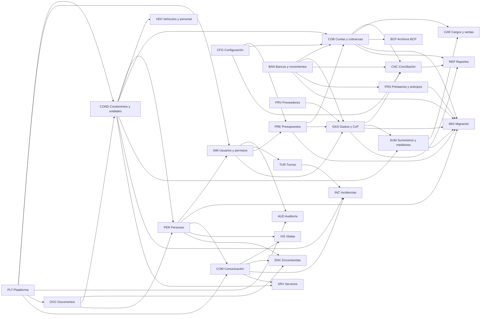

### Dependencias críticas (el orden no es negociable)

1. **`PLT` multi-tenant, `IAM`, `AUD` y `DOC` antes que cualquier dato de negocio.** Sin aislamiento, permisos y auditoría desde el inicio, el retrofit es costoso y riesgoso.
2. **`COND` y `PER` antes que `COB`.** Las cuotas se calculan por unidad, participación y persona responsable.
3. **`BAN` es el registro único del hecho económico.** `COB`, `GAS`, `PRS`, `CAR` y `CNC` se vinculan a él y no crean ingresos ni gastos propios (principio §1, "no duplicar").
4. **`CNC` necesita `BAN`, `COB` y `GAS`.** La conciliación vincula líneas de extracto con registros que ya existen.
5. **`MIG` necesita los destinos.** Importar deudas, obligaciones, saldos, lecturas, préstamos, anticipos, depósitos y fondos requiere que `COB`, `GAS`, `BAN`, `SUM` (catálogo), `PRS` y `PRE` (fondos) existan. La migración es modular por paquetes de importación. Los paquetes `MIG-019` a `MIG-021` dependen de `PRS` (F4) y se adelantarían si el piloto tiene esos saldos a la fecha de corte (`IN-15`).
6. **`COM` y `PLT-005` (push) antes de `VIS`, `ENC` e `INC`.** Las tres necesitan avisar a los residentes.
7. **`ENC`, `VIS` y `INC` dependen de `PER` autorizado.** Conserjería consulta residentes con datos mínimos (`PER-011` a `PER-013`).
8. **`SUM` (cálculo) depende de reglas pendientes (`PD-14`).** El catálogo y las últimas lecturas se adelantan por la migración. El cálculo y la distribución esperan a la especificación.

## 6. Funcionalidades del piloto (P0)

El conjunto `P0` es la propuesta de lo **imprescindible para operar el edificio piloto**. Es una recomendación sujeta a aprobación. La lista completa se obtiene filtrando `P0` en la [matriz](FUNCTIONAL_REQUIREMENTS.md). La distribución por fase está en el [roadmap](DEVELOPMENT_ROADMAP.md#5-alcance-del-piloto).

Criterio usado para asignar `P0`:

- Necesaria para la migración inicial desde Excel (§7, requisito del piloto).
- Necesaria para la conciliación bancaria con CSV/Excel (§12, requisito del primer release funcional).
- Necesaria para que la junta cobre, pague, registre y rinda cuentas.
- Necesaria para aislamiento de datos, permisos y auditoría (§8).
- Operaciones básicas de portería (visitas, encomiendas, novedades) y la vista financiera mínima del residente, que se entregan en fases posteriores de acuerdo con el principio de "validar primero los procesos fundamentales" (§12).

> `P0` no significa "primer lanzamiento". `P0` significa "necesario para la operación completa del piloto". El orden de entrega está en el [roadmap](DEVELOPMENT_ROADMAP.md).

> **Funcionalidades sin prioridad.** De las 286 funcionalidades, 144 son `P0`, 111 `P1` y 15 `P2`. Las 16 añadidas en la sincronización documental (ver el [control de cambios](FUNCTIONAL_REQUIREMENTS.md#control-de-cambios-de-la-sincronización-documental)) están como `Por definir` hasta que se apruebe su prioridad (`IN-16`).
````

## Documento: `docs/FUNCTIONAL_REQUIREMENTS.md`

````markdown
# Matriz de funcionalidades

> Entregable 2 del [prompt maestro](../PROMPT_MAESTRO.md). Cada fila es una funcionalidad trazable. La organización por dominios y módulos está en el [mapa funcional](FUNCTIONAL_MAP.md). Las fases están en el [roadmap](DEVELOPMENT_ROADMAP.md).

## Cómo leer la matriz

- **ID**: `<DOMINIO>-<NNN>`. El prefijo identifica el **dominio** (ver tabla de dominios; cada tabla de esta página corresponde a un dominio). Los IDs no se reutilizan.
- **Módulo / Submódulo**: jerarquía dominio → módulo → submódulo → funcionalidad. Los módulos son una lista cerrada (ver [mapa funcional](FUNCTIONAL_MAP.md)).
- **App**: `API` backend, `WEB` web administrativa, `RES` app de residentes, `CON` app de conserjería. La API participa en toda funcionalidad; solo se lista cuando es la responsable principal.
- **Reglas / origen**: de dónde sale el requisito. Las etiquetas están definidas en el [README](README.md#convención-de-etiquetas).
  - `C§n`: **requisito confirmado**, sección `n` del prompt maestro.
  - `REC`: recomendación técnica o funcional derivada del análisis (no confirmada).
  - `SUP-nn`: supuesto (ver [riesgos y decisiones](RISKS_AND_OPEN_DECISIONS.md#3-supuestos-sup-)).
  - `PD-nn`: la regla de negocio **no está definida** y depende de esa decisión pendiente. La funcionalidad existe, pero la regla no se ha inventado.
  - `PD-Nn` y `PD-Mn`: decisiones pendientes de arquitectura y de modelado, registradas en [RISKS_AND_OPEN_DECISIONS](RISKS_AND_OPEN_DECISIONS.md#43-decisiones-pendientes-de-arquitectura-pd-n) y [RISKS_AND_OPEN_DECISIONS](RISKS_AND_OPEN_DECISIONS.md#44-decisiones-pendientes-de-modelado-pd-m).
  - `Rev`: requisito de modelado solicitado en la revisión del [modelo de datos](DATA_MODEL.md#2-entidades-por-contexto). Las reglas de negocio asociadas siguen dependiendo de sus `PD-`.
- **Prio**: `P0` imprescindible para operar el piloto; `P1` importante tras el piloto; `P2` deseable o posterior. `Por definir`: la prioridad no tiene fundamento suficiente en el prompt maestro ni en una decisión aprobada y **no cuenta como P0, P1 ni P2** hasta que se apruebe (ver `IN-16`).
- **Fase**: primera fase en la que se entrega (F0 a F8). En las funcionalidades añadidas por `Rev`, es la fase de la entidad correspondiente en [DATA_MODEL](DATA_MODEL.md#2-entidades-por-contexto) (o la primera compatible con sus dependencias).
- **Trazabilidad con el modelo de datos**: cada entidad de [DATA_MODEL](DATA_MODEL.md#2-entidades-por-contexto) indica las funcionalidades que la sostienen. El control de cambios de esta matriz está al final del documento.
- **Criterios de aceptación**: comprobaciones verificables. Cuando una regla depende de un `PD-nn`, el criterio se completará al resolverlo.

### Dominios

| Prefijo | Dominio | Origen |
|---|---|---|
| PLT | Plataforma transversal | Habilitador técnico (§3, §8, §9, §10) |
| COND | Condominios, edificios y unidades | §4.1 |
| PER | Personas y relaciones con unidades (incluye consulta de residentes por conserjería) | §4.2, §5.1, §6.2 |
| VEH | Vehículos y personal asociado | §4.3 |
| PRE | Presupuestos y conceptos presupuestarios | §4.4 |
| COB | Cuotas, recibos y cobranzas (incluye vista financiera del residente) | §4.5, §5.2 |
| BAN | Cuentas bancarias y movimientos financieros (incluye cajas) | §4.6 |
| CNC | Conciliación bancaria | §4.7, §12 |
| PRV | Proveedores y memoria institucional | §4.8 |
| GAS | Gastos y cuentas por pagar | §4.9 |
| PRS | Préstamos, anticipos y depósitos recuperables | §4.10 |
| CAR | Cargos adicionales y ventas a propietarios | §4.11 |
| SUM | Suministros y medidores internos | §4.12, §6.6 |
| BCP | Archivos de cobranza BCP | §4.13 |
| IAM | Usuarios, roles y permisos | §4.14, §8 |
| REP | Reportes financieros y operativos | §4.15 |
| MIG | Apertura de condominios y migración inicial | §4.16, §7 |
| AUD | Auditoría y trazabilidad | §4.17 |
| CFG | Configuración y ayuda contextual | §4.18 |
| COM | Comunicación y notificaciones | §5.3, §6.8 |
| VIS | Visitas y control de acceso | §5.4, §6.3 |
| ENC | Encomiendas y documentos recibidos | §5.5, §6.4, §6.5 |
| INC | Incidencias, solicitudes y evidencias | §5.6, §6.7 |
| TUR | Turnos y novedades | §6.1, §6.9 |
| DOC | Gestión documental y archivos | §4.8, §7, §8 |
| SRV | Servicios adicionales al residente | §5.7 |

---

## PLT — Plataforma transversal

| ID | Módulo | Submódulo | Funcionalidad | App | Reglas / origen | Dep. | Prio | Fase | Criterios de aceptación |
|---|---|---|---|---|---|---|---|---|---|
| PLT-001 | Tenancy y administración de plataforma | Multi-tenant | Aislamiento por condominio: toda consulta y escritura queda acotada al condominio activo. | API | C§1, C§8, REC (RLS) | — | P0 | F1 | Un usuario del condominio A no puede leer ni escribir datos del B por ninguna ruta, incluidas las tablas de enlace (membresías y vínculos), que tienen su propia política (ver [ARCHITECTURE §7.1.1](ARCHITECTURE.md#711-categorías-de-tablas-global-tenant-y-enlace)). Pruebas de aislamiento en CI. |
| PLT-002 | Integración y contratos | Contrato de API | Contrato OpenAPI versionado y generación de clientes TypeScript y Dart. | API | C§9, REC | — | P0 | F0 | El contrato se genera desde la API. El CI falla ante cambios incompatibles. Los clientes se generan sin edición manual. |
| PLT-003 | Archivos y fotografías | Archivos | Almacenamiento privado de archivos con metadatos y URLs firmadas de corta vida. | API | C§8, REC | PLT-001 | P0 | F1 | Ningún archivo es accesible sin autorización. La URL expira. El acceso queda auditado. |
| PLT-004 | Mensajería y trabajos | Notificaciones (núcleo) | Núcleo de notificaciones: eventos, plantillas, preferencias, bandeja interna y correo. | API | C§3.1, REC | PLT-006 | P0 | F1 | Un evento genera notificaciones por canal según preferencia. Cada envío queda registrado con su estado. |
| PLT-005 | Mensajería y trabajos | Notificaciones push | Registro de dispositivos y envío de notificaciones push. | API | C§10, PD-41 | PLT-004 | P0 | F5 | Un dispositivo registrado recibe un push. Un dispositivo revocado deja de recibirlo. |
| PLT-006 | Mensajería y trabajos | Trabajos asíncronos | Cola de trabajos y tareas programadas con reintentos. | API | REC, PD-43 | — | P0 | F1 | Un trabajo fallido se reintenta con espera creciente y queda visible tras agotar reintentos. |
| PLT-007 | Operación, datos y sincronización | Sincronización móvil | Idempotencia y soporte de sincronización: IDs de cliente, `Idempotency-Key` y detección de duplicados. | API | C§10 | PLT-001 | P0 | F6 | Reenviar la misma operación no crea duplicados. Se guardan la hora del dispositivo y la del servidor. |
| PLT-008 | Operación, datos y sincronización | Observabilidad | Registros estructurados, correlación de solicitudes, métricas y *health checks*. | API | REC | — | P0 | F1 | Cada solicitud tiene un ID de correlación. Existen *health checks* de API y base de datos. |
| PLT-009 | Integración y contratos | Compatibilidad móvil | Versionado de API y política de versión mínima de app con aviso de actualización. | API | REC | PLT-002 | P1 | F5 | Una app con versión no soportada recibe una indicación clara de actualizar. |
| PLT-010 | Tenancy y administración de plataforma | Alta de condominios | Alta mínima de condominio y su primer administrador por el administrador de plataforma. | API | C§8, SUP-05 | PLT-001, IAM-006 | P0 | F1 | Se crea un condominio con su primer usuario administrador. El alta queda auditada. |
| PLT-011 | Tenancy y administración de plataforma | Consola de plataforma | Consola web para administrar condominios, planes y soporte. | WEB | PD-27, PD-32 | PLT-010 | P2 | F8 | Definir al resolver PD-27 y PD-32. |
| PLT-012 | Operación, datos y sincronización | Datos y respaldos | Entornos, copias de seguridad automáticas y restauración probada. | API | REC, PD-50 | — | P0 | F3 | Se restaura una copia en un entorno limpio y los datos son consistentes. |
| PLT-013 | Integración y contratos | Localización | Formatos es-PE de moneda, fecha y hora; zona `America/Lima`. | WEB, RES, CON | SUP-01, SUP-02, PD-25 | — | P1 | F1 | Importes, fechas y horas se muestran en formato peruano. Los instantes se guardan en UTC. |
| PLT-014 | Integración y contratos | Design tokens | Tokens de diseño compartidos (color, tipografía, espaciado) para Angular y Flutter. | WEB, RES, CON | C§9 | — | P1 | F0 | Un cambio de token se refleja en Tailwind y en el tema de Flutter desde una sola fuente. |
| PLT-015 | Archivos y fotografías | Fotografías móviles | Captura, compresión y subida diferida de fotografías con reintentos. | RES, CON | C§10 | PLT-003 | P0 | F6 | Una foto se comprime antes de subir. Si falla la subida, se reintenta y se asocia al registro correcto. |
| PLT-016 | Operación, datos y sincronización | Sincronización móvil | Cola local de operaciones pendientes con reintentos, orden y resolución de conflictos para las operaciones de conserjería que toleran trabajar sin conexión. | CON | C§10, PD-49 | PLT-007, PLT-015 | P1 | F7 | Una operación creada sin conexión se envía al recuperar la red sin duplicarse. Las operaciones que exigen conexión se bloquean con un mensaje claro. |
| PLT-017 | Operación, datos y sincronización | Sincronización móvil | Caché local cifrada y acotada del directorio de residentes para consulta en portería con conectividad limitada. | CON | C§10, C§6.2, PD-26, PD-49 | PER-011, PLT-016 | P1 | F7 | Solo se almacenan los datos mínimos autorizados. Se borran al cerrar sesión. |

## COND — Condominios, edificios y unidades

| ID | Módulo | Submódulo | Funcionalidad | App | Reglas / origen | Dep. | Prio | Fase | Criterios de aceptación |
|---|---|---|---|---|---|---|---|---|---|
| COND-001 | Condominio y edificios | Condominio | Registro y mantenimiento de los datos generales del condominio. | WEB | C§4.1 | PLT-010 | P0 | F1 | Un administrador edita los datos del condominio. El cambio queda auditado. |
| COND-002 | Condominio y edificios | Edificios | Gestión de edificios, torres, bloques o sectores de un condominio. La agrupación es opcional. | WEB | C§4.1, C§6.2, Rev | COND-001 | P0 | F1 | Se crean varios edificios por condominio. Una unidad puede pertenecer a un edificio o a ninguno (por ejemplo, una casa independiente). |
| COND-003 | Unidades | Unidades | Alta, edición y baja lógica de unidades con código único por condominio y tipo de unidad de un catálogo configurable (base: departamento, casa, estacionamiento, depósito y local). | WEB | C§4.1, PD-28, Rev | COND-001 | P0 | F1 | No se pueden repetir códigos en un condominio. No hay borrado físico. Cada unidad tiene un tipo. Un estacionamiento, un depósito o un local es una unidad por derecho propio. Si un tipo participa en gastos comunes se define en PD-02 y PD-28. |
| COND-004 | Unidades | Unidades | Participación en gastos comunes de cada unidad bajo un esquema de reparto, con vigencia, historial y fuente documental. | WEB | C§7, PD-02, PD-M4, Rev | COND-003, DOC-004 | P0 | F1 | Se registra la participación por unidad y esquema con fecha de inicio y de fin. Cada versión cita su fuente (documento adjunto o, cuando exista, decisión de IAM-020). Una versión nueva cierra la anterior sin sobrescribirla y las versiones no se solapan. Cada cuota emitida referencia la versión aplicada (COB-002). La regla de suma total y si hay uno o varios esquemas se definen en PD-02 y PD-M4. |
| COND-005 | Condominio y edificios | Ubicaciones | Catálogo de ubicaciones y áreas comunes. | WEB | C§6.7, C§5.7 | COND-001 | P1 | F1 | Las evidencias e incidencias pueden elegir una ubicación del catálogo. |
| COND-006 | Unidades | Unidades | Ficha integral de unidad: personas, vehículos, personal y estado. | WEB | REC | COND-003, PER-002 | P1 | F1 | La ficha muestra la información relacionada con la unidad. No muestra datos fuera del permiso del usuario. |
| COND-007 | Unidades | Relaciones entre unidades | Relaciones opcionales, dirigidas y con vigencia entre unidades (por ejemplo, un estacionamiento anexo a un departamento). | WEB | Rev, PD-M5, PD-28 | COND-003, DOC-004 | Por definir | F1 | Se vincula una unidad con otra con fecha de inicio y de fin y fuente documental. La relación no implica titularidad ni cobro compartidos mientras PD-M5 no lo defina. El historial se conserva. |

## PER — Personas y relaciones con unidades

| ID | Módulo | Submódulo | Funcionalidad | App | Reglas / origen | Dep. | Prio | Fase | Criterios de aceptación |
|---|---|---|---|---|---|---|---|---|---|
| PER-001 | Personas | Personas | Registro de personas con identificación y contacto. | WEB | C§4.2 | COND-001 | P0 | F1 | Se registra una persona sin necesidad de usuario. |
| PER-002 | Relaciones persona–unidad | Relaciones | Relación de una persona con una o varias unidades (propietario, inquilino, residente). | WEB | C§4.2, C§5.1 | PER-001, COND-003 | P0 | F1 | Una persona tiene relaciones distintas con distintas unidades. |
| PER-003 | Relaciones persona–unidad | Relaciones | Varias personas por unidad (titularidad múltiple) y persona responsable de pago. | WEB | C§7, PD-24, PD-M3, Rev | PER-002 | P0 | F1 | Una unidad puede tener varios propietarios. Una unidad tiene una persona responsable identificada para sus deudas, con vigencia. Si puede diferir de los titulares se define en PD-24. El porcentaje de titularidad está en PER-014. |
| PER-004 | Relaciones persona–unidad | Relaciones | Historial de relaciones con vigencia. | WEB | C§1 | PER-002 | P0 | F1 | Al cambiar de propietario o inquilino se conserva la relación anterior con sus fechas. |
| PER-005 | Personas | Contacto | Contactos y teléfono autorizados para consulta por conserjería. | WEB, RES | C§6.2 | PER-001 | P0 | F1 | Solo los datos marcados como autorizados son visibles para conserjería. |
| PER-006 | Relaciones persona–unidad | Autorizados | Personas autorizadas por unidad (ingreso, recojo). | WEB, RES | C§6.2, PD-18 | PER-002 | P1 | F6 | Una persona autorizada vigente aparece en la consulta de conserjería. |
| PER-007 | Personas | Depuración | Detección y fusión de personas duplicadas con trazabilidad. | WEB | REC, SUP-08 | PER-001 | P1 | F3 | Se fusionan dos personas conservando el historial de ambas. |
| PER-008 | Perfil del residente | Perfil del residente | Consulta de perfil y datos personales. | RES | C§5.1 | IAM-003 | P0 | F5 | El residente ve sus propios datos. La edición se define en PD-24. |
| PER-009 | Perfil del residente | Perfil del residente | Consulta de unidades relacionadas y tipo de relación. | RES | C§5.1 | PER-002 | P0 | F5 | Se listan solo las unidades donde la persona tiene relación vigente, con su tipo. |
| PER-010 | Perfil del residente | Perfil del residente | Preferencias de notificación. | RES | C§5.1 | PLT-004 | P1 | F5 | Cambiar una preferencia afecta los envíos siguientes. |
| PER-011 | Consulta de residentes (conserjería) | Consulta de residentes | Búsqueda por código de unidad, edificio, nombre de propietario o residente y teléfono autorizado. | CON | C§6.2 | PER-005 | P0 | F6 | La búsqueda devuelve resultados por cada criterio. El teléfono solo aparece si está autorizado. |
| PER-012 | Consulta de residentes (conserjería) | Consulta de residentes | Ficha operativa mínima: nombre, unidad, contacto autorizado, personas relacionadas y autorizaciones vigentes. | CON | C§6.2 | PER-011 | P0 | F6 | La ficha no incluye datos financieros ni datos no necesarios. |
| PER-013 | Consulta de residentes (conserjería) | Consulta de residentes | Garantía de exclusión de información financiera para conserjería. | API | C§6.2, C§8 | IAM-007 | P0 | F6 | Toda llamada financiera hecha con un usuario conserje devuelve `403`. Prueba automática. |
| PER-014 | Relaciones persona–unidad | Titularidad | Porcentaje de titularidad de cada propietario de una unidad, con vigencia, historial y fuente documental. Es distinto de la participación en gastos comunes (COND-004). | WEB | Rev, PD-24, PD-M3 | PER-003, DOC-004 | Por definir | F1 | Cada propietario tiene su porcentaje de titularidad con fecha de inicio y de fin y su fuente. Las versiones no se solapan por titular y unidad y cambiar el porcentaje conserva el anterior. La titularidad no altera la participación en gastos comunes. Las reglas de validación se definen en PD-24. |

## VEH — Vehículos y personal asociado

| ID | Módulo | Submódulo | Funcionalidad | App | Reglas / origen | Dep. | Prio | Fase | Criterios de aceptación |
|---|---|---|---|---|---|---|---|---|---|
| VEH-001 | Registro de vehículos y personal | Vehículos | Registro de vehículos asociados a una unidad. | WEB | C§4.3 | COND-003 | P1 | F1 | Un vehículo queda asociado a una unidad y a su responsable. Los campos exactos se definen al diseñar. |
| VEH-002 | Registro de vehículos y personal | Personal asociado | Registro de personal asociado a una unidad. | WEB | C§4.3, PD-24 | COND-003 | P1 | F1 | El personal queda asociado a una unidad. El alcance se confirma en PD-24. |
| VEH-003 | Registro de vehículos y personal | Vigencia | Estado y vigencia de vehículos y personal. | WEB | REC | VEH-001, VEH-002 | P1 | F1 | Un registro inactivo conserva su historial. |
| VEH-004 | Consulta y autoservicio | Consulta operativa | Consulta de vehículos y personal autorizados por conserjería. | CON | SUP, PD-24 | VEH-003, PER-011 | P2 | F6 | Solo se muestran los registros vigentes y autorizados. |
| VEH-005 | Consulta y autoservicio | Autoservicio | Gestión de vehículos y personal por el residente. | RES | SUP, PD-24 | VEH-003 | P2 | F8 | Definir al resolver PD-24. |

## PRE — Presupuestos y conceptos presupuestarios

| ID | Módulo | Submódulo | Funcionalidad | App | Reglas / origen | Dep. | Prio | Fase | Criterios de aceptación |
|---|---|---|---|---|---|---|---|---|---|
| PRE-001 | Conceptos presupuestarios | Conceptos | Catálogo de conceptos y categorías presupuestarias. | WEB | C§4.4, C§7 | CFG-007 | P0 | F2 | Se crean y desactivan conceptos. Un concepto usado no se elimina. |
| PRE-002 | Presupuesto | Presupuesto | Presupuesto por periodo con ingresos y egresos por concepto. | WEB | C§4.4, PD-10 | PRE-001 | P0 | F2 | Se registra un presupuesto con totales por concepto. |
| PRE-003 | Presupuesto | Presupuesto | Estados, versiones y aprobación del presupuesto. | WEB | PD-10 | PRE-002, IAM-021 | P1 | F2 | Se conserva cada versión aprobada. Reglas según PD-10. |
| PRE-004 | Presupuesto | Presupuesto | Generación de cuotas a partir del presupuesto. | WEB | C§4.4, PD-02, PD-10 | PRE-002, COB-002 | P0 | F2 | Las cuotas generadas cuadran con el presupuesto según la regla de prorrateo. |
| PRE-005 | Ejecución presupuestaria | Ejecución | Ejecución presupuestaria: presupuesto frente a real. | WEB | REC | PRE-002, GAS-010 | P1 | F4 | El reporte compara presupuesto y ejecución por concepto. |
| PRE-006 | Conceptos presupuestarios | Fondos | Fondos (por ejemplo, de reserva), si existen: destinos de recursos con un propósito, asociados opcionalmente a conceptos presupuestarios y con saldo derivado. | WEB | Rev, PD-11, PD-M10 | PRE-001 | Por definir | F2 | Definir al resolver PD-11. Si existen, el saldo de un fondo se calcula (no se edita) y un fondo no es una cuenta bancaria ni un concepto presupuestario. |
| PRE-007 | Conceptos presupuestarios | Fondos | Reasignación de recursos entre fondos, con motivo y aprobación, sin mover dinero entre cuentas. | WEB | Rev, PD-11, PD-M10 | PRE-006, IAM-021 | Por definir | F2 | Definir al resolver PD-11 y PD-M10. La reasignación conserva fondo de origen, fondo de destino, importe, motivo y aprobación. |

## COB — Cuotas, recibos y cobranzas

| ID | Módulo | Submódulo | Funcionalidad | App | Reglas / origen | Dep. | Prio | Fase | Criterios de aceptación |
|---|---|---|---|---|---|---|---|---|---|
| COB-001 | Conceptos de cobro | Conceptos de cobro | Catálogo de conceptos de cobro. | WEB | C§4.5, PD-11 | CFG-007 | P0 | F2 | Se definen conceptos que luego generan cuotas. |
| COB-002 | Cuotas y recibos | Cuotas | Generación de cuotas por unidad y periodo con prorrateo. | WEB | C§4, PD-02 | COB-001, COND-004 | P0 | F2 | Dado un periodo y una regla aprobada, se generan cuotas por unidad. Repetir la generación no duplica. Cada cuota referencia la emisión que la generó y la versión de participación aplicada. |
| COB-003 | Cuotas y recibos | Recibos | Emisión de recibos con numeración y tipo de documento. | WEB | C§4.5, PD-06 | COB-002 | P0 | F2 | Un recibo emitido es inmutable. Se corrige solo por anulación o ajuste. |
| COB-004 | Pagos y saldos | Pagos | Registro de pagos, con su medio (efectivo, transferencia, depósito u otro), aplicados a recibos o conceptos. | WEB | C§4.5, PD-03, Rev | COB-003, BAN-003, BAN-004 | P0 | F2 | Un pago se vincula, con importe, a uno o varios movimientos sin crear un ingreso duplicado. Un depósito agrupado (un movimiento) puede cubrir varios pagos con importes parciales. Un pago en efectivo se vincula a un movimiento de una caja y su depósito posterior al banco es una transferencia (BAN-006), no un ingreso nuevo. |
| COB-005 | Pagos y saldos | Pagos | Pagos parciales. | WEB | C§4 | COB-004 | P0 | F2 | Un pago menor al saldo deja el saldo restante exacto. |
| COB-006 | Pagos y saldos | Saldos | Saldos por concepto, unidad y periodo. | WEB | C§4 | COB-004 | P0 | F2 | La suma de saldos por concepto coincide con el saldo total de la unidad. |
| COB-007 | Pagos y saldos | Saldos | Saldos a favor y su aplicación. | WEB | C§5.2, PD-03 | COB-004 | P0 | F2 | Un excedente queda como saldo a favor y se aplica según PD-03. |
| COB-008 | Pagos y saldos | Estado de cuenta | Estado de cuenta por unidad. | WEB | C§5.2 | COB-006 | P0 | F2 | Muestra cargos, pagos y saldo con trazabilidad al documento. |
| COB-009 | Cuotas y recibos | Anulaciones | Anulación y reverso de recibos y pagos sin borrado físico. | WEB | C§1 | COB-003, AUD-004 | P0 | F2 | La anulación exige motivo y deja el original visible. |
| COB-010 | Pagos y saldos | Cartera | Antigüedad de deuda y cartera. | WEB | REC, PD-17 | COB-006 | P1 | F3 | La deuda consolidada se muestra identificada como tal. |
| COB-011 | Comprobantes de pago | Comprobantes | Recepción y validación de comprobantes enviados por residentes. | WEB | C§5.2, PD-07 | COB-016 | P0 | F5 | Un comprobante pendiente no cambia saldos. Solo la validación lo hace. |
| COB-012 | Pagos y saldos | Mora y descuentos | Intereses, penalidades o descuentos, si existen. | WEB | PD-04 | COB-004 | P1 | F4 | Definir al resolver PD-04. |
| COB-013 | Vista financiera del residente | Consulta del residente | Consulta de recibos y cuotas. | RES | C§5.2 | COB-003, COB-018 | P0 | F5 | El residente ve los recibos de sus unidades según su relación. |
| COB-014 | Vista financiera del residente | Consulta del residente | Consulta de deudas y saldos a favor. | RES | C§5.2 | COB-006 | P0 | F5 | Los importes coinciden con la web. |
| COB-015 | Vista financiera del residente | Consulta del residente | Estado de cuenta e historial de pagos. | RES | C§5.2 | COB-008 | P0 | F5 | Muestra el mismo detalle que la web para la unidad autorizada. |
| COB-016 | Comprobantes de pago | Comprobantes | Registro de comprobante de pago por el residente. | RES | C§5.2 | COB-018, PLT-003 | P0 | F5 | El comprobante queda adjunto y en estado "pendiente de validación". |
| COB-017 | Comprobantes de pago | Comprobantes | Consulta del estado de validación del pago. | RES | C§5.2, PD-07 | COB-016 | P0 | F5 | El residente ve pendiente, validado o rechazado, con el motivo si aplica. |
| COB-018 | Vista financiera del residente | Autorización | Restricción del acceso financiero por unidad y relación. | API | C§5.2, C§8, PD-24 | IAM-010 | P0 | F5 | Un residente no puede consultar finanzas de otra unidad sin autorización. Prueba automática. |
| COB-019 | Pagos y saldos | Cierre | Cierre y bloqueo de periodos. | WEB | PD-09 | COB-006 | P1 | F4 | Definir al resolver PD-09. |
| COB-020 | Cuotas y recibos | Ajustes | Ajuste de un cargo por cobrar que lo aumenta o reduce, con motivo y referencia al cargo original, sin editarlo ni eliminarlo. | WEB | C§1, Rev, PD-08 | COB-002, AUD-004 | Por definir | F2 | El ajuste exige motivo, usuario y referencia al cargo original, que permanece visible. Lo aplicado a un cargo no supera su importe con los ajustes. El saldo se recalcula desde el cargo, sus ajustes y sus aplicaciones. Si requiere aprobación se rige por PD-08 (IAM-021). |

## BAN — Cuentas bancarias y movimientos financieros

| ID | Módulo | Submódulo | Funcionalidad | App | Reglas / origen | Dep. | Prio | Fase | Criterios de aceptación |
|---|---|---|---|---|---|---|---|---|---|
| BAN-001 | Cuentas bancarias | Cuentas | Registro de cuentas financieras del condominio: cuentas bancarias y cajas (efectivo en custodia). | WEB | C§4.6, Rev, PD-M9 | COND-001 | P0 | F2 | Una cuenta bancaria se registra con banco, tipo, moneda y estado. Una caja se registra con moneda y persona responsable y no tiene extracto bancario. Cada movimiento pertenece a una sola cuenta financiera. Otros tipos de cuenta solo si PD-M9 los aprueba. |
| BAN-002 | Cuentas bancarias | Saldos | Saldo inicial por cuenta bancaria y por caja a la fecha de corte. | WEB | C§7, MIG, Rev | BAN-001 | P0 | F3 | El saldo inicial no genera ingresos ni gastos. |
| BAN-003 | Movimientos financieros | Movimientos | Movimientos financieros como registro único del hecho económico. | WEB | C§1, C§4.6 | BAN-001 | P0 | F2 | Un hecho económico tiene un solo movimiento. Los demás registros se vinculan a él. |
| BAN-004 | Movimientos financieros | Vínculos | Vinculación, con importe, entre un movimiento y los hechos que lo originan: pago, pago a proveedor, préstamo, anticipo, depósito recuperable, recuperación o devolución. Los gastos, obligaciones y cargos se alcanzan por medio de sus pagos. | API | C§1, Rev | BAN-003 | P0 | F2 | Un movimiento no se puede aplicar dos veces al mismo concepto. Lo vinculado de un movimiento no supera su importe y cada vínculo no supera el importe del hecho vinculado. Un movimiento admite varios vínculos (depósito agrupado) y un hecho puede estar cubierto por varios movimientos. |
| BAN-005 | Cuentas bancarias | Saldos | Saldo contable frente a saldo conciliado por cuenta. | WEB | C§4.6, C§4.7 | BAN-003 | P0 | F3 | Se muestran ambos saldos y su diferencia. |
| BAN-006 | Movimientos financieros | Transferencias | Transferencias entre cuentas del condominio, incluido el depósito de efectivo de una caja al banco. | WEB | REC, PD-M8 | BAN-003 | P1 | F2 | Una transferencia no cuenta como ingreso ni gasto. Genera dos movimientos, uno de salida y otro de entrada, en cuentas distintas. |
| BAN-007 | Movimientos financieros | Anulaciones | Anulación y reverso de movimientos sin borrado físico. | WEB | C§1 | BAN-003 | P0 | F2 | La anulación exige motivo y conserva el original. |
| BAN-008 | Movimientos financieros | Evidencias | Adjuntos del movimiento (comprobante bancario). | WEB | REC | PLT-003 | P1 | F2 | El adjunto se descarga solo con permiso. |
| BAN-009 | Cuentas bancarias | Cuentas | Inactivación de cuentas. | WEB | REC | BAN-001 | P2 | F2 | Una cuenta inactiva no recibe movimientos nuevos y conserva su historial. |

## CNC — Conciliación bancaria

| ID | Módulo | Submódulo | Funcionalidad | App | Reglas / origen | Dep. | Prio | Fase | Criterios de aceptación |
|---|---|---|---|---|---|---|---|---|---|
| CNC-001 | Importación de extractos | Importación | Importación de extractos CSV y Excel con perfiles de formato por banco. | WEB | C§12, PD-16 | BAN-001 | P0 | F3 | Un extracto válido se carga. Uno inválido informa las filas con error sin cargar parcialmente. |
| CNC-002 | Importación de extractos | Importación | Detección de líneas ya importadas (idempotencia). | API | C§12, REC | CNC-001 | P0 | F3 | Importar dos veces el mismo archivo no duplica líneas. |
| CNC-003 | Conciliación | Vinculación | Conciliación manual: vincular, total o parcialmente, una línea del extracto con movimientos, pagos o gastos mediante asignaciones con importe. | WEB | C§4.7, PD-16, Rev | CNC-001, BAN-004 | P0 | F3 | Cada asignación registra importe, usuario y fecha. Una línea puede asignarse parcialmente a varios movimientos y un movimiento a varias líneas mientras quede importe pendiente. Lo asignado no supera la línea. Una línea completamente asignada, o con diferencia justificada, no admite nuevas asignaciones salvo tras revertir una (CNC-009). |
| CNC-004 | Conciliación | Vinculación | Sugerencias de coincidencia. | WEB | REC, PD-16 | CNC-003 | P1 | F3 | Las sugerencias nunca concilian automáticamente. |
| CNC-005 | Conciliación | Vinculación | Conciliación de una línea con varios movimientos y viceversa, con diferencias justificadas. | WEB | PD-16, Rev | CNC-003, CFG-007 | P0 | F3 | La suma de lo asignado más las diferencias justificadas coincide con la línea según las tolerancias de PD-16. Cada diferencia tiene importe, motivo del catálogo y aprobación cuando corresponda, y puede resolverse con un movimiento propio (por ejemplo, un cargo bancario). No se fuerza la igualdad de importes. Cada asignación y diferencia conserva usuario, fecha y trazabilidad. |
| CNC-006 | Conciliación | Pendientes | Partidas sin identificar o pendientes de conciliar. | WEB | C§4.7 | CNC-003 | P0 | F3 | La lista muestra las líneas sin vincular con su antigüedad y los movimientos pendientes de identificación. |
| CNC-007 | Conciliación | Alta desde extracto | Registro de ingreso o gasto desde una línea sin movimiento existente, sin duplicar. | WEB | C§1, Rev | CNC-003, BAN-003 | P0 | F3 | La línea genera un único movimiento vinculado. Si no se conoce la contraparte, el movimiento queda pendiente de identificación y, al identificarse, se vincula a sus pagos sin crear otro movimiento. |
| CNC-008 | Conciliación | Cierre | Estado y cierre de conciliación por cuenta y periodo. | WEB | C§4.7, PD-09, Rev | CNC-006 | P0 | F3 | Un periodo conciliado queda bloqueado según reglas de PD-09. El cierre exige que cada línea esté asignada, con diferencia justificada o declarada pendiente, y conserva el saldo del extracto, el saldo del sistema, los pendientes y las diferencias justificadas. |
| CNC-009 | Conciliación | Reversión | Reversión de una conciliación con trazabilidad. | WEB | C§1 | CNC-003, AUD-004 | P0 | F3 | La reversión exige motivo y conserva el historial. |
| CNC-010 | Conciliación | Reporte | Reporte de conciliación por cuenta y periodo. | WEB | REC | CNC-008 | P1 | F3 | El reporte coincide con el estado de conciliación. |
| CNC-011 | Conciliación | Reapertura | Reapertura de un cierre de conciliación con motivo y aprobación, conservando el cierre original. | WEB | C§1, Rev, PD-09, PD-M14 | CNC-008, AUD-004 | Por definir | F3 | La reapertura exige motivo y aprobación y deja el cierre original visible. Quién aprueba y los efectos sobre periodos posteriores se definen en PD-M14. |

## PRV — Proveedores y memoria institucional

| ID | Módulo | Submódulo | Funcionalidad | App | Reglas / origen | Dep. | Prio | Fase | Criterios de aceptación |
|---|---|---|---|---|---|---|---|---|---|
| PRV-001 | Proveedores | Proveedores | Registro de proveedores con RUC, razón social y contacto. | WEB | C§4.8, C§7 | COND-001 | P0 | F2 | No se duplican RUC activos en un condominio. |
| PRV-002 | Contratos | Contratos | Contratos de proveedores con vigencia y documentos. | WEB | C§7 | PRV-001, DOC-004 | P0 | F2 | Un contrato vigente se lista con sus fechas y adjuntos. |
| PRV-003 | Proveedores | Proveedores | Estado e historial de cada proveedor. | WEB | C§1, REC | PRV-001 | P1 | F2 | Un proveedor inactivo conserva su historial. |
| PRV-004 | Memoria institucional | Memoria institucional | Memoria institucional por proveedor y por condominio. | WEB | C§1, PD-30 | PRV-001, DOC-001 | P1 | F4 | Definir contenido al resolver PD-30. Debe permitir la continuidad al cambiar la junta. |
| PRV-005 | Proveedores | Documentos | Documentos del proveedor (RUC, seguros, certificados). | WEB | REC | DOC-004 | P1 | F2 | Los documentos se adjuntan con vigencia. |
| PRV-006 | Proveedores | Validación | Validación de formato del RUC. | WEB | REC | PRV-001 | P1 | F2 | Un RUC con formato inválido se rechaza. La consulta externa no está incluida. |
| PRV-007 | Memoria institucional | Cotizaciones | Cotizaciones y comparación de proveedores. | WEB | SUP, PD-30 | PRV-004 | P2 | F8 | Definir al resolver PD-30. |
| PRV-008 | Memoria institucional | Trabajos | Trabajos de proveedores con evidencias. | WEB, CON | C§6.7 | PRV-001, INC-005 | P1 | F7 | Una evidencia puede vincularse a un proveedor. |

## GAS — Gastos y cuentas por pagar

| ID | Módulo | Submódulo | Funcionalidad | App | Reglas / origen | Dep. | Prio | Fase | Criterios de aceptación |
|---|---|---|---|---|---|---|---|---|---|
| GAS-001 | Gastos | Gastos | Registro de gastos como documentos del proveedor (factura, boleta, recibo, nota de crédito o débito u otro) con fechas, importe y clasificación por una o varias categorías presupuestarias. | WEB | C§4.9, C§7, Rev, PD-M12 | PRV-001, PRE-001 | P0 | F2 | Un gasto requiere categoría y documento según PD-06. Un documento puede clasificarse en varias categorías (GAS-009). Registrar el documento no crea un movimiento financiero. Un documento puede originar una obligación, varias (por ejemplo, vencimientos) o ninguna (por ejemplo, si se paga al contado). |
| GAS-002 | Cuentas por pagar | Obligaciones | Obligaciones y cuentas por pagar con saldo y vencimiento, originadas en un documento de gasto o en un saldo de apertura. | WEB | C§4.9, C§7, Rev | GAS-001 | P0 | F2 | Se calcula el saldo pendiente de cada obligación desde sus ajustes y aplicaciones. Un documento puede originar varias obligaciones. Una obligación puede recibir varios pagos y un pago puede aplicarse a varias obligaciones. |
| GAS-003 | Cuentas por pagar | Pagos | Pagos totales y parciales a proveedores, aplicados a una o varias obligaciones. | WEB | C§4, Rev | GAS-002, BAN-003, BAN-004 | P0 | F2 | Un pago parcial deja el saldo exacto de la obligación. El pago se vincula, con importe, al movimiento o movimientos que lo cubren y no crea un gasto. |
| GAS-004 | Cuentas por pagar | Aprobación | Aprobación de gastos y pagos según rol. | WEB | PD-08 | GAS-001, IAM-021 | P1 | F2 | Definir al resolver PD-08. |
| GAS-005 | Cuentas por pagar | Anulaciones | Anulación y reverso de gastos y pagos sin borrado físico. | WEB | C§1 | GAS-003, AUD-004 | P0 | F2 | La anulación exige motivo y conserva el original. |
| GAS-006 | Gastos | Adjuntos | Adjuntos de factura y comprobantes de pago. | WEB | C§7 | PLT-003 | P0 | F2 | Los adjuntos quedan asociados al gasto o pago. |
| GAS-007 | Cuentas por pagar | Agenda | Calendario de vencimientos de pagos. | WEB | REC | GAS-002 | P1 | F2 | Se listan obligaciones por vencer y vencidas. |
| GAS-008 | Cuentas por pagar | Estado de cuenta | Estado de cuenta por proveedor. | WEB | REC | GAS-002 | P1 | F3 | Muestra facturas, pagos y saldo por proveedor. |
| GAS-009 | Gastos | Presupuesto | Vinculación del gasto con el presupuesto. | WEB | C§7 | PRE-002 | P0 | F2 | Cada gasto afecta una categoría presupuestaria. |
| GAS-010 | Gastos | Recurrencia | Gastos recurrentes programados. | WEB | SUP | GAS-001 | P2 | F8 | Definir si se requiere. |
| GAS-011 | Gastos | Caja chica | Gastos menores sin proveedor formal. | WEB | PD-29 | GAS-001 | P1 | F2 | Definir al resolver PD-29. |
| GAS-012 | Cuentas por pagar | Notas de crédito y débito | Notas de crédito y de débito del proveedor: documentos que referencian el documento original y ajustan el saldo de una obligación. | WEB | C§1, Rev, PD-06, PD-M12 | GAS-001, GAS-002 | Por definir | F2 | La nota referencia el documento que corrige y ajusta la obligación con motivo, sin editar ni eliminar el original. No crea un movimiento financiero. El saldo de la obligación se recalcula. Los tipos de documento y su tratamiento se definen en PD-06 y PD-M12. |
| GAS-013 | Cuentas por pagar | Créditos con proveedor | Crédito con proveedor: saldo a favor del condominio frente a un proveedor (nota de crédito sin obligación que compensar, anticipo o pago en exceso) y su aplicación a obligaciones futuras. | WEB | Rev, PD-12, PD-M12 | GAS-012, GAS-003 | Por definir | F2 | El crédito conserva su origen y su saldo se deriva de sus aplicaciones y devoluciones. Se aplica sin exceder su importe. Un anticipo a un proveedor origina un crédito (PRS-002). |
| GAS-014 | Cuentas por pagar | Devoluciones | Devolución de proveedor: reintegro de dinero recibido del proveedor, que consume un crédito con proveedor. | WEB | Rev, PD-M12 | GAS-013, BAN-004 | Por definir | F2 | La devolución se vincula, con importe, al movimiento de ingreso sin crear un ingreso duplicado y no supera el saldo del crédito. |

## PRS — Préstamos, anticipos y depósitos recuperables

| ID | Módulo | Submódulo | Funcionalidad | App | Reglas / origen | Dep. | Prio | Fase | Criterios de aceptación |
|---|---|---|---|---|---|---|---|---|---|
| PRS-001 | Préstamos y anticipos | Préstamos | Registro y seguimiento de préstamos. | WEB | C§4.10, PD-12 | BAN-003 | P1 | F4 | Definir reglas al resolver PD-12. |
| PRS-002 | Préstamos y anticipos | Anticipos | Registro y aplicación de anticipos. | WEB | C§4.10, PD-12 | BAN-003, GAS-002 | P1 | F4 | Un anticipo aplicado no duplica el egreso. |
| PRS-003 | Depósitos recuperables | Depósitos | Depósitos recuperables. | WEB | C§4.10, PD-12 | BAN-003 | P1 | F4 | Un depósito no se registra como gasto definitivo. |
| PRS-004 | Recuperación y saldos | Recuperación | Devolución o recuperación total y parcial. | WEB | C§4.10, PD-12 | PRS-001 | P1 | F4 | La devolución parcial deja el saldo exacto. |
| PRS-005 | Recuperación y saldos | Saldos | Saldos y estado de préstamos, anticipos y depósitos. | WEB | C§4.10 | PRS-004 | P1 | F4 | Los saldos coinciden con los movimientos vinculados. |

## CAR — Cargos adicionales y ventas a propietarios

| ID | Módulo | Submódulo | Funcionalidad | App | Reglas / origen | Dep. | Prio | Fase | Criterios de aceptación |
|---|---|---|---|---|---|---|---|---|---|
| CAR-001 | Catálogo de cargos | Catálogo | Catálogo de cargos adicionales y ventas. | WEB | C§4.11, PD-13 | CFG-007 | P1 | F4 | Definir contenido al resolver PD-13. |
| CAR-002 | Cargos y ventas | Registro | Registro de cargo o venta a una unidad o persona. | WEB | C§4.11, PD-13 | CAR-001, PER-003 | P1 | F4 | El cargo genera una deuda trazable. |
| CAR-003 | Cargos y ventas | Cobranza | Integración con cobranza sin duplicar ingresos. | WEB | C§1 | CAR-002, COB-004 | P1 | F4 | El pago del cargo usa el mismo flujo de cobranza. |
| CAR-004 | Cargos y ventas | Ajustes | Anulación y ajuste de cargos. | WEB | C§1 | CAR-002, COB-020 | P1 | F4 | Se conserva el original y el motivo. Usa el mecanismo de ajuste de COB-020. |

## SUM — Suministros y medidores internos

| ID | Módulo | Submódulo | Funcionalidad | App | Reglas / origen | Dep. | Prio | Fase | Criterios de aceptación |
|---|---|---|---|---|---|---|---|---|---|
| SUM-001 | Suministros y medidores | Suministros | Catálogo de suministros (servicios contratados con un proveedor). | WEB | C§4.12, C§7, PD-14, Rev | COND-001 | P0 | F3 | Se registran suministros con su proveedor y su condominio o edificio. Un condominio puede tener varios suministros. |
| SUM-002 | Suministros y medidores | Medidores | Puntos de medición (lugar estable de medición) y medidores asociados a unidad o ubicación y suministro. | WEB | C§4.12, C§7, PD-14, Rev | SUM-001, COND-003 | P0 | F3 | Un medidor se identifica por su serie y se instala en un punto de medición asociado a su suministro y a su unidad o ubicación. El punto de medición se conserva cuando se cambia el medidor. |
| SUM-003 | Lecturas | Lecturas | Últimas lecturas a la fecha de corte. | WEB | C§7 | SUM-002 | P0 | F3 | La lectura inicial no genera consumo ni cargos. |
| SUM-004 | Lecturas | Lecturas | Calendario de lecturas. | WEB | C§6.6 | SUM-002 | P1 | F4 | Se programan y listan lecturas pendientes. |
| SUM-005 | Lecturas | Lecturas | Registro manual de lecturas desde la web. | WEB | REC | SUM-002 | P1 | F4 | La lectura guarda valor, fecha y usuario. |
| SUM-006 | Lecturas | Reglas | Detección de lecturas inferiores o inconsistentes. | API | C§6.6, PD-14 | SUM-003 | P1 | F4 | Una lectura menor a la anterior se marca. Tolerancias según PD-14. |
| SUM-007 | Consumo y distribución | Cálculo | Cálculo y distribución del consumo a unidades. | API | C§6.6, PD-14 | SUM-005 | P1 | F4 | La regla se ejecuta solo en la API. El consumo respeta los cambios de medidor (SUM-016). Definir la regla al resolver PD-14. |
| SUM-008 | Consumo y distribución | Cobranza | Generación de cargos por consumo hacia cobranza. | WEB | PD-14 | SUM-007, COB-002 | P1 | F4 | Los cargos se generan sin duplicar ingresos. |
| SUM-009 | Consumo y distribución | Obligaciones | Vínculo con recibos del proveedor del servicio. | WEB | PD-14 | SUM-007, GAS-002 | P1 | F4 | El ciclo de consumo de un suministro queda cubierto por uno o más documentos de gasto del proveedor, y el consumo distribuido se vincula a ellos y a su obligación con el proveedor. |
| SUM-010 | Lecturas | Historial | Historial de lecturas y consumos por unidad. | WEB | REC | SUM-005 | P1 | F4 | Se consulta por unidad y medidor. |
| SUM-011 | Lecturas | Correcciones | Corrección o anulación de lecturas con trazabilidad. | WEB | C§1 | SUM-005 | P1 | F4 | La corrección conserva la lectura original y el motivo. |
| SUM-012 | Lecturas | Revisión | Revisión y aprobación de lecturas enviadas por conserjería. | WEB | C§6.6 | SUM-006, SUM-014 | P1 | F7 | Una lectura pendiente no genera consumo hasta aprobarse. |
| SUM-013 | Lecturas | Lecturas móviles | Consulta de calendario, pendientes y lectura anterior. | CON | C§6.6 | SUM-004 | P1 | F7 | Se muestran los medidores pendientes con su lectura anterior. |
| SUM-014 | Lecturas | Lecturas móviles | Registro de lectura con fotografía, observaciones y fecha. | CON | C§6.6 | SUM-013, PLT-015 | P1 | F7 | El dato numérico es obligatorio. La foto es evidencia y no lo reemplaza. |
| SUM-015 | Lecturas | Lecturas móviles | Aviso de lectura inconsistente y consulta del estado de aprobación. | CON | C§6.6 | SUM-006, SUM-014 | P1 | F7 | El aviso es informativo. La API decide. El estado se actualiza al sincronizar. |
| SUM-016 | Suministros y medidores | Medidores | Cambio de medidor con historial de instalaciones: el retiro cierra una instalación y la instalación del nuevo medidor abre otra en el mismo punto de medición. | WEB | Rev, PD-14 | SUM-002, SUM-003 | Por definir | F3 | Cada instalación conserva medidor, punto de medición, fechas y lecturas de inicio y de retiro. El cambio no pierde el historial ni genera consumo por sí solo. El cálculo de consumo con cambio de medidor se define en PD-14 (SUM-007). |

## BCP — Archivos de cobranza BCP

| ID | Módulo | Submódulo | Funcionalidad | App | Reglas / origen | Dep. | Prio | Fase | Criterios de aceptación |
|---|---|---|---|---|---|---|---|---|---|
| BCP-001 | Convenio y configuración | Configuración | Configuración del convenio y códigos de cobranza BCP. | WEB | C§4.13, PD-15 | COND-001, BAN-001 | P1 | F4 | Definir al resolver PD-15. |
| BCP-002 | Generación de archivos | Generación | Generación del archivo de cobranza desde recibos o deudas. | WEB | C§4.13, PD-15 | COB-003, BCP-001 | P1 | F4 | El archivo cumple el formato oficial. |
| BCP-003 | Generación de archivos | Trazabilidad | Registro de archivos generados con huella y regeneración controlada. | API | C§1, REC | BCP-002 | P1 | F4 | Cada archivo queda registrado con usuario, fecha y contenido. |
| BCP-004 | Generación de archivos | Validación | Validaciones previas a la generación. | API | REC | BCP-002 | P1 | F4 | Se informan los registros inválidos antes de generar. |
| BCP-005 | Retorno de pagos | Retorno | Procesamiento de archivos de pago o retorno, si aplica. | WEB | PD-15 | BCP-003, CNC-001 | P1 | F4 | Definir al resolver PD-15. |

## IAM — Usuarios, roles y permisos

| ID | Módulo | Submódulo | Funcionalidad | App | Reglas / origen | Dep. | Prio | Fase | Criterios de aceptación |
|---|---|---|---|---|---|---|---|---|---|
| IAM-001 | Usuarios | Usuarios | Invitación, activación y desactivación de usuarios vinculados a personas. | WEB | C§4.14, SUP-04, PD-M2 | PER-001 | P0 | F1 | Una persona puede vincularse a un usuario por invitación o activación, con vigencia e historial. Un usuario desactivado no inicia sesión. |
| IAM-002 | Autenticación y sesiones | Autenticación | Inicio de sesión, renovación y cierre de sesión en web. | WEB | C§8, PD-39 | IAM-001 | P0 | F1 | La sesión se renueva sin pedir credenciales. El cierre invalida el refresh. |
| IAM-003 | Autenticación y sesiones | Autenticación | Autenticación segura en móviles: almacenamiento de credenciales y renovación de sesión. | RES, CON | C§8, C§10 | IAM-002 | P0 | F5 | Los tokens se guardan en almacenamiento seguro. La sesión se renueva sin intervención. |
| IAM-004 | Autenticación y sesiones | Autenticación | Recuperación y cambio de contraseña. | WEB, RES, CON | REC | IAM-001 | P0 | F1 | El enlace de recuperación expira y se usa una sola vez. |
| IAM-005 | Roles y permisos | Pertenencia | Un usuario con varios condominios y permisos distintos en cada uno. | API | C§8 | IAM-001 | P0 | F1 | Un usuario con dos condominios ve permisos distintos en cada uno. |
| IAM-006 | Roles y permisos | Roles | Catálogo base de perfiles: administrador de plataforma, administrador del condominio, junta, presidente, tesorero, personal administrativo, propietario, inquilino, residente, conserje y personal operativo. | API | C§8, PD-08 | — | P0 | F1 | Cada perfil existe y se puede asignar. Sus permisos se definen en la [matriz de seguridad](SECURITY.md#4-matriz-de-permisos-conceptual). |
| IAM-007 | Roles y permisos | Permisos | Permisos granulares por condominio, usuario, rol, unidad, función, tipo de información y acción. | API | C§8 | IAM-006 | P0 | F1 | Cada endpoint declara el permiso que exige. Un endpoint sin permiso falla en pruebas. |
| IAM-008 | Roles y permisos | Roles | Asignación de roles por condominio con vigencia. | WEB | C§8 | IAM-006 | P0 | F1 | Un rol vencido deja de aplicar. Queda historial. |
| IAM-009 | Roles y permisos | Roles | Roles personalizables por condominio. | WEB | PD-08 | IAM-007 | P1 | F4 | Definir al resolver PD-08. |
| IAM-010 | Roles y permisos | Autorización | Autorización por relación con la unidad. | API | C§5.1, C§8 | PER-002, IAM-007 | P0 | F1 | Los permisos de un propietario y de un inquilino sobre la misma unidad pueden diferir según PD-24. |
| IAM-011 | Roles y permisos | Autorización | Autorizaciones expresas de acceso a información de otra unidad. | WEB, RES | C§5.2, PD-24 | IAM-010 | P1 | F5 | Definir al resolver PD-24. |
| IAM-012 | Junta y soporte | Junta | Junta, periodos de gestión y cargos de la junta por periodo, y traspaso con conservación del historial. | WEB | C§1, PD-33 | IAM-008 | P1 | F1 | Al cambiar la junta, los accesos previos se cierran y la historia se conserva. |
| IAM-013 | Autenticación y sesiones | Sesiones | Administración de sesiones y dispositivos con revocación. | WEB, RES, CON | REC | IAM-002 | P1 | F5 | Se revoca una sesión y el token deja de funcionar. |
| IAM-014 | Roles y permisos | Condominio activo | Selección del condominio activo en web y móviles. | WEB, RES, CON | C§8, PD-48 | IAM-005 | P0 | F1 | Cambiar de condominio cambia el contexto y los permisos. |
| IAM-015 | Autenticación y sesiones | Seguridad | Verificación en dos pasos para roles críticos. | WEB | REC | IAM-002 | P2 | F8 | Definir alcance en TD-07. |
| IAM-016 | Autenticación y sesiones | Seguridad | Política de contraseñas, bloqueo por intentos y límite de solicitudes. | API | REC | IAM-002 | P0 | F1 | Tras N intentos fallidos se bloquea temporalmente. |
| IAM-017 | Usuarios | Personal operativo | Alta de conserjes y personal operativo por el administrador. | WEB | C§3.4, C§8 | IAM-001 | P0 | F6 | Un conserje creado accede solo a la app de conserjería. |
| IAM-018 | Junta y soporte | Soporte | Acceso de soporte de plataforma a un tenant con justificación y auditoría. | WEB | C§8, IN-11 | AUD-001 | P1 | F8 | Cada acceso exige motivo y queda auditado. |
| IAM-019 | Autenticación y sesiones | Seguridad | Pruebas automáticas de la matriz de permisos por perfil. | API | C§8 | IAM-007 | P0 | F1 | El CI falla si un perfil obtiene un permiso no previsto. |
| IAM-020 | Junta y soporte | Decisiones | Registro de decisiones de la junta o de la asamblea (órgano, fecha, tema y acta) que sustentan valores, aprobaciones y autorizaciones. | WEB | C§1, Rev, PD-08 | DOC-004, IAM-012 | Por definir | F2 | Cada decisión conserva órgano, fecha, tema y su acta como documento. Las aprobaciones y los valores versionados pueden citarla como fuente. Se conserva el historial. |
| IAM-021 | Roles y permisos | Aprobaciones | Aprobaciones: aprobar, rechazar u observar un objeto concreto (presupuesto, gasto, pago, ajuste, cierre o reapertura de conciliación, apertura) y reglas de aprobación por condominio, incluida la separación de funciones. | WEB | C§1, Rev, PD-08, PD-10 | IAM-007, AUD-001 | Por definir | F2 | Definir las reglas al resolver PD-08 y PD-10. Cada aprobación registra objeto, quién, cuándo, resultado y motivo, y puede citar una decisión (IAM-020). PRE-003 y GAS-004 usan este mecanismo. |

## REP — Reportes financieros y operativos

| ID | Módulo | Submódulo | Funcionalidad | App | Reglas / origen | Dep. | Prio | Fase | Criterios de aceptación |
|---|---|---|---|---|---|---|---|---|---|
| REP-001 | Reportes financieros | Financieros | Cobranza y morosidad. | WEB | C§4.15 | COB-006 | P0 | F3 | Las cifras coinciden con los saldos por unidad. |
| REP-002 | Reportes financieros | Financieros | Ingresos y egresos por periodo y categoría. | WEB | C§4.15 | BAN-003 | P0 | F3 | Las cifras coinciden con los movimientos. |
| REP-003 | Reportes financieros | Financieros | Situación de cuentas bancarias y saldos. | WEB | C§4.15 | BAN-005 | P0 | F3 | Los saldos coinciden con BAN-005. |
| REP-004 | Reportes financieros | Financieros | Cuentas por pagar y vencimientos. | WEB | C§4.15 | GAS-002 | P0 | F3 | Los saldos coinciden con las obligaciones. |
| REP-005 | Reportes financieros | Financieros | Ejecución presupuestaria. | WEB | C§4.15 | PRE-005 | P1 | F4 | Coincide con PRE-005. |
| REP-006 | Reportes financieros | Financieros | Préstamos, anticipos y depósitos pendientes. | WEB | C§4.15 | PRS-005 | P1 | F4 | Coincide con PRS-005. |
| REP-007 | Reportes operativos | Operativos | Consumos de suministros. | WEB | C§4.15 | SUM-010 | P1 | F4 | Coincide con el historial de lecturas. |
| REP-008 | Reportes operativos | Operativos | Visitas y encomiendas. | WEB | C§4.15 | VIS-010, ENC-007 | P1 | F6 | Filtra por fechas, unidad y estado. |
| REP-009 | Reportes operativos | Operativos | Turnos y novedades. | WEB | C§4.15 | TUR-009 | P1 | F6 | Filtra por turno, usuario y fecha. |
| REP-010 | Reportes operativos | Operativos | Incidencias y evidencias. | WEB | C§4.15 | INC-004 | P1 | F7 | Filtra por tipo, estado y fecha. |
| REP-011 | Exportación y paneles | Exportación | Exportación a PDF, Excel y CSV. | WEB | REC | REP-001 | P0 | F3 | El archivo exportado coincide con lo visible. |
| REP-012 | Reportes financieros | Apertura | Reporte de saldos de apertura y trazabilidad de la migración. | WEB | C§7 | MIG-014 | P0 | F3 | Cada saldo se rastrea hasta archivo, hoja y fila. |
| REP-013 | Reportes financieros | Transparencia | Informe de rendición de cuentas para la junta. | WEB | C§1, REC | REP-002 | P1 | F4 | El informe resume ingresos, egresos y saldos del periodo. |
| REP-014 | Exportación y paneles | Inicio | Panel de inicio con indicadores clave. | WEB | REC | REP-001 | P1 | F4 | Los indicadores coinciden con los reportes. |

## MIG — Apertura de condominios y migración inicial

| ID | Módulo | Submódulo | Funcionalidad | App | Reglas / origen | Dep. | Prio | Fase | Criterios de aceptación |
|---|---|---|---|---|---|---|---|---|---|
| MIG-001 | Diagnóstico y mapeo | Diagnóstico | Diagnóstico previo de archivos Excel: estructura, calidad y hallazgos. | WEB | C§7 | — | P0 | F3 | Un archivo genera un informe de hallazgos sin modificar datos del sistema. |
| MIG-002 | Diagnóstico y mapeo | Mapeo | Perfiles de importación y mapeo de columnas. | WEB | C§7 | MIG-001 | P0 | F3 | Un perfil de mapeo se reutiliza en importaciones posteriores. |
| MIG-003 | Motor de importación | Staging | Carga en área de preparación, validación y reporte de errores antes de confirmar. | API | C§7, REC | MIG-002 | P0 | F3 | Los datos no pasan a operación hasta confirmar el lote. |
| MIG-004 | Motor de importación | Idempotencia | Importación idempotente con referencia a archivo, hoja y fila. | API | C§7 | MIG-003 | P0 | F3 | Reimportar el mismo lote no duplica. Cada registro conserva su origen. |
| MIG-005 | Paquetes de importación | Unidades | Importación de unidades, tipos de unidad y porcentajes de participación. | WEB | C§7, Rev | COND-003, COND-004 | P0 | F3 | Las unidades quedan con su tipo y su participación vigente a la fecha de corte, con su referencia de origen (archivo, hoja y fila) y su fuente documental cuando exista. |
| MIG-006 | Paquetes de importación | Personas | Importación de personas y relaciones. | WEB | C§7 | PER-002 | P0 | F3 | Las personas y relaciones se crean sin duplicados. |
| MIG-007 | Paquetes de importación | Bancos | Importación de cuentas bancarias, cajas y saldos iniciales. | WEB | C§7, Rev | BAN-001, BAN-002 | P0 | F3 | Los saldos iniciales no crean movimientos de ingreso o gasto. |
| MIG-008 | Paquetes de importación | Deudas | Importación de deudas de propietarios con detalle: unidad, responsable, concepto, periodo, documento, fechas, importes, observaciones y adjunto. | WEB | C§7 | COB-006 | P0 | F3 | Importe original, pagado antes de apertura y saldo cuadran por registro. |
| MIG-009 | Paquetes de importación | Deudas | Deuda consolidada cuando no hay detalle histórico, identificada como tal. | WEB | C§7 | MIG-008 | P0 | F3 | La deuda consolidada queda marcada y se distingue en reportes. |
| MIG-010 | Paquetes de importación | Saldos a favor | Importación de saldos a favor. | WEB | C§7 | COB-007 | P0 | F3 | El saldo a favor no se registra como pago ficticio. |
| MIG-011 | Paquetes de importación | Obligaciones | Importación de obligaciones con proveedores: proveedor, RUC, concepto, documento, fechas, importes, categoría, observaciones y adjunto. | WEB | C§7 | GAS-002 | P0 | F3 | Importe original, pagado antes de apertura y saldo cuadran por registro. |
| MIG-012 | Paquetes de importación | Proveedores | Importación de proveedores activos y contratos vigentes. | WEB | C§7 | PRV-002 | P0 | F3 | Los proveedores se importan sin duplicar RUC. |
| MIG-013 | Paquetes de importación | Suministros | Importación de suministros, medidores y últimas lecturas. | WEB | C§7 | SUM-003 | P0 | F3 | Las lecturas iniciales no generan consumo. |
| MIG-014 | Apertura | Apertura | Fecha de corte de los saldos migrados y confirmación del lote de apertura, diferenciada de la fecha de apertura operativa. | WEB | C§7, PD-17, PD-M15, Rev | MIG-003 | P0 | F3 | La fecha de corte es la referencia de todos los saldos y lecturas importados. La fecha de apertura operativa se registra aparte; si coinciden se define en PD-M15 y PD-17. Tras confirmar, la apertura queda cerrada y auditada. |
| MIG-015 | Motor de importación | Integridad | Garantía de que no se crean movimientos bancarios, ingresos ni gastos ficticios. | API | C§7 | MIG-014 | P0 | F3 | Prueba automática: la migración no crea movimientos, pagos ni aplicaciones. |
| MIG-016 | Paquetes de importación | Documentación | Importación y vínculo de documentación existente. | WEB | C§7 | DOC-004 | P1 | F3 | Cada documento queda vinculado a su registro. |
| MIG-017 | Motor de importación | Reversión | Reversión de un lote antes de la apertura. | WEB | REC | MIG-003 | P1 | F3 | Revertir un lote deja el sistema como antes de importarlo. |
| MIG-018 | Motor de importación | Reimportación | Reimportaciones incrementales tras la apertura. | WEB | PD-17 | MIG-014 | P2 | F8 | Definir al resolver PD-17. |
| MIG-019 | Paquetes de importación | Préstamos | Importación de préstamos vigentes a la fecha de corte. | WEB | C§7, Rev, PD-12, PD-M15 | PRS-001, MIG-003 | Por definir | F4 | El préstamo vigente se crea con origen apertura y su saldo a la fecha de corte, sin movimientos ni pagos históricos ficticios. Las reglas del préstamo se definen en PD-12. Ver IN-15. |
| MIG-020 | Paquetes de importación | Anticipos | Importación de anticipos vigentes a la fecha de corte. | WEB | C§7, Rev, PD-12, PD-M15 | PRS-002, GAS-013, MIG-003 | Por definir | F4 | El anticipo vigente se crea con origen apertura, sin movimientos históricos ficticios. Si es un anticipo a un proveedor, origina un crédito con proveedor (GAS-013). Las reglas se definen en PD-12. Ver IN-15. |
| MIG-021 | Paquetes de importación | Depósitos | Importación de depósitos recuperables vigentes a la fecha de corte. | WEB | REC, Rev, PD-12, PD-M15 | PRS-003, MIG-003 | Por definir | F4 | El depósito vigente se crea con origen apertura, sin movimientos históricos ficticios y sin registrarse como gasto definitivo. Las reglas se definen en PD-12. Ver IN-15. |
| MIG-022 | Paquetes de importación | Fondos | Importación de saldos iniciales de fondos, si existen. | WEB | Rev, PD-11, PD-M15 | PRE-006, MIG-003 | Por definir | F3 | Definir al resolver PD-11. El saldo inicial de un fondo se declara a la fecha de corte sin crear ingresos, gastos ni movimientos. |

## AUD — Auditoría y trazabilidad

| ID | Módulo | Submódulo | Funcionalidad | App | Reglas / origen | Dep. | Prio | Fase | Criterios de aceptación |
|---|---|---|---|---|---|---|---|---|---|
| AUD-001 | Registro de auditoría | Registro | Registro de auditoría de solo anexado: usuario, fecha, condominio, acción, entidad y cambios. | API | C§1, C§8 | PLT-001 | P0 | F1 | Toda operación relevante genera un registro. Nadie puede modificarlo ni borrarlo. |
| AUD-002 | Consulta de auditoría | Consulta | Consulta y filtrado de auditoría. | WEB | C§4.17 | AUD-001 | P1 | F1 | Filtra por usuario, fecha, entidad y acción. |
| AUD-003 | Consulta de auditoría | Historial | Línea de tiempo por entidad. | WEB | C§1 | AUD-001 | P1 | F2 | Cada recibo, pago y movimiento muestra su historial. |
| AUD-004 | Registro de auditoría | Financiera | Trazabilidad financiera: anulaciones con motivo y vínculos entre registros. | API | C§1 | AUD-001 | P0 | F2 | Toda anulación tiene motivo, usuario y referencia al original. |
| AUD-005 | Registro de auditoría | Inmutabilidad | Prevención de eliminación física de información financiera. | API | C§1 | — | P0 | F2 | Una prueba confirma que no existe operación de borrado físico sobre tablas financieras. |
| AUD-006 | Registro de auditoría | Correlación | Correlación con solicitud, aplicación de origen y dispositivo. | API | REC | PLT-008 | P1 | F1 | Cada registro identifica la app y el ID de solicitud. |
| AUD-007 | Consulta de auditoría | Accesos sensibles | Auditoría de lectura de datos personales y documentos. | API | REC, PD-26 | AUD-001 | P1 | F8 | Se registran las lecturas de documentos y fotos sensibles. |
| AUD-008 | Consulta de auditoría | Exportación | Exportación de auditoría. | WEB | REC | AUD-002 | P2 | F8 | Exporta lo filtrado en pantalla. |

## CFG — Configuración y ayuda contextual

| ID | Módulo | Submódulo | Funcionalidad | App | Reglas / origen | Dep. | Prio | Fase | Criterios de aceptación |
|---|---|---|---|---|---|---|---|---|---|
| CFG-001 | Configuración del condominio | General | Parámetros generales por condominio (zona horaria, moneda, formatos). | WEB | C§1, SUP-01 | COND-001 | P0 | F1 | Cada condominio tiene sus parámetros. |
| CFG-002 | Configuración del condominio | Financiera | Configuración financiera por condominio según reglas aprobadas. | WEB | C§1, PD-01 | CFG-001 | P0 | F2 | Se definen al resolver PD-01. |
| CFG-003 | Configuración del condominio | Conserjería | Configuración de operación de conserjería (obligatoriedad del registro de turno, entrega de turno). | WEB | C§6.1, PD-20 | CFG-001 | P1 | F6 | El registro de turno es obligatorio u opcional según configuración. |
| CFG-004 | Configuración del condominio | Comunicación | Configuración de plantillas y canales de notificación. | WEB | REC, PD-41 | PLT-004 | P1 | F5 | Una plantilla modificada se aplica a los envíos nuevos. |
| CFG-005 | Ayuda contextual | Ayuda | Ayuda contextual en la web. | WEB | C§4.18, PD-31 | — | P1 | F1 | Definir alcance al resolver PD-31. |
| CFG-006 | Configuración del condominio | Módulos | Habilitación de módulos por condominio. | WEB | REC | CFG-001 | P1 | F1 | Un módulo deshabilitado no aparece ni responde en ese condominio. |
| CFG-007 | Catálogos | Catálogos | Catálogos maestros configurables (tipos de documento, categorías, mensajerías, tipos de unidad, cargos de junta y motivos de diferencia de conciliación). | WEB | C§1, PD-06, Rev | CFG-001 | P0 | F1 | Los catálogos se editan sin alterar registros históricos. |
| CFG-008 | Configuración del condominio | Visibilidad | Configuración de qué datos ve conserjería. | WEB | C§6.2, PD-24 | PER-005 | P1 | F6 | Un cambio de configuración se aplica sin modificar la app. |
| CFG-009 | Configuración del condominio | Retención | Políticas de retención de fotografías y documentos. | WEB | PD-26 | DOC-001 | P1 | F8 | Definir al resolver PD-26. |

## COM — Comunicación y notificaciones

| ID | Módulo | Submódulo | Funcionalidad | App | Reglas / origen | Dep. | Prio | Fase | Criterios de aceptación |
|---|---|---|---|---|---|---|---|---|---|
| COM-001 | Comunicados | Comunicados | Redacción y publicación de comunicados. | WEB | C§5.3 | PLT-004 | P0 | F5 | Un comunicado publicado llega a sus destinatarios. |
| COM-002 | Comunicados | Comunicados | Segmentación por condominio, edificio, unidades o tipo de relación. | WEB | C§5.3 | COM-001, PER-002 | P0 | F5 | Solo reciben el aviso los destinatarios del segmento. |
| COM-003 | Entrega de notificaciones | Canales | Envío por bandeja interna, push y correo. | API | PD-41 | PLT-005 | P0 | F5 | El envío respeta las preferencias del residente. |
| COM-004 | Entrega de notificaciones | Recepción | Recepción de comunicados y notificaciones importantes. | RES | C§5.3 | COM-003 | P0 | F5 | El residente recibe y consulta el comunicado. |
| COM-005 | Entrega de notificaciones | Historial | Historial de notificaciones. | RES | C§5.3 | COM-004 | P0 | F5 | El historial conserva lo recibido. |
| COM-006 | Comunicados | Lectura | Confirmación de lectura cuando corresponda. | WEB, RES | C§5.3 | COM-004 | P1 | F5 | La web muestra quién confirmó lectura. |
| COM-007 | Comunicados | Tipos | Tipos: mantenimiento, cortes de servicio, junta y otros. | WEB | C§5.3 | COM-001 | P0 | F5 | El tipo se muestra y permite filtrar. |
| COM-008 | Comunicados | Programación | Programación de envío y adjuntos. | WEB | REC | COM-001 | P1 | F5 | Un envío programado sale a la hora indicada. |
| COM-009 | Entrega de notificaciones | Trazabilidad | Registro de quién envió, a quién y cuándo. | API | C§6.8 | COM-003 | P0 | F5 | Cada comunicación identifica emisor, destinatarios y fecha. |
| COM-010 | Entrega de notificaciones | Notificaciones de sistema | Plantillas de notificaciones automáticas (recibo emitido, pago validado, etc.). | API | REC | PLT-004 | P1 | F5 | El evento genera la notificación con la plantilla vigente. |
| COM-011 | Comunicación de conserjería | Conserjería | Envío de avisos autorizados por conserjería. | CON | C§6.8, PD-21 | COM-001 | P1 | F7 | Solo se pueden enviar los tipos autorizados a destinatarios permitidos. |
| COM-012 | Comunicación de conserjería | Conserjería | Control de destinatarios, tipos y trazabilidad (no es un chat libre). | API | C§6.8 | COM-009 | P0 | F7 | Una comunicación fuera de permiso se rechaza. |
| COM-013 | Comunicación de conserjería | Conserjería | Consulta de respuestas recibidas cuando corresponda. | CON | C§6.8 | COM-011 | P1 | F7 | Se listan las respuestas a comunicaciones del propio conserje. |
| COM-014 | Comunicación de conserjería | Conserjería | Alertas y tareas hacia conserjería. | CON | REC | TUR-004 | P1 | F6 | El conserje recibe la alerta o tarea asignada. |

## VIS — Visitas y control de acceso

| ID | Módulo | Submódulo | Funcionalidad | App | Reglas / origen | Dep. | Prio | Fase | Criterios de aceptación |
|---|---|---|---|---|---|---|---|---|---|
| VIS-001 | Visitas del residente | Pre-registro | Registro anticipado de visitas por el residente. | RES | C§5.4 | PER-002 | P0 | F6 | La visita queda autorizada para la unidad del residente. |
| VIS-002 | Visitas del residente | Identificación | Código o mecanismo de identificación de la visita. | RES, API | C§5.4, PD-18 | VIS-001 | P1 | F6 | Definir mecanismo al resolver PD-18. |
| VIS-003 | Visitas del residente | Consulta | Consulta de visitas y su estado de autorización. | RES | C§5.4 | VIS-001 | P1 | F6 | El residente ve solo visitas de sus unidades. |
| VIS-004 | Control de acceso en portería | Portería | Registro del visitante: unidad, persona visitada, motivo, fecha y hora, identificación cuando corresponda. | CON | C§6.3 | PER-011 | P0 | F6 | El registro exige unidad y fecha. La identificación depende de PD-18. |
| VIS-005 | Control de acceso en portería | Portería | Verificación de visita preautorizada. | CON | C§6.3 | VIS-001 | P0 | F6 | Una visita preautorizada vigente se identifica y registra su ingreso. |
| VIS-006 | Autorización de visitantes | Autorización | Solicitud de autorización al residente para visitas no autorizadas. | CON | C§6.3 | VIS-004, COM-003 | P0 | F6 | La solicitud llega al residente con identificación de la visita. |
| VIS-007 | Autorización de visitantes | Autorización | Notificación y respuesta del residente (autorizar o rechazar). | RES | C§5.4 | VIS-006 | P0 | F6 | La respuesta llega al conserje y queda registrada. |
| VIS-008 | Control de acceso en portería | Control | Registro de ingreso y salida. | CON | C§6.3 | VIS-004 | P0 | F6 | Se registra la hora de ingreso y de salida con el usuario. |
| VIS-009 | Control de acceso en portería | Control | Visitas activas. | CON | C§6.3 | VIS-008 | P0 | F6 | Se listan las visitas sin salida registrada. |
| VIS-010 | Control de acceso en portería | Historial | Historial de visitas en la app y en la web. | WEB, CON | C§6.3 | VIS-008 | P1 | F6 | Se consulta por fecha, unidad y estado según el permiso. |
| VIS-011 | Visitas del residente | Autorizaciones recurrentes | Autorizaciones vigentes de ingreso (familiares, personal). | RES, CON | C§6.2, PD-18 | PER-006 | P1 | F6 | Una autorización vigente se muestra al conserje. |
| VIS-012 | Autorización de visitantes | Tiempo de espera | Expiración de solicitudes y alternativa si el residente no responde. | API | PD-18 | VIS-006 | P1 | F6 | Definir al resolver PD-18. |
| VIS-013 | Control de acceso en portería | Gestión web | Consulta y configuración de visitas desde la web. | WEB | REC | VIS-010 | P1 | F6 | La administración consulta el historial. |

## ENC — Encomiendas y documentos recibidos

| ID | Módulo | Submódulo | Funcionalidad | App | Reglas / origen | Dep. | Prio | Fase | Criterios de aceptación |
|---|---|---|---|---|---|---|---|---|---|
| ENC-001 | Encomiendas | Recepción | Registro de encomienda: mensajería, destinatario, unidad, fecha y hora, fotografía y observaciones. | CON | C§6.4 | PER-011, PLT-015 | P0 | F6 | La encomienda queda pendiente con quien la recibió. |
| ENC-002 | Encomiendas | Notificación | Notificación al residente por encomienda. | API, RES | C§5.5, C§6.4 | ENC-001, COM-003 | P0 | F6 | El residente recibe aviso con fecha, hora y fotografía. |
| ENC-003 | Encomiendas | Pendientes | Consulta de encomiendas pendientes. | CON | C§6.4 | ENC-001 | P0 | F6 | Se listan las no entregadas. |
| ENC-004 | Encomiendas | Entrega | Registro de entrega: quién recoge, fecha, hora y evidencia cuando corresponda. | CON | C§6.4, PD-19 | ENC-003 | P0 | F6 | Queda registrado quién recibió, quién entregó y quién recogió. |
| ENC-005 | Encomiendas | Consulta del residente | Consulta de encomiendas: quién recibió, fecha, hora y fotografías. | RES | C§5.5 | ENC-001 | P0 | F6 | El residente ve solo encomiendas de sus unidades. |
| ENC-006 | Encomiendas | Confirmación | Confirmación de recepción o recojo por el residente. | RES | C§5.5, PD-19 | ENC-005 | P1 | F6 | Regla de prevalencia según PD-19. |
| ENC-007 | Encomiendas | Historial | Historial de encomiendas y entregas. | WEB, CON, RES | C§5.5, C§6.4 | ENC-004 | P0 | F6 | Muestra la cadena recibió, entregó y recogió. |
| ENC-008 | Documentos recibidos | Documentos físicos | Registro de sobres, cartas y documentos: destinatario, unidad, remitente, fecha y hora, evidencia. | CON | C§6.5 | PER-011, PLT-015 | P0 | F6 | El documento queda pendiente de entrega con quien lo recibió. |
| ENC-009 | Documentos recibidos | Documentos físicos | Notificación y registro de entrega de documentos. | CON, RES | C§6.5 | ENC-008, COM-003 | P0 | F6 | El residente recibe el aviso. La entrega queda registrada. |
| ENC-010 | Documentos recibidos | Documentos físicos | Distinción entre documentos físicos recibidos y documentos digitales enviados por la administración. | API | C§6.5 | ENC-008, DOC-005 | P1 | F6 | Los dos tipos se identifican y se listan por separado. |
| ENC-011 | Encomiendas | Consulta del residente | Consulta de documentos recibidos para la unidad. | RES | C§5.5 | ENC-008 | P1 | F6 | Se listan los documentos físicos recibidos por unidad. |
| ENC-012 | Encomiendas | Supervisión | Supervisión de pendientes y antigüedad desde la web. | WEB | REC | ENC-007 | P1 | F6 | Se listan los pendientes con su antigüedad. |
| ENC-013 | Encomiendas | Catálogo | Catálogo de empresas de mensajería. | WEB | C§6.4 | CFG-007 | P1 | F6 | Conserjería elige la mensajería del catálogo. |
| ENC-014 | Encomiendas | Custodia | Plazos y reglas de custodia. | API | PD-19 | ENC-003 | P2 | F6 | Definir al resolver PD-19. |

## INC — Incidencias, solicitudes y evidencias

| ID | Módulo | Submódulo | Funcionalidad | App | Reglas / origen | Dep. | Prio | Fase | Criterios de aceptación |
|---|---|---|---|---|---|---|---|---|---|
| INC-001 | Incidencias del residente | Solicitudes | Registro de incidencias por el residente con descripción y fotografías. | RES | C§5.6 | PLT-015 | P0 | F7 | La incidencia se crea y queda asociada a la unidad o área. |
| INC-002 | Incidencias del residente | Solicitudes | Estado de atención y respuestas de la administración. | RES | C§5.6 | INC-004 | P0 | F7 | El residente ve cambios de estado y respuestas. |
| INC-003 | Incidencias del residente | Solicitudes | Historial de solicitudes. | RES | C§5.6 | INC-001 | P1 | F7 | Se listan las solicitudes del propio residente. |
| INC-004 | Gestión de incidencias | Gestión | Gestión de incidencias: estados, respuestas, asignación y cierre. | WEB | C§5.6, PD-22 | INC-001 | P0 | F7 | Las transiciones de estado quedan auditadas. |
| INC-005 | Evidencias | Evidencias | Registro de evidencias: tipo, descripción, ubicación, fecha, usuario, fotografías, estado y observaciones. | CON | C§6.7 | COND-005, PLT-015 | P0 | F7 | La evidencia exige tipo, ubicación y usuario. |
| INC-006 | Evidencias | Evidencias | Tipos: desperfectos, áreas comunes, mantenimiento, limpieza, seguridad, trabajos de proveedores, incidentes y novedades. | CON | C§6.7 | INC-005 | P0 | F7 | Cada tipo es seleccionable y filtrable. |
| INC-007 | Evidencias | Evidencias | Seguimiento y estados de las evidencias. | WEB, CON | C§6.7 | INC-005 | P1 | F7 | El estado se actualiza y se ve en ambas apps. |
| INC-008 | Gestión de incidencias | Vínculos | Vinculación de incidencias con proveedor o gasto. | WEB | REC | INC-004, PRV-001 | P2 | F7 | Una incidencia puede vincular un proveedor y un gasto. |
| INC-009 | Gestión de incidencias | Notificación | Notificación de cambios de estado. | API | REC | COM-003 | P1 | F7 | Cada cambio de estado notifica al solicitante. |

## TUR — Turnos y novedades

| ID | Módulo | Submódulo | Funcionalidad | App | Reglas / origen | Dep. | Prio | Fase | Criterios de aceptación |
|---|---|---|---|---|---|---|---|---|---|
| TUR-001 | Turnos | Configuración | Configuración de turnos y puestos. | WEB | C§6.1, PD-20 | CFG-003 | P1 | F6 | Se definen turnos por condominio. |
| TUR-002 | Turnos | Turno | Inicio y fin de turno según configuración. | CON | C§6.1 | TUR-001 | P0 | F6 | El turno registra usuario, condominio, hora de inicio y hora de fin. |
| TUR-003 | Turnos | Identificación | Identificación del conserje y del condominio activo. | CON | C§6.1 | IAM-014 | P0 | F6 | La app muestra el conserje y el condominio de la sesión. |
| TUR-004 | Tareas y alertas | Tareas | Tareas pendientes: asignación, consulta y cierre. | WEB, CON | C§6.1, PD-20 | TUR-002 | P1 | F6 | Una tarea asignada aparece en la app y se puede completar. |
| TUR-005 | Novedades y entrega de turno | Novedades | Registro de novedades con descripción, fotografías, tareas y alertas. | CON | C§6.9 | TUR-002, PLT-015 | P0 | F6 | La novedad identifica turno y usuario. |
| TUR-006 | Novedades y entrega de turno | Entrega de turno | Consulta de novedades por el siguiente conserje. | CON | C§6.1, C§6.9 | TUR-005 | P0 | F6 | El siguiente turno ve las novedades y tareas del anterior. |
| TUR-007 | Tareas y alertas | Alertas | Alertas del edificio. | CON | C§6.1 | TUR-005 | P1 | F6 | La alerta queda visible hasta resolverse. |
| TUR-008 | Turnos | Historial | Historial de actividades del conserje. | CON | C§6.1 | TUR-002 | P1 | F6 | Lista las actividades del propio usuario. |
| TUR-009 | Turnos | Supervisión | Consulta de turnos, novedades y alertas por la administración. | WEB | C§6.9 | TUR-005 | P1 | F6 | La administración ve todo el historial. |

## DOC — Gestión documental y archivos

| ID | Módulo | Submódulo | Funcionalidad | App | Reglas / origen | Dep. | Prio | Fase | Criterios de aceptación |
|---|---|---|---|---|---|---|---|---|---|
| DOC-001 | Repositorio documental | Repositorio | Repositorio de documentos del condominio. | WEB | C§4.8, C§7 | PLT-003 | P0 | F1 | Se suben y consultan documentos con permisos. |
| DOC-002 | Repositorio documental | Metadatos | Categorías, vigencia y versionado de documentos. | WEB | REC | DOC-001 | P1 | F1 | Cada versión se conserva. |
| DOC-003 | Adjuntos y seguridad | Seguridad | Acceso restringido a documentos y fotografías. | API | C§8 | PLT-003, IAM-007 | P0 | F1 | Un usuario sin permiso no obtiene el archivo ni su URL. |
| DOC-004 | Adjuntos y seguridad | Adjuntos | Adjuntos a entidades (deudas, obligaciones, movimientos, contratos). | WEB | C§7 | DOC-001 | P0 | F1 | Un adjunto se vincula a una entidad y hereda sus permisos. |
| DOC-005 | Repositorio documental | Envío | Documentos digitales enviados a unidades o residentes. | WEB, RES | C§6.5 | DOC-001, COM-003 | P1 | F5 | El residente accede solo a los documentos de su unidad. |
| DOC-006 | Adjuntos y seguridad | Seguridad | Validación de tipo y tamaño y análisis de archivos. | API | REC | PLT-003 | P1 | F1 | Un archivo no permitido se rechaza. |

## SRV — Servicios adicionales al residente

| ID | Módulo | Submódulo | Funcionalidad | App | Reglas / origen | Dep. | Prio | Fase | Criterios de aceptación |
|---|---|---|---|---|---|---|---|---|---|
| SRV-001 | Reservas | Reservas | Reservas de áreas comunes. | WEB, RES | C§5.7, PD-23 | COND-005 | P2 | F8 | Definir al resolver PD-23. |
| SRV-002 | Información al residente | Reglamentos | Consulta de reglamentos y documentos del edificio. | RES | C§5.7 | DOC-002 | P2 | F8 | El residente consulta los documentos marcados como visibles. |
| SRV-003 | Información al residente | Contactos | Contactos útiles. | WEB, RES | C§5.7 | COND-001 | P2 | F8 | La administración publica contactos y el residente los consulta. |
| SRV-004 | Emergencias | Emergencias | Emergencias y avisos importantes de alta prioridad. | WEB, RES, CON | C§5.7 | COM-003 | P1 | F8 | Un aviso de emergencia se prioriza en todos los canales. |
| SRV-005 | Reservas | Reservas | Cobro asociado a reservas. | WEB | SUP, PD-23 | SRV-001, CAR-002 | P2 | F8 | Definir al resolver PD-23. |

---

## Control de cambios de la sincronización documental

Cambios hechos al sincronizar la matriz con [DATA_MODEL](DATA_MODEL.md) (revisión 2) y con las decisiones registradas en [RISKS_AND_OPEN_DECISIONS](RISKS_AND_OPEN_DECISIONS.md). **No se eliminó ninguna funcionalidad ni se cambió ninguna prioridad o fase existente.** Total vigente: **286 funcionalidades** (270 originales y 16 añadidas).

### Funcionalidades añadidas (16)

La fase es la de la entidad en [DATA_MODEL](DATA_MODEL.md#2-entidades-por-contexto) o la primera compatible con sus dependencias. Ninguna tiene prioridad asignada (`Por definir`, `IN-16`).

| ID | Entidad o tema del modelo | Por qué no estaba cubierto | Decisiones pendientes |
|---|---|---|---|
| COND-007 | Relación entre unidades | No existía funcionalidad | PD-M5, PD-28 |
| PER-014 | Porcentaje de titularidad | `PER-003` no distinguía el porcentaje de titularidad ni su historial | PD-24, PD-M3 |
| COB-020 | Ajuste de cargo | `COB-009` solo cubre anulaciones y reversos | PD-08 |
| PRE-006 | Fondo | No existía funcionalidad de fondos | PD-11, PD-M10 |
| PRE-007 | Reasignación entre fondos | Ídem | PD-11, PD-M10 |
| CNC-011 | Reapertura de conciliación | `CNC-009` revierte asignaciones, no reabre cierres | PD-09, PD-M14 |
| GAS-012 | Ajuste de obligación (notas de crédito y débito) | No existían | PD-06, PD-M12 |
| GAS-013 | Crédito con proveedor | No existía | PD-12, PD-M12 |
| GAS-014 | Devolución de proveedor | No existía | PD-M12 |
| SUM-016 | Instalación de medidor (cambio de medidor) | `SUM-011` corrige lecturas, no cambios de medidor | PD-14 |
| IAM-020 | Decisión | Solo existían aprobaciones puntuales (`PRE-003`, `GAS-004`) | PD-08 |
| IAM-021 | Aprobación y regla de aprobación | Ídem | PD-08, PD-10 |
| MIG-019 | Saldo de apertura de préstamos | Sin paquete de importación | PD-12, PD-M15, `IN-15` |
| MIG-020 | Saldo de apertura de anticipos | Ídem | PD-12, PD-M15, `IN-15` |
| MIG-021 | Saldo de apertura de depósitos recuperables | Ídem | PD-12, PD-M15, `IN-15` |
| MIG-022 | Saldo de apertura de fondos | Ídem | PD-11, PD-M15 |

### Funcionalidades corregidas (significado conservado)

| ID | Corrección |
|---|---|
| COND-002, COND-003, COND-005 | El edificio es opcional (casas independientes). `COND-003` incorpora el tipo de unidad. La dependencia de `COND-003` y `COND-005` pasa a `COND-001` |
| COND-004 | Esquemas de reparto, historial y fuente documental de la participación |
| PER-003 | Titularidad múltiple. El porcentaje de titularidad pasa a `PER-014` |
| CFG-007 | El catálogo incluye tipos de unidad, cargos de junta y motivos de diferencia |
| COB-002, COB-004 | La cuota referencia la versión de participación. Los pagos admiten medio (efectivo), depósitos agrupados y varios movimientos |
| CAR-004 | Usa el mecanismo de `COB-020` |
| PRE-003, GAS-004 | Dependen del mecanismo común de aprobación (`IAM-021`) |
| BAN-001, BAN-002 | Cuentas bancarias y cajas. Saldo inicial a la fecha de corte |
| BAN-004, BAN-006 | Vínculo con importe y sin relación 1:1. El depósito de efectivo es una transferencia |
| CNC-003, CNC-005 | Asignaciones parciales entre varias líneas y movimientos, y diferencias justificadas |
| CNC-006, CNC-007, CNC-008 | Movimientos pendientes de identificación. El cierre conserva saldos, pendientes y diferencias |
| GAS-001, GAS-002, GAS-003 | Sin relación rígida 1:1 entre documento de gasto, obligación y pago |
| SUM-001, SUM-002, SUM-003, SUM-007, SUM-009 | Varios suministros, puntos de medición, fecha de corte, cambios de medidor y ciclo con varios documentos del proveedor |
| MIG-005, MIG-007, MIG-014, MIG-015 | Tipos de unidad y participación con fuente, cajas, fecha de corte frente a fecha de apertura operativa, y no creación de pagos ni aplicaciones |
| IAM-001, IAM-012, PLT-001 | Vínculo usuario–persona con historial, junta y periodos de gestión, y tablas de enlace en el aislamiento |
| (encabezado) | El dominio de conciliación se titulaba `CON`. Se corrigió a `CNC` |

### Entidades del modelo sin funcionalidad propia (cubiertas por otra)

| Entidad | Funcionalidad que la cubre |
|---|---|
| Tipo de unidad | `COND-003`, `CFG-007` |
| Caja | `BAN-001`, `BAN-002`, `BAN-006` |
| Diferencia de conciliación | `CNC-005` |
| Movimiento pendiente de identificación | `CNC-007` |
| Ciclo de consumo | `SUM-009` |
| Junta y periodo de gestión | `IAM-012` |
````

## Documento: `docs/DEVELOPMENT_ROADMAP.md`

````markdown
# Roadmap de desarrollo

> Entregable 3 del [prompt maestro](../PROMPT_MAESTRO.md). Es una **propuesta para aprobación**. Las funcionalidades se identifican por ID de la [matriz](FUNCTIONAL_REQUIREMENTS.md). Las decisiones (`PD-`), supuestos (`SUP-`) y riesgos (`RK-`) están en [RISKS_AND_OPEN_DECISIONS](RISKS_AND_OPEN_DECISIONS.md).

## 1. Principios del roadmap

1. **Ninguna funcionalidad del alcance original se elimina.** Las que no son críticas se programan en fases posteriores (`P1`/`P2`).
2. **Valor progresivo.** Cada fase termina con algo utilizable y verificable por la junta.
3. **Fundamentos primero.** Multi-tenant, permisos, auditoría y archivos van antes que cualquier dato de negocio (ver [dependencias críticas](FUNCTIONAL_MAP.md#dependencias-críticas-el-orden-no-es-negociable)).
4. **Web antes que móviles.** Los procesos financieros se validan en la web con el piloto (§12). Las apps móviles se incorporan después, reutilizando una API ya probada.
5. **Reglas financieras solo con especificación aprobada.** Ninguna fase financiera inicia sin cerrar sus decisiones (ver [puertas](#3-puertas-de-decisión-gates)).
6. **Cada fase incluye sus pruebas.** Una fase no termina si su criterio de finalización no se cumple con pruebas automáticas.
7. **No se estiman fechas.** El tamaño del equipo y la capacidad no se conocen (`PD-50`). Se indica tamaño relativo (S, M, L, XL) solo como orientación.

## 2. Resumen de fases

Las cifras de funcionalidades provienen de la columna `Fase` de la [matriz](FUNCTIONAL_REQUIREMENTS.md) (286 funcionalidades: 270 originales y 16 añadidas en la sincronización documental, ver su [control de cambios](FUNCTIONAL_REQUIREMENTS.md#control-de-cambios-de-la-sincronización-documental)). Las 16 añadidas no tienen prioridad asignada (`IN-16`).

| Fase | Nombre | Apps | Funcionalidades | Tamaño relativo | Hito de valor |
|---|---|---|---|---|---|
| F0 | Fundación y decisiones | API, WEB, RES, CON (esqueletos) | 2 | M | Repositorio, CI, contrato y seis pruebas técnicas aprobadas |
| F1 | Núcleo organizativo, identidad y seguridad | API, WEB | 47 | L | Condominio, unidades, personas y usuarios con permisos |
| F2 | Núcleo financiero | API, WEB | 46 | XL | Presupuesto, cuotas, recibos, cobranza, proveedores y gastos |
| F3 | Conciliación, migración y reportes esenciales | API, WEB | 45 | XL | **H1: el edificio opera en la web desde la fecha de apertura** |
| F4 | Financiero ampliado y gestión | API, WEB | 35 | L | **H1+: alcance financiero completo de la web** |
| F5 | App de residentes v1 y comunicaciones | API, WEB, RES | 27 | L | **H2: residentes consultan finanzas y reciben comunicados** |
| F6 | App de conserjería v1 y operación de portería | API, WEB, CON, RES | 49 | XL | **H3: portería digital (visitas, encomiendas, turnos)** |
| F7 | Operación avanzada y modo con conectividad limitada | API, WEB, CON, RES | 20 | L | **H4: lecturas, incidencias, evidencias y sincronización** |
| F8 | Servicios al residente, escalamiento y endurecimiento | API, WEB, RES, CON | 15 | M | **H5: preparado para múltiples condominios** |
| | **Total** | | **286** | | |

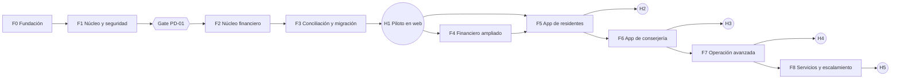

Notas de paralelismo (recomendaciones):

- Dentro de F1, el diseño de los Excel y el diagnóstico (`MIG-001`) pueden comenzar apenas lleguen los archivos del piloto, sin esperar a F2.
- `MIG-001` a `MIG-004` (diagnóstico, mapeo, preparación e idempotencia) no dependen de las reglas financieras y pueden adelantarse a F2.
- F4 y F5 pueden solaparse parcialmente: F5 solo necesita el núcleo de F2 y F3. Se secuencian en el diagrama porque un solo equipo es el supuesto (`SUP-09`).
- El diseño de UX de las apps móviles puede iniciar durante F3.

## 3. Puertas de decisión (gates)

Una fase no inicia hasta que sus puertas están cerradas.

| Puerta | Antes de | Debe estar resuelto | Referencia |
|---|---|---|---|
| G0 | F0 | Aprobación de este plan, de la arquitectura y de las decisiones técnicas `PD-34` a `PD-36`, `PD-40`, `PD-47`, `PD-50` | [RISKS](RISKS_AND_OPEN_DECISIONS.md) |
| G1 | F1 | `PD-08`, `PD-24`, `PD-25`, `PD-28`, `PD-31`, `PD-33`, `PD-37` a `PD-39`, `PD-43`, `PD-45`; decisiones de arquitectura `PD-N1` a `PD-N3` (`PD-N4` solo si T3 falla); decisiones de modelado `PD-M1`, `PD-M2`, `PD-M3`, `PD-M5` y `PD-M13`; y las pruebas técnicas T1 a T6 aprobadas o una decisión escrita para el caso en que alguna falle | [ARCHITECTURE §17](ARCHITECTURE.md#17-pruebas-técnicas-obligatorias-de-f0), [RISKS §4.3](RISKS_AND_OPEN_DECISIONS.md#43-decisiones-pendientes-de-arquitectura-pd-n) y [§4.4](RISKS_AND_OPEN_DECISIONS.md#44-decisiones-pendientes-de-modelado-pd-m) |
| G2 | F2 | **`PD-01` (especificación funcional)**, `PD-02`, `PD-03`, `PD-05`, `PD-06`, `PD-07`, `PD-10`, `PD-11`, `PD-29`, `PD-30`, `PD-46`; decisiones de modelado `PD-M4`, `PD-M6` a `PD-M10` y `PD-M12` | `IN-01` |
| G3 | F3 | `PD-14` (catálogo), `PD-16`, `PD-17`, `PD-M14`, `PD-M15`, y recepción de los Excel y extractos reales del piloto | |
| G4 | F4 | `PD-04`, `PD-09`, `PD-12`, `PD-13`, `PD-14` (cálculo), `PD-15`, `PD-M11` | |
| G5 | F5 | `PD-41`, `PD-42`, `PD-44`, `PD-47`, `PD-48` | |
| G6 | F6 | `PD-18`, `PD-19`, `PD-20`, `PD-26`, `PD-49`, `PD-M16` | |
| G7 | F7 | `PD-21`, `PD-22` | |
| G8 | F8 | `PD-23`, `PD-27`, `PD-32` | |

## 4. Fases en detalle

En cada fase, "Entidades" lista las entidades del [inventario de DATA_MODEL](DATA_MODEL.md#214-inventario-y-conteo-de-entidades) cuya **primera fase** es esa (135 en total: 35 en F1, 34 en F2, 22 en F3, 12 en F4, 6 en F5, 16 en F6, 4 en F7 y 6 en F8) y usa exactamente sus nombres vigentes. "APIs" son grupos de endpoints, no definiciones finales.

### F0 — Fundación y decisiones

- **Objetivo:** dejar el repositorio, las herramientas y el contrato de API listos y validar con las versiones reales las integraciones de mayor riesgo mediante las **seis pruebas técnicas obligatorias** (T1 a T6) definidas en [ARCHITECTURE §17](ARCHITECTURE.md#17-pruebas-técnicas-obligatorias-de-f0). Esas pruebas no son desarrollo funcional: usan proyectos mínimos y datos sintéticos.
- **Aplicaciones:** esqueletos de API, WEB, RES y CON (sin funcionalidades).
- **Funcionalidades:** `PLT-002`, `PLT-014`.
- **Trabajo técnico (no funcional):**
  - Inicializar monorepo, estructura de carpetas y pnpm. Nx gestiona Angular, NestJS y las librerías TypeScript. Las apps Flutter conservan su estructura y herramientas propias, y su registro en Nx mediante `run-commands` es opcional (ver [ARCHITECTURE §2.1](ARCHITECTURE.md#21-nx-y-flutter)).
  - Inicializar los cuatro proyectos y ejecutar CI (lint, pruebas, compilación) por proyecto. Los trabajos de Flutter pueden invocar `flutter` directamente.
  - Base PostgreSQL local reproducible y entornos.
  - Ejecutar y documentar las pruebas T1 a T6 (tabla siguiente) y registrar cada resultado como decisión técnica en [TECHNICAL_DECISIONS](TECHNICAL_DECISIONS.md).
  - Verificar versiones reales de Angular 22, NestJS, Prisma, Nx, Tailwind y Flutter (`RK-18`), que quedan fijadas como resultado de T1 a T4.
  - Gestionar cuentas de Apple y Google (`PD-47`).
- **Entidades:** ninguna de negocio.
- **APIs:** `GET /health` y publicación del documento OpenAPI.
- **Dependencias:** puerta G0.
- **Pruebas técnicas obligatorias (fuente: [ARCHITECTURE §17](ARCHITECTURE.md#17-pruebas-técnicas-obligatorias-de-f0)):**

| ID | Prueba | Riesgo | Criterio de aprobación | Decisiones que cierra |
|---|---|---|---|---|
| [T1](ARCHITECTURE.md#t1--compatibilidad-de-angular-22-con-la-versión-de-nx-elegida) | Angular 22 con la versión de Nx elegida | `RK-18` | El espacio de trabajo compila y las pruebas de ejemplo pasan con versiones exactas fijadas y registradas. Una regla de *boundaries* violada hace fallar el análisis | `PD-34`, `PD-45` |
| [T2](ARCHITECTURE.md#t2--integración-de-flutter-en-el-monorepo) | Flutter integrado en el monorepo | `RK-17` | Un desarrollador Flutter trabaja sin saber que Nx existe. Eliminar los `project.json` de Flutter no rompe nada. Las dependencias por ruta funcionan | `PD-34`, `PD-35`, `PD-N2` |
| [T3](ARCHITECTURE.md#t3--prisma-con-postgresql-rls-y-transacciones) | Prisma con PostgreSQL RLS y transacciones (incluye tablas Global, Tenant y Enlace) | `RK-09`, `RK-16` | Pasan todos los casos de [ARCHITECTURE §7.5](ARCHITECTURE.md#75-pruebas-de-aislamiento-validación-técnica-y-suite-permanente) (ISO, POOL, CTX, ROL, ENL, GLO). Cero filtraciones. Un solo fallo de aislamiento bloquea F1 | `PD-38`, `PD-N4`. Aporta evidencia técnica a `PD-M1` (tablas de enlace) |
| [T4](ARCHITECTURE.md#t4--generación-de-clientes-typescript-y-dart-desde-openapi) | Generación de clientes TypeScript y Dart desde OpenAPI | `RK-19` | Generación reproducible en una sola orden, clientes utilizables sin edición manual y las ocho verificaciones de `contract-sync` funcionando en CI | `PD-36`, `PD-N1` |
| [T5](ARCHITECTURE.md#t5--ejecución-independiente-de-api-y-worker) | Ejecución independiente de API y worker (incluye la comparación de colas) | `RK-20`, `RK-22` | Todos los escenarios pasan con al menos una de las dos colas y existe una recomendación fundamentada | `PD-43` |
| [T6](ARCHITECTURE.md#t6--generación-de-temas-desde-tokens-compartidos) | Generación de temas desde tokens compartidos | `RK-17`, `RK-19` | Un cambio de token se refleja en web y en ambas apps móviles desde una sola edición, con verificación automática en CI | `PD-N1` |

- **Pruebas:** el pipeline de CI corre en verde en los cuatro proyectos. Un cambio incompatible del contrato rompe el CI. Se ejecutan las seis pruebas T1 a T6, cada una con su informe (versiones exactas, resultado, medidas, problemas y decisión resultante).
- **Regla de puerta [R]:** F1 no inicia hasta que las seis pruebas pasen o exista una decisión escrita y aprobada por usted para el caso en que una falle ([ARCHITECTURE §17](ARCHITECTURE.md#17-pruebas-técnicas-obligatorias-de-f0)). Las decisiones `PD-N1` a `PD-N4` y `PD-M1` se registran en [RISKS_AND_OPEN_DECISIONS](RISKS_AND_OPEN_DECISIONS.md#4-decisiones-pendientes-pd-); `PD-N4` solo se decide si T3 falla.
- **Criterios de finalización:** informes de T1 a T6 anexados y sus resultados registrados como decisiones técnicas aprobadas en [TECHNICAL_DECISIONS](TECHNICAL_DECISIONS.md). Versiones exactas de las herramientas fijadas. Pipeline estable.
- **Resultado funcional:** ninguno para el usuario final. Es la base técnica.

### F1 — Núcleo organizativo, identidad y seguridad

- **Objetivo:** modelar el condominio y sus personas con seguridad multi-tenant, permisos y auditoría desde el primer registro.
- **Aplicaciones:** API, WEB.
- **Funcionalidades (47):** PLT 001, 003, 004, 006, 008, 010, 013; COND 001–007; PER 001–005, 014; VEH 001–003; IAM 001, 002, 004–008, 010, 012, 014, 016, 019; AUD 001, 002, 006; CFG 001, 005–007; DOC 001–004, 006.
- **Entidades (35):** Usuario; Sesión; Membresía; Vínculo usuario–persona; Rol; Permiso; Asignación de rol; Condominio; Edificio, bloque o sector; Ubicación / área común; Parámetro de configuración; Catálogo y elemento; Unidad; Tipo de unidad; Relación entre unidades; Persona; Relación persona–unidad; Titularidad; Porcentaje de titularidad; Esquema de reparto; Participación en gastos comunes; Responsable de pago; Vehículo; Personal asociado; Notificación; Plantilla de notificación; Bandeja de salida (*outbox*); Entrega de notificación; Documento / archivo; Versión de documento; Adjunto; Registro de auditoría; Junta; Periodo de gestión; Cargo de junta.
- **APIs:** autenticación y sesiones; condominios; edificios y unidades; personas y relaciones; vehículos y personal; usuarios, roles y permisos; documentos y archivos; auditoría; configuración y catálogos.
- **Dependencias:** puerta G1.
- **Pruebas:** aislamiento entre condominios (en cada endpoint de negocio), matriz de permisos por perfil (`IAM-019`), pruebas de autenticación y renovación de sesión, auditoría de toda escritura, restricciones de archivos. La suite permanente de aislamiento ([ARCHITECTURE §7.5](ARCHITECTURE.md#75-pruebas-de-aislamiento-validación-técnica-y-suite-permanente)) incluye los casos de las tablas de enlace (`ENL`: Membresía, Vínculo usuario–persona y Acceso de soporte) y la prueba de clasificación de tablas (`ROL-05`), de modo que ninguna tabla nueva se cree sin categoría Global, Tenant o Enlace.
- **Criterios de finalización:** un administrador de plataforma crea un condominio y su administrador. El administrador crea edificios, unidades, personas, relaciones y usuarios con roles. Los permisos se verifican en la API. Toda escritura queda auditada. El CI ejecuta las pruebas de aislamiento y permisos.
- **Resultado funcional:** estructura completa del edificio piloto cargable a mano, con usuarios y roles.

### F2 — Núcleo financiero

- **Objetivo:** operar el ciclo financiero básico: presupuesto, cuotas, recibos, cobranza, proveedores, gastos y cuentas por pagar, sin duplicar hechos económicos.
- **Aplicaciones:** API, WEB.
- **Funcionalidades (46):** PRE 001–004, 006, 007; COB 001–009, 020; BAN 001, 003, 004, 006–009; PRV 001–003, 005, 006; GAS 001–007, 009, 011–014; IAM 020, 021; AUD 003–005; CFG 002.
- **Entidades (34):** Concepto presupuestario; Presupuesto; Concepto de cobro; Periodo; Emisión de cuotas; Cargo por cobrar; Ajuste de cargo; Recibo; Línea de recibo; Pago; Aplicación de cobranza; Crédito a favor; Anulación / reverso; Cuenta financiera; Cuenta bancaria; Caja; Movimiento financiero; Transferencia entre cuentas; Vínculo movimiento–hecho; Fondo; Reasignación entre fondos; Proveedor; Contrato; Documento de gasto; Línea de gasto; Obligación por pagar; Ajuste de obligación; Pago a proveedor; Aplicación de pago a obligación; Crédito con proveedor; Devolución de proveedor; Decisión; Aprobación; Regla de aprobación.
- **APIs:** presupuestos, conceptos y fondos; cargos, ajustes de cargo y recibos; pagos y saldos; estados de cuenta; cuentas, cajas y movimientos; proveedores y contratos; gastos, obligaciones, ajustes, créditos y devoluciones de proveedor; decisiones y reglas de aprobación.
- **Dependencias:** puerta G2 (especificación funcional obligatoria). Requiere F1.
- **Pruebas:** pruebas de propiedades del prorrateo (la suma del reparto es igual al total según `PD-02`), pagos parciales e imputación (`PD-03`), invariantes de no duplicación (`RK-03`), anulaciones sin borrado físico, ajustes de cargo y de obligación que conservan el original (`COB-020`, `GAS-012`), pruebas con datos reales anonimizados.
- **Criterios de finalización:** se genera un periodo completo de cuotas desde un presupuesto, se emiten recibos, se registran pagos totales y parciales, se registran gastos y pagos a proveedores. Los saldos por concepto y por unidad cuadran. Ningún registro financiero puede eliminarse físicamente.
- **Resultado funcional:** la junta puede gestionar cobranza y pagos (sin conciliación ni migración todavía).

### F3 — Conciliación, migración y reportes esenciales (Hito H1)

- **Objetivo:** cargar la situación actual del edificio desde Excel, conciliar con el banco y emitir los reportes imprescindibles. Al terminar, el edificio puede operar en la web.
- **Aplicaciones:** API, WEB.
- **Funcionalidades (45):** PLT 012; PER 007; COB 010; BAN 002, 005; CNC 001–011; GAS 008; SUM 001–003, 016; REP 001–004, 011, 012; MIG 001–017, 022.
- **Entidades (22):** Perfil de formato de extracto; Importación de extracto; Línea de extracto; Resultado de importación de línea; Asignación de conciliación; Diferencia de conciliación; Periodo de conciliación; Cierre de conciliación; Reapertura de conciliación; Suministro; Punto de medición; Medidor; Instalación de medidor; Lectura; Apertura del condominio; Lote de migración; Archivo de origen; Diagnóstico de archivo; Perfil de mapeo; Registro de preparación (*staging*); Referencia de origen; Saldo de apertura.
- **APIs:** importación y conciliación de extractos (con diferencias y reapertura); diagnóstico y migración (preparación, validación, confirmación, reversión); suministros y medidores (catálogo); reportes y exportaciones.
- **Dependencias:** puerta G3. Requiere F2. Requiere los Excel y extractos reales.
- **Pruebas:** importación idempotente, conservación de origen archivo/hoja/fila, prueba de que la migración no crea movimientos ni ingresos ni gastos (`MIG-015`), importes originales = pagado + saldo, conciliación 1:N y N:1, restauración de respaldos (`PLT-012`), pruebas de carga con el volumen del piloto.
- **Criterios de finalización:** se ejecuta el ensayo completo de migración con los datos reales del piloto, con aprobación de la junta de la fecha de apertura. Un extracto real se concilia. Los reportes coinciden con los saldos.
- **Resultado funcional (H1):** el edificio piloto opera sus cobranzas, pagos y conciliación en la web desde la apertura.

### F4 — Financiero ampliado y gestión

- **Objetivo:** completar el alcance financiero de la web.
- **Aplicaciones:** API, WEB.
- **Funcionalidades (35):** PRE 005; COB 012, 019; PRV 004; PRS 001–005; CAR 001–004; SUM 004–011; BCP 001–005; IAM 009; REP 005–007, 013, 014; MIG 019–021.
- **Entidades (12):** Cargo adicional o venta; Convenio BCP; Archivo de cobranza BCP; Préstamo; Anticipo; Depósito recuperable; Recuperación; Calendario de lectura; Ciclo de consumo; Consumo; Distribución de consumo; Línea de distribución.
- **APIs:** préstamos, anticipos y depósitos; cargos y ventas; lecturas, consumo y distribución; generación de archivos BCP; cierre de periodos; reportes adicionales.
- **Dependencias:** puerta G4. Si el piloto cobra por BCP, `BCP-001` a `BCP-004` se adelantan a F3.
- **Pruebas:** cálculo y distribución de consumo (reglas de `PD-14`), formato BCP contra el archivo de ejemplo oficial, saldos de préstamos y depósitos, cierres.
- **Criterios de finalización:** las funcionalidades pendientes de la web se completan según las reglas aprobadas. Los reportes de F4 coinciden con sus fuentes.
- **Resultado funcional:** web con el alcance financiero completo.

### F5 — App de residentes v1 y comunicaciones (Hito H2)

- **Objetivo:** dar a propietarios e inquilinos una app para consultar su situación y comunicarse con la administración.
- **Aplicaciones:** API, WEB, RES.
- **Funcionalidades (27):** PLT 005, 009; PER 008–010; COB 011, 013–018; IAM 003, 011, 013; CFG 004; COM 001–010; DOC 005.
- **Entidades (6):** Dispositivo; Autorización expresa; Comprobante de pago enviado; Comunicado; Destinatario de comunicado; Preferencia de notificación.
- **APIs:** perfil y unidades del residente; consulta financiera del residente (con restricción por unidad); comprobantes de pago; comunicados y notificaciones; dispositivos y push.
- **Dependencias:** puerta G5. Requiere F2 y F3. Infraestructura de notificaciones de F1.
- **Pruebas:** un residente no accede a datos de otra unidad (`COB-018`), un comprobante no cambia saldos hasta validarse (`COB-011`), pruebas de integración Flutter contra la API, pruebas de push en Android e iOS, pruebas de sesión móvil.
- **Criterios de finalización:** residentes del piloto inician sesión, ven recibos, deudas y estado de cuenta de sus unidades, registran comprobantes y ven su estado, y reciben comunicados. La app está disponible en el canal de prueba de cada tienda.
- **Resultado funcional (H2):** transparencia financiera y comunicación digital con los residentes.

### F6 — App de conserjería v1 y operación de portería (Hito H3)

- **Objetivo:** digitalizar la operación diaria de portería. Incluye las funcionalidades de residentes asociadas (pre-registro de visitas, encomiendas).
- **Aplicaciones:** API, WEB, CON, RES.
- **Funcionalidades (49):** PLT 007, 015; PER 006, 011–013; VEH 004; IAM 017; REP 008, 009; CFG 003, 008; COM 014; VIS 001–013; ENC 001–014; TUR 001–009.
- **Entidades (16):** Persona autorizada; Turno; Puesto; Tarea; Novedad; Alerta; Visita; Visitante; Autorización de visita; Solicitud de autorización; Encomienda; Documento recibido; Entrega; Empresa de mensajería; Solicitud procesada; Conflicto de sincronización.
- **APIs:** turnos y tareas; novedades; visitas y autorizaciones; encomiendas y documentos recibidos; consulta de residentes con datos mínimos; idempotencia y sincronización.
- **Dependencias:** puerta G6. Requiere F1 y F5 (push y comunicaciones). Prepara el diseño idempotente para F7.
- **Pruebas:** un conserje no accede a información financiera (`PER-013`), visitas con y sin autorización previa, notificación y respuesta del residente, registro de recibió/entregó/recogió, subida de fotografías con reintento, pruebas de integración Flutter.
- **Criterios de finalización:** los conserjes del piloto inician turno, registran visitas, encomiendas y novedades, los residentes reciben los avisos y responden las solicitudes de autorización, y la administración consulta el historial desde la web.
- **Resultado funcional (H3):** portería digital con trazabilidad.

### F7 — Operación avanzada y modo con conectividad limitada (Hito H4)

- **Objetivo:** incorporar lecturas de medidores, incidencias y evidencias, comunicación controlada de conserjería y la operación con conectividad limitada.
- **Aplicaciones:** API, WEB, CON, RES.
- **Funcionalidades (20):** PLT 016, 017; PRV 008; SUM 012–015; REP 010; COM 011–013; INC 001–009.
- **Entidades (4):** Incidencia; Evidencia; Respuesta; Comunicación de conserjería.
- **APIs:** incidencias y evidencias; lecturas móviles y revisión; comunicación de conserjería; sincronización.
- **Dependencias:** puerta G7. Requiere F4 (reglas de lecturas) y F6.
- **Pruebas:** escenarios de sincronización (duplicados, reintentos, conflictos, reloj del dispositivo, evidencias diferidas), lecturas inconsistentes, flujo de incidencia punta a punta.
- **Criterios de finalización:** las operaciones definidas como "con conexión opcional" funcionan sin red y se sincronizan sin duplicados. Las lecturas llegan a revisión con fotografía. Las incidencias de residentes se gestionan en la web.
- **Resultado funcional (H4):** operación completa de conserjería y gestión de incidencias.

### F8 — Servicios al residente, escalamiento y endurecimiento (Hito H5)

- **Objetivo:** completar funcionalidades de menor prioridad y preparar la plataforma para operar varios condominios.
- **Aplicaciones:** API, WEB, RES, CON.
- **Funcionalidades (15):** PLT 011; VEH 005; PRV 007; GAS 010; IAM 015, 018; MIG 018; AUD 007, 008; CFG 009; SRV 001–005.
- **Entidades (6):** Área reservable; Reserva; Contacto útil; Aviso de emergencia; Política de retención; Acceso de soporte.
- **APIs:** reservas; contactos y reglamentos; emergencias; administración de plataforma; políticas de retención.
- **Dependencias:** puerta G8.
- **Pruebas:** pruebas de seguridad y penetración básicas, carga con varios condominios, retención y borrado según política, restauración de respaldos.
- **Criterios de finalización:** se incorpora un segundo condominio sin cambios de código. Pruebas de aislamiento y carga en verde.
- **Resultado funcional (H5):** Adminístralo preparado para escalar a múltiples condominios.

## 5. Alcance del piloto

El piloto es **un edificio completo** (§7, §12). La propuesta de lo imprescindible (`P0`) se distribuye así:

| Fase | Funcionalidades `P0` | Qué habilita |
|---|---|---|
| F0 | 1 | Contrato de API |
| F1 | 32 | Estructura, usuarios, permisos, auditoría y archivos |
| F2 | 27 | Cobranza, pagos y gastos |
| F3 | 35 | Migración, conciliación CSV/Excel, reportes esenciales (**H1**) |
| F4 | 0 | (todo `P1`) |
| F5 | 18 | Residentes: finanzas, comprobantes y comunicados (**H2**) |
| F6 | 25 | Portería: visitas, encomiendas, turnos, novedades (**H3**) |
| F7 | 6 | Incidencias y evidencias |
| F8 | 0 | (todo `P1`/`P2`) |
| **Total** | **144** | |

- **Piloto operativo en web (H1):** 95 funcionalidades `P0` de F0 a F3 (suma 1 + 32 + 27 + 35).
- **Piloto con apps móviles:** las 49 `P0` restantes de F5 a F7 (18 + 25 + 6).
- **Confirmación pendiente:** si el piloto cobra por BCP (`PD-15`) o si necesita cálculo de consumo desde el primer ciclo (`PD-14`), las funcionalidades correspondientes de F4 pasan a `P0` y se adelantan a F3. Es una decisión suya.
- **Funcionalidades sin prioridad:** las 16 funcionalidades añadidas en la sincronización documental (`COND-007`, `PER-014`, `COB-020`, `PRE-006`, `PRE-007`, `CNC-011`, `GAS-012`, `GAS-013`, `GAS-014`, `SUM-016`, `IAM-020`, `IAM-021`, `MIG-019`, `MIG-020`, `MIG-021`, `MIG-022`) figuran como `Por definir` y no se cuentan en `P0`, `P1` ni `P2` (144 + 111 + 15 + 16 = 286). Su prioridad queda pendiente de aprobación (`IN-16`).
- **Saldos de préstamos, anticipos y depósitos:** `MIG-019` a `MIG-021` están en F4 porque dependen de `PRS` (F4). Si el piloto tiene esos saldos vigentes a la fecha de corte y deben cargarse en la apertura, esos paquetes tendrían que adelantarse (`IN-15`). Es una decisión suya.

## 6. Qué no cambia sin aprobación

- El stack aprobado (§2 del prompt).
- Las cuatro aplicaciones independientes.
- La API como única responsable de reglas de negocio y permisos.
- Cualquier cambio de fase o prioridad en la matriz.
````

## Documento: `docs/ARCHITECTURE.md`

````markdown
# Arquitectura técnica

> Entregable 4 del [prompt maestro](../PROMPT_MAESTRO.md). **Revisión 2** (ver [historial](#19-historial-de-revisiones)). Es una **propuesta para aprobación**. Cada elección tiene su justificación y alternativas en [TECHNICAL_DECISIONS](TECHNICAL_DECISIONS.md) (`TD-`). La seguridad se desarrolla en [SECURITY](SECURITY.md) y las pruebas en [TESTING_STRATEGY](TESTING_STRATEGY.md).
>
> **Etiquetas:** **[C]** confirmado en el prompt, **[R]** recomendación, **[PD]** pendiente de decisión (ver [RISKS](RISKS_AND_OPEN_DECISIONS.md)). Las versiones exactas de herramientas **no se verificaron en esta etapa** y se confirman en F0 (`RK-18`).
>
> **Hipótesis, no hechos:** varias afirmaciones técnicas de este documento (Nx con Angular 22, Flutter en el monorepo, Prisma con RLS, generación de clientes, worker y cola, generación de temas) son **diseños objetivo que todavía no se han validado**. La [sección 17](#17-pruebas-técnicas-obligatorias-de-f0) define las pruebas que deben pasar antes de iniciar cualquier desarrollo funcional.

## 1. Vista general

Cuatro aplicaciones independientes consumen una sola API. El backend es el único que accede a PostgreSQL y el único que valida permisos y ejecuta reglas de negocio **[C]**.

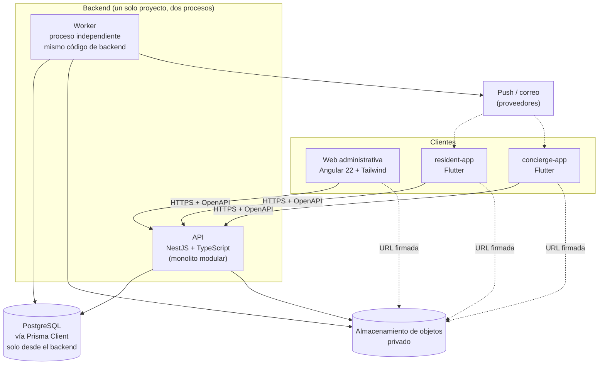

La API y el worker **no se comunican entre sí por red**. Se coordinan a través de PostgreSQL (tabla de bandeja de salida y cola, ver §4.2).

Decisiones de forma **[R]**:

- **Monolito modular** en NestJS (módulos con fronteras claras por dominio). No microservicios: el equipo es pequeño (`SUP-09`) y las transacciones financieras exigen consistencia fuerte. Los módulos se pueden extraer más adelante porque comunican por interfaces y eventos.
- **Un solo esquema de base de datos compartido** entre condominios, con aislamiento por `condominium_id` y Row Level Security (ver §7).
- **Un worker como proceso independiente de la API**, con el mismo código de backend y otro punto de entrada (ver §4.2).
- **Prisma Client solo se usa desde el backend**, y el backend es dueño de todas las migraciones (ver §7.2).

## 2. Monorepositorio

### 2.1. Nx y Flutter

| Criterio | Nx | pnpm workspaces + Turborepo | Repos separados |
|---|---|---|---|
| Angular y NestJS | Plugins oficiales, generadores, *affected* | Sin generadores. Se orquesta a mano | Sin código compartido simple |
| Código TS compartido (`libs/`) | Nativo, con reglas de dependencias entre proyectos | Manual | Publicar paquetes |
| Flutter | **Sin soporte oficial.** Solo `run-commands`. Hay plugins comunitarios sin evaluar | Igual | Natural |
| Compilar solo lo afectado | Sí (grafo de proyectos y caché) | Sí (por paquete) | No aplica |
| Curva de aprendizaje | Media | Baja | Baja |
| Riesgo | Dependencia de la herramienta. Debe ser compatible con la versión de Angular | Menos funciones | Deriva entre repos |

**Recomendación [R] (`TD-02`, `PD-34`): Nx + pnpm solo para Angular, NestJS y las librerías TypeScript.** Flutter conserva su independencia:

1. **Nx gestiona** `apps/web`, `apps/api`, `libs/*` y `database/`. La versión de Nx se elige en la prueba T1 según su compatibilidad real con Angular 22.
2. **Flutter no depende de Nx.** Cada app Flutter (`apps/resident-app`, `apps/concierge-app`) se desarrolla, analiza, prueba y compila **únicamente con el SDK de Flutter**. No se necesita Node, pnpm ni Nx instalados para trabajar en una app Flutter.
3. Nx puede **ejecutar** los comandos de Flutter mediante `run-commands` (`flutter analyze`, `flutter test`, `flutter build`). Son envoltorios mínimos que llaman exactamente a los mismos comandos que un desarrollador ejecutaría a mano. **No hay ejecutores propios de Nx para Flutter, ni caché de compilaciones de Flutter, ni plugins comunitarios.**
4. **Estructura oficial intacta.** Cada app Flutter conserva la estructura que genera `flutter create` (su propio `pubspec.yaml`, `android/`, `ios/`, `lib/`, `test/`). Lo único adicional permitido es un `project.json` mínimo en la raíz de la app para registrar los envoltorios de Nx.
5. **Beneficio concreto de registrar Flutter en Nx:** `nx affected` puede marcar las apps Flutter como afectadas cuando cambia el contrato OpenAPI o un paquete de `packages/`, mediante dependencias implícitas declaradas. Es lo único que se pide a Nx respecto de Flutter.
6. **Prueba de independencia:** si se eliminara Nx, las apps Flutter seguirían compilando sin ningún cambio. La prueba T2 lo verifica explícitamente.
7. **Los pipelines de CI de Flutter pueden llamar directamente a `flutter`.** Usar `run-commands` es opcional para CI.
8. **Releases independientes.** Cada app Flutter tiene su propia versión, configuración de firma, *flavors* y despliegue a tiendas.
9. **Plan B:** si T2 detecta fricción, Flutter queda **totalmente fuera** de Nx (sin `project.json`) y Nx solo se usa para TypeScript. La estructura de carpetas no cambia.

**Melos no se incorpora inicialmente.** No hay justificación hoy: habrá dos paquetes Dart (`administralo_api_client` y `administralo_design`) y dos apps, y un pequeño conjunto de scripts es suficiente. Se reevalúa solo si se cumple alguno de estos criterios (todos medibles en el momento): más de tres paquetes Dart, necesidad real de publicar versiones coordinadas de paquetes, o tiempos de CI de Dart que justifiquen ejecución selectiva que los scripts no resuelvan.

**Resolución de paquetes Dart (`PD-N2`) [R]:** las apps Flutter declaran los paquetes compartidos como **dependencias por ruta** (`path`) en su propio `pubspec.yaml`. Esto no requiere herramienta adicional y no altera la estructura estándar. Los *Dart pub workspaces* (función nativa de Dart, distinta de Melos) quedan descartados por defecto porque cambian el manejo del archivo de bloqueo de dependencias. Se reconsideran solo si T2 muestra un problema real con las dependencias por ruta.

### 2.2. Estructura propuesta

Parte de la estructura del prompt (§9). La separación entre `libs/` (TypeScript) y `packages/` (Dart) es una decisión **[PD-35]** que usted indicó conservar.

```
administralo/
├─ apps/
│  ├─ api/                     NestJS. Un proyecto con dos puntos de entrada: API y worker
│  ├─ web/                     Angular 22 + Tailwind
│  ├─ resident-app/            Flutter (estructura oficial de flutter create)
│  └─ concierge-app/           Flutter (estructura oficial de flutter create)
├─ libs/                       SOLO TypeScript (gestionado por Nx)
│  ├─ contracts/               Documento OpenAPI versionado y constantes del contrato
│  ├─ api-client/              Cliente TypeScript generado desde OpenAPI (consumido por web)
│  ├─ design-tokens/           FUENTE ÚNICA de tokens (JSON) y su generación
│  └─ shared/                  Utilidades TS puras sin dependencias de framework (uso mínimo)
├─ packages/                   SOLO Dart (dependencias por ruta, sin Melos)
│  ├─ administralo_api_client/ Cliente Dart generado desde OpenAPI
│  └─ administralo_design/     Tema Flutter generado desde los tokens
├─ database/                   Propiedad exclusiva del backend
│  ├─ prisma/                  schema.prisma (cuando se defina)
│  ├─ migrations/              ÚNICO historial de migraciones (Prisma Migrate + SQL manual)
│  └─ seed/
├─ docs/
├─ infra/                      Contenedores, IaC, pipelines
└─ tools/                      Scripts de generación y verificación (contratos, tokens)
```

Reglas de la estructura:

- **`libs/` solo contiene TypeScript. `packages/` solo contiene Dart.** Evita forzar estructuras de un ecosistema en otro (§9: "no forzar la estructura de Angular o NestJS dentro de Flutter").
- **`libs/shared`** solo puede contener utilidades puras sin reglas de negocio.
- **`database/`** está en la raíz como pide el prompt, pero **solo el backend (`apps/api`) puede usarlo**. Los modelos de Prisma **no se exponen** a los clientes **[C]**; los clientes solo ven los DTO del contrato. Resuelve `IN-13`.

### 2.3. Reglas de dependencia entre proyectos [R]

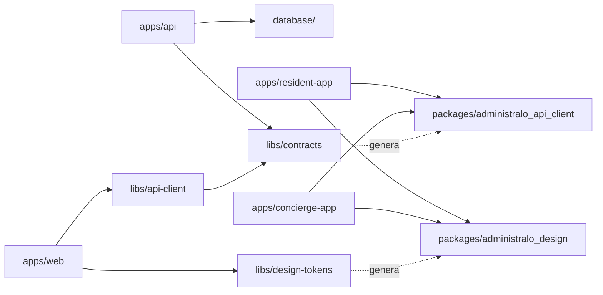

- Ninguna app importa a otra app.
- Los clientes **nunca** importan `database/`, Prisma ni código interno de la API.
- `libs/shared` no importa nada del dominio.
- **Para proyectos TypeScript**, las reglas se hacen cumplir con las *module boundaries* de Nx (etiquetas por proyecto).
- **Para Dart**, Nx no puede hacer cumplir reglas. Se cumplen por construcción (cada `pubspec.yaml` declara solo lo permitido) y con un script de verificación en CI que falla si aparece una dependencia no permitida.

### 2.4. Compartición controlada

| Recurso | Mecanismo | Fuente de verdad |
|---|---|---|
| Contratos de API | Documento **OpenAPI** generado por NestJS y versionado en `libs/contracts` (ver §3) | La API |
| Esquemas de validación | Se definen en la API (DTO). Los clientes **no** reimplementan reglas críticas **[C]**. Las validaciones de formulario en cliente son solo ayuda de usabilidad | La API |
| Tipos y modelos | Generados desde OpenAPI (TypeScript y Dart) | OpenAPI |
| Constantes | Enumeraciones y códigos de error dentro del contrato | OpenAPI |
| Cliente API | Generado (TypeScript en `libs/api-client`, Dart en `packages/`) | OpenAPI |
| Design tokens | JSON → configuración de Angular/Tailwind y tema de Flutter (ver §2.5) | `libs/design-tokens` |
| Componentes visuales | **No se comparten.** Cada framework tiene los suyos | — |
| Documentación | `docs/` | — |

Los modelos internos de Prisma **no se comparten** con ninguna aplicación cliente **[C]**.

### 2.5. Design tokens: fuente única **[R] (`PLT-014`)**

**Un solo origen:** archivos **JSON** en `libs/design-tokens/` (el formato exacto, por ejemplo el estándar de tokens de diseño del W3C u otro esquema propio, se define en la prueba T6). **Nadie edita a mano** los archivos generados.

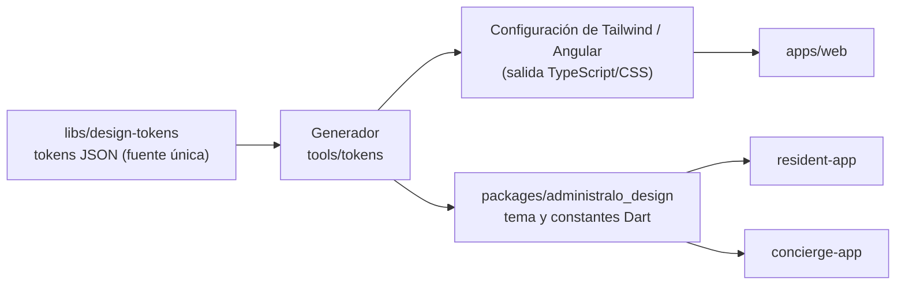

- **Qué se comparte:** valores (color, tipografía, espaciado, radios, sombras, y otros que se definan). **Nada más.**
- **Qué NO se comparte:** componentes visuales. Los componentes de Angular y los *widgets* de Flutter se escriben por separado, cada uno con las convenciones de su framework.
- **Salida para Angular/Tailwind:** el formato depende de la versión de Tailwind que se use (se verifica en T1 y T6). El generador debe adaptarse a ella.
- **Salida para Flutter:** código Dart en `packages/administralo_design` (constantes y tema). **La salida Dart se versiona en el repositorio** (`PD-N1`) para que un desarrollador Flutter no necesite ejecutar el generador.
- **Determinismo:** la generación produce siempre el mismo resultado desde las mismas entradas. CI vuelve a generar y falla si hay diferencias con lo versionado (§3.5, aplicado también a tokens).
- **Cambios de token:** se editan en el JSON, se regenera y se revisan ambas salidas en el mismo cambio.

## 3. Contrato de API y generación de clientes

**[R] (`TD-04`, `PD-36`)**: enfoque *code-first*. NestJS (con `@nestjs/swagger`) genera el documento OpenAPI. A partir de él se generan los clientes TypeScript y Dart. **Todo el proceso debe ser reproducible con un comando y verificable en CI.**

### 3.1. Artefactos y ubicaciones

| Artefacto | Ubicación | Origen | ¿Se versiona en el repositorio? |
|---|---|---|---|
| Documento OpenAPI | `libs/contracts/openapi/` | Generado desde el código de la API | **Sí** (`PD-N1`) |
| Metadatos del contrato (huella del documento, versión) | `libs/contracts/openapi/` | Generado | Sí |
| Cliente TypeScript | `libs/api-client/` (carpeta generada separada del código escrito a mano) | Generado desde el documento | Sí |
| Cliente Dart | `packages/administralo_api_client/` (carpeta generada separada de la fachada pública escrita a mano) | Generado desde el documento | Sí |

**Por qué versionar los generados (`PD-N1`) [R]:** (a) los desarrolladores Flutter no necesitan Node ni las herramientas de generación para trabajar; (b) los cambios del contrato son visibles en las revisiones de código; (c) CI detecta cualquier desincronización. **Alternativa:** generarlos solo en CI y no versionarlos; reduce ruido en el repositorio pero obliga a todos a ejecutar la generación localmente y rompe la independencia de Flutter (§2.1). Decisión pendiente.

### 3.2. Proceso de generación reproducible

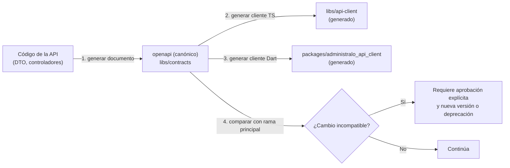

Pasos **[R]**:

1. **Generar el documento desde el código.** Un comando de Nx (por ejemplo, un objetivo `generate` del proyecto `contracts`) arranca la API en **modo de contrato**, que **no requiere base de datos ni servicios externos**, y escribe el documento. Si la aplicación no puede arrancar sin base de datos, se resuelve con proveedores simulados solo para este modo (validar en T4).
2. **Forma canónica.** El documento se escribe con claves ordenadas y formato fijo, para que dos ejecuciones produzcan **exactamente el mismo archivo**.
3. **Generar clientes.** Un solo comando regenera TypeScript y Dart desde el documento versionado (no desde la API en ejecución).
4. **Herramientas fijadas.** Las versiones de los generadores quedan fijadas de forma exacta. Si alguno requiere un entorno particular (por ejemplo una máquina virtual de Java), vive en un contenedor de desarrollo y en CI, y **no es requisito para quien solo trabaja en Flutter o Angular**.
5. **Código generado y escrito a mano separados.** Los clientes tienen una carpeta `generated/` que nadie edita (con cabecera de advertencia) y una fachada pública pequeña escrita a mano (por ejemplo, para interceptores de autenticación).
6. **Huella.** Cada cliente registra la huella del documento con el que fue generado.

Generadores candidatos (se eligen en T4): para TypeScript, `openapi-typescript`, `@hey-api/openapi-ts` u `orval`; para Dart, el generador de OpenAPI para Dart/Dio u otra alternativa.

### 3.3. Versionado del contrato

- **Versión mayor en la ruta:** `/v1`. Un cambio incompatible exige `/v2` o un periodo de deprecación acordado.
- **Versión del documento** (`info.version`) con versionado semántico: parche para correcciones de documentación, menor para adiciones compatibles, mayor para cambios incompatibles.
- **Compatibilidad hacia atrás dentro de `/v1`** porque las apps móviles se actualizan lentamente (ver §13.3).
- Un cambio **incompatible** se detecta automáticamente comparando el documento del cambio contra el de la rama principal y contra el último publicado. Requiere aprobación explícita.

### 3.4. Convenciones **[R]**

Errores con formato estándar (tipo *problem details*), paginación consistente, fechas ISO 8601 en UTC, importes como cadenas decimales (nunca `float`).

### 3.5. Verificación de sincronización en CI **[R]**

Un trabajo de CI (`contract-sync`) falla ante **cualquiera** de estas condiciones:

| # | Verificación | Falla si |
|---|---|---|
| 1 | Regenerar el documento desde el código | El resultado difiere del documento versionado |
| 2 | Regenerar el cliente TypeScript desde el documento versionado | El resultado difiere del cliente versionado |
| 3 | Regenerar el cliente Dart desde el documento versionado | El resultado difiere del cliente versionado |
| 4 | Comparar con la rama principal | Hay un cambio incompatible sin la aprobación explícita registrada |
| 5 | Compilar el cliente TypeScript y analizar el cliente Dart | No compilan o no pasan el análisis |
| 6 | Huellas de los clientes | No coinciden con la huella del documento |
| 7 | Pruebas de contrato | Una respuesta real de la API no cumple su esquema |
| 8 | Regenerar tokens (§2.5) | La salida difiere de lo versionado |

Los pasos 1 a 3 y 8 son comparaciones directas (*regenerar y verificar que no hay diferencias*). La verificación se ejecuta en **Linux en CI**. T4 y T6 comprueban además que **el resultado es idéntico en macOS y en Linux**, para evitar diferencias por sistema operativo.

### 3.6. Flujo de trabajo del desarrollador

1. Cambia DTO o controladores en la API.
2. Ejecuta el comando de regeneración del contrato.
3. Incluye en el mismo cambio el documento y los clientes regenerados.
4. CI verifica la sincronización. Quien trabaja en Flutter o Angular consume los clientes ya versionados.

## 4. API (NestJS) y worker

### 4.1. Módulos y capas de la API

**Estructura de módulos [R]**: un módulo NestJS por dominio funcional (por ejemplo `identity`, `condominiums`, `people`, `budgets`, `billing`, `banking`, `reconciliation`, `suppliers`, `payables`, `supplies`, `migration`, `audit`, `communications`, `visits`, `parcels`, `incidents`, `shifts`, `documents`). Los nombres finales se fijan en F1.

Capas dentro de cada módulo **[R]**:

1. **Controladores:** HTTP, validación de entrada, permisos declarados (`@RequirePermission(...)`).
2. **Servicios de aplicación:** orquestan casos de uso y transacciones.
3. **Dominio:** reglas de negocio puras y testeables (cálculo de prorrateo, imputación de pagos, validaciones de consumo).
4. **Repositorios:** único lugar que usa Prisma, siempre a través de la transacción protegida (§7.3).

Reglas **[R]**:

- Los **DTO de salida son distintos de los modelos de Prisma**. Cada perfil recibe solo los campos que le corresponden (minimización de datos).
- Las **reglas de negocio críticas viven solo aquí** **[C]**. Esto incluye prorrateo, pagos parciales, conciliación, consumo, estado de comprobantes y autorización de visitas.
- Los casos de uso financieros se ejecutan en **transacciones** y generan su registro de auditoría en la misma transacción.
- Las operaciones iniciadas desde móviles aceptan `Idempotency-Key` (ver §13).
- Los trabajos pesados (importación de Excel, análisis de archivos, notificaciones) se delegan al worker.

### 4.2. Worker: proceso independiente con el mismo código de backend

**[R] (`TD-09`, `TD-19`)** El worker es un **proceso distinto de la API**, construido a partir del **mismo proyecto de backend** (`apps/api`) con **otro punto de entrada**. No es un microservicio ni un repositorio aparte.

Características:

| Aspecto | Diseño |
|---|---|
| Código | Mismo proyecto, mismos módulos de dominio, repositorios y reglas. **Cero duplicación** de lógica |
| Arranque | Punto de entrada propio. **No abre endpoints de negocio.** Solo *health check* y métricas |
| Artefacto | Misma imagen con distinto comando, o imágenes distintas del mismo proyecto. Se confirma en T5 |
| Despliegue y escala | Independiente de la API. Se puede reiniciar, escalar o detener sin afectar a la API, y al revés |
| Comunicación con la API | **Ninguna directa.** Se coordinan por PostgreSQL (bandeja de salida y cola) |
| Base de datos | Mismo Prisma Client y mismo patrón de transacción protegida. **Cada trabajo de un condominio establece su contexto de tenant** (§7.3) |
| Credenciales | Rol de base de datos propio, con los permisos mínimos que necesite |
| Configuración | Variables propias. No hereda las de la API por accidente |

**Responsabilidades del worker:**

1. **Envío de notificaciones**: leer la bandeja de salida y entregar por bandeja interna, push y correo, con plantillas y preferencias (§11).
2. **Procesamiento de archivos**: validar tipo real y análisis de seguridad después de la subida (§10).
3. **Importaciones pesadas**: procesar Excel de migración y extractos bancarios por lotes, cada lote en su propia transacción protegida.
4. **Tareas programadas**: generación periódica que se defina (por ejemplo, recordatorios o limpiezas), ejecutadas **una sola vez** aunque haya varios workers.
5. **Reintentos y trabajos fallidos**: reintento con espera creciente y registro de los que agotan intentos.
6. **Mantenimiento**: limpieza de datos temporales, expiración de solicitudes (por ejemplo `VIS-012`, según `PD-18`) y similares que se definan.

**Reglas de diseño del worker [R]:**

- **Trabajos idempotentes.** Repetir un trabajo no duplica su efecto.
- **Sin transacciones abiertas durante llamadas externas** (almacenamiento, proveedores de push o correo).
- **Apagado ordenado**: termina o libera el trabajo en curso antes de cerrar.
- **Varios workers a la vez** sin que un mismo trabajo se procese dos veces. Las tareas programadas se ejecutan una vez.
- **Lo que no hace:** no recibe tráfico de clientes ni decide permisos de usuarios.

**Cola de trabajos: decisión pendiente de spike técnico (`PD-43`).** No se elige todavía entre `pg-boss` y BullMQ.

| Criterio | `pg-boss` (sobre PostgreSQL) | BullMQ (sobre Redis) |
|---|---|---|
| Piezas adicionales de infraestructura | Ninguna | Redis |
| Coherencia con la bandeja de salida | Misma base de datos | Base de datos distinta |
| Copias de seguridad y recuperación | Ya cubiertas por las de PostgreSQL | Hay que planificar la persistencia de Redis |
| Programación de tareas y reintentos | Incluidos | Incluidos |
| Rendimiento a gran volumen | Menor margen | Mayor |
| Visibilidad operativa | Por consultas SQL o herramientas | Herramientas propias del ecosistema |
| Convivencia con Prisma y RLS | **A validar** | **A validar** |
| Costo operativo | Menor | Mayor |

Nota de diseño: la **bandeja de salida (*outbox*) es una tabla propia** escrita con Prisma en la misma transacción que el cambio de negocio. Un proceso de retransmisión la lee y publica en la cola. Por eso **la cola no necesita compartir la transacción con Prisma**, y cambiar de `pg-boss` a BullMQ no altera las reglas de negocio ni la consistencia. El spike lo comprueba (T5). El criterio de decisión se define en T5.

## 5. Web administrativa (Angular 22 + Tailwind)

**[C]** Angular 22, TypeScript y Tailwind CSS. **[R]** Prácticas, a confirmar con el *scaffold* real en F0 (`RK-18`, T1):

- Componentes autónomos (*standalone*), señales (*signals*) para estado local y rutas con carga diferida por dominio.
- Organización por *features* (una carpeta por dominio funcional) con capas `ui`, `data-access` y `feature`.
- Consumo de la API **solo mediante el cliente generado**. Sin llamadas HTTP manuales con tipos duplicados.
- Estado de servidor con la capa `data-access` de cada *feature*. Se evita una librería global de estado salvo que se justifique.
- Los permisos del usuario se usan para **ocultar o deshabilitar** opciones (usabilidad). La API vuelve a validar siempre.
- Tailwind configurado desde los *design tokens* generados (§2.5, `PLT-014`). Sin valores de diseño duplicados a mano.
- Biblioteca de componentes para tablas, formularios y accesibilidad: `PD-45`.
- Pantallas pensadas para "personas sin conocimientos contables" (§1): lenguaje claro, ayuda contextual (`CFG-005`), confirmaciones en operaciones irreversibles.

## 6. Aplicaciones móviles (Flutter)

Dos proyectos independientes **[C]** con estructura Flutter estándar, dependencias y configuración de compilación propias. Detalle en [RESIDENT_APP](RESIDENT_APP.md) y [CONCIERGE_APP](CONCIERGE_APP.md). **Su relación con Nx está en §2.1: Nx puede ejecutar sus comandos, pero ninguna app Flutter depende de Nx para desarrollarse o compilarse.** Decisiones comunes **[R] (`TD-10`)**:

| Tema | Recomendación | Alternativa |
|---|---|---|
| Organización | Por *features* con capas de presentación, dominio y datos | Por capas globales |
| Estado | Riverpod | Bloc |
| Navegación | `go_router` | Navigator 2 propio |
| HTTP | `dio` con el cliente generado (`packages/administralo_api_client`) | `http` |
| Tema | `packages/administralo_design`, generado desde los tokens | — |
| Almacenamiento seguro | Keychain (iOS) y Keystore (Android) vía `flutter_secure_storage` | — |
| Base local (solo conserjería) | SQLite con `drift`, con cifrado si se cachean datos personales | Isar, Hive |
| Notificaciones push | Firebase Cloud Messaging (Android e iOS) | OneSignal |
| Fotografías | Captura, compresión local y subida directa con URL firmada | — |
| Pruebas | Unitarias, de *widgets* e integración | — |
| Paquetes compartidos | Dependencias por ruta en `pubspec.yaml`, sin Melos (§2.1) | — |

No se duplican reglas de negocio críticas en los móviles **[C]**. Las validaciones locales (por ejemplo, avisar que una lectura es menor a la anterior) son **informativas**. La API decide. No se comparten componentes visuales con la web (§2.5).

## 7. PostgreSQL, Prisma y multi-tenant

### 7.1. Estrategia multi-tenant **[R] (`TD-05`, `TD-06`)**

| Opción | Aislamiento | Costo operativo | Idoneidad |
|---|---|---|---|
| **Base y esquema compartidos con `condominium_id` + RLS** | Lógico (aplicación + base de datos) | Bajo | **Recomendada** para el tamaño previsto |
| Esquema por condominio | Fuerte | Alto (migraciones por esquema, conexiones) | No justificada |
| Base por condominio | Muy fuerte | Muy alto | No justificada |

Reglas:

- Toda tabla pertenece a **una de tres categorías**: **Global**, **Tenant** o **Enlace** (§7.1.1). No existe una cuarta.
- Toda tabla de datos de condominio (**Tenant**) lleva `condominium_id` no nulo.
- Las claves foráneas entre tablas de un mismo condominio **incluyen `condominium_id`** (clave compuesta) para impedir referencias cruzadas entre condominios. Esto importa especialmente porque las comprobaciones de claves foráneas no están sujetas a RLS.
- Tablas **Global** (usuarios, sesiones, catálogos de plataforma) no llevan `condominium_id`. No se relacionan con tablas de Tenant mediante claves compuestas.
- Un usuario se relaciona con condominios mediante tablas de **Enlace** (membresías, vínculos usuario–persona y accesos de soporte). Llevan `condominium_id`, pero tienen **RLS con una política propia** que permite al usuario leer sus propias filas antes de conocer el condominio. **No están exentas de RLS ni de autorización** (§7.1.1).


#### 7.1.1. Categorías de tablas: Global, Tenant y Enlace

**[R]** (`PD-M1`, `PD-38`)

> **Estado: diseño objetivo, no probado.** Esta sección resuelve la contradicción señalada en [DATA_MODEL §8.3](DATA_MODEL.md#83-referencias-cruzadas-con-architecture) entre las dos categorías de la revisión anterior (global y tenant) y las tres tablas que relacionan una cuenta global con un condominio. Las políticas descritas se validan en **T3** (§17) con los casos `ENL` de §7.5. La decisión `PD-M1` sigue **pendiente** en [RISKS_AND_OPEN_DECISIONS](RISKS_AND_OPEN_DECISIONS.md#44-decisiones-pendientes-de-modelado-pd-m): aquí se documenta el diseño técnico que la haría posible, no se aprueba.

**Las tres categorías.** Toda tabla se clasifica en **una y solo una**. Una tabla sin categoría no puede crearse (prueba `ROL-05`, §7.5).

| Categoría | Qué contiene | Tablas (ver [DATA_MODEL](DATA_MODEL.md)) | `condominium_id` | Protección | Punto de entrada |
|---|---|---|---|---|---|
| **Global** | Datos de plataforma que no pertenecen a un condominio | Usuario, Sesión, Dispositivo, Permiso, Preferencia de notificación y los valores de plataforma de las tablas de ámbito Mixto | No lleva | Sin RLS por tenant. Permisos (`GRANT`) mínimos al rol de aplicación y acceso solo desde módulos autorizados | `withGlobal` |
| **Tenant** | Todos los datos de un condominio | Unidad, Persona, Cargo por cobrar, Movimiento financiero, etc. (la gran mayoría) | No nulo | RLS habilitado y forzado, con política por comando. Claves foráneas compuestas con `condominium_id` | `withTenant` |
| **Enlace** | Relación entre una cuenta global y un condominio | Membresía, Vínculo usuario–persona, Acceso de soporte | No nulo, **y además** referencia a un usuario | RLS habilitado y forzado, con **política propia de dos rutas** (abajo). **No están exentas de autorización** | `withUser` (lectura propia) y `withTenant` (lectura y escritura del condominio) |

**Por qué las tablas de Enlace son especiales.** Llevan `condominium_id`, pero deben cumplir dos requisitos que la política de Tenant no permite:

1. **Leerse antes de saber el condominio.** Al iniciar sesión, un usuario debe listar sus condominios (`IAM-005`, `IAM-014`) y no existe todavía un contexto de condominio. Con la política de Tenant, el resultado sería cero filas.
2. **Unir dos categorías.** El Vínculo usuario–persona referencia a Usuario (global) y a Persona (tenant). Una clave foránea compuesta con `condominium_id` no puede apuntar a una tabla global (§7.1). La solución es que la tabla de enlace sea la que lleve ambos datos.

Hacer estas tablas globales y sin RLS **no es aceptable**: cualquier fallo de autorización en la API expondría las membresías y vínculos de todos los condominios.

**Contextos y puntos de entrada [R].**

| Punto de entrada | Variable de contexto fijada (local a la transacción) | Tablas que puede tocar |
|---|---|---|
| `withTenant(condominio, …)` | Condominio activo | Tenant y Enlace (lectura y escritura del propio condominio) |
| `withUser(usuario, …)` | Usuario autenticado | **Solo lectura** de Enlace (filas propias) y de la fila de Condominio de sus membresías vigentes |
| `withGlobal(…)` | Ninguna | Global, desde módulos concretos (autenticación, plataforma, planificador) |

- `withUser` y `withTenant` son **mutuamente excluyentes**: una misma transacción fija una sola de las variables de contexto de las políticas. No existe una ruta que combine ambas. El identificador del actor para auditoría se pasa en una variable distinta, que **ninguna política de RLS lee**.
- El identificador de `withUser` **solo proviene del token verificado** (§8), nunca de un parámetro, una cabecera o el cuerpo de la solicitud. La firma de la función solo acepta la identidad producida por el guard de autenticación. Esto impide suplantar a otro usuario.
- Como en §7.3, las variables son **locales a la transacción**, se pasan como **parámetro**, y un valor nulo, vacío o que no sea UUID significa **sin acceso**.

**Política de las tablas de Enlace [R].**

| Operación | Regla |
|---|---|
| **Lectura (`SELECT`)** | La fila es visible si (**a**) su usuario coincide con el contexto de `withUser`, **o** (**b**) su `condominium_id` coincide con el contexto de `withTenant`. Con ambos contextos ausentes, no hay filas |
| **Inserción (`INSERT`)** | Solo con contexto de tenant, con `WITH CHECK` sobre `condominium_id`. El contexto de usuario **no escribe** |
| **Modificación (`UPDATE`)** | Solo con contexto de tenant, con `USING` y `WITH CHECK` sobre `condominium_id`. `condominium_id` y el usuario son **inmutables** tras la creación (`GRANT` por columna o *trigger*, a definir en el diseño del esquema), para que no se pueda mover una fila a otro condominio ni reasignarla a otro usuario |
| **Eliminación (`DELETE`)** | **No existe**: se retira con `REVOKE DELETE` al rol de aplicación. La baja se registra con estado y vigencia (historial, principios `P2` y `P3` del modelo) |

**Cómo se evita el acceso entre condominios.**

- **Lectura por el usuario:** solo ve **sus propias** filas. No puede ver las de otro usuario ni el listado de miembros de un condominio.
- **Lectura por un condominio:** `withTenant` solo se abre **después** de que la API valide que el usuario tiene una Membresía vigente en ese condominio y el permiso requerido (§7.4, §9). Dentro del contexto, la política solo muestra filas de ese condominio.
- **Escritura:** un administrador del condominio A solo puede crear, modificar o dar de baja membresías y vínculos con `condominium_id` de A. El intento de escribir con otro `condominium_id` es rechazado por `WITH CHECK`.
- **Referencias:** el Vínculo usuario–persona usa clave foránea compuesta `(condominium_id, persona_id)` hacia Persona, y una clave simple hacia Usuario (global). Un vínculo no puede apuntar a una Persona de otro condominio. Las asignaciones de rol (Tenant) referencian la Membresía con clave compuesta.
- **Datos de Usuario:** las rutas de tenant y de usuario **no leen las credenciales** de la tabla Usuario. La identidad visible dentro de un condominio sale de Persona. La búsqueda de un usuario para invitarlo se resuelve en un módulo global concreto que **no expone un listado de usuarios** ni distingue entre "no existe" y "no autorizado".
- **Existencia de usuarios:** la clave foránea hacia Usuario puede revelar si un identificador existe. Se mitiga porque los identificadores son UUID no enumerables y porque el administrador nunca elige el identificador: la invitación se resuelve en el módulo global.

**Alta de un condominio (`PLT-010`) [R].** El administrador de plataforma **no tiene acceso por defecto** a los datos de un condominio (`IN-11`). Para crear uno, la API (tras verificar el permiso de plataforma) genera el UUID del condominio por adelantado y abre `withTenant` con ese identificador. En esa transacción inserta el Condominio, con política de inserción que exige `id` igual al contexto, y la primera Membresía con ese mismo `condominium_id`. No se usa un rol con `BYPASSRLS`. Toda la operación queda auditada.

**Acceso de soporte (`IAM-018`, F8) [R].** Un operador de plataforma solo puede abrir `withTenant` sobre un condominio si existe un **Acceso de soporte vigente** para su usuario y ese condominio, con motivo, y la API lo comprueba **antes** de abrir la transacción. Todo acceso queda auditado con su motivo (`RK-15`). Quién autoriza ese acceso (el condominio, la plataforma o ambos) **está pendiente** (`IN-11`) y no se supone aquí.

**Casos que no encajan del todo.** El modelo conceptual usa además dos ámbitos que esta arquitectura no trataba. Se proponen así, **sin aprobarse** y a confirmar al diseñar el esquema y en T3:

| Ámbito del modelo | Tablas | Tratamiento propuesto **[R]** |
|---|---|---|
| **Raíz** | Condominio | Se trata como **Tenant**, usando su propio `id` como identificador del condominio. La política de lectura de la ruta `withUser` permite ver solo las filas de sus membresías vigentes (para listar y nombrar sus condominios). Sin escritura desde `withUser` |
| **Mixto** | Rol, Catálogo y elemento, Tipo de unidad, Plantilla de notificación (valores de plataforma y de condominio) | Se modelan como **una tabla Global para los valores de plataforma y una tabla Tenant para los del condominio**, para no tener `condominium_id` nulo en una tabla de Tenant ni excepciones en las claves compuestas. La lectura combinada la resuelve el repositorio |

**Pruebas de seguridad aplicables.** Los casos `ENL-01` a `ENL-13`, `ROL-02`, `ROL-02b` y `ROL-05` de §7.5 se ejecutan con el rol de aplicación. Son parte de **T3** y después de la **suite permanente de CI**.

### 7.2. Prisma: alcance de uso y propiedad de las migraciones **[C] [R]**

**Alcance de uso de Prisma Client [R]:**

- **Prisma Client se usa solo desde el backend** (`apps/api`), que incluye los dos procesos: la API y el worker. **Ningún otro proyecto lo usa**: ni `apps/web`, ni las apps Flutter, ni ninguna librería de `libs/` o `packages/`.
- Prisma Client **solo se usa en los repositorios** (§4.1) y **solo a través de la transacción protegida** (§7.3). Un módulo de negocio no recibe el cliente sin protección.
- Los modelos de Prisma **no se exponen** fuera del backend **[C]**. Hacia afuera solo salen DTO.
- Regla de Nx: `database/` y el paquete de Prisma Client solo pueden ser dependencias de `apps/api`. Una importación desde otro proyecto hace fallar el CI.

**Propiedad de las migraciones [R]:**

- **El backend es responsable de todas las migraciones**, sin excepción:
  - Las tablas, columnas e índices que gestiona Prisma Migrate.
  - **Las migraciones SQL manuales**: políticas de RLS (`ENABLE` y `FORCE ROW LEVEL SECURITY`, políticas por comando), restricciones `CHECK`, índices parciales, claves foráneas compuestas con `condominium_id`, *triggers* (por ejemplo, inmutabilidad de la auditoría) y permisos (`GRANT`/`REVOKE`) de los roles.
- Hay **un único historial ordenado** en `database/migrations/`. **No se usa una segunda herramienta de migración**, para que no haya dos fuentes de verdad.
- Las migraciones SQL manuales se crean dentro del flujo de Prisma Migrate (generación sin aplicar y edición del SQL) para conservar el orden.
- **Quién las aplica (`PD-N3`) [R]:** un **paso de despliegue** con un **rol migrador** (dueño de las tablas), ejecutado una vez por despliegue y **nunca al arrancar la API ni el worker**. La API y el worker conectan con roles de aplicación sin privilegios de dueño. Evita migraciones concurrentes cuando hay varias instancias.
- **Verificaciones en CI:** una base de datos vacía se construye aplicando todas las migraciones; el esquema resultante coincide con el esquema de Prisma; y las comprobaciones de RLS (§7.5) pasan sobre ese resultado.
- Los cambios de esquema siguen el patrón *expand/contract* (§13.3).
- Prisma **no detecta** si una política de RLS, una restricción manual o un permiso se elimina o se altera fuera de las migraciones. Por eso las comprobaciones sobre el catálogo de PostgreSQL (§7.5) son obligatorias.

**Otros criterios del modelo de datos [R]:**

- **No se define todavía el esquema de Prisma** (instrucción de esta etapa). El modelo conceptual está en [DATA_MODEL](DATA_MODEL.md).
- Importes con tipo `NUMERIC` (en Prisma, `Decimal`) y aritmética decimal en código. Nunca `float`.
- Identificadores UUID, preferentemente ordenados en el tiempo (v7). Se verifica el soporte de la versión de Prisma en F0.
- Fechas como instantes UTC. La zona `America/Lima` se aplica solo al mostrar (`SUP-01`).
- No hay `DELETE` físico en tablas financieras (§1). Se usan estados y anulaciones con motivo.

### 7.3. RLS con Prisma y conexiones reutilizables **[R] (`TD-06`, `PD-38`)**

> **Todo lo de esta sección es un diseño objetivo, no una integración probada.** No se asume que Prisma y PostgreSQL RLS funcionen juntos según este diseño hasta que la prueba **T3** (§17) lo demuestre con las versiones reales. Si T3 falla, se activa el plan alternativo (`PD-N4`, §7.6).

**Problema.** Prisma usa un **conjunto de conexiones reutilizables** (*pool*). Las conexiones se prestan a distintas solicitudes. Si el contexto del tenant se guardara en la sesión de la conexión, una solicitud posterior podría heredar el contexto de otra y ver datos de otro condominio. El diseño debe garantizar que **el contexto nunca sobrevive a la transacción que lo estableció**.

**Diseño objetivo:**

1. **Contexto local a la transacción.** El contexto del tenant se establece **dentro de cada transacción protegida**, con la función de PostgreSQL que fija un parámetro **solo para la transacción en curso** (`set_config` con el indicador de ámbito local verdadero). **Nunca** se fija a nivel de sesión.
2. **Valor parametrizado.** El identificador del condominio se pasa como **parámetro** (no concatenado en el texto SQL), para evitar inyección.
3. **Un único punto de entrada: la transacción protegida.** Existe una sola función (por ejemplo, `withTenant(contexto, operación)`) que: abre una transacción interactiva de Prisma, establece el contexto local, ejecuta **todas** las consultas del caso de uso con el cliente transaccional, y confirma o revierte. Los repositorios solo reciben el cliente transaccional.
4. **Sin acceso directo.** Los módulos de negocio **no inyectan** el cliente de Prisma sin protección. Una regla de Nx/lint y una prueba lo verifican.
5. **Acceso global y de usuario explícitos y separados.** Algunas operaciones no pertenecen a un tenant. Se distinguen dos puntos de entrada, ambos limitados a módulos concretos:
   - `withGlobal`: autenticación (credenciales y sesiones), administración de plataforma y el planificador del worker que enumera condominios. Solo toca tablas **Global**.
   - `withUser`: **solo lectura** de las tablas de **Enlace** y del Condominio propios del usuario autenticado, para listar sus condominios después de iniciar sesión (§7.1.1). Nunca se combina con `withTenant`.
   Ambos son distintos de `withTenant`. **Una tarea del worker para un condominio usa `withTenant` con el contexto de ese condominio.**
6. **Contexto en las políticas.** Las políticas leen el parámetro de contexto. **Contexto ausente = sin acceso** (ver el punto sobre cadena vacía abajo).
7. **Políticas por comando.** Cada tabla de tenant tiene política para lectura (`USING`) y para inserción y modificación (`WITH CHECK`), de modo que **no se puede escribir una fila con otro `condominium_id` ni mover una fila entre condominios**. Las tablas de Enlace tienen la política propia de §7.1.1 y tampoco permiten escribir con otro `condominium_id`.
8. **Roles.**
   - Rol **migrador**: dueño de las tablas. Solo para migraciones.
   - Rol de **aplicación** (API y worker): **no es dueño** de las tablas y **sin `BYPASSRLS`**.
   - `FORCE ROW LEVEL SECURITY` en todas las tablas de tenant y de enlace, como protección adicional.
9. **Vistas y funciones.** Las vistas ejecutan con los permisos de su dueño y pueden saltarse RLS salvo que se declaren con ejecución con los permisos del invocador (disponible en versiones recientes de PostgreSQL). Las funciones de seguridad definida (*security definer*) también lo evitan. **Regla:** no crear vistas ni funciones de ese tipo sin revisión y prueba de aislamiento.
10. **Transacciones cortas.** Una transacción protegida no se mantiene abierta mientras se llama a servicios externos. Las operaciones largas (importaciones) se parten en lotes, cada uno con su propia transacción protegida. Se configuran límites de espera y de transacción ociosa.

**Puntos que deben validarse (no se asumen):**

| # | Punto a validar | Por qué importa |
|---|---|---|
| a | Que las consultas realmente se ejecuten **en la misma conexión y transacción** donde se fijó el contexto, y no en otra conexión del *pool*. Esto depende de cómo se implemente la extensión o el envoltorio con Prisma Client y de la versión | Es el riesgo central: un error aquí rompe el aislamiento sin avisar |
| b | **Contexto ausente: valor nulo frente a cadena vacía.** Tras una transacción que fijó un parámetro local, PostgreSQL puede devolver cadena vacía en lugar de nulo. La política debe tratar ambos casos como "sin acceso" y no fallar con un error ambiguo al convertir a UUID | Evita errores confusos y accesos accidentales |
| c | Límites de las **transacciones interactivas** de Prisma (tiempos de espera y duración, con valores por defecto a verificar) y su efecto en casos de uso largos | Define el tamaño máximo de un caso de uso |
| d | Convivencia con un **agrupador de conexiones externo** (por ejemplo PgBouncer) en modo transacción, si se usa. El contexto local a la transacción debería ser compatible; el de sesión no lo sería. Verificar además el manejo de sentencias preparadas | Define si se puede usar un agrupador |
| e | Comportamiento con operaciones de Prisma que internamente generan varias consultas (relaciones anidadas, `createMany`, `upsert`, agregaciones, `groupBy`, consultas SQL directas) | Todas deben respetar RLS |
| f | Sobrecoste de la transacción protegida y uso de índices con `condominium_id` | Rendimiento |
| g | Uso de RLS junto a claves foráneas compuestas y restricciones únicas | Evitar filtraciones indirectas |

### 7.4. Flujo de una solicitud con tenant

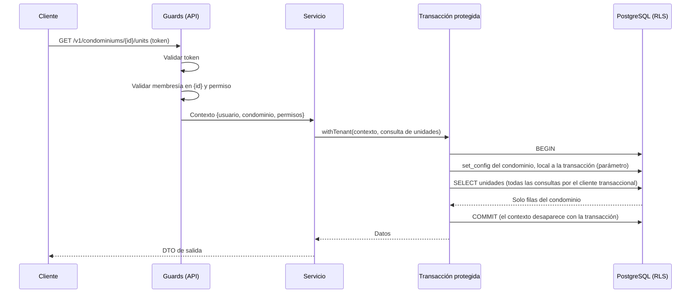

El condominio activo se transmite en la **URL** **[R] (`TD-05`, `PD-37`)**: es explícito, es visible en el contrato OpenAPI, evita enviar el tenant por cabeceras olvidadas y facilita las pruebas. La API valida la membresía del usuario para ese condominio en cada solicitud, **antes** de abrir la transacción protegida.

### 7.5. Pruebas de aislamiento (validación técnica y suite permanente)

Estas pruebas **se ejecutan primero como validación en T3 (F0)** y después **pasan a ser la suite permanente de CI** ([TESTING_STRATEGY](TESTING_STRATEGY.md#31-aislamiento-entre-condominios)). Deben ejecutarse **con el rol de aplicación**, nunca con el rol migrador, contra una instancia real de PostgreSQL de la misma versión mayor que la de producción.

**A. Aislamiento y accesos cruzados**

| ID | Caso | Resultado esperado |
|---|---|---|
| ISO-01 | El condominio A lee su tabla | Solo ve filas de A |
| ISO-02 | Con contexto A, pedir por identificador una fila de B | No existe (sin filas), sin distinguir de "no existe" |
| ISO-03 | Con contexto A, insertar una fila con `condominium_id` de B | Rechazada |
| ISO-04 | Con contexto A, modificar una fila de A cambiando su `condominium_id` a B | Rechazada |
| ISO-05 | Con contexto A, modificar o eliminar por identificador una fila de B | Cero filas afectadas |
| ISO-06 | Con contexto A, crear una fila de A que referencie un registro padre de B | Rechazada por la clave foránea compuesta |
| ISO-07 | Relaciones anidadas, conteos, agregaciones, `groupBy`, `createMany`, `upsert` y consultas SQL directas con contexto A | Solo datos de A, sin excepciones |

**B. Conexiones reutilizadas**

| ID | Caso | Resultado esperado |
|---|---|---|
| POOL-01 | *Pool* limitado a **una conexión**: ejecutar A, B, A y una operación sin contexto, en secuencia | Cada una ve solo lo suyo. La operación sin contexto no ve nada |
| POOL-02 | Muchas solicitudes **concurrentes** alternando A y B, con esperas aleatorias, con *pool* pequeño y con *pool* grande, durante un número alto de iteraciones | **Cero filtraciones** |
| POOL-03 | Tras `COMMIT`, el contexto **no persiste** en la conexión devuelta al *pool* | La siguiente solicitud no hereda el contexto |
| POOL-04 | Tras `ROLLBACK` por error de negocio, por excepción y por tiempo agotado | El contexto no persiste |
| POOL-05 | Transacción interrumpida o conexión reiniciada a mitad de un caso de uso | No queda contexto y no hay filtración |
| POOL-06 | Una operación fuera de la transacción protegida usando la misma conexión justo después de una protegida | No ve datos de ningún tenant |

**C. Contexto ausente o inválido**

| ID | Caso | Resultado esperado |
|---|---|---|
| CTX-01 | Consulta a una tabla de tenant **sin contexto** | Cero filas |
| CTX-02 | Escritura en una tabla de tenant **sin contexto** | Rechazada |
| CTX-03 | Contexto como **cadena vacía** y como **nulo** | Mismo resultado: sin acceso, sin error ambiguo |
| CTX-04 | Contexto con un valor **que no es UUID** o con texto malicioso | Rechazado o sin acceso. Sin inyección |
| CTX-05 | Código que accede a Prisma **sin** la transacción protegida | Sin datos por RLS. Y CI detecta el acceso directo (regla de lint o prueba) |

**D. Roles y catálogo**

| ID | Caso | Resultado esperado |
|---|---|---|
| ROL-01 | El rol de aplicación no es dueño de las tablas ni tiene `BYPASSRLS` | Verificado contra el catálogo |
| ROL-02 | Toda tabla de categoría **Tenant** (con `condominium_id`) tiene RLS habilitado y forzado, y políticas para lectura, inserción, modificación y eliminación | Verificado contra el catálogo |
| ROL-02b | Toda tabla de categoría **Enlace** tiene RLS habilitado y forzado, con la política de dos rutas de §7.1.1 y **sin** `DELETE` para el rol de aplicación | Verificado contra el catálogo |
| ROL-03 | No hay vistas ni funciones de seguridad definida sin revisión registrada | Verificado contra el catálogo |
| ROL-04 | Como contraste, repetir ISO-01 con el rol migrador | Se documenta que **sí** ve todo, confirmando por qué la aplicación no puede usar ese rol |
| ROL-05 | **Registro de clasificación:** cada tabla del esquema figura en una lista versionada con su categoría (Global, Tenant o Enlace). Una tabla ausente de la lista, o con una categoría que no corresponde a sus columnas y políticas, hace fallar la prueba | Verificado contra el catálogo y la lista. Impide crear tablas sin clasificar |

**E. Tablas de Enlace (Membresía, Vínculo usuario–persona, Acceso de soporte)**

| ID | Caso | Resultado esperado |
|---|---|---|
| ENL-01 | Con contexto de usuario `U1`, leer una tabla de Enlace | Solo las filas de `U1`, de cualquier condominio. Ninguna de otro usuario |
| ENL-02 | Con contexto de usuario, insertar, modificar o eliminar una fila de Enlace | Rechazado o cero filas afectadas. El contexto de usuario no escribe |
| ENL-03 | Con contexto de tenant `A`, leer una tabla de Enlace | Solo filas con `condominium_id` de `A` (incluidos los usuarios del propio condominio) |
| ENL-04 | Con contexto de tenant `A`, insertar una fila de Enlace con `condominium_id` de `B` | Rechazada |
| ENL-05 | Con contexto de tenant `A`, cambiar `condominium_id` o el usuario de una fila de Enlace existente | Rechazado |
| ENL-06 | Con contexto de tenant `A`, modificar o eliminar por identificador una fila de Enlace de `B` | Cero filas afectadas |
| ENL-07 | Sin contexto, con contexto vacío, nulo o que no sea UUID, en ambas rutas | Cero filas y escritura rechazada, sin error ambiguo |
| ENL-08 | Intentar fijar a la vez el contexto de usuario y el de tenant en una transacción, o fijar un usuario distinto del token | No es posible por construcción. Se verifica por prueba de la firma de las funciones y por intento directo |
| ENL-09 | Tras `COMMIT` o `ROLLBACK`, el contexto de usuario no persiste en la conexión (equivalente a `POOL-03` y `POOL-04`) | La siguiente solicitud no hereda el contexto |
| ENL-10 | Vínculo usuario–persona con una Persona de otro condominio | Rechazado por la clave foránea compuesta |
| ENL-11 | Membresía dada de baja (no vigente) | No permite abrir un contexto de tenant: la API la rechaza antes de la transacción y la fila queda como historial |
| ENL-12 | Acceso de soporte: sin acceso vigente, vencido o sin motivo | No se abre el contexto de tenant. Con acceso vigente, queda auditado con su motivo |
| ENL-13 | Con contexto de usuario, leer la tabla Usuario o las tablas de Tenant | Sin acceso a credenciales ni a datos de condominio, salvo la fila de Condominio propia de sus membresías vigentes |

**F. Flujos globales y rendimiento**

| ID | Caso | Resultado esperado |
|---|---|---|
| GLO-01 | Iniciar sesión, consultar membresías, planificador del worker | Funciona por el acceso global explícito |
| GLO-02 | El acceso global no puede usarse desde rutas de negocio de un tenant | Verificado por regla o prueba |
| GLO-03 | Una tarea del worker de un condominio no ve datos de otro | Cero filtraciones |
| RND-01 | Sobrecoste de la transacción protegida frente a una consulta sin ella, con el mismo caso de uso | Medido y registrado. El umbral aceptable lo define el equipo (`PD-50`) |
| RND-02 | Los planes de ejecución usan índices que empiezan por `condominium_id` | Verificado |

**Criterio de aprobación de T3:** todos los casos ISO, POOL, CTX, ROL, ENL y GLO pasan. Cero filtraciones en las pruebas de concurrencia. El sobrecoste medido es aceptable para el equipo. Un solo caso de aislamiento que falle **bloquea el inicio de F1**.

### 7.6. Plan alternativo si T3 falla (`PD-N4`)

No se decide hoy. Si T3 no puede garantizar aislamiento con RLS y Prisma, las opciones a evaluar en ese momento son:

1. Cambiar la forma de implementar el envoltorio transaccional (por ejemplo, usar otra técnica de Prisma o consultas directas dentro de la transacción protegida) y repetir T3.
2. Mantener el aislamiento **solo en la aplicación** (filtro obligatorio por tenant, pruebas automáticas y claves foráneas compuestas), dejando RLS como mejora posterior. **Esto aumenta `RK-09`** y requiere su aprobación expresa.

Cualquiera de las dos requiere su decisión antes de F1.

## 8. Autenticación **[R] (`TD-07`, `PD-39`)**

- **Contraseñas:** hash con argon2id. Política y bloqueo por intentos (`IAM-016`).
- **Token de acceso:** corto (minutos), firmado. No contiene permisos de negocio, solo identidad y sesión.
- **Token de renovación:** opaco, aleatorio, guardado **con hash** en base de datos, **rotativo** y con detección de reutilización (si se reutiliza uno ya rotado, se revoca toda la familia de sesión).
- **Web:** el token de renovación va en una cookie `HttpOnly`, `Secure`, `SameSite`. El token de acceso se mantiene en memoria. Protección CSRF para el endpoint de renovación.
- **Móviles:** ambos tokens en almacenamiento seguro del sistema. Desbloqueo biométrico opcional más adelante.
- **Sesiones y dispositivos:** cada sesión es revocable (`IAM-013`).
- **Verificación en dos pasos** para roles críticos: P2 (`IAM-015`).
- Identificador de acceso (correo, teléfono o documento) y recuperación: `PD-39`.

## 9. Autorización **[R]**

Cada solicitud pasa por capas, todas en la API. La política conceptual está en [SECURITY](SECURITY.md).

1. Autenticación (¿quién es?).
2. Membresía en el condominio de la URL.
3. **Permiso** del rol para la acción (`recurso:acción`). El catálogo de permisos es fijo en el código. Los roles son conjuntos de permisos por condominio (`PD-08`).
4. **Política de alcance**: relación con la unidad (propietario, inquilino, residente), autorización expresa, y propiedad del registro.
5. **Minimización de campos** en la respuesta según el perfil.
6. **RLS** como última barrera en base de datos (§7.3).

Implementación sugerida: *guards* y decorador de permisos de NestJS, más clases de política por recurso. CASL es una opción; se decide en F1.

## 10. Gestión de archivos **[R] (`TD-08`)**

- Almacenamiento de objetos **privado**, compatible con S3 (proveedor: `PD-40`).
- Clave de objeto con prefijo por condominio, nombres generados por el servidor.
- **Subida:** la app solicita la subida a la API → la API valida permiso, tipo y tamaño máximos → devuelve una URL firmada de corta vida → la app sube directamente al almacenamiento → la API confirma y el worker valida el contenido (tipo real, antivirus) → el archivo pasa a "disponible".
- **Descarga:** la API valida el permiso y entrega una URL firmada de corta vida. Nunca hay URLs públicas ni permanentes.
- Los metadatos (entidad asociada, autor, hora, tamaño, huella) están en base de datos. El permiso del archivo **hereda** el de la entidad a la que está adjunto.
- Retención y borrado: `PD-26`.

## 11. Notificaciones **[R] (`TD-09`)**

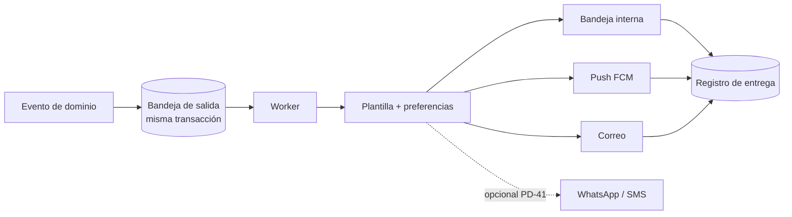

- Patrón *outbox*: el evento se guarda en la misma transacción que el cambio. Evita notificar algo que no se confirmó, o perder la notificación.
- El push **no contiene información sensible**. Es un aviso para que la app consulte a la API.
- La bandeja interna es la fuente de verdad: si el push falla (`RK-22`), el usuario igual ve el aviso al abrir la app.
- Cola de trabajos: **pendiente de spike técnico** entre `pg-boss` y BullMQ (`PD-43`, ver §4.2 y T5). El diseño de la bandeja de salida no depende de la elección.

## 12. Auditoría **[R] (`TD-14`)**

- Tabla de **solo anexado**: usuario, fecha, condominio, aplicación y dispositivo de origen, ID de solicitud, acción, entidad, estado anterior y posterior.
- Se escribe **en la misma transacción** que el cambio.
- El rol de la aplicación solo tiene `INSERT` y `SELECT` sobre auditoría. Un *trigger* impide `UPDATE` y `DELETE`. Ambos se crean en migraciones SQL manuales del backend (§7.2).
- Aparte de la auditoría técnica, las entidades financieras conservan su propio historial de estados y anulaciones.
- Cadena de huellas (*hash chain*) para detectar manipulación: opcional (P2).

## 13. Sincronización móvil

### 13.1. API

- Toda creación desde móvil lleva un **ID generado en el cliente** (UUID) y una cabecera `Idempotency-Key`. Repetir la solicitud devuelve el resultado original (`PLT-007`).
- Se guarda la **hora del dispositivo** y la **hora de recepción** en el servidor.
- Las operaciones de solo anexado (registrar visita, encomienda, novedad) minimizan los conflictos.
- Para cambios de estado (por ejemplo, entregar una encomienda), el servidor valida la transición. Si ya cambió, devuelve un conflicto explícito y la app lo muestra.

### 13.2. Cliente

Solo en la app de conserjería (`PLT-016`, `PLT-017`). Detalle en [CONCIERGE_APP](CONCIERGE_APP.md#4-operación-con-conectividad-limitada). La app de residentes **requiere conexión** y solo guarda en caché de lectura.

### 13.3. Compatibilidad con versiones antiguas **[R]**

- La API es compatible hacia atrás dentro de `/v1`.
- Política de versión mínima por aplicación (`PLT-009`).
- Cambios de base de datos con patrón *expand/contract* para poder desplegar la API sin romper apps antiguas.

## 14. Despliegues independientes **[R] (`TD-17`)**

| Componente | Artefacto | Despliegue | Notas |
|---|---|---|---|
| Migraciones | Paso de despliegue con el rol migrador | Una vez por despliegue, antes de la API y del worker | Nunca al arrancar la API ni el worker (`PD-N3`) |
| API | Imagen de contenedor | Continuo a staging, aprobado a producción | Escala independiente |
| Worker | Imagen de contenedor (misma imagen con otro comando, o imagen propia del mismo proyecto, ver T5) | Independiente de la API | Escala, reinicia y se detiene sin afectar a la API |
| Web | Archivos estáticos | CDN o alojamiento estático | Compatible con la versión de API vigente |
| resident-app | Binarios Android e iOS | Tiendas (canales de prueba en el piloto) | Versión mínima controlada por la API. Versión y firma propias |
| concierge-app | Binarios Android e iOS | Tiendas (canales de prueba en el piloto) | Ídem |

- Entornos: local, desarrollo, *staging* y producción. Datos de producción no se usan en otros entornos sin anonimizar.
- CI con `nx affected` para los proyectos de Nx. **Los trabajos de Flutter pueden invocar `flutter` directamente**; `run-commands` es opcional (§2.1).
- Hosting, región, proveedor de almacenamiento y host del repositorio: `PD-40`. La API y el worker acceden al almacenamiento y a las notificaciones mediante interfaces propias (`RK-26`).

## 15. Observabilidad y operación **[R]**

- Registros estructurados con ID de correlación por solicitud (`PLT-008`, `AUD-006`). El worker incluye el ID del evento o trabajo.
- Métricas de latencia, errores y trabajos.
- Alertas de errores de trabajos de importación y notificaciones.
- Copias de seguridad y restauración probada (`PLT-012`, `RK-24`).

## 16. Pruebas

Estrategia completa en [TESTING_STRATEGY](TESTING_STRATEGY.md). Puntos arquitectónicos: dominio puro testeable sin base de datos, pruebas de aislamiento de tenant (§7.5) y de matriz de permisos en CI, pruebas de contrato contra el documento OpenAPI y verificación de sincronización del contrato (§3.5). Las pruebas de viabilidad previas al desarrollo funcional están en la sección siguiente.

## 17. Pruebas técnicas obligatorias de F0

**Propósito.** Validar con las versiones reales las integraciones de mayor riesgo **antes de iniciar el desarrollo funcional**. Estas pruebas **no son desarrollo funcional**: usan proyectos de prueba mínimos y datos sintéticos, y sus resultados quedan documentados.

**Regla de puerta [R]:** **F1 no inicia hasta que las seis pruebas pasen o exista una decisión escrita y aprobada por usted para el caso en que una falle.** Cada resultado se registra como decisión técnica en [TECHNICAL_DECISIONS](TECHNICAL_DECISIONS.md). El tiempo de cada prueba se acota con el equipo (`PD-50`).

| ID | Prueba | Riesgo | Decisiones que cierra |
|---|---|---|---|
| T1 | Angular 22 con la versión de Nx elegida | `RK-18` | `PD-34`, `PD-45` |
| T2 | Flutter integrado en el monorepo | `RK-17` | `PD-34`, `PD-35`, `PD-N2` |
| T3 | Prisma con PostgreSQL RLS y transacciones (incluye las tablas de Enlace) | `RK-09`, `RK-16` | `PD-38`, `PD-N4`. Aporta evidencia a `PD-M1` |
| T4 | Generación de clientes TypeScript y Dart desde OpenAPI | `RK-19` | `PD-36`, `PD-N1` |
| T5 | Ejecución independiente de API y worker (incluye cola) | `RK-20`, `RK-22` | `PD-43` |
| T6 | Generación de temas desde tokens compartidos | `RK-17`, `RK-19` | `PD-N1` |

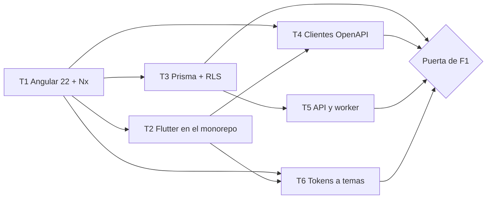

### T1 — Compatibilidad de Angular 22 con la versión de Nx elegida

- **Qué se valida:**
  - La versión de Nx que soporta Angular 22 según su documentación oficial **y** en la práctica, con un proyecto Angular real.
  - Compatibilidad de versiones de Node, pnpm, TypeScript, Angular, NestJS y Tailwind **en el mismo espacio de trabajo**.
  - Que `nx` pueda compilar, probar, analizar y servir la web, y compilar y probar un proyecto NestJS y una librería TypeScript de ejemplo.
  - Integración de Tailwind con Angular 22 y funcionamiento del ejecutor de pruebas que traiga Angular por defecto.
  - Reglas de *module boundaries* funcionando entre `apps/` y `libs/`.
  - `nx affected` identifica correctamente los proyectos afectados.
- **Criterios de aprobación:** el espacio de trabajo compila y las pruebas de ejemplo pasan con **versiones exactas fijadas** y registradas. Una regla de *boundaries* violada hace fallar el análisis.
- **Si falla:** elegir otra versión de Nx; si no es posible, evaluar mantener Angular fuera de Nx (con Nx solo para backend y librerías) o esperar la versión compatible. Requiere su aprobación porque Angular 22 está aprobado en el prompt.
- **Resultado a registrar:** versiones exactas de todas las herramientas.

### T2 — Integración de Flutter en el monorepo

- **Qué se valida:**
  - Que las dos apps Flutter se crean con la **estructura oficial** (`flutter create`) dentro de `apps/` sin alterarla.
  - **Independencia:** en una máquina **sin Node, pnpm ni Nx**, solo con el SDK de Flutter, cada app se analiza, se prueba y compila para Android (y para iOS en macOS).
  - Que Nx ejecuta esos mismos comandos mediante `run-commands`, y que `nx affected` marca las apps Flutter cuando cambia el contrato o un paquete de `packages/`.
  - Que **eliminar los `project.json` de Flutter no rompe nada** (prueba de independencia).
  - Que las dependencias por ruta hacia `packages/administralo_api_client` y `packages/administralo_design` funcionan en ambas apps, y que cada app mantiene su propio archivo de bloqueo de dependencias.
  - Que el IDE abre y ejecuta cada app Flutter por separado.
  - Que CI compila Android en Linux, y evalúa el costo de compilar iOS en macOS.
  - Que no hace falta Melos (confirmar con la lista de criterios de §2.1).
- **Criterios de aprobación:** un desarrollador Flutter puede trabajar **sin saber que Nx existe**. Nx solo añade ejecución y detección de afectados.
- **Si falla:** Flutter queda **totalmente fuera** de Nx (plan B de §2.1), con scripts de CI propios. Si las dependencias por ruta fallan, evaluar los *pub workspaces* o, en último caso, Melos, con justificación escrita. Los *pub workspaces* de Dart **no son un requisito** de la arquitectura: solo se evalúan si esta prueba falla.
- **Resultado a registrar:** versión de Flutter y de Dart, comandos de CI, decisión sobre `PD-N2`.

### T3 — Prisma con PostgreSQL RLS y transacciones

- **Qué se valida:** el diseño completo de §7.3 con **todos los casos de §7.5** (ISO, POOL, CTX, ROL, ENL, GLO, RND), incluidas las tres categorías de tablas de §7.1.1, usando las versiones reales de PostgreSQL y de Prisma, un esquema mínimo de prueba y los roles reales (migrador y aplicación).
- **Alcance adicional:**
  - Cómo se implementa la transacción protegida con Prisma Client y que las consultas usan efectivamente el cliente transaccional.
  - Límites de las transacciones interactivas.
  - Compatibilidad con un agrupador de conexiones externo, **solo si** el despliegue lo va a usar.
  - Flujo de migraciones: una base vacía se construye con el historial único, incluidas las migraciones SQL manuales de RLS y restricciones, y la verificación de catálogo pasa.
- **Criterios de aprobación:** los de §7.5, incluidos los casos `ENL` y la clasificación de tablas (`ROL-05`). Cero filtraciones. Un solo fallo de aislamiento bloquea F1.
- **Si falla:** plan alternativo de §7.6 (`PD-N4`). Requiere su aprobación.
- **Resultado a registrar:** patrón elegido para la transacción protegida y para `withUser`, límites encontrados, sobrecoste medido. Evidencia técnica para `PD-M1` (tratamiento de las tablas de Enlace), que **sigue pendiente de su aprobación**.

### T4 — Generación de clientes TypeScript y Dart desde OpenAPI

- **Qué se valida:**
  - Que la API genera el documento **sin base de datos** y de forma **determinista** (dos ejecuciones producen el mismo archivo, también entre macOS y Linux).
  - Que se generan los clientes TypeScript y Dart desde el documento versionado, con herramientas de versión fijada.
  - **Cobertura de tipos difíciles**: enumeraciones, campos opcionales y nulos, fechas, importes como cadena decimal, paginación, errores estándar, subida de archivos y respuestas con variantes.
  - Que los clientes compilan (`tsc`) y pasan el análisis (`dart analyze`), y que **funcionan contra una API real** de prueba.
  - Que el **trabajo `contract-sync` de §3.5 falla** cuando se cambia un DTO sin regenerar, cuando se edita a mano un archivo generado y cuando se introduce un cambio incompatible.
  - Que la separación entre código generado y fachada escrita a mano funciona.
  - Qué herramientas externas requiere cada generador (por ejemplo, entorno de Java) y que **quien trabaja solo en Flutter o Angular no las necesita**.
- **Criterios de aprobación:** generación reproducible en una sola orden, clientes utilizables sin edición manual, y las ocho verificaciones de §3.5 funcionando en CI.
- **Si falla:** probar otro generador. Si ninguno cumple para Dart, considerar un cliente Dart más delgado escrito a mano **sobre** el documento OpenAPI, lo que requiere su aprobación.
- **Resultado a registrar:** generadores y versiones elegidos, decisión sobre `PD-N1`.

### T5 — Ejecución independiente de API y worker

- **Qué se valida:**
  - Un solo proyecto de backend con **dos puntos de entrada** que comparten código de dominio.
  - La API arranca y atiende solicitudes **sin que el worker esté en ejecución**. El worker arranca y procesa **sin que la API esté en ejecución**.
  - Que el worker **no abre endpoints de negocio** y expone *health check* y métricas.
  - Un trabajo creado por la API a través de la **bandeja de salida** se procesa en el worker **con el contexto de tenant correcto** (usando la transacción protegida de T3) y sin ver datos de otro condominio.
  - **Dos workers simultáneos**: un trabajo se procesa **una sola vez**, y una tarea programada se ejecuta **una sola vez**.
  - Reintentos con espera creciente, registro de trabajos agotados, **idempotencia** al repetir un trabajo y **apagado ordenado**.
  - Reinicio del worker durante un trabajo: no se pierde ni se duplica.
  - Credenciales de base de datos propias del worker, con permisos mínimos.
  - Opciones de empaquetado: misma imagen con distinto comando o imagen propia.
- **Comparación de colas (spike de `PD-43`):** repetir los escenarios anteriores con `pg-boss` y con BullMQ, y comparar con los criterios de §4.2 (infraestructura adicional, coherencia con la bandeja de salida, respaldo y recuperación, programación, reintentos, visibilidad, convivencia con RLS, rendimiento con el volumen esperado y costo operativo).
- **Criterios de aprobación:** todos los escenarios pasan con al menos una de las dos colas, y existe una recomendación fundamentada.
- **Si falla:** evaluar la otra cola. Si ninguna cumple, revisar el diseño del worker con su aprobación.
- **Resultado a registrar:** cola recomendada (para su aprobación en `PD-43`) y forma de empaquetado.

### T6 — Generación de temas desde tokens compartidos

- **Qué se valida:**
  - Un conjunto mínimo de tokens en JSON genera: (a) la configuración de **Angular/Tailwind** con la versión de Tailwind elegida en T1, y (b) el **tema y constantes de Flutter** en `packages/administralo_design`.
  - **Cambiar un token** en el JSON cambia las dos salidas, y nada más.
  - La generación es **determinista** y produce lo mismo en macOS y en Linux.
  - Las salidas se consumen desde `apps/web` y desde las dos apps Flutter, y **ambas apps Flutter compilan sin ejecutar el generador** (porque la salida Dart está versionada).
  - CI falla si se edita a mano una salida generada o si el JSON cambia sin regenerar.
  - **No se comparte ningún componente visual** entre Angular y Flutter.
  - Herramienta de generación: evaluar una existente de tokens de diseño frente a un script propio pequeño, y fijar su versión.
- **Criterios de aprobación:** un cambio de token se refleja en web y en ambas apps móviles desde una sola edición, con verificación automática en CI.
- **Si falla:** simplificar el formato de tokens o usar un generador propio. Si no es posible mantener una sola fuente para ambos frameworks, se informa antes de continuar.
- **Resultado a registrar:** formato de tokens, herramienta y versión.

### Entregable de F0 respecto de estas pruebas

Un informe breve por prueba con: versiones exactas usadas, resultado, medidas (cuando apliquen), problemas encontrados y decisión técnica resultante. Se anexan como decisiones aprobadas en [TECHNICAL_DECISIONS](TECHNICAL_DECISIONS.md).

## 18. Decisiones pendientes que afectan a este documento

Todas las decisiones de la lista siguiente están registradas en [RISKS_AND_OPEN_DECISIONS](RISKS_AND_OPEN_DECISIONS.md), que es la **única fuente de su estado** (ver [README](README.md#reglas-para-mantener-la-documentación-sin-duplicaciones)): las `PD-nn` en la [sección 4](RISKS_AND_OPEN_DECISIONS.md#4-decisiones-pendientes-pd-) y las **PD-N** en la [sección 4.3](RISKS_AND_OPEN_DECISIONS.md#43-decisiones-pendientes-de-arquitectura-pd-n). Todas están **pendientes**. Las decisiones de modelado `PD-M` están en la [sección 4.4](RISKS_AND_OPEN_DECISIONS.md#44-decisiones-pendientes-de-modelado-pd-m). La tabla resume lo que afecta a este documento.

| ID | Decisión | Recomendación | Se resuelve con |
|---|---|---|---|
| PD-34 | Nx para Angular, NestJS y librerías TS. Flutter independiente, con `run-commands` opcional | Aprobar §2.1 | T1, T2 |
| PD-35 | Estructura con `libs/` (TS) y `packages/` (Dart) | Aprobar §2.2 | T2 |
| PD-36 | OpenAPI *code-first* con clientes TS y Dart generados | Aprobar §3 | T4 |
| PD-37 | Tenant explícito en la URL | Aprobar §7.4 | — |
| PD-38 | RLS como segunda capa desde F1 | Aprobar §7.3, condicionado a T3 | T3 |
| PD-40 | Hosting, almacenamiento, CI/CD y repositorio | Decidir en F0 | — |
| PD-43 | Cola de trabajos: `pg-boss` o BullMQ | **Sin recomendación hasta el spike** | T5 |
| PD-45 | Biblioteca de componentes de Angular | Decidir en F0 | T1 |
| PD-47 | Cuentas de Apple y Google | Gestionar en F0 | T2 |
| PD-50 | Equipo, capacidad, tiempos de las pruebas y umbrales de rendimiento | Informar | — |
| **PD-N1** | Versionar en el repositorio los clientes generados (TS y Dart) y la salida de tokens | Versionar (§3.1) | T4, T6 |
| **PD-N2** | Paquetes Dart por dependencias por ruta, **sin Melos ni pub workspaces** | Aprobar §2.1 | T2 |
| **PD-N3** | Migraciones aplicadas por un paso de despliegue con rol migrador, nunca al arrancar API ni worker | Aprobar §7.2 | — |
| **PD-N4** | Plan alternativo si T3 falla | Decidir solo si T3 falla | T3 |
| `PD-M1` | Membresía para todo usuario y tratamiento de las tablas de Enlace frente a RLS (§7.1.1) | Ver [DATA_MODEL §7](DATA_MODEL.md#7-decisiones-pendientes-de-modelado). Pendiente | T3 aporta evidencia técnica |

## 19. Historial de revisiones

| Revisión | Cambios |
|---|---|
| 1 | Primera propuesta de arquitectura |
| 2 | Nx limitado a Angular, NestJS y TS, con Flutter independiente y sin Melos (§2.1). Prisma Client solo en el backend y migraciones, incluidas las SQL manuales, a cargo del backend (§7.2). RLS con Prisma y conexiones reutilizables profundizado, con matriz de pruebas de aislamiento y sin asumir que funciona (§7.3 a §7.6). Worker como proceso independiente con responsabilidades definidas y cola pendiente de spike (§4.2). Proceso reproducible de OpenAPI con verificación de sincronización en CI (§3). Tokens JSON como fuente única, sin compartir componentes visuales (§2.5). Separación `libs/` TypeScript y `packages/` Dart conservada (§2.2). Seis pruebas técnicas obligatorias de F0 (§17) y decisiones pendientes (§18) |
| 3 | Sincronización documental. Tres categorías de tablas: Global, Tenant y Enlace, con política de RLS propia para las de Enlace, puntos de entrada `withUser` y `withTenant` y alta de condominio sin `BYPASSRLS` (§7.1.1). Ajustes de §7.1, §7.3 y §7.5 (casos `ENL`, `ROL-02b` y `ROL-05`) y del alcance y criterio de aprobación de T3. Aclaración de que los *pub workspaces* de Dart no son un requisito (T2). Las decisiones `PD-N` y `PD-M` pasan a estar registradas en RISKS (§18). Sin cambios en el stack ni en decisiones aprobadas |
````

## Documento: `docs/DATA_MODEL.md`

````markdown
# Modelo de datos conceptual

> Entregable 5 del [prompt maestro](../PROMPT_MAESTRO.md). **Revisión 2** (ver [cambios](#6-cambios-respecto-a-la-revisión-1)). Es un modelo **conceptual**: identifica entidades, relaciones y cardinalidades. **No es el esquema definitivo de Prisma** y no define columnas, tipos, índices ni migraciones. El esquema se diseña en cada fase, después de aprobar las reglas de negocio (ver [roadmap](DEVELOPMENT_ROADMAP.md)).
>
> Los modelos internos de Prisma no se exponen a las aplicaciones cliente. Los clientes trabajan con DTO del contrato OpenAPI ([ARCHITECTURE](ARCHITECTURE.md#3-contrato-de-api-y-generación-de-clientes)).
>
> **Etiquetas de origen:** **[C]** confirmado en el prompt maestro · **[Rev]** solicitado por usted en la revisión de este modelo (se acepta como requisito de modelado, pero las **reglas de negocio** asociadas siguen siendo `PD-`) · **[R]** recomendación · **[PD]** decisión pendiente. Los IDs `PD-M1` a `PD-M16` están **registrados, con estado Pendiente**, en [RISKS_AND_OPEN_DECISIONS §4.4](RISKS_AND_OPEN_DECISIONS.md#44-decisiones-pendientes-de-modelado-pd-m), que es la fuente oficial de su estado (ver [sección 7](#7-decisiones-pendientes-de-modelado)).
>
> **Este documento no decide contabilidad de doble partida.** El modelo propuesto es compatible con partida simple vinculada o con doble partida y deja la decisión en `PD-46` ([TD-18](TECHNICAL_DECISIONS.md#td-18--modelo-financiero-interno)).

## 1. Principios de modelado

| # | Principio | Origen |
|---|---|---|
| P1 | **Un solo registro por hecho económico.** El *dinero que entra o sale* es **un solo** Movimiento financiero. La *extinción de una deuda* es una Aplicación. El *significado de negocio* (quién pagó, qué documento) vive en Pago o en Documento de gasto. Estos registros se **vinculan**, nunca se duplican. Los reportes de ingresos y egresos se calculan **solo** sobre Movimientos. | §1 |
| P2 | **No hay borrado físico de datos financieros.** Los errores se corrigen con anulación, reverso, ajuste o reapertura, siempre como **registros nuevos** con motivo, usuario y referencia al original. | §1 |
| P3 | **Historial conservado.** Las relaciones y valores con vigencia (relación persona–unidad, titularidad, participación, rol, cargo de junta, instalación de medidor) guardan inicio y fin en lugar de sobrescribirse. | §1 |
| P4 | **Todo dato de condominio pertenece a un condominio** y las referencias internas se mantienen dentro del mismo condominio. Las tablas se clasifican por **ámbito**: *Global* (sin condominio), *Tenant* (con condominio y aislamiento por RLS) y *Enlace* (relaciona una cuenta global con un condominio; ver `PD-M1`). | §1, §8 |
| P5 | **Todo lo importado conserva su origen**: lote, archivo, hoja, fila y fecha de corte. | §7 |
| P6 | **Los saldos de apertura no son ingresos, gastos, pagos ni movimientos.** Y **no se reconstruyen operaciones históricas** que no existan en los archivos. | §7 |
| P7 | **Una persona no es un usuario.** La **Persona** es un registro **dentro de un condominio**. El **Usuario** es una cuenta global. Una persona puede no tener usuario; un usuario puede estar vinculado a distintas Personas en distintos condominios. | `SUP-04`, **[Rev]** |
| P8 | **Importes con moneda explícita** y aritmética decimal. | [TD-13](TECHNICAL_DECISIONS.md#td-13--dinero-fechas-e-identificadores) |
| P9 | **Lo calculado es reproducible.** Saldos, consumos y saldos de fondos deben poder recalcularse desde sus orígenes. Si se materializan por rendimiento, se verifican contra el cálculo. | `RK-02` |
| P10 | **Evidencias y datos numéricos van separados.** La fotografía de un medidor es un documento adjunto y no reemplaza la lectura. | §6.6 |
| P11 | **Las operaciones móviles llevan ID de cliente** y se registran como solicitudes procesadas para idempotencia. | §10, **[Rev]** |
| P12 | **Todo valor versionado cita su fuente documental**: un Documento, una Decisión o una Referencia de origen de migración. | **[Rev]** |
| P13 | **No confundir** concepto presupuestario, fondo, cuenta financiera y saldo por cobrar (ver [sección 3](#3-distinciones-clave)). | **[Rev]** |
| P14 | **Cada etapa del dinero es un hecho distinto**: comprobante enviado, pago validado, movimiento financiero y línea de extracto bancario. | §5.2, **[Rev]** |
| P15 | **No se presupone doble partida.** | **[Rev]**, `PD-46` |
| P16 | **Integridad entre ámbitos.** Un adjunto y su destino, una aplicación y sus partes, una asignación y sus partes pertenecen al mismo condominio. | §8, **[R]** |

## 2. Entidades por contexto

**Columnas:** `Cambio` respecto de la revisión 1 (Nueva, Redefinida, Sin cambios). `Ámbito`: Global, Tenant, Enlace, Raíz (el Condominio) o Mixto (catálogos). `Fase`: primera fase en la que aparece. `Origen`: ver etiquetas. `Funcionalidades`: IDs de la [matriz](FUNCTIONAL_REQUIREMENTS.md); cada entidad tiene al menos una funcionalidad (las 14 que no la tenían se cubrieron en la sincronización documental, ver [sección 8](#8-trazabilidad-con-la-matriz-y-la-arquitectura)). Las entidades de ámbito Derivado no tienen funcionalidad propia. Las cardinalidades se escriben `1`, `0..1`, `N`, `0..N`.

### 2.1. Identidad y acceso

| Entidad | Cambio | Descripción | Relaciones y cardinalidad | Ámbito | Fase | Origen | Funcionalidades |
|---|---|---|---|---|---|---|---|
| Usuario | Redefinida | **Cuenta global de acceso.** Una cuenta puede acceder a varios condominios. Sus datos de acceso no son visibles para otros condominios. | 0..N Membresías · 0..N Vínculos usuario–persona · 0..N Sesiones | Global | F1 | C§8, Rev | IAM-001, IAM-005 |
| Sesión | Sin cambios | Sesión de acceso revocable con token de renovación rotativo. | N:1 Usuario · N:1 Dispositivo | Global | F1 | R | IAM-002, IAM-013 |
| Dispositivo | Sin cambios | Dispositivo móvil o navegador registrado, con token de notificaciones push. | N:1 Usuario | Global | F5 | R | PLT-005, IAM-013 |
| Membresía | Redefinida | **Acceso de un usuario a un condominio.** Es el punto donde la API valida el condominio de la URL en cada solicitud. Máximo una vigente por usuario y condominio. | N:1 Usuario · N:1 Condominio · 0..N Asignaciones de rol | Enlace | F1 | C§8, PD-M1 | IAM-005, IAM-014 |
| Vínculo usuario–persona | **Nueva** | **Enlace verificado entre una cuenta y la Persona que la representa en un condominio**, con vigencia e historial. Un usuario puede tener vínculos con Personas **de distintos condominios**. Una Persona tiene como máximo un vínculo vigente. Se establece por invitación o activación, no por coincidencia automática de documento. | N:1 Usuario · N:1 Persona · N:1 Condominio | Enlace | F1 | Rev, R, PD-39 | IAM-001 |
| Rol | Sin cambios | Conjunto de permisos con nombre. Los roles base son globales. Si se permiten roles personalizados (`PD-08`), serán por condominio. | N:M Permiso · 0..N Asignaciones | Mixto | F1 | C§8, PD-08 | IAM-006, IAM-009 |
| Permiso | Sin cambios | Capacidad atómica `recurso:acción` del catálogo. | N:M Rol | Global | F1 | C§8 | IAM-007 |
| Asignación de rol | Redefinida | Rol asignado a una Membresía con vigencia. **Puede originarse en un Cargo de junta** y cerrarse con él. | N:1 Membresía · N:1 Rol · 0..1 Cargo de junta (origen) | Tenant | F1 | C§8, PD-33 | IAM-008, IAM-012 |
| Autorización expresa | Redefinida | Permiso, otorgado por una decisión concreta, para que una **Persona** vea información de **otra unidad**, con alcance y vigencia. | N:1 Persona · N:1 Unidad · 0..1 Aprobación | Tenant | F5 | C§5.2, PD-24 | IAM-011 |

### 2.2. Organización y configuración

| Entidad | Cambio | Descripción | Relaciones y cardinalidad | Ámbito | Fase | Origen | Funcionalidades |
|---|---|---|---|---|---|---|---|
| Condominio | Sin cambios | Tenant. Unidad de aislamiento. | 0..N de casi todo lo demás | Raíz | F1 | C§1 | COND-001, PLT-010 |
| Edificio, bloque o sector | Redefinida | Agrupación física opcional (edificio, torre, bloque o sector). **Una Unidad puede no pertenecer a ninguno** (por ejemplo, casas). | N:1 Condominio · 0..N Unidades | Tenant | F1 | C§4.1, Rev | COND-002 |
| Ubicación / área común | Sin cambios | Lugar para evidencias, incidencias y reservas. | N:1 Condominio · 0..1 Edificio | Tenant | F1 | C§6.7 | COND-005 |
| Parámetro de configuración | Sin cambios | Configuración particular del condominio. | N:1 Condominio | Tenant | F1 | C§1 | CFG-001, CFG-002 |
| Catálogo y elemento | Sin cambios | Catálogos configurables (tipos de documento, categorías, mensajerías, cargos de junta, motivos de diferencia). | N:1 Condominio o plataforma | Mixto | F1 | C§1 | CFG-007 |

### 2.3. Unidades, personas y titularidad

| Entidad | Cambio | Descripción | Relaciones y cardinalidad | Ámbito | Fase | Origen | Funcionalidades |
|---|---|---|---|---|---|---|---|
| Unidad | Redefinida | **Unidad inmobiliaria individualizada** con código único por condominio. Un estacionamiento, un depósito o un local es una Unidad por derecho propio. No es un dato de otra unidad. | N:1 Tipo de unidad · 0..1 Edificio · N:1 Condominio | Tenant | F1 | C§4.1, Rev | COND-003 |
| Tipo de unidad | **Nueva** | **Catálogo configurable** que clasifica las unidades. Base solicitada: departamento, casa, estacionamiento, depósito y local. Puede indicar si participa en gastos comunes (regla en `PD-02`/`PD-28`). | 1:N Unidades | Mixto | F1 | Rev, PD-28 | COND-003 |
| Relación entre unidades | **Nueva** | **Vínculo opcional, dirigido y con vigencia entre dos unidades** (por ejemplo, un estacionamiento anexo a un departamento). **No implica** titularidad ni cobro compartidos: esos efectos, si existen, son reglas (`PD-M5`). Con fuente documental. | N:1 Unidad origen · N:1 Unidad destino · 0..1 Fuente | Tenant | F1 | Rev, PD-M5 | COND-007 |
| Persona | Redefinida | **Registro de una persona natural o jurídica dentro de un condominio.** La misma persona en dos condominios son dos registros, sin compartir datos entre ellos. Puede existir sin usuario. | N:1 Condominio · 0..N Vínculos usuario–persona (≤ 1 vigente) · 0..N Relaciones | Tenant | F1 | C§4.2, Rev, PD-M2 | PER-001 |
| Relación persona–unidad | Redefinida | **Supertipo.** Relación de una persona con una unidad: propietario, inquilino, residente u otra (`PD-24`), con vigencia y fuente. Es la base de la autorización por unidad. | N:1 Persona · N:1 Unidad · 0..1 Titularidad | Tenant | F1 | C§4.2, C§5.1 | PER-002, PER-004 |
| Titularidad | **Nueva** | **Especialización para la propiedad.** Permite **varios propietarios por unidad**. Lleva las versiones del porcentaje de titularidad. | 1:1 Relación persona–unidad (tipo propietario) · 1:N Porcentajes de titularidad | Tenant | F1 | Rev, PD-24, PD-M3 | PER-003 |
| Porcentaje de titularidad | **Nueva** | **Parte de la propiedad de la unidad que corresponde a un titular**, con vigencia y fuente documental (escritura, acta, otra). **Es distinto de la participación en gastos comunes.** | N:1 Titularidad · 0..1 Fuente (Documento o Decisión) | Tenant | F1 | Rev, P12 | PER-014 |
| Esquema de reparto | **Nueva** | **Base de reparto de gastos comunes** (por ejemplo "participación general"). Si existe uno solo o varios, por concepto o fondo, es `PD-M4`. | 1:N Participaciones · 0..N Conceptos de cobro · 0..N Emisiones de cuotas | Tenant | F1 | Rev, PD-02, PD-M4 | COND-004 |
| Participación en gastos comunes | Redefinida | **Valor de reparto de una unidad bajo un esquema**, con vigencia y fuente documental. Antes era un dato de la Unidad. **Cada Cuota emitida referencia la versión aplicada**, de modo que el historial de porcentajes usados se conserva. | N:1 Unidad · N:1 Esquema · 0..1 Fuente | Tenant | F1 | C§7, Rev, P12 | COND-004, MIG-005 |
| Responsable de pago | Redefinida | **Persona a quien se factura una unidad**, con vigencia. Puede diferir de los titulares (`PD-24`). Un Cargo guarda el responsable vigente al emitirse. | N:1 Unidad · N:1 Persona | Tenant | F1 | C§7, PD-24 | PER-003 |
| Persona autorizada | Sin cambios | Persona con autorización vigente para una unidad (ingreso o recojo). `PD-18` | N:1 Unidad | Tenant | F6 | C§6.2 | PER-006, VIS-011 |
| Vehículo | Sin cambios | Vehículo asociado a una unidad y, opcionalmente, a una Persona. | N:1 Unidad · 0..1 Persona | Tenant | F1 | C§4.3 | VEH-001 |
| Personal asociado | Sin cambios | Personal asociado a una unidad. `PD-24` | N:1 Unidad | Tenant | F1 | C§4.3 | VEH-002 |

### 2.4. Presupuesto, cargos por cobrar y cobranza

> **Núcleo de cobranza.** La entidad central es el **Cargo por cobrar** (evaluación y alternativas en la [sección 3.2](#32-evaluación-de-la-entidad-central-de-cobranza)). Todo lo cobrable se expresa como Cargo, sea cuota, consumo, venta, deuda inicial migrada o ajuste. Lo que **se aplica** a un cargo es un Pago o un Crédito a favor, mediante una Aplicación.

| Entidad | Cambio | Descripción | Relaciones y cardinalidad | Ámbito | Fase | Origen | Funcionalidades |
|---|---|---|---|---|---|---|---|
| Concepto presupuestario | Redefinida | **Clasificación de ingresos y egresos previstos y ejecutados.** No es un fondo ni una cuenta. Puede asociarse opcionalmente a un Fondo de destino (`PD-M10`). | 0..N Líneas de presupuesto · 0..N Líneas de gasto · 0..N Conceptos de cobro · 0..1 Fondo | Tenant | F2 | C§4.4, C§7 | PRE-001 |
| Presupuesto | Sin cambios | Presupuesto de un periodo, con versiones y líneas por concepto. La aprobación es una Aprobación (`PD-10`). | 1:N Versiones · 1:N Líneas · 0..N Aprobaciones | Tenant | F2 | C§4.4, PD-10 | PRE-002, PRE-003 |
| Concepto de cobro | Redefinida | **Tipo de cobro que se factura.** Se relaciona con un Concepto presupuestario de ingreso y, para cuotas, con un Esquema de reparto. | 1:N Cargos · N:0..1 Concepto presupuestario · N:0..1 Esquema | Tenant | F2 | C§4.5, PD-11 | COB-001 |
| Periodo | Sin cambios | Periodo contable o de cobro. `PD-09` | 1:N Cargos | Tenant | F2 | PD-09 | COB-019 |
| Emisión de cuotas | **Nueva** | **Corrida que genera los Cargos ordinarios de un periodo** a partir de un presupuesto y un esquema. Registra los parámetros usados y la versión de participación aplicada. Repetirla no duplica. | N:1 Presupuesto · N:1 Esquema · 1:N Cargos | Tenant | F2 | Rev, PD-02 | COB-002, PRE-004 |
| Cargo por cobrar | **Nueva (central)** | **Importe exigible a una unidad** por un concepto y periodo, con el responsable vigente al emitirse. **Origen**: cuota ordinaria (Emisión de cuotas), consumo (Línea de distribución), cargo adicional o venta, deuda inicial migrada (Saldo de apertura) y, si existiera, mora o interés (`PD-04`). Puede ser **detallado** o **consolidado** (deuda migrada sin detalle). **No se edita ni se elimina**: se ajusta o se anula. Su saldo se deriva. | N:1 Unidad · N:1 Concepto · N:1 Periodo · 1 Origen · 0..N Líneas de recibo · 0..N Aplicaciones · 0..N Ajustes | Tenant | F2 | Rev, PD-M6 | COB-002, CAR-002, SUM-008, MIG-008, MIG-009 |
| Cargo adicional o venta | Redefinida | **Evento comercial** (motivo, concepto, documento) que origina uno o más Cargos. No es la deuda. `PD-13` | 1:N Cargos · N:1 Unidad o Persona | Tenant | F4 | C§4.11, PD-13 | CAR-002 |
| Ajuste de cargo | **Nueva** | **Corrección con motivo que aumenta o reduce un Cargo**, referenciando el original. Puede requerir Aprobación (`PD-08`). | N:1 Cargo · 0..1 Aprobación | Tenant | F2 | C§1, Rev | COB-020 |
| Recibo | Redefinida | **Documento de cobro que agrupa Cargos.** **No es la deuda** (`PD-M6`). Inmutable tras emitirse. Estados: emitido, anulado. `PD-06` | 1:N Líneas de recibo | Tenant | F2 | C§4.5, PD-06 | COB-003 |
| Línea de recibo | **Nueva** | Asocia un Cargo (o parte de su saldo) con un Recibo. | N:1 Recibo · N:1 Cargo | Tenant | F2 | R | COB-003 |
| Comprobante de pago enviado | Redefinida | **Evidencia enviada por un residente.** No tiene efecto financiero (§5.2). Al validarse, origina un Pago o se vincula a uno existente. `PD-07` | N:1 Unidad · N:1 Documento (adjunto) · 0..1 Pago | Tenant | F5 | C§5.2, PD-07 | COB-016, COB-011 |
| Pago | Redefinida | **Cobro recibido de un deudor**: quién, medio (efectivo, transferencia, depósito u otro), fecha e importe. Estados indicativos: registrado, validado, rechazado, anulado (`PD-07`). **Solo un Pago validado afecta saldos.** No es un movimiento. | 0..1 Comprobante · 0..N Aplicaciones · 0..N Vínculos con Movimiento · 0..N Créditos a favor generados | Tenant | F2 | C§4.5, C§5.2, PD-07 | COB-004, COB-005 |
| Aplicación de cobranza | Redefinida | **Asigna un importe de una fuente (Pago o Crédito a favor) a un Cargo.** Admite parciales, varias por pago y varias por cargo. Se revierte con un registro compensatorio. `PD-03` | N:1 Fuente (Pago o Crédito) · N:1 Cargo | Tenant | F2 | C§4, PD-03 | COB-004, COB-005 |
| Crédito a favor | Redefinida | **Importe a favor de una unidad o persona**, originado por excedente de un Pago, por apertura o por ajuste. Se aplica a Cargos futuros con una Aplicación. Antes "saldo a favor". `PD-M7` | N:1 Origen · 0..N Aplicaciones | Tenant | F2 | C§5.2, PD-03, PD-M7 | COB-007, MIG-010 |
| Saldo por concepto / por cobrar | Derivado | **No es una entidad.** Se calcula desde Cargos, Ajustes y Aplicaciones (P9). La "cuenta por cobrar" de una unidad es esta vista. | — | — | F2 | C§4 | COB-006, COB-008 |
| Anulación / reverso | Sin cambios | Reverso con motivo de un documento financiero. Referencia al original. | N:1 Original | Tenant | F2 | C§1 | COB-009, AUD-004 |

### 2.5. Tesorería, fondos y conciliación

| Entidad | Cambio | Descripción | Relaciones y cardinalidad | Ámbito | Fase | Origen | Funcionalidades |
|---|---|---|---|---|---|---|---|
| Cuenta financiera | **Nueva (supertipo)** | **Lugar donde está el dinero del condominio**: cuenta bancaria o caja. Con moneda propia. Otros tipos solo si se aprueban (`PD-M9`). | 1:N Movimientos · 0..1 Cuenta bancaria o Caja | Tenant | F2 | Rev, PD-M9 | BAN-001 |
| Cuenta bancaria | Redefinida | Especialización: banco, tipo y datos de la cuenta. Tiene perfiles de formato de extracto y, si aplica, convenio de cobranza. | 1:1 Cuenta financiera · 0..N Perfiles · 0..N Importaciones · 0..N Líneas | Tenant | F2 | C§4.6 | BAN-001, BAN-002, BAN-005 |
| Caja | **Nueva** | Especialización: efectivo en custodia, con responsable. **No tiene extracto bancario.** | 1:1 Cuenta financiera · N:1 Persona responsable | Tenant | F2 | Rev | BAN-001 |
| Movimiento financiero | Redefinida | **Único registro de la entrada o salida de dinero de una Cuenta financiera.** Estados indicativos: **pendiente de identificación**, identificado y anulado. Puede crearse desde una línea de extracto sin contraparte conocida. | N:1 Cuenta financiera · 0..N Vínculos · 0..N Asignaciones de conciliación · 0..1 Transferencia | Tenant | F2 | C§1, C§4.6, Rev | BAN-003, CNC-006, CNC-007 |
| Transferencia entre cuentas | **Nueva en el modelo** (ya existe `BAN-006`) | **Un solo hecho con dos movimientos**, uno de salida y otro de entrada, en cuentas distintas (por ejemplo, depósito de efectivo de la Caja al banco). Cada tramo se concilia por separado. No es ingreso ni gasto. `PD-M8` | 1:2 Movimientos | Tenant | F2 | R, PD-M8 | BAN-006 |
| Vínculo movimiento–hecho | Redefinida | **Relaciona parte o todo el importe de un Movimiento con un hecho**: Pago de cobranza, Pago a proveedor, Préstamo, Anticipo, Depósito recuperable, Recuperación o Devolución. Permite **depósitos agrupados** (un movimiento, varios pagos) y pagos cubiertos por varios movimientos. | N:1 Movimiento · N:1 Hecho (tipado) | Tenant | F2 | C§1, Rev | BAN-004 |
| Fondo | **Nueva** | **Destino acumulado de recursos con un propósito** (por ejemplo, reserva), **si existe** (`PD-11`). **No es una cuenta ni un concepto presupuestario.** Su saldo se deriva (P9). | 0..N Conceptos presupuestarios · 0..N Reasignaciones | Tenant | F2 | Rev, PD-11, PD-M10 | PRE-006 |
| Reasignación entre fondos | **Nueva** | Traslado interno de recursos entre fondos, con motivo y Aprobación, **sin mover dinero entre cuentas**. `PD-M10` | N:1 Fondo origen · N:1 Fondo destino · 0..1 Aprobación | Tenant | F2 | Rev, PD-M10 | PRE-007 |
| Perfil de formato de extracto | Sin cambios | Formato de CSV/Excel de un banco. `PD-16` | N:1 Cuenta bancaria | Tenant | F3 | C§12, PD-16 | CNC-001 |
| Importación de extracto | Redefinida | **Carga de un archivo de extracto** (antes "Extracto"): archivo, huella, usuario, cuenta y rango. Una importación repetida es detectable. | N:1 Cuenta bancaria · 1:N Resultados de línea | Tenant | F3 | C§12, Rev | CNC-001, CNC-002 |
| Línea de extracto | Redefinida | **Registro del banco con identidad estable por cuenta.** Importar de nuevo, o importar periodos solapados, **no la duplica**. | N:1 Cuenta bancaria · 0..N Resultados · 0..N Asignaciones | Tenant | F3 | C§12, Rev | CNC-002 |
| Resultado de importación de línea | **Nueva** | Registra qué ocurrió con cada línea en cada importación: nueva, ya existente o rechazada. | N:1 Importación · N:1 Línea (si no se rechazó) | Tenant | F3 | Rev | CNC-001, CNC-002 |
| Asignación de conciliación | **Nueva** | **Entidad intermedia** que asocia **parte o todo** de una Línea con **parte o todo** de un Movimiento, con un importe asignado. Relación N:M. Estado: vigente o revertida (nunca se borra). | N:1 Línea · N:1 Movimiento · 0..N Diferencias | Tenant | F3 | Rev, PD-16 | CNC-003, CNC-005, CNC-009 |
| Diferencia de conciliación | **Nueva** | **Diferencia justificada** entre lo asignado y la línea, con importe, motivo del catálogo y Aprobación. **Evita forzar igualdad de importes.** Puede resolverse con un Movimiento propio (por ejemplo, un cargo bancario). `PD-16` | N:1 Asignación o Línea · 0..1 Aprobación · 0..1 Movimiento | Tenant | F3 | Rev, PD-16 | CNC-005 |
| Periodo de conciliación | **Nueva** | Cuenta bancaria por periodo, con estado abierto o cerrado. | N:1 Cuenta bancaria · 0..N Cierres | Tenant | F3 | C§4.7, Rev | CNC-008 |
| Cierre de conciliación | **Nueva** | **Acto de cierre**, con una fotografía del saldo del extracto, del saldo del sistema, de pendientes y de diferencias justificadas. No se modifica. | N:1 Periodo · 0..1 Aprobación · 0..N Reaperturas | Tenant | F3 | Rev, PD-09 | CNC-008 |
| Reapertura de conciliación | **Nueva** | **Acto con motivo y Aprobación** que reabre un cierre. Conserva el cierre original. `PD-M14` | N:1 Cierre · 0..1 Aprobación | Tenant | F3 | Rev, PD-M14 | CNC-011 |
| Convenio BCP | Sin cambios | Configuración de cobranza con el banco. `PD-15` | N:1 Cuenta bancaria | Tenant | F4 | C§4.13, PD-15 | BCP-001 |
| Archivo de cobranza BCP | Sin cambios | Archivo generado, con huella y trazabilidad. Referencia los Recibos o Cargos incluidos. `PD-15` | N:1 Convenio · N:M Recibos | Tenant | F4 | C§4.13, PD-15 | BCP-002, BCP-003 |

### 2.6. Proveedores, documentos de gasto y obligaciones

> **Se elimina la relación obligatoria 1:1 entre Gasto y Obligación.** El **Documento de gasto** registra lo facturado y su clasificación. La **Obligación por pagar** es el importe exigible. Un documento puede generar **varias** obligaciones (por ejemplo, vencimientos) o **ninguna** (pagado al contado). Las notas de crédito y débito son documentos que **ajustan** obligaciones. Ver el [flujo de la sección 3.3](#33-cadena-del-hecho-económico-en-cobranza-y-pagos).

| Entidad | Cambio | Descripción | Relaciones y cardinalidad | Ámbito | Fase | Origen | Funcionalidades |
|---|---|---|---|---|---|---|---|
| Proveedor | Sin cambios | Proveedor con RUC. | N:1 Condominio · 0..N Contratos · 0..N Documentos de gasto | Tenant | F2 | C§4.8 | PRV-001 |
| Contrato | Sin cambios | Contrato con vigencia y documentos. | N:1 Proveedor | Tenant | F2 | C§7 | PRV-002 |
| Documento de gasto | Redefinida | **Documento del proveedor** (antes "Gasto"): factura, boleta, recibo, **nota de crédito**, **nota de débito** u otro (`PD-06`). Una nota referencia el documento que corrige. **No crea movimiento.** | N:1 Proveedor · 0..1 Documento referenciado · 1:N Líneas de gasto · 0..N Obligaciones · 0..N Ciclos de consumo | Tenant | F2 | C§4.9, Rev, PD-06, PD-M12 | GAS-001 |
| Línea de gasto | **Nueva** | **Clasificación de parte del documento por Concepto presupuestario**, para permitir varias categorías por documento. | N:1 Documento · N:1 Concepto presupuestario | Tenant | F2 | C§7, Rev | GAS-009 |
| Obligación por pagar | Redefinida | **Importe exigible por un proveedor**, con vencimiento. Su origen es un Documento de gasto o un Saldo de apertura. Su saldo se deriva. | N:1 Proveedor · 0..1 Documento · 0..N Ajustes · 0..N Aplicaciones | Tenant | F2 | C§4.9, C§7 | GAS-002, MIG-011 |
| Ajuste de obligación | **Nueva** | **Modifica el saldo de una Obligación** por nota de crédito, nota de débito u otro ajuste con motivo. Referencia el documento de la nota. | N:1 Obligación · N:1 Documento (nota) | Tenant | F2 | Rev, PD-M12 | GAS-012 |
| Pago a proveedor | Redefinida | **Pago total o parcial** a un proveedor. No crea un gasto. | 0..N Aplicaciones · 0..N Vínculos con Movimiento | Tenant | F2 | C§4 | GAS-003 |
| Aplicación de pago a obligación | **Nueva** | **Asigna un importe de un Pago a proveedor o de un Crédito con proveedor a una Obligación.** Admite parciales y varias por pago. | N:1 Fuente · N:1 Obligación | Tenant | F2 | C§4, Rev | GAS-003 |
| Crédito con proveedor | **Nueva** | **Saldo a favor del condominio frente a un proveedor** (nota de crédito sin obligación que compensar, anticipo o pago en exceso). Se aplica a obligaciones futuras o se recupera con una Devolución. | N:1 Proveedor · N:1 Origen · 0..N Aplicaciones · 0..N Devoluciones | Tenant | F2 | Rev, PD-M12 | GAS-013 |
| Devolución de proveedor | **Nueva** | **Reintegro de dinero recibido del proveedor.** Se vincula al Movimiento de ingreso y consume un Crédito con proveedor. | N:1 Crédito · 0..N Vínculos con Movimiento | Tenant | F2 | Rev, PD-M12 | GAS-014 |
| Préstamo | Sin cambios | Préstamo del condominio o a terceros. `PD-12` | 0..N Recuperaciones · 0..N Vínculos con Movimiento | Tenant | F4 | C§4.10, PD-12 | PRS-001 |
| Anticipo | Redefinida | Anticipo entregado o recibido. Un anticipo a proveedor **origina un Crédito con proveedor**. `PD-12` | 0..1 Crédito con proveedor · 0..N Vínculos | Tenant | F4 | C§4.10, PD-12 | PRS-002 |
| Depósito recuperable | Sin cambios | Depósito o garantía a recuperar. `PD-12` | 0..N Recuperaciones · 0..N Vínculos | Tenant | F4 | C§4.10, PD-12 | PRS-003 |
| Recuperación | Sin cambios | Devolución total o parcial de préstamo, anticipo o depósito. | N:1 Préstamo, Anticipo o Depósito · 0..N Vínculos | Tenant | F4 | C§4.10 | PRS-004 |

La **memoria institucional** deja de listarse como entidad porque su contenido no está definido (`PD-30`). Se modela como una **vista** sobre Decisiones, Documentos, Contratos, Proveedores e Incidencias (ver [sección 2.13](#213-gobierno-decisiones-y-aprobaciones)).

### 2.7. Suministros, medidores y consumo

| Entidad | Cambio | Descripción | Relaciones y cardinalidad | Ámbito | Fase | Origen | Funcionalidades |
|---|---|---|---|---|---|---|---|
| Suministro | Redefinida | **Servicio contratado con un proveedor** (el "suministro general"). **Puede haber varios** por condominio. `PD-14` | N:1 Condominio · N:1 Proveedor · 0..N Puntos de medición · 0..N Ciclos | Tenant | F3 | C§4.12, Rev, PD-14 | SUM-001 |
| Punto de medición | **Nueva** | **Lugar lógico y estable de medición**: general, interno de una unidad o área común (`PD-14`). Sobrevive a los cambios de medidor. | N:1 Suministro · 0..1 Unidad o Ubicación · 0..N Instalaciones | Tenant | F3 | Rev, PD-14 | SUM-002 |
| Medidor | Redefinida | **Dispositivo físico** identificado por su serie. Puede instalarse en distintos puntos a lo largo del tiempo. | 0..N Instalaciones | Tenant | F3 | C§4.12 | SUM-002 |
| Instalación de medidor | **Nueva** | **Periodo en que un Medidor está instalado en un Punto**, con lectura de inicio y de retiro. **Un cambio de medidor cierra una instalación y abre otra**; el historial se conserva. | N:1 Punto · N:1 Medidor · 1:N Lecturas | Tenant | F3 | Rev, PD-14 | SUM-016 |
| Calendario de lectura | Sin cambios | Programación de lecturas. | N:M Puntos | Tenant | F4 | C§6.6 | SUM-004 |
| Lectura | Redefinida | **Valor numérico** con fecha, usuario, tipo (inicial, ordinaria, retiro, corrección) y estado de revisión. **La fotografía es un Documento adjunto**, no una Evidencia ni sustituto del dato (P10). | N:1 Instalación · 0..N Adjuntos | Tenant | F3 | C§6.6, C§7 | SUM-003, SUM-005, SUM-014 |
| Ciclo de consumo | **Nueva** | **Suministro por periodo**, cubierto por **uno o más Documentos de gasto del proveedor** (la factura del suministro general). | N:1 Suministro · N:M Documentos de gasto · 0..N Distribuciones | Tenant | F4 | Rev, PD-14 | SUM-009 |
| Consumo | Redefinida | **Derivado** (P9): consumo de un punto en un ciclo, calculado desde las lecturas y respetando los cambios de medidor. | Calculado desde Lecturas e Instalaciones | Tenant | F4 | C§6.6, PD-14 | SUM-007 |
| Distribución de consumo | Redefinida | **Reparto del costo de un ciclo** entre puntos y unidades. Referencia el Documento de gasto del proveedor, las lecturas usadas y la regla vigente (`PD-14`). Idempotente por ciclo. | N:1 Ciclo · N:1 Documento de gasto · 1:N Líneas | Tenant | F4 | C§6.6, Rev, PD-14 | SUM-007 |
| Línea de distribución | **Nueva** | **Parte asignada a una unidad o punto.** **Origina un Cargo por cobrar.** Cualquier remanente no distribuido (áreas comunes, pérdidas) se trata según `PD-14`. | N:1 Distribución · N:1 Punto o Unidad · 0..1 Cargo | Tenant | F4 | Rev, PD-14 | SUM-008 |

### 2.8. Operación de portería y residentes

| Entidad | Cambio | Descripción | Relaciones y cardinalidad | Ámbito | Fase | Origen | Funcionalidades |
|---|---|---|---|---|---|---|---|
| Turno | Sin cambios | Turno de un conserje con inicio y fin. Guarda hora del dispositivo y del servidor. `PD-20` | N:1 Usuario · N:1 Condominio | Tenant | F6 | C§6.1 | TUR-002 |
| Puesto | Sin cambios | Puesto de servicio configurado. | N:1 Condominio | Tenant | F6 | C§6.1 | TUR-001 |
| Tarea | Sin cambios | Tarea pendiente asignada a conserjería. | N:1 Turno o Puesto | Tenant | F6 | C§6.1 | TUR-004 |
| Novedad | Sin cambios | Registro de novedades entre turnos. Sus fotografías son documentos adjuntos. | N:1 Turno · 0..N Adjuntos | Tenant | F6 | C§6.9 | TUR-005, TUR-006 |
| Alerta | Sin cambios | Alerta del edificio. | N:1 Turno o Condominio | Tenant | F6 | C§6.1 | TUR-007 |
| Visita | Sin cambios | Registro de visitante con unidad, persona visitada, ingreso y salida. `PD-18` | N:1 Unidad · 0..1 Autorización · 0..1 Solicitud | Tenant | F6 | C§6.3 | VIS-004, VIS-008 |
| Visitante | Sin cambios | Datos mínimos de la persona que visita. `PD-18`, `PD-26` | 0..N Visitas | Tenant | F6 | C§6.3 | VIS-004 |
| Autorización de visita | Sin cambios | Autorización puntual o recurrente. | N:1 Unidad · N:1 Persona | Tenant | F6 | C§5.4 | VIS-001, VIS-011 |
| Solicitud de autorización | Sin cambios | Consulta al residente por una visita no autorizada. `PD-18` | 1:1 Visita | Tenant | F6 | C§6.3 | VIS-006, VIS-007 |
| Encomienda | Sin cambios | Paquete recibido con empresa, destinatario, unidad, fotos y estado. `PD-19` | N:1 Unidad · 0..N Entregas | Tenant | F6 | C§6.4 | ENC-001 |
| Documento recibido | Sin cambios | Sobre, carta o documento físico recibido. | N:1 Unidad · 0..N Entregas | Tenant | F6 | C§6.5 | ENC-008 |
| Entrega | Sin cambios | Quién recibió, entregó y recogió. | N:1 Encomienda o Documento recibido | Tenant | F6 | C§6.4 | ENC-004, ENC-007 |
| Empresa de mensajería | Sin cambios | Catálogo de mensajería. | N:1 Condominio | Tenant | F6 | C§6.4 | ENC-013 |
| Incidencia | Sin cambios | Solicitud o reclamo de un residente. `PD-22` | N:1 Unidad o Ubicación · 0..N Respuestas | Tenant | F7 | C§5.6 | INC-001, INC-004 |
| Evidencia | Redefinida | **Registro de conserjería** con tipo, ubicación, estado y observaciones. **Sus fotografías son Documentos adjuntos.** Distinta de la fotografía de una lectura. | N:1 Condominio · 0..N Adjuntos · 0..1 Incidencia o Proveedor | Tenant | F7 | C§6.7 | INC-005, INC-006 |
| Respuesta | Sin cambios | Respuesta de administración a una incidencia. | N:1 Incidencia | Tenant | F7 | C§5.6 | INC-002 |

### 2.9. Comunicación y notificaciones

| Entidad | Cambio | Descripción | Relaciones y cardinalidad | Ámbito | Fase | Origen | Funcionalidades |
|---|---|---|---|---|---|---|---|
| Comunicado | Sin cambios | Mensaje publicado por administración o junta. | 0..N Destinatarios | Tenant | F5 | C§5.3 | COM-001 |
| Destinatario de comunicado | Sin cambios | Segmentación de audiencia y confirmación de lectura. | N:1 Comunicado · N:1 Persona o Unidad | Tenant | F5 | C§5.3 | COM-002, COM-006 |
| Notificación | Sin cambios | Aviso entregado a un usuario por uno o más canales. | N:1 Usuario · 0..N Entregas | Tenant | F1 | R | PLT-004, COM-005 |
| Plantilla de notificación | Sin cambios | Texto y canales de cada tipo de evento. | N:1 Condominio o plataforma | Mixto | F1 | R | CFG-004, COM-010 |
| Preferencia de notificación | Sin cambios | Canales elegidos por el usuario. | N:1 Usuario | Global | F5 | C§5.1 | PER-010 |
| Bandeja de salida (*outbox*) | Sin cambios | Evento pendiente de enviar. Técnica. Se escribe en la misma transacción que el cambio. | 1:0..1 Notificación | Tenant | F1 | R | PLT-004 |
| Entrega de notificación | Sin cambios | Intento y estado de envío por canal. | N:1 Notificación | Tenant | F1 | R | PLT-004 |
| Comunicación de conserjería | Sin cambios | Aviso del conserje con destinatarios y tipo controlados. `PD-21` | N:1 Turno · 0..1 Comunicado | Tenant | F7 | C§6.8 | COM-011, COM-012 |

La **cola de trabajos** (`pg-boss` o BullMQ, `PD-43`) **no forma parte del modelo de negocio**: la gestiona la librería elegida. Solo la bandeja de salida es una entidad propia.

### 2.10. Documentos, adjuntos e idempotencia

| Entidad | Cambio | Descripción | Relaciones y cardinalidad | Ámbito | Fase | Origen | Funcionalidades |
|---|---|---|---|---|---|---|---|
| Documento / archivo | Sin cambios | Archivo con metadatos, estado y huella. Sus versiones son inmutables. | 1:N Versiones · 0..N Adjuntos | Tenant | F1 | C§8 | DOC-001, PLT-003 |
| Versión de documento | Sin cambios | Versión conservada de un documento. | N:1 Documento | Tenant | F1 | R | DOC-002 |
| Adjunto | Redefinida | **Relación entre un Documento y una entidad destino del mismo condominio.** Hereda los permisos del destino. **La integridad referencial se resuelve con relaciones tipadas por tipo de destino** y no con un par genérico "tipo + identificador" (`PD-M13`). | N:1 Documento · N:1 Destino (tipado) | Tenant | F1 | C§7, C§8, PD-M13 | DOC-004, DOC-003 |
| Solicitud procesada | **Nueva** | **Registro de una operación recibida desde una app**: clave de idempotencia, usuario, dispositivo, tipo de operación, huella del contenido, resultado y recurso creado. Repetir la solicitud devuelve el resultado original. Su retención se define en `PD-M16`. | N:1 Usuario · N:1 Dispositivo · 0..1 Recurso creado · 0..1 Conflicto | Tenant | F6 | C§10, Rev | PLT-007 |
| Conflicto de sincronización | **Nueva** | **Rechazo por transición inválida o conflicto** (por ejemplo, entregar una encomienda ya entregada), conservado para revisión. | N:1 Solicitud procesada | Tenant | F6 | R, Rev | PLT-007, PLT-016 |

### 2.11. Auditoría y migración inicial

> **Tipos de saldo de apertura y su destino.** Un Saldo de apertura **no crea** Pagos, Movimientos ni Aplicaciones: crea la entidad vigente a la fecha de corte, marcada como de origen "apertura" y con su Referencia de origen (P6). El importe pagado antes de la apertura se conserva como **dato informativo de apertura**, no como pagos.

| Tipo de saldo de apertura | Entidad que crea | Observación |
|---|---|---|
| Saldo inicial bancario | Saldo inicial de una Cuenta bancaria (`BAN-002`, `MIG-007`) | No es ingreso |
| Saldo inicial de caja | Saldo inicial de una Caja | No es ingreso |
| Deuda inicial de unidad | **Cargo por cobrar** de origen apertura | Detallado o consolidado, identificado como tal |
| Saldo a favor inicial | **Crédito a favor** de origen apertura | No es un pago ficticio |
| Obligación inicial con proveedor | **Obligación por pagar** de origen apertura | Sin pagos históricos |
| Préstamo vigente | **Préstamo** de origen apertura | Sin movimiento histórico (**[Rev]**, `PRS-001`) |
| Anticipo vigente | **Anticipo** de origen apertura | Puede originar Crédito con proveedor (**[Rev]**) |
| Depósito recuperable vigente | **Depósito recuperable** de origen apertura | **[R]** Coherente con `PRS-003` |
| Saldo inicial de fondo | Saldo inicial de un **Fondo** | **[R]** Solo si los fondos existen (`PD-11`) |

| Entidad | Cambio | Descripción | Relaciones y cardinalidad | Ámbito | Fase | Origen | Funcionalidades |
|---|---|---|---|---|---|---|---|
| Registro de auditoría | Sin cambios | Evento de solo anexado: quién, cuándo, dónde, qué y cambios. | N:1 Usuario · N:1 Condominio · N:1 Entidad | Tenant | F1 | C§1, C§8 | AUD-001 |
| Apertura del condominio | **Nueva** | **Puesta en marcha con su fecha de corte**, estado y Aprobación. Agrupa los lotes. Si la fecha de corte y la de apertura son la misma, `PD-17`/`PD-M15`. | 1:N Lotes · 0..1 Aprobación | Tenant | F3 | C§7, Rev, PD-17 | MIG-014 |
| Lote de migración | Redefinida | **Ejecución de una importación** dentro de una apertura, con estado y fecha de corte. | N:1 Apertura · 1:N Archivos · 1:N Registros de preparación · 1:N Saldos de apertura | Tenant | F3 | C§7, Rev | MIG-003, MIG-014 |
| Archivo de origen | Sin cambios | Archivo Excel importado. | N:1 Lote · 0..N Diagnósticos | Tenant | F3 | C§7 | MIG-001 |
| Diagnóstico de archivo | **Nueva** | **Informe del diagnóstico previo** con hallazgos por hoja, columna y fila. No modifica datos. | N:1 Archivo | Tenant | F3 | C§7 | MIG-001 |
| Perfil de mapeo | Sin cambios | Mapeo de columnas reutilizable. | N:1 Condominio | Tenant | F3 | C§7 | MIG-002 |
| Registro de preparación (*staging*) | Redefinida | Fila validada antes de confirmarse. Guarda su huella natural para impedir duplicados al reimportar. | N:1 Lote · 0..1 Referencia de origen | Tenant | F3 | C§7 | MIG-003, MIG-004 |
| Referencia de origen | Redefinida | **Lote, archivo, hoja, fila y fecha de corte** de cada registro importado. | N:1 Lote · N:1 Archivo · 1:1 Registro creado | Tenant | F3 | C§7 | MIG-004 |
| Saldo de apertura | Redefinida | **Declaración de un saldo a la fecha de corte**, con los tipos diferenciados de la tabla anterior. | N:1 Lote · 0..1 Entidad creada (tipada) | Tenant | F3 | C§7, Rev | MIG-005 a MIG-013, MIG-019 a MIG-022 |

La entidad "Deuda consolidada" de la revisión 1 se **absorbe**: es el nivel de detalle "consolidado" de un Cargo por cobrar de origen apertura.

### 2.12. Servicios adicionales

| Entidad | Cambio | Descripción | Relaciones y cardinalidad | Ámbito | Fase | Origen | Funcionalidades |
|---|---|---|---|---|---|---|---|
| Área reservable | Sin cambios | Área común con reglas de reserva. `PD-23` | 1:1 Ubicación | Tenant | F8 | C§5.7 | SRV-001 |
| Reserva | Sin cambios | Reserva de un área por un residente. `PD-23` | N:1 Unidad | Tenant | F8 | C§5.7 | SRV-001 |
| Contacto útil | Sin cambios | Contacto publicado a residentes. | N:1 Condominio | Tenant | F8 | C§5.7 | SRV-003 |
| Aviso de emergencia | Sin cambios | Aviso de alta prioridad. | 1:1 Comunicado | Tenant | F8 | C§5.7 | SRV-004 |
| Política de retención | Sin cambios | Regla de conservación de archivos y datos. `PD-26` | N:1 Condominio | Tenant | F8 | PD-26 | CFG-009 |
| Acceso de soporte | Sin cambios | Acceso temporal de plataforma a un tenant, con motivo. | N:1 Usuario · N:1 Condominio | Enlace | F8 | C§8 | IAM-018 |

### 2.13. Gobierno, decisiones y aprobaciones

| Entidad | Cambio | Descripción | Relaciones y cardinalidad | Ámbito | Fase | Origen | Funcionalidades |
|---|---|---|---|---|---|---|---|
| Junta | **Nueva** | **Órgano de gobierno del condominio** (junta de propietarios). Existe a lo largo de varios periodos. | N:1 Condominio · 1:N Periodos de gestión | Tenant | F1 | C§1, Rev | IAM-012 |
| Periodo de gestión | **Nueva** | **Mandato de una junta** con inicio, fin y la Decisión o acta que lo respalda. Al cerrarse, la historia se conserva. | N:1 Junta · 1:N Cargos · 0..1 Decisión | Tenant | F1 | C§1, Rev, PD-33 | IAM-012 |
| Cargo de junta | Redefinida | **Persona (no usuario) que ocupa un cargo durante un periodo.** Los cargos vienen de un catálogo configurable. Puede originar una Asignación de rol. | N:1 Periodo · N:1 Persona · 0..N Asignaciones de rol | Tenant | F1 | C§1, PD-33 | IAM-012 |
| Decisión | **Nueva** | **Acuerdo de un órgano** (junta, asamblea): órgano, fecha, tema y Documento (acta). Sustenta valores, aprobaciones y autorizaciones. | N:1 Documento (acta) · 0..N Aprobaciones · 0..N Fuentes | Tenant | F2 | Rev, R | IAM-020 |
| Aprobación | **Nueva** | **Acto de aprobar, rechazar u observar un objeto concreto** (versión de presupuesto, gasto, pago, ajuste, cierre o reapertura de conciliación, apertura). Registra quién, cuándo, resultado y motivo. Puede citar una Decisión. | N:1 Objeto (tipado) · N:1 Usuario o Persona · 0..1 Decisión · 0..1 Regla | Tenant | F2 | Rev, PD-08, PD-10 | PRE-003, GAS-004, IAM-021 |
| Regla de aprobación | **Nueva** | **Qué objetos requieren aprobación y de quién**, por condominio. Incluye separación de funciones. `PD-08` | N:1 Condominio · 0..N Aprobaciones | Tenant | F2 | Rev, PD-08 | IAM-021 |
| Memoria institucional (vista) | Derivado | **No es una entidad todavía.** Vista sobre Decisiones, Documentos, Contratos, Proveedores e Incidencias. Contenido por definir en `PD-30`. | — | — | F4 | C§1, PD-30 | PRV-004 |

### 2.14. Inventario y conteo de entidades

Conteo real de las filas de las secciones 2.1 a 2.13, **sin** las dos filas marcadas "Derivado" (*Saldo por concepto / por cobrar* y *Memoria institucional (vista)*), que **no son entidades**. Esta es la cifra que usan los demás documentos.

| Total de entidades | **135** |
|---|---|

| Contexto | Entidades |
|---|---|
| 2.1 Identidad y acceso | 9 |
| 2.2 Organización y configuración | 5 |
| 2.3 Unidades, personas y titularidad | 13 |
| 2.4 Presupuesto, cargos por cobrar y cobranza | 15 |
| 2.5 Tesorería, fondos y conciliación | 19 |
| 2.6 Proveedores, documentos de gasto y obligaciones | 14 |
| 2.7 Suministros, medidores y consumo | 10 |
| 2.8 Operación de portería y residentes | 16 |
| 2.9 Comunicación y notificaciones | 8 |
| 2.10 Documentos, adjuntos e idempotencia | 5 |
| 2.11 Auditoría y migración inicial | 9 |
| 2.12 Servicios adicionales | 6 |
| 2.13 Gobierno, decisiones y aprobaciones | 6 |
| **Total** | **135** |

| Ámbito | Entidades | Categoría de tabla ([ARCHITECTURE §7.1.1](ARCHITECTURE.md#711-categorías-de-tablas-global-tenant-y-enlace)) |
|---|---|---|
| Tenant | 122 | Tenant |
| Global | 5 | Global (Usuario, Sesión, Dispositivo, Permiso, Preferencia de notificación) |
| Enlace | 3 | Enlace (Membresía, Vínculo usuario–persona, Acceso de soporte) |
| Mixto | 4 | Propuesto **[R]**: una tabla Global y una Tenant (Rol, Catálogo y elemento, Tipo de unidad, Plantilla de notificación) |
| Raíz | 1 | Propuesto **[R]**: Tenant (Condominio) |
| **Total** | **135** | |

| Primera fase | F1 | F2 | F3 | F4 | F5 | F6 | F7 | F8 | Total |
|---|---|---|---|---|---|---|---|---|---|
| Entidades | 35 | 34 | 22 | 12 | 6 | 16 | 4 | 6 | **135** |

Observaciones:

- **Consumo** figura como entidad (cambio "Redefinida") aunque su valor es derivado (P9). Se cuenta porque el modelo conserva el consumo de un ciclo como resultado revisable. Si se tratara solo como cálculo, el total sería 134. No se decide aquí.
- **Decisión** (F2) es fuente documental de valores que aparecen desde F1 (principio P12). **En F1, la fuente es un Documento** (por ejemplo, un acta); la entidad Decisión se incorpora en F2 y puede enlazarse después a esos valores. No hay cambio de fase.
- El conteo anterior de PRODUCT_OVERVIEW (101) correspondía a la revisión 1.

## 3. Distinciones clave

### 3.1. No confundir

| Concepto | Qué es | Qué **no** es |
|---|---|---|
| **Concepto presupuestario** | Clasificación de lo previsto y lo ejecutado (ingreso o egreso). | No es un fondo, ni una cuenta, ni una deuda. |
| **Fondo** | Destino acumulado de recursos con un propósito (si existe, `PD-11`). Su saldo se deriva. | No es una cuenta bancaria: el dinero de varios fondos puede estar en una misma cuenta, y un fondo puede abarcar varias cuentas. No es un concepto presupuestario, aunque un concepto puede apuntar a un fondo. |
| **Cuenta financiera** | Dónde está físicamente el dinero: cuenta bancaria o caja. | No es un fondo ni un concepto. |
| **Saldo por cobrar** | Lo que una unidad debe: se deriva de Cargos, Ajustes y Aplicaciones. | No es un saldo de banco ni de fondo. |
| **Comprobante enviado** | Evidencia que sube un residente. | No confirma el pago (§5.2). |
| **Pago** | Cobro de un deudor, con estado de validación. | No es el movimiento de dinero. |
| **Movimiento financiero** | Entrada o salida de dinero de una cuenta financiera. | No es una línea del banco. |
| **Línea de extracto** | Lo que informa el banco. | No es un movimiento del sistema hasta asignarse. |
| **Documento de gasto** | Lo facturado por el proveedor y su clasificación. | No es la obligación ni el pago. |
| **Obligación por pagar** | Lo exigible por el proveedor. | No es el documento ni el pago. |
| **Titularidad** | Propiedad de la unidad y su porcentaje. | No es la participación en gastos. |
| **Participación en gastos comunes** | Valor de reparto de gastos de la unidad. | No es la titularidad. |
| **Usuario** | Cuenta global de acceso. | No es la Persona de un condominio. |
| **Persona** | Registro dentro de un condominio. | No es una cuenta ni un registro compartido entre condominios. |

### 3.2. Evaluación de la entidad central de cobranza

Se evaluó incorporar una entidad central `Cuenta por cobrar` o `Cargo por cobrar` (requisito de revisión **[Rev]**).

| Criterio | A. El Recibo es la deuda | B. Cuotas, consumos, ventas y deudas iniciales como entidades separadas | **C. Cargo por cobrar central** |
|---|---|---|---|
| Un solo saldo por unidad y concepto | Difícil: un recibo mezcla conceptos | Hay que unir varias entidades | **Simple: un solo origen del saldo** |
| Pagos parciales y aplicaciones a varios cobros | Poco claro | Una aplicación por tipo | **Una sola Aplicación contra Cargos** |
| Deudas iniciales migradas | Se fuerza un recibo ficticio | Entidad aparte | **Cargo de origen apertura, detallado o consolidado** |
| Ajustes y anulaciones | Sobre el documento | Duplicados por tipo | **Ajuste de cargo sobre una sola entidad** |
| Archivo BCP y estado de cuenta | Por recibo | Unir tipos | **Por Cargo o por Recibo** |
| Evitar duplicar hechos económicos | Riesgo medio | Riesgo alto | **Bajo: el Recibo agrupa y no suma deuda** |
| Complejidad | Baja | Media | Media |
| Riesgo | La deuda depende de que exista el documento (`PD-06`) | Cálculos repetidos | Requiere definir bien el origen de cada cargo |

**Recomendación [R] (`PD-M6`):** opción C. **Cargo por cobrar** es el nombre del registro individual. **Cuenta por cobrar** es la vista derivada del saldo de una unidad (no una entidad). El término funcional "cuota" se conserva como **un tipo de Cargo** (origen: Emisión de cuotas).

**Relación entre los elementos:**

- **Cargo** nace de uno de cuatro orígenes: Emisión de cuotas, Línea de distribución de consumo, Cargo adicional o venta, o Saldo de apertura. Si existiera mora o interés, sería un quinto origen (`PD-04`).
- **Recibo** agrupa uno o más Cargos mediante Líneas de recibo. Un Cargo no debería estar en dos Recibos vigentes a la vez.
- **Aplicación** asigna parte o todo de un Pago o Crédito a un Cargo. Un Pago puede cubrir varios Cargos y un Cargo puede recibir varios Pagos.
- **Obligación cobrable** no existe como entidad aparte: lo cobrable al propietario es siempre un Cargo. Lo exigible por un proveedor es una Obligación por pagar (lado de pagos).
- Si el Recibo debiera ser la deuda (modelo A), es una decisión de negocio (`PD-06`) y se reflejaría cambiando el origen del saldo, no el resto del modelo.

### 3.3. Cadena del hecho económico en cobranza y pagos

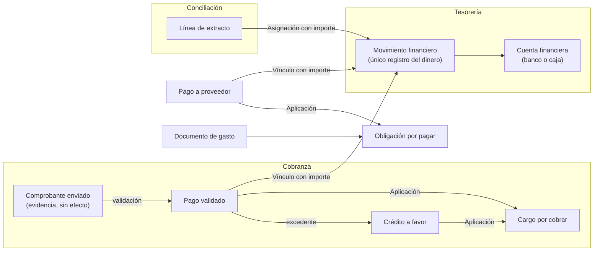

Reglas de lectura **[R]**:

- El **dinero** se registra una sola vez: en el Movimiento. Un Pago o un Pago a proveedor **se vincula** al Movimiento, no crea otro.
- Un **Pago en efectivo** se vincula a un Movimiento de una **Caja**. Al depositar el efectivo, una **Transferencia** mueve el dinero de la Caja a la cuenta bancaria. La línea del extracto concilia con el tramo de entrada de la cuenta bancaria.
- Un **depósito agrupado** del banco es **un** Movimiento vinculado con **varios** Pagos, con importes parciales.
- Un **ingreso del banco sin identificar** puede registrarse como Movimiento **pendiente de identificación**. Cuando se identifica, se **vincula** a los Pagos correspondientes y **no se crea otro movimiento**.
- La **ejecución presupuestaria** puede medirse por lo facturado (Documento de gasto) o por lo pagado (Movimiento). Es decisión `PD-M11`.

## 4. Diagramas de relaciones

Diagramas simplificados: cardinalidad sin atributos. Donde un lado dice "tipado" hay una relación por cada tipo de destino. Los nombres de entidades usan guiones bajos.

### 4.1. Identidad y personas

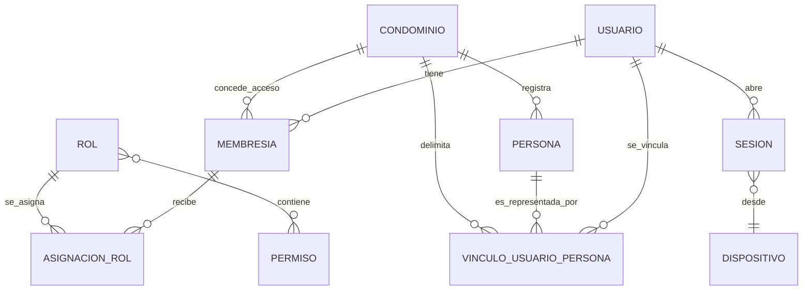

Lectura: un usuario tiene **0..N** vínculos, uno por cada Persona que lo representa, en **distintos condominios**. Una Persona tiene como máximo un vínculo **vigente** (los anteriores quedan como historial). Una Persona puede no tener ninguno.

### 4.2. Unidades, titularidad y participación

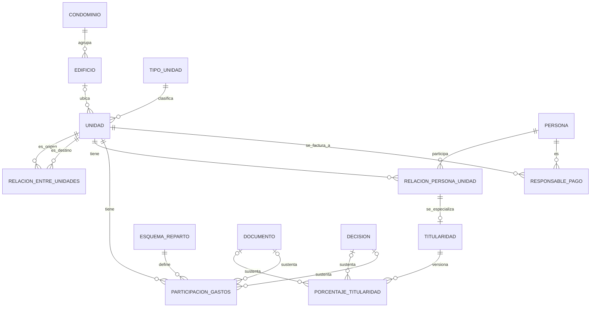

Lectura: una Unidad **puede no tener Edificio** y **puede no tener relación con otra unidad**. La titularidad y la participación en gastos son entidades **separadas**, ambas versionadas y con fuente documental.

### 4.3. Presupuesto, cargos por cobrar y cobranza

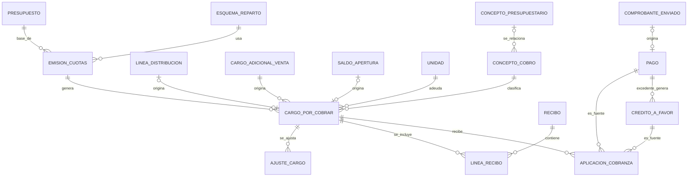

### 4.4. Tesorería y conciliación

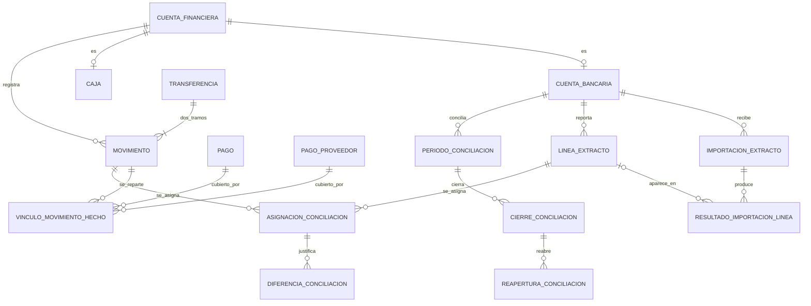

Lectura: la **Asignación de conciliación** es una entidad intermedia, por lo que una línea puede asociarse **parcialmente** a varios movimientos y un movimiento a varias líneas. Las **diferencias justificadas** evitan forzar igualdad de importes. Los cierres y reaperturas son **registros**, nunca ediciones.

### 4.5. Fondos, gastos, obligaciones y créditos con proveedores

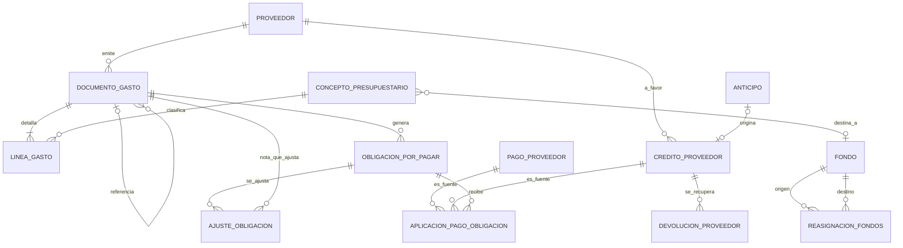

Lectura: un Documento de gasto genera **0..N** obligaciones (ya no 1:1). Una nota de crédito o débito es otro Documento de gasto que **referencia** al original y **ajusta** una obligación. El Fondo se relaciona con el gasto **solo** a través del concepto presupuestario.

### 4.6. Suministros, medidores y consumo

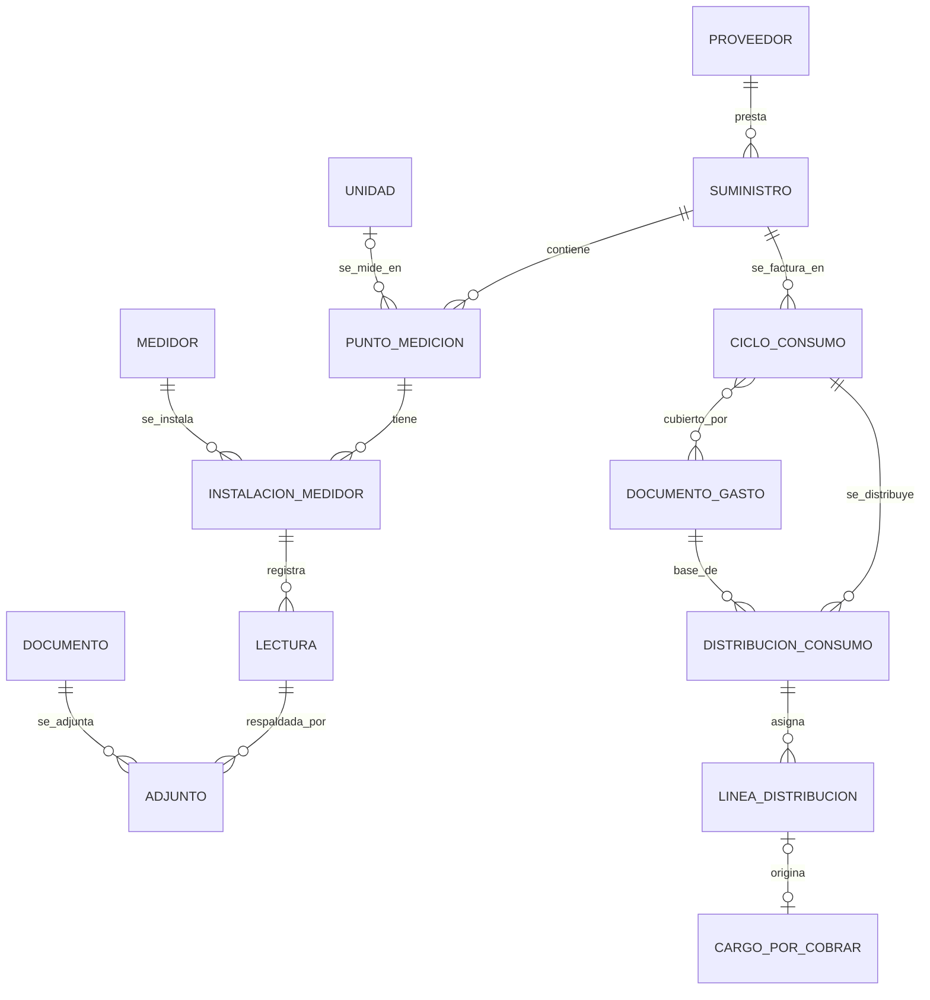

Lectura: cada **cambio de medidor** genera una nueva Instalación en el mismo Punto de medición. La **Distribución** referencia el **documento del proveedor** y cada **Línea** origina el **Cargo** de la unidad: la cadena documento original → distribución → cargo es trazable.

### 4.7. Migración inicial

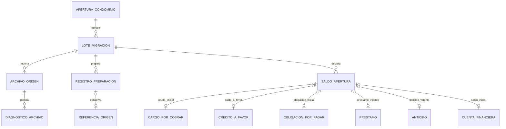

Lectura: ningún Saldo de apertura crea Pagos, Movimientos ni Aplicaciones (P6). Depósitos vigentes y saldos de fondos siguen el mismo patrón (ver la tabla de la sección 2.11).

### 4.8. Gobierno, aprobaciones, adjuntos e idempotencia

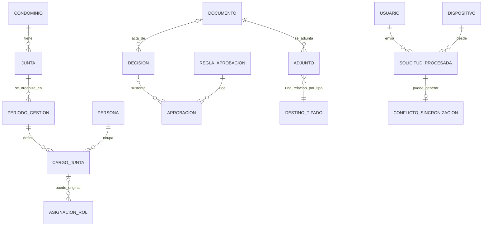

### 4.9. Operación y comunicación

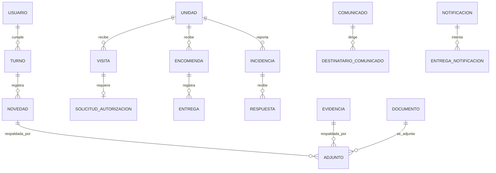

## 5. Invariantes de integridad conceptual

Son **restricciones estructurales** que el diseño debe poder garantizar y probar. **No son reglas de negocio nuevas.** Los límites numéricos, tolerancias y excepciones dependen de las decisiones `PD-` indicadas. Se convertirán en pruebas ([TESTING_STRATEGY](TESTING_STRATEGY.md)).

| # | Invariante | Depende de |
|---|---|---|
| I-01 | El dinero se registra **una sola vez**: un hecho económico tiene **un** Movimiento. Pagos y documentos se vinculan, no lo duplican. | P1 |
| I-02 | Los reportes de ingresos y egresos se calculan **solo sobre Movimientos**. Nunca se suman Pagos y Movimientos. | P1 |
| I-03 | Lo aplicado desde un Pago, más el Crédito a favor que genere, **no supera** el importe del Pago. | PD-03 |
| I-04 | Lo aplicado a un Cargo **no supera** el importe del Cargo con sus Ajustes. | PD-03 |
| I-05 | Lo vinculado de un Movimiento **no supera** el importe del Movimiento. Cada vínculo no supera el importe del hecho vinculado. | — |
| I-06 | Lo asignado de una Línea de extracto **no supera** la línea. Un cierre exige que cada línea esté asignada, o con diferencia justificada, o declarada pendiente. | PD-16 |
| I-07 | Un Movimiento pertenece a **una** Cuenta financiera. Una Transferencia tiene **exactamente dos** Movimientos en **cuentas distintas**. | — |
| I-08 | Una Línea de extracto **no se duplica** por importaciones repetidas o solapadas. | PD-16 |
| I-09 | Un Saldo de apertura **no crea** Pagos, Movimientos ni Aplicaciones. | C§7 |
| I-10 | Todo registro importado tiene **Referencia de origen** (lote, archivo, hoja, fila y fecha de corte). | C§7 |
| I-11 | Un Adjunto y su destino pertenecen al **mismo condominio**. | PD-M13 |
| I-12 | Un Cargo, Recibo, Pago, Movimiento, Documento de gasto o Cierre **nunca se elimina ni se modifica**: se ajusta, anula, revierte o reabre con un registro nuevo. | C§1 |
| I-13 | Cada Cuota referencia la **Emisión** que la generó y la **versión de participación** aplicada. | PD-02 |
| I-14 | Una Línea de gasto pertenece a un Documento. Un Documento de gasto **no crea Movimiento**; un Pago a proveedor **no crea gasto**. | P1 |
| I-15 | Una Persona tiene **como máximo un vínculo vigente** con un usuario. Un usuario tiene **como máximo un vínculo vigente por condominio**. | PD-M2 |
| I-16 | Las versiones de titularidad y de participación **no se solapan** por titular o unidad y esquema. La validación de suma total es regla de `PD-02`. | PD-02, PD-24 |
| I-17 | Repetir una operación móvil con la misma clave **devuelve el resultado original** y no crea otro registro. | C§10 |
| I-18 | Una Lectura **no genera consumo ni cargo** por sí sola; solo lo hace una Distribución. La lectura inicial de apertura no genera consumo. | C§7 |
| I-19 | Una Aprobación referencia un objeto del **mismo condominio** y registra quién aprobó. | PD-08 |

## 6. Cambios respecto a la revisión 1

| Revisión 1 | Revisión 2 | Motivo |
|---|---|---|
| Persona "puede tener Usuario" (0..1) y Membresía como única relación | **Vínculo usuario–persona** (Enlace, con historial). Persona por condominio | Un usuario puede estar vinculado a distintas Personas en distintos condominios |
| Membresía con ámbito de condominio | Membresía con ámbito **Enlace** | Debe leerse sin contexto de tenant al iniciar sesión (`PD-M1`) |
| Unidad con porcentaje de participación y "pertenece a Edificio" | **Unidad** + **Tipo de unidad** + **Relación entre unidades**. Edificio opcional | Soportar casas, estacionamientos, depósitos y locales independientes |
| Relación persona–unidad única | Supertipo + **Titularidad** + **Porcentaje de titularidad** | Varios propietarios y porcentaje de titularidad |
| Porcentaje de participación como dato de la unidad | **Esquema de reparto** + **Participación en gastos comunes** versionada, con fuente | Distinguir titularidad de participación y conservar historial |
| Cuota, Recibo, Cargo adicional, Saldo a favor, Deuda consolidada separados | **Cargo por cobrar** central. Recibo agrupa con Líneas. **Crédito a favor**. Deuda consolidada como nivel de detalle | Núcleo único de cobranza |
| Aplicación de pago | **Aplicación de cobranza** (fuente: Pago o Crédito) | Aplicaciones parciales a varios cargos |
| Pago vinculado a un movimiento | **Vínculo movimiento–hecho** con importe | Depósitos agrupados y efectivo |
| Cuenta bancaria | **Cuenta financiera** con **Cuenta bancaria** y **Caja** | Efectivo |
| Vínculo sin importe, sin transferencias | **Transferencia entre cuentas** (dos tramos) | Caja a banco |
| Extracto y Conciliación | **Importación de extracto**, **Línea de extracto** estable, **Resultado de importación**, **Asignación de conciliación**, **Diferencia**, **Periodo**, **Cierre** y **Reapertura** | Asociaciones parciales, importaciones repetidas, cierres y reaperturas |
| Gasto 1:1 Obligación | **Documento de gasto** + **Línea de gasto** + **Obligación por pagar** (0..N) + **Ajuste de obligación** + **Crédito con proveedor** + **Devolución** | Notas de crédito y débito, pagos parciales y devoluciones |
| Suministro, Medidor, Lectura | **Punto de medición**, **Instalación de medidor**, **Ciclo de consumo**, **Línea de distribución**. Lectura con foto como adjunto | Cambios de medidor y trazabilidad al documento del proveedor |
| Saldo de apertura genérico | Saldos de apertura **tipificados**, **Apertura del condominio** con fecha de corte y **Diagnóstico de archivo** | Diferenciar saldos y no reconstruir historia |
| Cargo de junta: "Persona/Usuario con vigencia" | **Junta**, **Periodo de gestión**, **Cargo de junta** (Persona) | Continuidad entre juntas |
| Sin aprobaciones | **Decisión**, **Aprobación** y **Regla de aprobación** | Aprobaciones y actas |
| Sin fondos | **Fondo** y **Reasignación entre fondos** (si existen) | Fondos acumulados |
| Adjunto genérico | **Adjunto** con relaciones tipadas | Integridad referencial |
| Sin registro de solicitudes | **Solicitud procesada** y **Conflicto de sincronización** | Idempotencia de operaciones móviles |
| Memoria institucional como entidad | **Vista** sobre Decisiones, Documentos y otros | Contenido sin definir (`PD-30`) |

## 7. Decisiones pendientes de modelado

Los `PD-M` están **registrados en [RISKS_AND_OPEN_DECISIONS §4.4](RISKS_AND_OPEN_DECISIONS.md#44-decisiones-pendientes-de-modelado-pd-m)**, que es la **única fuente de su estado** (todos **Pendientes**). La tabla conserva sus definiciones originales y se mantiene aquí como referencia del modelo. Las recomendaciones **no están aprobadas**. Las `PD-` existentes se indican como relacionadas.

| ID | Decisión | Recomendación | Relacionadas | Bloquea |
|---|---|---|---|---|
| **PD-M1** | Membresía para **todo** usuario (incluidos residentes) frente a membresía solo para personal. Y tratamiento de las tablas de **Enlace** frente a RLS: un usuario debe poder listar sus condominios al iniciar sesión sin contexto de tenant. | Membresía para todos. Categoría "Enlace" con política propia (lectura por el propio usuario y por el tenant) | PD-08, PD-38, PD-39 | F1 |
| **PD-M2** | Persona **por condominio** (sin persona global) y tipos de persona (natural, jurídica, documentos de identidad admitidos). | Persona por condominio. Vínculo con cuenta por invitación | PD-24 | F1 |
| **PD-M3** | Titularidad y ocupación como tipos de una misma relación (supertipo) y separación del **Responsable de pago**. | Supertipo con Titularidad como especialización | PD-24 | F1 |
| **PD-M4** | Participación en gastos: **un solo esquema** por condominio o **varios** (por concepto, fondo o tipo de unidad). Validación de suma total. | Modelar varios esquemas, usar uno hasta que se defina | PD-02, PD-28 | F2 |
| **PD-M5** | Relación entre unidades: tipos, y si una relación implica efectos (por ejemplo, titularidad conjunta o cobro conjunto). | Sin efectos automáticos | PD-28, PD-24 | F1 |
| **PD-M6** | **Cargo por cobrar** como entidad central. El Recibo agrupa y no es la deuda. | Aprobar opción C de §3.2 | PD-06, PD-04 | F2 |
| **PD-M7** | Crédito a favor como **entidad** (frente a un saldo solo derivado). | Entidad, para poder aplicarlo y conservar su origen | PD-03 | F2 |
| **PD-M8** | Transferencia como un hecho con **dos movimientos**. | Dos tramos, para conciliar cada cuenta | — | F2 |
| **PD-M9** | Tipos de cuenta financiera: banco y caja. ¿Otros (tarjeta, billetera digital)? Responsable de la caja. | Banco y caja | — | F2 |
| **PD-M10** | Fondos: existencia, derivación de saldos desde conceptos clasificados y reasignaciones entre fondos. | Saldo derivado y reasignaciones aprobadas | PD-11, PD-12 | F2 |
| **PD-M11** | Base de la ejecución presupuestaria: **devengado** (documento de gasto) o **pagado** (movimiento). | Mostrar ambas | PD-10 | F4 |
| **PD-M12** | Documento de gasto con **varias obligaciones**, tratamiento de notas de crédito y débito, crédito con proveedor y devoluciones. Gastos sin documento. | Según §2.6 | PD-06, PD-29 | F2 |
| **PD-M13** | Adjuntos: **relaciones tipadas** por tipo de destino o relación genérica. | Tipadas (integridad referencial real y mismo condominio) | PD-26 | F1 |
| **PD-M14** | Cierre y reapertura de conciliación: quién aprueba, efectos sobre periodos posteriores y sobre cierres de periodo contable. | Reapertura con Aprobación y motivo | PD-09, PD-16 | F3 |
| **PD-M15** | **Fecha de corte** y **fecha de apertura**: ¿son la misma? Migración de depósitos recuperables y de fondos. | Fecha de corte como fecha de los saldos | PD-17, PD-12 | F3 |
| **PD-M16** | Retención y expiración de **solicitudes procesadas** y de **conflictos de sincronización**. | Definir en F6 | PD-26 | F6 |

### Decisiones previas que siguen abiertas y afectan al modelo

`PD-02` (prorrateo), `PD-03` (imputación), `PD-04` (mora), `PD-06` (documentos), `PD-07` (validación de pagos), `PD-08` (roles y aprobaciones), `PD-09` (cierres), `PD-11` (fondos), `PD-12` (préstamos), `PD-13` (cargos y ventas), `PD-14` (suministros), `PD-16` (conciliación), `PD-17` (migración), `PD-24` (titularidad y visibilidad), `PD-28` (tipos de unidad), `PD-29` (caja chica), `PD-30` (memoria institucional), `PD-33` (junta), `PD-46` (partida simple o doble).

## 8. Trazabilidad con la matriz y la arquitectura

### 8.1. Funcionalidades de la matriz que este modelo no cubría explícitamente

**Estado: resuelto en la sincronización documental.** La [matriz](FUNCTIONAL_REQUIREMENTS.md) se corrigió y se amplió (ver su [control de cambios](FUNCTIONAL_REQUIREMENTS.md#control-de-cambios-de-la-sincronización-documental)). Las funcionalidades nuevas figuran con prioridad **Por definir** (`IN-16`) y fase tomada de la primera fase de la entidad.

| Tema del modelo | Cubierto por | Tipo de cambio |
|---|---|---|
| Tipos de unidad configurables, unidades sin edificio | COND-002, COND-003 | Corregida |
| Relación entre unidades | COND-007 | **Nueva** |
| Titularidad múltiple con porcentaje, historial y fuente | PER-003, COND-004, PER-014 | Corregidas y nueva |
| Esquemas de reparto y versiones de participación | COND-004, COB-002 | Corregidas |
| Ajustes de cargo | COB-020 (y COB-009) | **Nueva** |
| Caja como cuenta financiera y pagos en efectivo | BAN-001, COB-004 | Corregidas |
| Movimientos pendientes de identificación | CNC-006, CNC-007 | Corregidas |
| Diferencias justificadas de conciliación | CNC-005 | Corregida |
| Reapertura de un cierre de conciliación | CNC-011 | **Nueva** |
| Notas de crédito y débito, crédito con proveedor, devoluciones | GAS-012, GAS-013, GAS-014 | **Nuevas** |
| Documento de gasto con varias obligaciones | GAS-001, GAS-002 | Corregidas |
| Cambio de medidor e historial de instalación | SUM-016 | **Nueva** |
| Ciclo de consumo y documento del suministro general | SUM-009 | Corregida |
| Fondos y reasignaciones | PRE-006, PRE-007 | **Nuevas** |
| Decisiones y aprobaciones generales | IAM-020, IAM-021 | **Nuevas** |
| Migración de préstamos, anticipos, depósitos y fondos | MIG-019, MIG-020, MIG-021, MIG-022 | **Nuevas** |
| Fecha de corte | MIG-014 | Corregida |

### 8.2. Inconsistencias con la matriz

**Estado: resueltas** en la matriz. Se conserva el detalle de lo que se encontró y cómo quedó.

| # | Funcionalidades | Inconsistencia | Resolución |
|---|---|---|---|
| 1 | `COND-002` | "Una unidad pertenece a uno" suponía edificio obligatorio. Con casas puede no haber edificio | Edificio opcional |
| 2 | `COB-004`, `BAN-004` | "Un pago se vincula a un movimiento" suponía 1:1. Con depósitos agrupados es N:1 y con efectivo pasa por una Caja | Vínculo N:M mediante `BAN-004`. Dependencias ajustadas |
| 3 | `CNC-003`, `CNC-005` | "Una línea conciliada no se puede conciliar de nuevo" contradecía las asignaciones parciales. "La suma coincide" no admitía diferencias justificadas | Asignaciones parciales hasta completar el importe. Diferencias con motivo y aprobación |
| 4 | `GAS-001`, `GAS-002` | Trataban el gasto y la obligación como un par | Documento de gasto con 0..N obligaciones |
| 5 | `BAN-001`, `BAN-002` | Solo hablaban de cuentas bancarias | Incluyen cajas |
| 6 | `MIG-014`, `PD-17` | "Fecha de apertura" frente a "fecha de corte" | Fecha de corte diferenciada de la fecha de apertura operativa. Si son la misma, queda pendiente en `PD-M15` y `PD-17` |
| 7 | `COND-004`, `MIG-005` | "Porcentaje de participación" como dato de la unidad, sin versiones ni fuente | Esquemas, historial y fuente |

### 8.3. Referencias cruzadas con ARCHITECTURE

Revisadas con [ARCHITECTURE](ARCHITECTURE.md) (revisión 3, que incorpora las tres categorías de tablas). **Estado: resueltas en ARCHITECTURE**, salvo `PD-M1`, que sigue pendiente:

| Sección de ARCHITECTURE | Estado | Observación |
|---|---|---|
| §7.1 reglas multi-tenant ("tablas globales; un usuario se relaciona mediante membresías") | **Resuelta** en [ARCHITECTURE §7.1 y §7.1.1](ARCHITECTURE.md#711-categorías-de-tablas-global-tenant-y-enlace) | Ahora hay tres categorías: Global, Tenant y Enlace. Las tablas de Enlace (Membresía, Vínculo usuario–persona, Acceso de soporte) llevan condominio, tienen RLS con política propia y se leen sin contexto de tenant mediante `withUser`. Falta aprobar `PD-M1` |
| §7.3 punto 5 (acceso global para membresías al iniciar sesión) | **Resuelta** | Separa `withGlobal` (tablas Global) de `withUser` (lectura propia de las tablas de Enlace) |
| §7.5 caso `ROL-02` (toda tabla con `condominium_id` tiene RLS forzado) | **Resuelta** | `ROL-02` se limita a Tenant. `ROL-02b` verifica la política de Enlace. `ROL-05` exige clasificar toda tabla. Casos `ENL-01` a `ENL-13`. Las tablas de Enlace **no están exentas** de RLS |
| §7.1 claves foráneas compuestas con `condominium_id` | Coherente | Aplica a tablas de tenant. No puede aplicarse entre una tabla global y una de tenant, por eso el Vínculo usuario–persona es de Enlace |
| §10 gestión de archivos y herencia de permisos del adjunto | Coherente | `PD-M13` precisa la integridad del Adjunto |
| §12 auditoría | Coherente | Aprobación y Decisión no sustituyen a la auditoría |
| §13.1 `Idempotency-Key` y resultado original | Coherente | Requiere persistir la Solicitud procesada (nueva entidad) |
| §4.2 worker | Coherente | Podría encargarse de la expiración de Solicitudes procesadas (`PD-M16`) |
| §11 notificaciones y bandeja de salida | Coherente | Sin cambios |

### 8.4. Otros documentos

**Estado: sincronizados.** [PRODUCT_OVERVIEW](PRODUCT_OVERVIEW.md) cita 135 entidades, las listas de entidades de [DEVELOPMENT_ROADMAP](DEVELOPMENT_ROADMAP.md) usan los nombres de este modelo y [RISKS_AND_OPEN_DECISIONS](RISKS_AND_OPEN_DECISIONS.md) registra `PD-M1` a `PD-M16` (§4.4) y enlaza correctamente desde `RK-03`.

## 9. Relación con los componentes

| Componente | Usa principalmente | No debe usar |
|---|---|---|
| API | Todas las entidades, a través de repositorios y de la transacción protegida | — |
| WEB | DTO de administración | Modelos de Prisma |
| RES | DTO acotados a la unidad y relación del usuario | Datos de otras unidades |
| CON | DTO mínimos de residentes, visitas, encomiendas, turnos | Entidades financieras |
````

## Documento: `docs/RISKS_AND_OPEN_DECISIONS.md`

````markdown
# Riesgos, vacíos y decisiones pendientes

> Entregable 6 del [prompt maestro](../PROMPT_MAESTRO.md). Este documento es la **única fuente** de: vacíos/inconsistencias (`IN-`), supuestos (`SUP-`), decisiones pendientes (`PD-`) y riesgos (`RK-`). Los demás documentos solo los referencian por ID.
>
> Convención de estados: ver [README](README.md#convención-de-etiquetas).

## 1. Hallazgo crítico

**`IN-01` — La "especificación funcional detallada" que el prompt maestro cita no está en el repositorio.**
El §4 del prompt exige conservar "las reglas de prorrateo, pagos parciales, obligaciones, conciliación bancaria, saldos por concepto, migración desde Excel y demás controles financieros" de "la especificación funcional del proyecto". Esa especificación **no existe en `PROMPT_MAESTRO.md` ni en el workspace**. El prompt solo nombra las reglas; no las describe.

Consecuencias:

- No se inventó ninguna regla financiera. Cada funcionalidad financiera está marcada con la decisión pendiente que la bloquea (`PD-01` a `PD-17`).
- Las fases F0 y F1 se pueden ejecutar sin esa especificación. **La fase F2 (núcleo financiero) no puede iniciar sin ella** (ver [roadmap](DEVELOPMENT_ROADMAP.md#3-puertas-de-decisión-gates)).
- Acción solicitada: entregar la especificación funcional (documento, Excel actuales del piloto o sesión de levantamiento) antes de iniciar F2.

## 2. Vacíos e inconsistencias del prompt (`IN-`)

| ID | Hallazgo | Dónde | Impacto | Resolución propuesta |
|---|---|---|---|---|
| IN-01 | Falta la especificación funcional detallada (ver §1). | §4 | Bloquea F2 | `PD-01` |
| IN-02 | Se listan "Administrador del condominio", "Junta", "Presidente" y "Tesorero" como perfiles. En una junta autoadministrada no se sabe quién es el "administrador" ni cómo se separan funciones. | §3.2, §8 | Modelo de roles | `PD-08` |
| IN-03 | "Propietarios", "Inquilinos", "Residentes" y "Residentes autorizados" aparecen como perfiles distintos. No queda claro si "residente" es un tipo de relación o una condición, ni qué es "personal asociado a unidades". | §3.3, §5.1, §8, §4.3 | Modelo persona–unidad | `PD-24`, `PD-28` |
| IN-04 | La app de residentes no puede ver otras unidades "salvo autorización expresa". No se define quién autoriza ni el alcance. | §5.2, §8 | Autorización | `PD-24` |
| IN-05 | La conserjería registra lecturas "para revisión" y la web tiene "suministros y medidores internos". No se define el flujo completo ni quién más puede registrar lecturas. | §4.12, §6.6 | Flujo de lecturas | `PD-14` |
| IN-06 | El residente "confirma recepción o recojo" (§5.5) y el conserje "registra entrega" (§6.4). No se define cuál confirmación es la oficial ni qué pasa si discrepan. | §5.5, §6.4 | Estado de encomienda | `PD-19` |
| IN-07 | "Memoria institucional" se menciona como principio y dominio, pero no se define su contenido. | §1, §4.8 | Alcance de PRV-004 | `PD-30` |
| IN-08 | "Ayuda contextual" no tiene alcance definido. | §4.18 | Alcance de CFG-005 | `PD-31` |
| IN-09 | El prompt no menciona requisitos no funcionales: volumen, disponibilidad, RPO/RTO, presupuesto, tamaño del equipo, fechas objetivo, soporte. | — | Dimensionamiento | `PD-50` |
| IN-10 | No se indica si habrá pagos en línea. Los residentes solo registran comprobantes. | §5.2 | Alcance | `SUP-07` |
| IN-11 | El alcance del "Administrador de plataforma" (¿ve datos de los condominios? ¿tiene consola web?) no está definido. | §8 | Seguridad y alcance web | `PD-27`, `PD-32` |
| IN-12 | La solicitud de autorización de visitantes requiere respuesta casi en tiempo real. No hay reglas de tiempo de espera ni de alternativa. | §5.4, §6.3 | Flujo de visitas | `PD-18` |
| IN-13 | La carpeta `database/` en la raíz sugiere Prisma compartido. El prompt también prohíbe compartir modelos de Prisma con los clientes. | §9 | Estructura | `PD-35` → propuesta en [ARCHITECTURE](ARCHITECTURE.md#22-estructura-propuesta) (solo `api` importa `database/`) |
| IN-14 | No se define si el sistema debe emitir comprobantes electrónicos (SUNAT) o solo recibos internos. | §4.5, §4.9 | Alcance fiscal | `PD-06` |
| IN-15 | No se sabe si el piloto tiene **préstamos, anticipos o depósitos recuperables vigentes** a la fecha de corte que deban cargarse en la apertura. Los paquetes de importación `MIG-019` a `MIG-021` dependen de `PRS` (F4) y, si hay tales saldos, tendrían que adelantarse. **Pregunta única:** ¿el edificio piloto tiene préstamos, anticipos o depósitos recuperables vigentes a la fecha de corte que deban estar en el sistema desde la apertura? | §7 | Fase de `MIG-019` a `MIG-021` | `PD-12`, `PD-17`, `PD-M15` |
| IN-16 | Las **16 funcionalidades añadidas** en la sincronización documental (`COND-007`, `PER-014`, `COB-020`, `PRE-006`, `PRE-007`, `CNC-011`, `GAS-012`, `GAS-013`, `GAS-014`, `SUM-016`, `IAM-020`, `IAM-021`, `MIG-019`, `MIG-020`, `MIG-021`, `MIG-022`) cubren entidades de [DATA_MODEL](DATA_MODEL.md) que no tenían funcionalidad. No hay base en el prompt ni en decisiones aprobadas para asignarles prioridad. Figuran como `Por definir`. **Pregunta única:** ¿qué prioridad (`P0`, `P1` o `P2`) asigna a cada una de ellas? | Matriz | Alcance del piloto y conteo de `P0` | Su aprobación |

## 3. Supuestos (`SUP-`)

Son suposiciones de trabajo. Si alguna es falsa hay que revisar el plan.

| ID | Supuesto | Impacto si es falso |
|---|---|---|
| SUP-01 | La moneda base es PEN y la zona horaria es `America/Lima`. | Modelo monetario (`PD-05`) |
| SUP-02 | El idioma de la interfaz es español (Perú). | i18n |
| SUP-03 | El piloto es **un condominio** (un edificio, posiblemente con varias torres/bloques). | Alcance de F1 |
| SUP-04 | Una persona puede existir sin usuario (propietarios sin app). | Modelo persona/usuario |
| SUP-05 | Los condominios los crea el equipo de Adminístralo (administrador de plataforma), no hay autoregistro en el piloto. | `PLT-010` |
| SUP-06 | La junta opera dentro de la web con roles del condominio (presidente, tesorero, etc.). | `PD-08` |
| SUP-07 | No hay pagos en línea. Los residentes pagan fuera del sistema y registran el comprobante. | Alcance de COB |
| SUP-08 | Los Excel del piloto pueden ser desordenados, con datos duplicados y deuda sin detalle. | Esfuerzo de MIG |
| SUP-09 | El equipo es pequeño. El plan favorece entregas verticales con pocas piezas de infraestructura. | Duración del roadmap |
| SUP-10 | Los datos personales de residentes, visitantes y fotos están sujetos a la Ley N.º 29733 (Perú) y su reglamento. **Requiere validación legal.** | `RK-12` |
| SUP-11 | Las apps móviles se distribuirán por Google Play y App Store (en piloto, por canales de prueba). | Plazos de publicación |

## 4. Decisiones pendientes (`PD-`)

Todas están en estado **Pendiente**. La columna "Bloquea" indica la primera fase que no puede iniciar sin la decisión. Este documento es la **fuente oficial del estado** de todas las decisiones, incluidas las de arquitectura (`PD-N`, [§4.3](#43-decisiones-pendientes-de-arquitectura-pd-n)) y las de modelado (`PD-M`, [§4.4](#44-decisiones-pendientes-de-modelado-pd-m)). Una recomendación **no** es una decisión aprobada.

### 4.1. Negocio y especificación

| ID | Decisión / información requerida | Bloquea | Notas |
|---|---|---|---|
| PD-01 | Entregar la especificación funcional detallada (ver `IN-01`). | F2 | Crítico |
| PD-02 | Regla de prorrateo: base de reparto (porcentaje de participación, partes iguales, por tipo de unidad), redondeo y tratamiento del residuo. Validación de que los porcentajes sumen 100 %. | F2 | |
| PD-03 | Pagos parciales e imputación: orden de aplicación entre conceptos y periodos, y tratamiento del excedente (saldo a favor). | F2 | |
| PD-04 | ¿Existen mora, intereses, penalidades o descuentos por pronto pago? Si existen, sus reglas. | F4 | Si no existen, se descarta `COB-012`. |
| PD-05 | Moneda(s) admitidas y tipo de cambio. | F2 | `SUP-01` |
| PD-06 | Tipos de documento para recibos, cobros y gastos. ¿Se emiten comprobantes electrónicos (SUNAT) o solo recibos internos? | F2 | `IN-14` |
| PD-07 | Flujo de validación de pagos y comprobantes: quién valida, estados, rechazo, y cuándo un pago pasa a "confirmado" (validación manual, conciliación o ambas). | F2 / F5 | El prompt solo dice que adjuntar no confirma (§5.2). |
| PD-08 | Modelo de roles: significado de "Administrador del condominio" frente a "Junta"; roles personalizables por condominio; segregación de funciones (quien registra no aprueba). | F1 | `IN-02` |
| PD-09 | Cierre de periodos: ¿hay cierres mensuales?, ¿se bloquean?, ¿quién puede reabrir? | F4 | |
| PD-10 | Presupuestos: periodicidad, versiones, aprobación (junta/asamblea), relación con las cuotas. | F2 | |
| PD-11 | Fondos: ¿existen fondos separados (reserva, mantenimiento) o solo "saldos por concepto"? | F2 | |
| PD-12 | Préstamos, anticipos y depósitos recuperables: definiciones, contrapartes, reglas de devolución. | F4 | |
| PD-13 | Cargos adicionales y ventas a propietarios: qué se vende o cobra y sus reglas. | F4 | |
| PD-14 | Suministros y medidores: tipos de suministro, significado de "interno", tarifas, cálculo y distribución del consumo, tolerancias de "lectura inconsistente". | F3 (catálogo) / F4 (cálculo) | `IN-05` |
| PD-15 | Archivos de cobranza BCP: formato oficial, flujo (solo generación o también retorno de pagos), requisitos del convenio. ¿Es necesario para el piloto? | F4 | Si el piloto cobra por BCP, se adelanta. |
| PD-16 | Conciliación: formatos reales de extracto (CSV/Excel de cada banco), reglas de coincidencia, tolerancias, tratamiento de depósitos que agrupan varios pagos. | F3 | Se necesitan extractos reales de ejemplo. |
| PD-17 | Migración: fecha de apertura, responsable de validar los datos, aprobación de la apertura, tratamiento de la deuda consolidada en reportes. | F3 | Se necesitan los Excel reales. |
| PD-18 | Visitas: mecanismo de identificación (código, QR, documento), datos del visitante que se almacenan, tiempo de espera y alternativa si el residente no responde. | F6 | `IN-12` |
| PD-19 | Encomiendas y documentos: confirmación oficial (portería vs residente), plazos de custodia, quién puede recoger. | F6 | `IN-06` |
| PD-20 | Turnos: definición de turnos por condominio, obligatoriedad de entrega de turno, origen de las tareas pendientes. | F6 | |
| PD-21 | Comunicaciones del conserje: tipos de aviso autorizados, plantillas y si requieren aprobación. | F7 | |
| PD-22 | Incidencias: categorías, estados, tiempos de atención (SLA), asignación a proveedor, visibilidad entre residentes. | F7 | |
| PD-23 | Servicios al residente (reservas, contactos, emergencias): confirmar si son fase posterior. | F8 | |
| PD-24 | Autorizaciones expresas para ver información de otra unidad; qué ve un inquilino frente a un propietario (por ejemplo, deuda); cotitularidad. | F1 / F5 | `IN-03`, `IN-04` |
| PD-25 | Idiomas y accesibilidad requeridos. | F1 | `SUP-02` |
| PD-26 | Retención de datos y cumplimiento legal: plazos de retención de fotos y datos de visitantes, consentimientos. | F6 | `SUP-10` |
| PD-27 | Modelo comercial del SaaS: planes, cobro a condominios, límites, soporte. Alcance del administrador de plataforma. | F8 | `IN-11` |
| PD-28 | Tipos de unidad (departamento, local, estacionamiento, depósito) y si todas participan en cuotas. | F1 | |
| PD-29 | Caja chica y gastos menores sin proveedor formal. | F2 | |
| PD-30 | Contenido de la "memoria institucional" (actas, decisiones, cotizaciones, historial de trabajos). | F2 / F4 | `IN-07` |
| PD-31 | Alcance de la "ayuda contextual". | F1 | `IN-08` |
| PD-32 | ¿El administrador de plataforma necesita una consola web propia? | F8 | `IN-11` |
| PD-33 | Gestión de periodos de la junta (cargos y traspaso). Se propone `IAM-012`; confirmar alcance. | F1 | Derivado del principio de continuidad (§1). |

### 4.2. Técnicas (requieren aprobación)

Cada una se desarrolla en [TECHNICAL_DECISIONS](TECHNICAL_DECISIONS.md) con alternativas.

| ID | Decisión | Recomendación | Bloquea |
|---|---|---|---|
| PD-34 | Nx, con pnpm, para Angular, NestJS y las librerías TypeScript. Flutter conserva su estructura y herramientas propias: su registro en Nx mediante `run-commands` es **opcional**. Los *pub workspaces* de Dart no son un requisito. | Aprobar `TD-02`, condicionado a T1 y T2 | F0 |
| PD-35 | Estructura de carpetas: se añade `packages/` para paquetes Dart compartidos. | Aprobar `TD-03` | F0 |
| PD-36 | Contrato: OpenAPI code-first desde NestJS, con generación de cliente TypeScript y Dart. | Aprobar `TD-04` | F0 |
| PD-37 | Tenant explícito en la URL (`/v1/condominiums/{id}/...`). | Aprobar `TD-05` | F1 |
| PD-38 | Row Level Security como segunda capa de defensa desde F1. | Aprobar `TD-06` | F1 |
| PD-39 | Autenticación: JWT de acceso corto + refresh rotativo. Identificador de login (correo, teléfono o documento). MFA para roles críticos. | Aprobar `TD-07` | F1 |
| PD-40 | Hosting, región, almacenamiento de objetos, CI/CD y host del repositorio. | Decidir en F0 | F0 |
| PD-41 | Canales de notificación y proveedores (push, correo, WhatsApp/SMS). | Push + correo + in-app; WhatsApp/SMS por validar | F5 |
| PD-42 | Flutter: Riverpod, `go_router`, `dio`, `drift` (SQLite local). | Aprobar `TD-10` | F5 |
| PD-43 | Cola de trabajos: `pg-boss` (sobre PostgreSQL) frente a BullMQ + Redis. Pendiente del *spike* técnico T5. | **Sin recomendación hasta el *spike* T5** | F1 |
| PD-44 | Orden de las apps móviles: residentes (F5) antes que conserjería (F6) y sincronización offline en F7. | Aprobar `TD-12` | F5 |
| PD-45 | Biblioteca de componentes de Angular con Tailwind (Angular CDK/Material, PrimeNG, Spartan u otra). | Decidir en F0 | F1 |
| PD-46 | Modelo financiero interno: movimientos de partida simple vinculados frente a doble partida. | Decidir tras `PD-01` | F2 |
| PD-47 | Cuentas de desarrollador Apple/Google y canales de distribución de pilotos. | Gestionar en F0 | F5 |
| PD-48 | Usuario de varios condominios en las apps móviles: selector de condominio. | Aprobar `TD-05` | F5 |
| PD-49 | Conectividad del edificio piloto (Wi-Fi y cobertura en portería). | Medir antes de F6 | F6 |
| PD-50 | Equipo, capacidad, fechas objetivo, disponibilidad esperada, RPO/RTO y presupuesto de infraestructura (`IN-09`). | Informar | F0 |

### 4.3. Decisiones pendientes de arquitectura (`PD-N`)

Surgieron en la revisión 2 de [ARCHITECTURE](ARCHITECTURE.md#18-decisiones-pendientes-que-afectan-a-este-documento), donde estaban identificadas provisionalmente. Se registran aquí con su definición original. Todas están **Pendientes**. Se resuelven con las pruebas técnicas T1 a T6 de [ARCHITECTURE §17](ARCHITECTURE.md#17-pruebas-técnicas-obligatorias-de-f0): **F1 no inicia hasta que las seis pasen o exista una decisión escrita y aprobada para el caso en que alguna falle.**

| ID | Decisión | Recomendación | Se resuelve con | Bloquea |
|---|---|---|---|---|
| PD-N1 | Versionar en el repositorio los clientes generados (TypeScript y Dart) y la salida de tokens. | Versionar ([ARCHITECTURE §3.1](ARCHITECTURE.md#31-artefactos-y-ubicaciones)) | T4, T6 | F1 |
| PD-N2 | Paquetes Dart por dependencias por ruta, **sin Melos ni *pub workspaces***. | Aprobar [ARCHITECTURE §2.1](ARCHITECTURE.md#21-nx-y-flutter) | T2 | F1 |
| PD-N3 | Migraciones aplicadas por un paso de despliegue con rol migrador, nunca al arrancar la API ni el worker. | Aprobar [ARCHITECTURE §7.2](ARCHITECTURE.md#72-prisma-alcance-de-uso-y-propiedad-de-las-migraciones-c-r) | — | F1 |
| PD-N4 | Plan alternativo si T3 falla. | Decidir **solo si T3 falla** ([ARCHITECTURE §7.6](ARCHITECTURE.md#76-plan-alternativo-si-t3-falla-pd-n4)) | T3 | F1 (solo si T3 falla) |

### 4.4. Decisiones pendientes de modelado (`PD-M`)

Surgieron en la revisión 2 de [DATA_MODEL](DATA_MODEL.md#7-decisiones-pendientes-de-modelado), donde estaban identificadas como provisionales. Se registran aquí con su definición y recomendación originales. Todas están **Pendientes**. Las recomendaciones **no están aprobadas**. Las `PD-` relacionadas están en la [sección 4.1](#41-negocio-y-especificación) y la [sección 4.2](#42-técnicas-requieren-aprobación).

| ID | Decisión | Recomendación | Relacionadas | Bloquea |
|---|---|---|---|---|
| PD-M1 | Membresía para **todo** usuario (incluidos residentes) frente a membresía solo para personal. Y tratamiento de las tablas de **Enlace** frente a RLS: un usuario debe poder listar sus condominios al iniciar sesión sin contexto de tenant. | Membresía para todos. Categoría "Enlace" con política propia (lectura por el propio usuario y por el tenant). Diseño técnico propuesto en [ARCHITECTURE §7.1.1](ARCHITECTURE.md#711-categorías-de-tablas-global-tenant-y-enlace), a validar en T3 | `PD-08`, `PD-38`, `PD-39` | F1 |
| PD-M2 | Persona **por condominio** (sin persona global) y tipos de persona (natural, jurídica, documentos de identidad admitidos). | Persona por condominio. Vínculo con cuenta por invitación | `PD-24` | F1 |
| PD-M3 | Titularidad y ocupación como tipos de una misma relación (supertipo) y separación del **Responsable de pago**. | Supertipo con Titularidad como especialización | `PD-24` | F1 |
| PD-M4 | Participación en gastos: **un solo esquema** por condominio o **varios** (por concepto, fondo o tipo de unidad). Validación de suma total. | Modelar varios esquemas, usar uno hasta que se defina | `PD-02`, `PD-28` | F2 |
| PD-M5 | Relación entre unidades: tipos, y si una relación implica efectos (por ejemplo, titularidad conjunta o cobro conjunto). | Sin efectos automáticos | `PD-28`, `PD-24` | F1 |
| PD-M6 | **Cargo por cobrar** como entidad central. El Recibo agrupa y no es la deuda. | Aprobar la opción C de [DATA_MODEL §3.2](DATA_MODEL.md#32-evaluación-de-la-entidad-central-de-cobranza) | `PD-06`, `PD-04` | F2 |
| PD-M7 | Crédito a favor como **entidad** (frente a un saldo solo derivado). | Entidad, para poder aplicarlo y conservar su origen | `PD-03` | F2 |
| PD-M8 | Transferencia como un hecho con **dos movimientos**. | Dos tramos, para conciliar cada cuenta | — | F2 |
| PD-M9 | Tipos de cuenta financiera: banco y caja. ¿Otros (tarjeta, billetera digital)? Responsable de la caja. | Banco y caja | — | F2 |
| PD-M10 | Fondos: existencia, derivación de saldos desde conceptos clasificados y reasignaciones entre fondos. | Saldo derivado y reasignaciones aprobadas | `PD-11`, `PD-12` | F2 |
| PD-M11 | Base de la ejecución presupuestaria: **devengado** (documento de gasto) o **pagado** (movimiento). | Mostrar ambas | `PD-10` | F4 |
| PD-M12 | Documento de gasto con **varias obligaciones**, tratamiento de notas de crédito y débito, crédito con proveedor y devoluciones. Gastos sin documento. | Según [DATA_MODEL §2.6](DATA_MODEL.md#26-proveedores-documentos-de-gasto-y-obligaciones) | `PD-06`, `PD-29` | F2 |
| PD-M13 | Adjuntos: **relaciones tipadas** por tipo de destino o relación genérica. | Tipadas (integridad referencial real y mismo condominio) | `PD-26` | F1 |
| PD-M14 | Cierre y reapertura de conciliación: quién aprueba, efectos sobre periodos posteriores y sobre cierres de periodo contable. | Reapertura con Aprobación y motivo | `PD-09`, `PD-16` | F3 |
| PD-M15 | **Fecha de corte** y **fecha de apertura**: ¿son la misma? Migración de depósitos recuperables y de fondos. | Fecha de corte como fecha de los saldos | `PD-17`, `PD-12` | F3 |
| PD-M16 | Retención y expiración de **solicitudes procesadas** y de **conflictos de sincronización**. | Definir en F6 | `PD-26` | F6 |

Las decisiones previas que siguen abiertas y afectan al modelo (`PD-02`, `PD-03`, `PD-04`, `PD-06`, `PD-07`, `PD-08`, `PD-09`, `PD-11`, `PD-12`, `PD-13`, `PD-14`, `PD-16`, `PD-17`, `PD-24`, `PD-28`, `PD-29`, `PD-30`, `PD-33`, `PD-46`) están en la sección 4.1 y la sección 4.2.

## 5. Riesgos (`RK-`)

Probabilidad (P) e impacto (I): A = alta, M = media, B = baja.

### 5.1. Financieros y de negocio

| ID | Riesgo | P | I | Mitigación |
|---|---|---|---|---|
| RK-01 | Construir F2 sin la especificación (`IN-01`) obliga a rehacer. | A | A | Puerta de decisión antes de F2. No codificar reglas financieras sin especificación firmada. |
| RK-02 | Errores de redondeo y prorrateo que descuadran cuotas frente a presupuesto. | M | A | `NUMERIC` en base de datos, aritmética decimal en código (nunca `float`), pruebas de propiedades sobre la suma del reparto. Regla final según `PD-02`. |
| RK-03 | Duplicar ingresos o gastos (pago + movimiento bancario + conciliación). | M | A | Un solo registro por hecho económico y vínculos entre entidades. Pruebas de invariantes. Ver los principios P1 y P14 en [DATA_MODEL](DATA_MODEL.md#1-principios-de-modelado) y los invariantes I-01 e I-02 en [DATA_MODEL §5](DATA_MODEL.md#5-invariantes-de-integridad-conceptual). |
| RK-04 | Calidad desconocida de los Excel retrasa el piloto. | A | A | Diagnóstico previo (`MIG-001`) en cuanto lleguen los archivos. Importación por lotes con *staging* y revisión humana. |
| RK-05 | Deuda consolidada sin detalle distorsiona reportes de antigüedad. | M | M | Marcarla explícitamente como consolidada (§7) y excluirla o tratarla aparte según `PD-17`. |
| RK-06 | Conciliación automática con falsos positivos. | M | A | Comenzar con vinculación manual asistida. Las sugerencias nunca confirman solas. |
| RK-07 | Alcance muy amplio para un equipo pequeño (`SUP-09`). | A | A | Entregas verticales por fase, hitos de valor (H1 a H5), prioridad P0/P1/P2. |
| RK-08 | Formato BCP o requisitos del convenio desconocidos. | M | M | Obtener la especificación del banco en F0/F1. Aislar el generador. |

### 5.2. Seguridad y privacidad

| ID | Riesgo | P | I | Mitigación |
|---|---|---|---|---|
| RK-09 | Fuga de datos entre condominios (error de filtrado por tenant). | M | A | Contexto de tenant obligatorio, extensión de Prisma que inyecta el filtro, RLS como segunda capa (también en las tablas de Enlace, con política propia: [ARCHITECTURE §7.1.1](ARCHITECTURE.md#711-categorías-de-tablas-global-tenant-y-enlace)), pruebas automáticas de aislamiento en CI. |
| RK-10 | Un residente o conserje accede a información no autorizada (financiera o de otra unidad). | M | A | Autorización centralizada en la API, pruebas de matriz de permisos, política por unidad. |
| RK-11 | Fotos y documentos expuestos por URL pública. | M | A | Almacenamiento privado, URLs firmadas de corta vida, autorización previa en la API. |
| RK-12 | Incumplimiento de la Ley N.º 29733 (datos personales, imágenes, visitantes). | M | A | Validación legal, consentimientos, retención definida (`PD-26`), minimización de datos en conserjería. |
| RK-13 | Robo de sesión móvil o web. | B | A | Refresh rotativo con detección de reutilización, almacenamiento seguro, revocación de dispositivos. |
| RK-14 | Archivos maliciosos subidos por usuarios. | M | M | Validación de tipo y tamaño, análisis antivirus, nombres generados por el servidor. |
| RK-15 | Acceso de soporte de plataforma sin control a datos de un tenant. | B | A | Acceso con justificación y auditoría (`IAM-018`). |

### 5.3. Técnicos

| ID | Riesgo | P | I | Mitigación |
|---|---|---|---|---|
| RK-16 | Prisma y RLS: el pool de conexiones puede mezclar el contexto de tenant; el rol dueño de las tablas ignora RLS; las políticas no se modelan en `schema.prisma`. | M | A | Contexto con `set_config(..., true)` dentro de transacción, rol de aplicación sin privilegio de dueño, `FORCE ROW LEVEL SECURITY`, políticas en migraciones SQL, clasificación obligatoria de tablas (Global, Tenant o Enlace) con prueba de catálogo. Ver [SECURITY](SECURITY.md#6-row-level-security-y-prisma). |
| RK-17 | Fricción entre Nx y Flutter. | M | M | Las apps Flutter conservan su estructura y herramientas propias (`flutter`, `dart`) y no dependen de Nx. Su registro en Nx mediante `run-commands` es opcional y sin cachear compilaciones. Los paquetes Dart compartidos son dependencias por ruta (`PD-N2`). La prueba T2 lo verifica. Si falla, Flutter queda fuera de Nx con CI propio (plan B de [ARCHITECTURE §2.1](ARCHITECTURE.md#21-nx-y-flutter)). |
| RK-18 | Angular 22 y Tailwind: compatibilidad de librerías y cambios recientes. Las versiones no se verificaron en esta etapa. | M | M | Verificar versiones en F0. Prueba T1 con el *scaffold* real antes de aprobar `PD-45`. |
| RK-19 | Desviación entre el contrato de la API y los clientes (web, Dart). | M | M | OpenAPI como artefacto versionado, verificación de cambios incompatibles en CI, clientes generados. |
| RK-20 | La sincronización offline de conserjería introduce duplicados y conflictos. | M | A | IDs generados en cliente, `Idempotency-Key`, operaciones de solo anexado, resolución de conflictos en servidor. Solo las operaciones que lo toleran van offline. Ver [CONCIERGE_APP](CONCIERGE_APP.md#4-operación-con-conectividad-limitada). |
| RK-21 | Fecha y hora del dispositivo no confiables. | M | M | Guardar hora del dispositivo y hora de recepción del servidor. |
| RK-22 | Entrega de notificaciones push no garantizada (iOS/Android, permisos, ahorro de batería). | M | M | La notificación push no es el único canal. Bandeja interna y reintentos. Para visitas: alternativa definida en `PD-18`. |
| RK-23 | Rendimiento de la auditoría y de las consultas con RLS. | B | M | Índices por `condominio_id`, particionado de auditoría si hace falta, pruebas de carga en F3. |
| RK-24 | Pérdida de datos financieros. | B | A | Copias de seguridad automáticas, restauración probada, retención definida, RPO/RTO acordados (`PD-50`). |
| RK-25 | Retrasos por publicación en tiendas y cuentas de desarrollador. | M | M | Gestionar cuentas en F0 (`PD-47`), usar canales de prueba interna. |
| RK-26 | Dependencia de un proveedor cloud o de notificaciones. | B | M | Interfaces propias (puertos) para almacenamiento y notificaciones. |

## 6. Cómo se resuelven las decisiones

1. Usted revisa y responde cada `PD-` (aprobar, rechazar o modificar).
2. Las decisiones técnicas aprobadas se registran como ADR en [TECHNICAL_DECISIONS](TECHNICAL_DECISIONS.md) con estado **Aprobada**.
3. Las decisiones de negocio se trasladan a [FUNCTIONAL_REQUIREMENTS](FUNCTIONAL_REQUIREMENTS.md), reemplazando la etiqueta `PD-xx` de la regla por la regla confirmada.
````

## Documento: `docs/TECHNICAL_DECISIONS.md`

````markdown
# Decisiones técnicas

> Registro de decisiones técnicas en formato ADR resumido. El detalle de implementación está en [ARCHITECTURE](ARCHITECTURE.md). Las decisiones pendientes de negocio están en [RISKS_AND_OPEN_DECISIONS](RISKS_AND_OPEN_DECISIONS.md).

**Estados:** `Confirmada` (viene del prompt maestro) · `Propuesta` (recomendación pendiente de su aprobación) · `Abierta` (falta información para proponer) · `Aprobada` (se usará cuando usted apruebe una propuesta).

**Pruebas técnicas de F0.** Los resultados de las pruebas T1 a T6 ([ARCHITECTURE §17](ARCHITECTURE.md#17-pruebas-técnicas-obligatorias-de-f0)) se registran en este documento como decisiones técnicas una vez aprobadas por usted. Hasta entonces, ninguna decisión que dependa de ellas se considera aprobada. Las decisiones de arquitectura `PD-N1` a `PD-N4` están en [RISKS §4.3](RISKS_AND_OPEN_DECISIONS.md#43-decisiones-pendientes-de-arquitectura-pd-n).

| ID | Decisión | Estado | Decisión pendiente |
|---|---|---|---|
| TD-01 | Stack tecnológico | Confirmada | — |
| TD-02 | Nx + pnpm para Angular, NestJS y TypeScript; Flutter independiente | Propuesta | PD-34, PD-N2 |
| TD-03 | Estructura de carpetas (`packages/` para Dart) | Propuesta | PD-35 |
| TD-04 | Contrato OpenAPI *code-first* y clientes generados | Propuesta | PD-36, PD-N1 |
| TD-05 | Base compartida, tenant explícito en la URL | Propuesta | PD-37, PD-48 |
| TD-06 | Row Level Security como segunda capa | Propuesta | PD-38, PD-N4, PD-M1 |
| TD-07 | Autenticación con acceso corto y renovación rotativa | Propuesta | PD-39 |
| TD-08 | Archivos privados con URLs firmadas | Propuesta | PD-40 |
| TD-09 | Notificaciones con *outbox* y trabajos asíncronos (cola pendiente del *spike* T5) | Propuesta | PD-41, PD-43 |
| TD-10 | Stack de Flutter | Propuesta | PD-42 |
| TD-11 | Conserjería: clasificación de operaciones con y sin conexión | Propuesta | PD-49 |
| TD-12 | Orden de las apps móviles | Propuesta | PD-44 |
| TD-13 | Dinero, fechas e identificadores | Propuesta | PD-05 |
| TD-14 | Auditoría e inmutabilidad financiera | Propuesta | — |
| TD-15 | Angular 22: prácticas y biblioteca de componentes | Propuesta | PD-45 |
| TD-16 | Estrategia de pruebas | Propuesta | — |
| TD-17 | Despliegues independientes y entornos | Propuesta | PD-40, PD-N3 |
| TD-18 | Modelo financiero interno | Abierta | PD-46 |
| TD-19 | Monolito modular | Propuesta | — |

---

## TD-01 — Stack tecnológico

- **Estado:** Confirmada (§2 del prompt).
- **Decisión:** backend NestJS + TypeScript + PostgreSQL + Prisma; web Angular 22 + TypeScript + Tailwind CSS; móviles Flutter + Dart en dos aplicaciones independientes (`resident-app`, `concierge-app`).
- **Prohibido:** Ionic, React Native y Capacitor como sustitutos de Flutter. No reemplazar tecnologías aprobadas sin justificación y autorización.
- **Nota:** las versiones exactas no se verificaron en esta etapa (`RK-18`). Se confirman en F0.

## TD-02 — Nx + pnpm para Angular, NestJS y TypeScript; Flutter independiente

- **Estado:** Propuesta (`PD-34`, `PD-N2`). Se verifica con T1 y T2.
- **Contexto:** el prompt pide evaluar Nx sin asumir que gestiona la compilación de Flutter (§2).
- **Decisión propuesta:** Nx con pnpm para Angular, NestJS y librerías TypeScript. **Flutter conserva su propia estructura y herramientas** (`flutter`, `dart`, `pubspec.yaml`) y no depende de Nx. Registrar las apps Flutter en Nx mediante `project.json` de tipo `run-commands` (análisis, pruebas, compilación, `nx affected`) es **opcional**, sin caché de compilación de Flutter. Los paquetes Dart compartidos son dependencias por ruta (`PD-N2`). Los *Dart pub workspaces* **no son un requisito** y solo se evaluarían si T2 falla.
- **Alternativas:** pnpm + Turborepo (menos funciones para Angular/Nest); repos separados (deriva de contratos); Flutter totalmente fuera de Nx (plan B si T2 muestra fricción); Melos o *pub workspaces* (descartados por defecto, ver [ARCHITECTURE §2.1](ARCHITECTURE.md#21-nx-y-flutter)).
- **Consecuencias:** un solo grafo de proyectos para TypeScript y, si se registra, CI por proyecto afectado. Se paga una curva de aprendizaje de Nx. No hay soporte oficial de Flutter en Nx (`RK-17`).

## TD-03 — Estructura de carpetas

- **Estado:** Propuesta (`PD-35`).
- **Decisión propuesta:** estructura del prompt (§9) con dos ajustes: `packages/` para paquetes Dart, y `libs/shared` limitado a utilidades puras. `database/` se mantiene en la raíz pero solo `apps/api` puede importarlo.
- **Alternativa:** poner los paquetes Dart en `libs/dart/`. Se descarta para no mezclar ecosistemas.
- **Consecuencias:** resuelve `IN-13`. Detalle en [ARCHITECTURE §2](ARCHITECTURE.md#2-monorepositorio).

## TD-04 — Contrato OpenAPI *code-first* y clientes generados

- **Estado:** Propuesta (`PD-36`).
- **Decisión propuesta:** la API NestJS genera OpenAPI. El documento se versiona y se verifica en CI contra cambios incompatibles. Los clientes TypeScript y Dart se generan desde él. No se editan a mano.
- **Alternativas:** contratos primero (*contract-first*) con OpenAPI escrito a mano; esquemas Zod compartidos (no sirven a Flutter sin pasar por OpenAPI).
- **Consecuencias:** una sola fuente de verdad. Los clientes dependen de la calidad de los generadores, por eso la prueba T4 de F0 es obligatoria (`RK-19`). Versionar los clientes generados en el repositorio es `PD-N1`.

## TD-05 — Base compartida con tenant explícito en la URL

- **Estado:** Propuesta (`PD-37`, `PD-48`).
- **Decisión propuesta:** una base y un esquema compartidos con `condominium_id`. El condominio activo va en la ruta (`/v1/condominiums/{id}/...`). Los usuarios tienen membresías por condominio y las apps móviles incluyen un selector de condominio.
- **Alternativas:** tenant en cabecera o en el token (más fácil de olvidar y menos visible en el contrato); esquema o base por condominio (costo operativo alto, no justificado).
- **Consecuencias:** rutas más largas. A cambio, el tenant es explícito, auditable y testeable. Claves foráneas compuestas con `condominium_id`.

## TD-06 — Row Level Security como segunda capa de defensa

- **Estado:** Propuesta (`PD-38`).
- **Contexto:** el prompt pide evaluar RLS y sus implicancias con Prisma (§8).
- **Decisión propuesta:** el aislamiento se garantiza en dos capas independientes: (1) la aplicación, con un contexto de tenant obligatorio y una extensión de Prisma que lo aplica, y (2) RLS en PostgreSQL para las tablas **Tenant** (con `condominium_id`) y las de **Enlace** (membresías, vínculos usuario–persona y accesos de soporte, con política propia de dos rutas: [ARCHITECTURE §7.1.1](ARCHITECTURE.md#711-categorías-de-tablas-global-tenant-y-enlace)). La prueba T3 de F0 valida el patrón antes de F1. Si T3 falla se decide el plan alternativo (`PD-N4`). El tratamiento de las tablas de Enlace depende de `PD-M1`, que sigue pendiente.
- **Alternativas:** solo aplicación (un error de código puede filtrar datos); solo RLS (difícil de depurar y de cubrir permisos por unidad).
- **Consecuencias:** requiere rol de base de datos de aplicación sin privilegios de dueño, migraciones SQL manuales y pruebas específicas. Costo de rendimiento bajo si hay índices por `condominium_id`. Ver [SECURITY](SECURITY.md#6-row-level-security-y-prisma) (`RK-16`).

## TD-07 — Autenticación

- **Estado:** Propuesta (`PD-39`).
- **Decisión propuesta:** argon2id; token de acceso corto; token de renovación opaco, con hash en base de datos, rotativo y con detección de reutilización. Web con cookie `HttpOnly`. Móviles con almacenamiento seguro del sistema. Sesiones revocables. 2FA para roles críticos como P2.
- **Alternativas:** sesiones de servidor con cookie en web y tokens en móvil (dos mecanismos); delegar en un proveedor de identidad externo (costo y dependencia).
- **Abierto:** identificador de acceso (correo, teléfono o documento) y recuperación de cuenta para residentes sin correo.

## TD-08 — Archivos privados con URLs firmadas

- **Estado:** Propuesta (`PD-40`).
- **Decisión propuesta:** almacenamiento de objetos privado compatible con S3. Subida y descarga directas con URL firmada de corta vida, emitida solo tras validar permisos en la API. El archivo hereda el permiso de su entidad. Validación de tipo, tamaño y análisis antes de marcarlo disponible.
- **Alternativas:** archivos en la base de datos (no escala); *proxy* de todas las descargas por la API (más control, más carga).
- **Consecuencias:** se necesita proveedor de almacenamiento y política de retención (`PD-26`).

## TD-09 — Notificaciones y trabajos asíncronos

- **Estado:** Propuesta (`PD-41`, `PD-43`).
- **Decisión propuesta:** patrón *outbox*; worker; canales bandeja interna, push (FCM) y correo; la bandeja interna es la fuente de verdad. **La cola de trabajos queda pendiente del *spike* técnico T5**: se comparan `pg-boss` (sobre PostgreSQL) y BullMQ (sobre Redis) y no se elige ninguna por defecto (`PD-43`).
- **Alternativas:** `pg-boss` o BullMQ + Redis, según el resultado de T5 (BullMQ tiene más rendimiento y una pieza más que operar); WhatsApp o SMS (costo y proveedor por validar).
- **Consecuencias:** cambiar de cola o de canal no afecta a los módulos de negocio si se mantienen las interfaces.

## TD-10 — Stack de Flutter

- **Estado:** Propuesta (`PD-42`).
- **Decisión propuesta:** organización por *features*; Riverpod; `go_router`; `dio` con el cliente generado; `flutter_secure_storage`; `drift` solo en conserjería; FCM; pruebas unitarias, de *widgets* e integración.
- **Alternativas:** Bloc; Navigator imperativo; Isar o Hive.
- **Consecuencias:** ambos proyectos comparten criterios, lo que facilita el mantenimiento. Se validan con un esqueleto en F0.

## TD-11 — Conserjería: operaciones con y sin conexión

- **Estado:** Propuesta (`PD-49`).
- **Decisión propuesta:** solo algunas operaciones funcionan sin conexión, con cola local, IDs de cliente e idempotencia. La clasificación está en [CONCIERGE_APP](CONCIERGE_APP.md#4-operación-con-conectividad-limitada). No se asume que todo puede funcionar sin red.
- **Consecuencias:** se implementa en F7. En F6 la API ya es idempotente.

## TD-12 — Orden de las apps móviles

- **Estado:** Propuesta (`PD-44`).
- **Decisión propuesta:** residentes (F5) antes que conserjería (F6). La sincronización avanzada va en F7.
- **Justificación:** la app de residentes reutiliza el núcleo financiero ya validado y entrega transparencia pronto. Conserjería depende de la infraestructura de notificaciones y de las respuestas de residentes.
- **Alternativa:** conserjería primero. Es razonable si el piloto tiene la portería como principal dolor. **Es una decisión de prioridad de negocio.**

## TD-13 — Dinero, fechas e identificadores

- **Estado:** Propuesta (depende de `PD-05`).
- **Decisión propuesta:** importes `NUMERIC` en base de datos y decimales en código, moneda explícita en cada importe; fechas en UTC con zona `America/Lima` al mostrar; identificadores UUID (preferible v7); las apps móviles generan IDs para operaciones creadas sin conexión.
- **Consecuencias:** evita errores de redondeo (`RK-02`) y permite idempotencia.

## TD-14 — Auditoría e inmutabilidad financiera

- **Estado:** Propuesta.
- **Decisión propuesta:** auditoría de solo anexado escrita en la misma transacción. Sin borrado físico en tablas financieras. Las correcciones se hacen por anulación o ajuste con motivo, usuario y referencia al original. Permisos de base de datos y *triggers* refuerzan la regla.
- **Consecuencias:** cumple el principio de historial y trazabilidad (§1). Requiere diseñar cada entidad financiera con estados y anulaciones.

## TD-15 — Angular 22: prácticas y biblioteca de componentes

- **Estado:** Propuesta (`PD-45`).
- **Decisión propuesta:** componentes autónomos, señales, carga diferida, *features* por dominio, cliente generado, tokens compartidos. La biblioteca de componentes se elige con la prueba T1 de F0 según compatibilidad con Angular 22 y Tailwind, accesibilidad y tablas/formularios complejos.
- **Alternativas:** Angular CDK/Material, PrimeNG, Spartan u otra.

## TD-16 — Estrategia de pruebas

- **Estado:** Propuesta. Ver [TESTING_STRATEGY](TESTING_STRATEGY.md).

## TD-17 — Despliegues independientes y entornos

- **Estado:** Propuesta (`PD-40`).
- **Decisión propuesta:** API y worker como imagen de contenedor, web como estáticos, móviles por tiendas. Entornos local, desarrollo, *staging* y producción. Migraciones *expand/contract*, aplicadas por un paso de despliegue con rol migrador y nunca al arrancar la API ni el worker (`PD-N3`). CI con `nx affected` para los proyectos registrados en Nx.
- **Abierto:** proveedor cloud, región, almacenamiento, CI/CD y repositorio.

## TD-18 — Modelo financiero interno

- **Estado:** Abierta (`PD-46`).
- **Contexto:** el prompt exige no duplicar ingresos, gastos, pagos ni movimientos (§1), pero no indica si el modelo es de partida simple o doble. No se decide sin la especificación (`PD-01`).
- **Opciones:**
  - *Movimientos vinculados (partida simple):* un movimiento por hecho económico, con vínculos a recibos, gastos y obligaciones. Más simple para usuarios sin conocimientos contables.
  - *Partida doble:* contabilidad completa. Más potente y más complejo; solo si hay requisito contable.
- **Criterio de decisión:** requisitos de reportes y de rendición de cuentas de la junta, definidos en la especificación.

## TD-19 — Monolito modular

- **Estado:** Propuesta.
- **Decisión propuesta:** una sola aplicación NestJS con módulos por dominio y un worker. Sin microservicios.
- **Justificación:** equipo pequeño (`SUP-09`), transacciones financieras que exigen consistencia fuerte, operación simple.
- **Consecuencias:** las fronteras entre módulos se protegen con reglas y revisión de código para poder extraer módulos en el futuro si hace falta.
````

## Documento: `docs/SECURITY.md`

````markdown
# Seguridad

> Políticas y diseño conceptual de seguridad. Implementación técnica en [ARCHITECTURE](ARCHITECTURE.md). Funcionalidades asociadas: dominios `IAM`, `AUD`, `DOC` y `PLT` de la [matriz](FUNCTIONAL_REQUIREMENTS.md). Riesgos: [RISKS](RISKS_AND_OPEN_DECISIONS.md#52-seguridad-y-privacidad).
>
> **Etiquetas:** **[C]** confirmado en el prompt, **[R]** recomendación, **[PD]** pendiente.

## 1. Principios

1. **La API es la única que valida permisos y ejecuta reglas de negocio [C].** Las apps ocultan opciones por usabilidad, nunca como medida de seguridad.
2. **Aislamiento multi-tenant desde el inicio [C].** Un condominio no puede ver ni modificar datos de otro.
3. **Mínimo privilegio [R].** Cada perfil recibe solo lo necesario para su función.
4. **Defensa en profundidad [R].** Autenticación, membresía, permiso, política de alcance, minimización de campos y RLS.
5. **Toda operación relevante identifica usuario, fecha y condominio [C].**
6. **Los documentos y fotografías tienen acceso restringido [C].**
7. **Nada financiero se borra físicamente [C].**

## 2. Restricciones confirmadas

Estas reglas vienen del prompt maestro y deben tener pruebas automáticas (`IAM-019`).

| Restricción | Fuente | Funcionalidad / prueba |
|---|---|---|
| Un conserje no puede consultar información financiera | §6.2, §8 | `PER-013` |
| Un residente no puede consultar información de otras unidades sin autorización | §5.2, §8 | `COB-018`, `IAM-010`, `IAM-011` |
| Un usuario puede pertenecer a varios condominios con permisos diferentes | §8 | `IAM-005` |
| Los documentos y fotografías tienen acceso restringido | §8 | `DOC-003`, `PLT-003` |
| Toda operación relevante identifica usuario, fecha y condominio | §8 | `AUD-001` |
| Adjuntar un comprobante no confirma el pago | §5.2 | `COB-011` |
| Los conserjes solo acceden a la información necesaria para su función | §6 | `PER-012` |
| Autenticación móvil segura: credenciales, almacenamiento y renovación | §8 | `IAM-003` |
| La autorización considera condominio, usuario, rol, unidad relacionada, función, tipo de información y acción | §8 | `IAM-007` |

## 3. Perfiles

Los 11 perfiles base de §8 se crean en `IAM-006`. Lo siguiente es una **propuesta de punto de partida**. El modelo definitivo depende de `PD-08` y `PD-24`.

| Perfil | Ámbito | App principal |
|---|---|---|
| Administrador de plataforma | Plataforma (no es un rol de condominio) | WEB (consola, `PLT-011`) |
| Administrador del condominio | Un condominio | WEB |
| Junta de propietarios | Un condominio | WEB |
| Presidente | Un condominio | WEB |
| Tesorero | Un condominio | WEB |
| Personal administrativo | Un condominio | WEB |
| Propietario | Unidades con relación vigente | RES |
| Inquilino | Unidades con relación vigente | RES |
| Residente | Unidades con relación vigente | RES |
| Conserje | Un condominio, turno | CON |
| Personal operativo | Un condominio | CON |

Los perfiles de un mismo usuario pueden diferir por condominio (`IAM-005`). Un mismo usuario puede ser propietario en un condominio y administrador en otro.

## 4. Matriz de permisos (conceptual)

> **Es una propuesta de partida, no una regla de negocio.** Solo las celdas marcadas **[C]** están confirmadas por el prompt. Las celdas `?` dependen de `PD-08` (modelo de roles) y `PD-24` (visibilidad entre unidades y relaciones). Los permisos finales se definen en F1 como catálogo `recurso:acción`.

Leyenda: ✔ permitido · ◐ limitado (propio, de su unidad o datos mínimos) · ✖ no permitido · `?` pendiente de decisión.

| Capacidad | Adm. plataforma | Adm. condominio | Junta | Presidente | Tesorero | Personal adm. | Propietario | Inquilino | Residente | Conserje | Pers. operativo |
|---|---|---|---|---|---|---|---|---|---|---|---|
| Estructura (unidades, personas) | ✖ | ✔ | ? | ? | ? | ? | ◐ | ◐ | ◐ | ◐ **[C]** | ? |
| Finanzas: lectura | ✖ | ✔ | ? | ? | ✔ | ? | ◐ | ◐ `PD-24` | ◐ `PD-24` | ✖ **[C]** | ✖ |
| Finanzas: escritura | ✖ | ✔ | ? | ? | ✔ | ? | ✖ | ✖ | ✖ | ✖ **[C]** | ✖ |
| Registrar comprobante de pago | ✖ | ✔ | ? | ? | ✔ | ? | ◐ **[C]** | ◐ `PD-24` | ◐ `PD-24` | ✖ | ✖ |
| Validar pagos y comprobantes | ✖ | ? | ? | ? | ? | ? | ✖ | ✖ | ✖ | ✖ | ✖ |
| Conciliación bancaria | ✖ | ✔ | ? | ? | ✔ | ? | ✖ | ✖ | ✖ | ✖ | ✖ |
| Proveedores, gastos y cuentas por pagar | ✖ | ✔ | ? | ? | ✔ | ? | ✖ | ✖ | ✖ | ✖ | ✖ |
| Migración y apertura | ◐ asistida | ✔ | ? | ? | ? | ? | ✖ | ✖ | ✖ | ✖ | ✖ |
| Usuarios, roles y permisos | ◐ alta de condominio | ✔ | ? | ? | ✖ | ✖ | ✖ | ✖ | ✖ | ✖ | ✖ |
| Auditoría | ◐ soporte, con motivo | ✔ | ? | ? | ? | ✖ | ✖ | ✖ | ✖ | ✖ | ✖ |
| Visitas | ✖ | ✔ | ? | ? | ✖ | ? | ◐ | ◐ | ◐ | ✔ | ◐ `PD-18` |
| Encomiendas y documentos recibidos | ✖ | ✔ | ? | ? | ✖ | ? | ◐ | ◐ | ◐ | ✔ | ◐ `PD-19` |
| Lecturas de medidores | ✖ | ✔ aprueba | ? | ? | ? | ? | ✖ | ✖ | ✖ | ✔ registra **[C]** | ? |
| Incidencias y evidencias | ✖ | ✔ gestiona | ? | ? | ✖ | ? | ◐ registra | ◐ registra | ◐ registra | ✔ registra **[C]** | ◐ |
| Comunicados | ✖ | ✔ publica | ? | ? | ? | ? | ◐ recibe | ◐ recibe | ◐ recibe | ◐ avisos autorizados **[C]** `PD-21` | ◐ |
| Turnos y novedades | ✖ | ✔ consulta | ? | ? | ✖ | ? | ✖ | ✖ | ✖ | ✔ propios | ◐ |
| Documentos y fotografías | ✖ | ✔ | ? | ? | ? | ? | ◐ | ◐ | ◐ | ◐ | ◐ |

Nota sobre el **administrador de plataforma**: se propone que **no tenga acceso por defecto** a los datos de un condominio. El acceso de soporte requiere motivo y queda auditado (`IAM-018`, `RK-15`). Es una recomendación que debe confirmar (`IN-11`).

## 5. Autenticación y sesiones

Ver [ARCHITECTURE §8](ARCHITECTURE.md#8-autenticación-r-td-07-pd-39). Resumen **[R]**:

- argon2id; política de contraseñas; bloqueo temporal y límite de solicitudes (`IAM-016`).
- Acceso corto y renovación rotativa con detección de reutilización.
- Web: cookie `HttpOnly` para renovación. Móviles: Keychain/Keystore.
- Cierre de sesión e invalidación en servidor. Sesiones y dispositivos revocables (`IAM-013`).
- Recuperación de contraseña con enlace de un solo uso y vencimiento.
- Verificación en dos pasos para roles críticos (`IAM-015`, P2).

## 6. Row Level Security y Prisma

El prompt pide evaluar RLS y sus implicancias con Prisma (§8). **Recomendación [R] (`TD-06`, `PD-38`):** usar RLS como **segunda capa**, no como único mecanismo.

### 6.1. Qué aporta

RLS hace que PostgreSQL filtre las filas según una política, aunque el código de la aplicación olvide un filtro. Para este sistema, la política se basa en `condominium_id` y en un valor de contexto que la aplicación fija en cada transacción.

### 6.2. Qué no resuelve

- Permisos por unidad (un residente solo ve sus unidades) y por campo (qué datos ve un conserje). Eso sigue en la API.
- Errores de lógica de negocio.
- Accesos con roles que ignoran RLS (dueño de tablas, superusuario, `BYPASSRLS`).

### 6.3. Implicancias con Prisma

| # | Implicancia | Consecuencia y mitigación |
|---|---|---|
| 1 | Prisma usa un **pool de conexiones**. Un valor de sesión fijado en una conexión puede ser reutilizado por otra solicitud. | Fijar el contexto con un valor **local a la transacción** y ejecutar cada operación con tenant dentro de una transacción. Se implementa en una extensión de Prisma Client. Nunca fijar el contexto a nivel de sesión. |
| 2 | Cada consulta con tenant queda dentro de una transacción. | Costo pequeño de latencia. Se mide en F0. Algunas optimizaciones de lotes quedan limitadas. |
| 3 | Con un *pooler* externo (por ejemplo PgBouncer) en modo transacción, el valor local a la transacción funciona, pero no el valor de sesión. | Compatible con la recomendación del punto 1. Se valida en F0 si se usa un *pooler*. |
| 4 | El **dueño de la tabla ignora RLS** salvo que se use `FORCE ROW LEVEL SECURITY`. Superusuarios y roles con `BYPASSRLS` siempre lo ignoran. | La aplicación usa un **rol distinto del dueño**, sin `BYPASSRLS`. Las migraciones se ejecutan con otro rol. Se activa `FORCE` en las tablas de tenant. |
| 5 | `schema.prisma` **no modela** políticas, `ENABLE ROW LEVEL SECURITY` ni restricciones `CHECK`. | Se escriben en **migraciones SQL manuales** dentro del flujo de Prisma Migrate. Prisma no detecta si alguien elimina una política. |
| 6 | Riesgo de olvidar RLS en una tabla nueva. | Prueba en CI que consulta el catálogo de PostgreSQL contra una lista versionada de tablas clasificadas (Global, Tenant o Enlace) y falla si una tabla no está clasificada o si una tabla Tenant o Enlace no tiene RLS habilitado y forzado (`ROL-02`, `ROL-02b`, `ROL-05`). |
| 7 | Operaciones **entre tenants**: iniciar sesión (buscar membresías de un usuario), tareas de plataforma, importaciones, worker. | Hay tres categorías de tablas: **Global** (usuarios, sesiones: sin RLS por tenant, acceso solo desde módulos autorizados), **Tenant** y **Enlace** (membresías, vínculos usuario–persona y accesos de soporte). Las tablas de Enlace **tienen RLS** con una política propia: un usuario lee solo sus filas (`withUser`, solo lectura) y un condominio lee y escribe solo las suyas (`withTenant`). **No están exentas de autorización.** Ver [ARCHITECTURE §7.1.1](ARCHITECTURE.md#711-categorías-de-tablas-global-tenant-y-enlace). Las tareas del worker fijan el tenant por trabajo. Si algo necesita saltarse RLS, se hace con un rol de uso restringido, con registro y revisión. |
| 8 | Rendimiento. | Políticas simples (comparación de igualdad con el contexto), índices con `condominium_id` primero, sin subconsultas en políticas. La única excepción prevista es la lectura de la fila de Condominio desde la ruta de usuario ([ARCHITECTURE §7.1.1](ARCHITECTURE.md#711-categorías-de-tablas-global-tenant-y-enlace)), cuyo costo se mide en T3. Pruebas de carga en F3. |
| 9 | Herramientas administrativas (consola SQL, Prisma Studio) con el rol dueño ignoran RLS. | Acceso a producción restringido y auditado. |
| 10 | Si no hay contexto de tenant, la política no debe devolver filas. | El comportamiento por defecto es denegar. Se prueba. |

### 6.4. Decisión requerida

Aprobar RLS desde F1 como segunda capa (`PD-38`). Si no se aprueba, el aislamiento depende solo de la aplicación y `RK-09` sube de nivel. La prueba **T3** de F0 ([ARCHITECTURE §17](ARCHITECTURE.md#t3--prisma-con-postgresql-rls-y-transacciones)) valida el patrón, incluidas las tablas de Enlace, con la versión real de Prisma antes de comprometer F1. El tratamiento de las tablas de Enlace depende de `PD-M1`, que sigue pendiente.

## 7. Archivos y evidencias

Ver [ARCHITECTURE §10](ARCHITECTURE.md#10-gestión-de-archivos-r-td-08).

- Almacenamiento privado. URLs firmadas de corta vida emitidas tras validar permisos.
- Validación de tipo, tamaño y análisis antes de publicar un archivo.
- Las fotografías pueden contener metadatos (ubicación, dispositivo). Se evalúa eliminarlos al subir (decisión técnica en F6, `PD-26`).
- La lectura de documentos y fotos sensibles se audita (`AUD-007`).

## 8. Privacidad y datos personales

> **Supuesto `SUP-10`:** aplica la Ley N.º 29733 de Protección de Datos Personales (Perú) y su reglamento. **No es asesoría legal. Debe validarse con un asesor** (`RK-12`).

Controles propuestos **[R]**:

- **Minimización:** conserjería ve solo nombre, unidad, contacto autorizado y autorizaciones vigentes (§6.2).
- **Consentimiento y finalidad:** definir qué consienten propietarios e inquilinos, especialmente sobre teléfono visible a portería (`PER-005`) y visitantes (`PD-18`).
- **Retención:** plazos para fotografías, datos de visitantes y evidencias (`PD-26`, `CFG-009`).
- **Datos de terceros:** visitantes y personal asociado son personas que no usan la plataforma. Se almacenan los datos mínimos.
- **Caché local:** en conserjería, el directorio local es acotado, cifrado y se borra al cerrar sesión (`PLT-017`).
- **Registros técnicos:** no se escriben datos personales ni tokens en logs.
- **Derechos de las personas** (acceso, rectificación, cancelación): procedimiento por definir con asesoría legal.
- Posibles obligaciones de registro de bancos de datos y de información al titular: validar con asesoría legal.

## 9. Seguridad de la API

**[R]** Validación estricta de entrada en la API; límites de tamaño y de tasa de solicitudes; CORS restringido a los orígenes de la web; cabeceras de seguridad; protección frente a inyección (consultas parametrizadas con Prisma); respuestas de error sin detalles internos; análisis de dependencias en CI; gestión de secretos fuera del repositorio; copias de seguridad cifradas; principio de mínimo privilegio en cuentas de base de datos y de almacenamiento.

## 10. Seguridad móvil

**[R]**

- Tokens solo en almacenamiento seguro del sistema. Nunca en preferencias simples ni en logs.
- Cierre de sesión borra tokens y caché local.
- Comunicación solo por HTTPS. La fijación de certificados se evalúa más adelante.
- Detección de dispositivo comprometido: no se exige en el piloto. Se evalúa según el riesgo.
- Notificaciones push sin información sensible en el contenido.
- Versión mínima de la app obligatoria desde la API (`PLT-009`).
- Código ofuscado en compilaciones de producción.

## 11. Auditoría

Ver [ARCHITECTURE §12](ARCHITECTURE.md#12-auditoría-r-td-14) y dominios `AUD`.

- Registro de solo anexado en la misma transacción del cambio.
- Consulta por usuario, fecha, entidad y acción (`AUD-002`).
- Anulaciones financieras con motivo, usuario y referencia al original (`AUD-004`).
- Auditoría de accesos sensibles (`AUD-007`).

## 12. Pruebas de seguridad

Detalle en [TESTING_STRATEGY](TESTING_STRATEGY.md#6-seguridad). Resumen: pruebas automáticas de aislamiento entre condominios, matriz de permisos por perfil, restricciones confirmadas de la sección 2, pruebas de sesión y renovación, y revisión externa antes de abrir la plataforma a más condominios (F8).
````

## Documento: `docs/TESTING_STRATEGY.md`

````markdown
# Estrategia de pruebas

> Propuesta para aprobación (`TD-16`). Las herramientas son candidatas y se confirman en F0 con las versiones reales (`RK-18`). Criterios de finalización por fase: [roadmap](DEVELOPMENT_ROADMAP.md). Riesgos que cubre: [RISKS](RISKS_AND_OPEN_DECISIONS.md#5-riesgos-rk-).

## 1. Principios

1. **Lo más crítico se prueba más.** Aislamiento de tenant, permisos y cálculos financieros tienen pruebas automáticas obligatorias en CI.
2. **Las reglas de negocio se prueban en el dominio, sin base de datos**, y se complementan con pruebas de integración contra PostgreSQL real.
3. **Ninguna regla financiera se codifica ni se prueba sin especificación aprobada** (`IN-01`). Las pruebas se escriben a partir de ejemplos aprobados por la junta.
4. **Los criterios de aceptación de la [matriz](FUNCTIONAL_REQUIREMENTS.md) son el origen de los casos de prueba.** Cada funcionalidad debe tener al menos una prueba trazable por ID.
5. **Pruebas reproducibles.** Base de datos limpia y datos de prueba generados. Los datos reales del piloto solo se usan anonimizados.

## 2. Niveles de prueba

| Nivel | Qué verifica | Dónde | Herramientas candidatas |
|---|---|---|---|
| Unitarias de dominio | Reglas puras: prorrateo, imputación de pagos, saldos, validaciones de lectura | API (`domain`) | Jest o Vitest |
| Propiedades | Invariantes sobre muchos casos aleatorios (por ejemplo, la suma del reparto es igual al total) | API (finanzas) | `fast-check` |
| Integración de API | Servicios y repositorios con PostgreSQL real, transacciones y RLS | API | Contenedor de PostgreSQL desechable (por ejemplo Testcontainers) |
| Contrato | El documento OpenAPI no cambia de forma incompatible. Los clientes generados compilan | API, clientes | Verificador de cambios incompatibles de OpenAPI |
| Componentes web | Componentes y formularios de Angular | WEB | Ejecutor de pruebas por defecto de Angular 22 (verificar) |
| *Widgets* Flutter | Pantallas y componentes | RES, CON | `flutter_test` |
| Integración Flutter | Flujos completos contra una API de prueba | RES, CON | `integration_test` |
| E2E web | Flujos de usuario completos | WEB + API | Playwright |
| Carga | Rendimiento con el volumen esperado | API | k6 u otra |
| Seguridad | Autorización, aislamiento, sesión | API | Pruebas propias, análisis de dependencias |
| Accesibilidad | Contraste, foco, lectores de pantalla | WEB, RES, CON | Revisiones automáticas y manuales |

## 3. Pruebas obligatorias en CI desde F1

### 3.1. Aislamiento entre condominios

- Para cada endpoint de negocio, un usuario del condominio A no puede leer, escribir ni referenciar datos del B (`PLT-001`).
- Con el rol de aplicación y **sin contexto de tenant**, las consultas no devuelven filas (RLS).
- Toda tabla Tenant y toda tabla de Enlace tiene RLS habilitado y forzado, y toda tabla del esquema está clasificada como Global, Tenant o Enlace (verificación contra el catálogo de PostgreSQL: `ROL-02`, `ROL-02b` y `ROL-05`).
- Las tablas de Enlace (membresías, vínculos usuario–persona, accesos de soporte) cumplen los casos `ENL-01` a `ENL-13`: un usuario lee solo sus filas, no escribe desde el contexto de usuario, no se mueven filas entre condominios y no hay eliminación física ([ARCHITECTURE §7.5](ARCHITECTURE.md#75-pruebas-de-aislamiento-validación-técnica-y-suite-permanente)).
- Las claves foráneas compuestas impiden vincular entidades de condominios distintos.

### 3.2. Matriz de permisos

- Se prueba cada perfil contra cada endpoint: lo permitido y lo prohibido (`IAM-019`).
- El CI falla si se agrega un endpoint sin permiso declarado.
- Casos confirmados del prompt ([SECURITY §2](SECURITY.md#2-restricciones-confirmadas)): conserje sin finanzas, residente sin otras unidades, usuario con permisos distintos por condominio.

### 3.3. Auditoría e inmutabilidad

- Toda escritura relevante genera un registro de auditoría con usuario, fecha y condominio.
- No existe operación que borre físicamente datos financieros (`AUD-005`).
- Las anulaciones exigen motivo y referencia al original.

## 4. Pruebas por dominio crítico

### 4.1. Finanzas (desde F2)

- **Prorrateo** (`PD-02`): la suma de las cuotas es igual al total. Distribución del residuo según la regla aprobada. Casos extremos de redondeo.
- **Pagos parciales e imputación** (`PD-03`): saldos exactos, excedente a saldo a favor, orden de aplicación.
- **Invariantes de no duplicación** (`RK-03`): un movimiento no se vincula dos veces. Un pago no genera dos ingresos.
- **Coherencia de saldos**: la suma de saldos por concepto es igual al saldo de la unidad. Los reportes coinciden con los movimientos.
- **Inmutabilidad**: un recibo emitido no cambia. Se corrige por anulación.
- **Idempotencia de generación**: generar cuotas dos veces no duplica.
- **Casos aprobados**: un conjunto de ejemplos numéricos aprobados por la junta se convierte en pruebas de regresión permanentes.

### 4.2. Conciliación (F3)

- Importación idempotente (mismo archivo, mismo resultado).
- Líneas con formato inválido se informan sin carga parcial.
- Conciliación 1:N y N:1 con tolerancias de `PD-16`.
- Una línea conciliada no se concilia de nuevo. La reversión conserva el historial.
- Los extractos reales anonimizados del piloto se usan como casos de prueba.

### 4.3. Migración (F3)

- **Idempotencia:** reimportar un lote no duplica.
- **Trazabilidad:** cada registro conserva archivo, hoja y fila (`MIG-004`).
- **No ficticios:** la migración no crea movimientos bancarios, ingresos ni gastos (`MIG-015`).
- **Consistencia:** importe original = pagado antes de apertura + saldo pendiente, por registro.
- **Deuda consolidada** identificada como tal.
- **Reversión** de lote antes de la apertura.
- **Ensayo completo** con los Excel reales del piloto antes de la apertura.
- Casos de archivos defectuosos: duplicados, columnas faltantes, importes inválidos, fechas ambiguas.

### 4.4. Suministros (F4, F7)

- Detección de lecturas inferiores o inconsistentes (`PD-14`).
- Cálculo y distribución del consumo según la regla aprobada.
- La lectura numérica es obligatoria. La fotografía no la reemplaza.

### 4.5. Visitas, encomiendas y novedades (F6)

- Visitas con y sin autorización previa. Solicitud, respuesta, expiración (`PD-18`).
- Cadena recibió / entregó / recogió en encomiendas.
- Un residente solo ve lo de sus unidades.

## 5. Aplicaciones móviles

### 5.1. Comunes

- Autenticación: almacenamiento seguro, renovación de sesión, cierre de sesión borra datos locales.
- Compatibilidad Android e iOS en dispositivos representativos del piloto.
- Manejo de errores y mensajes claros (sin conexión, sesión vencida, permiso denegado).
- Subida de fotografías con compresión y reintento.
- Notificaciones push en ambas plataformas (primer plano, segundo plano y cerrada).

### 5.2. Conserjería y operación sin conexión (F7)

Escenarios obligatorios:

| Escenario | Resultado esperado |
|---|---|
| Crear operación sin conexión y reconectar | Se envía una vez. Sin duplicados |
| Reenvío tras caída a mitad de la solicitud | La `Idempotency-Key` evita duplicados |
| Dos dispositivos modifican el mismo registro | El servidor resuelve y notifica el conflicto |
| Foto pendiente de subir y operación ya sincronizada | La foto se asocia al registro correcto al subir |
| Reloj del dispositivo incorrecto | Se guardan hora del dispositivo y del servidor |
| Cierre de sesión con operaciones pendientes | Se advierte antes de borrar. No se pierden datos silenciosamente |
| Operación que exige conexión sin red | Se bloquea con mensaje claro |
| Cierre forzado de la app durante la sincronización | La cola se recupera al reabrir |

## 6. Seguridad

- Pruebas de sesión: renovación rotativa, detección de reutilización, revocación de dispositivos.
- Pruebas de archivos: acceso sin permiso, URL vencida, tipos no permitidos.
- Análisis de dependencias en CI.
- Revisión de seguridad independiente antes de F8.
- Pruebas de las restricciones de [SECURITY §2](SECURITY.md#2-restricciones-confirmadas).

## 7. Datos de prueba

- Generadores de datos sintéticos para unidades, personas, cuotas y movimientos.
- Datos del piloto **anonimizados** para migración y conciliación. Nunca datos reales sin anonimizar fuera de producción.
- Semillas (`database/seed`) para entornos de desarrollo.

## 8. Puertas de calidad por fase

Una fase se considera terminada si cumple su criterio de finalización del [roadmap](DEVELOPMENT_ROADMAP.md) y estas puertas:

| Fase | Pruebas imprescindibles para cerrar |
|---|---|
| F0 | CI verde en los cuatro proyectos. Cambio incompatible del contrato rompe el CI. Pruebas técnicas T1 a T6 aprobadas o con decisión escrita para el caso en que alguna falle ([ARCHITECTURE §17](ARCHITECTURE.md#17-pruebas-técnicas-obligatorias-de-f0)), incluidos los casos ISO, POOL, CTX, ROL, ENL y GLO de T3 |
| F1 | Aislamiento de tenant (incluidas las tablas de Enlace), matriz de permisos, auditoría, sesión |
| F2 | Propiedades de prorrateo y pagos, invariantes de no duplicación, inmutabilidad |
| F3 | Migración idempotente y sin movimientos ficticios, conciliación con extractos reales, restauración de respaldo, carga con el volumen del piloto |
| F4 | Cálculo de consumo, formato BCP contra ejemplo oficial, saldos de préstamos y depósitos |
| F5 | Restricción por unidad, comprobante sin efecto hasta validar, integración Flutter, push en Android e iOS |
| F6 | Conserje sin finanzas, flujo de visitas completo, historial de encomiendas, subida de fotos |
| F7 | Escenarios de sincronización, lecturas, incidencias punta a punta |
| F8 | Seguridad independiente, carga multi-condominio, retención |

## 9. Cobertura

No se fijan porcentajes de cobertura globales, porque incentivan pruebas de poco valor. Sí se exige:

- Cobertura completa de las ramas de las reglas financieras del dominio.
- Cada funcionalidad `P0` con al menos una prueba trazable por ID.
- Cada defecto en producción genera una prueba de regresión.
````

## Documento: `docs/RESIDENT_APP.md`

````markdown
# App de residentes (`resident-app`)

> Alcance de la app Flutter para propietarios, inquilinos y residentes autorizados (§3.3 y §5 del [prompt maestro](../PROMPT_MAESTRO.md)). Funcionalidades en la [matriz](FUNCTIONAL_REQUIREMENTS.md). Arquitectura común en [ARCHITECTURE §6](ARCHITECTURE.md#6-aplicaciones-móviles-flutter). App hermana: [CONCIERGE_APP](CONCIERGE_APP.md).
>
> **Etiquetas:** **[C]** confirmado, **[R]** recomendación, **[PD]** pendiente.

## 1. Propósito y límites

- **Propósito [C]:** un canal digital sencillo para consultar información, recibir notificaciones, hacer solicitudes e interactuar con la administración.
- **Aplicación independiente [C]:** navegación, interfaz, permisos y funcionalidades propios. No incluye módulos de conserjería ni de administración.
- **No hace [C]:** no ejecuta reglas de negocio críticas. No confirma pagos. No muestra información de unidades ajenas sin autorización.
- **No hace [R]:** pagos en línea (`SUP-07`).

## 2. Principio de acceso por unidad y relación

Una persona puede estar relacionada con varias unidades y con distintos tipos de relación (propietario, inquilino, residente) **[C]**. Todo dato que muestra la app se filtra en la API por:

1. Condominio activo (`IAM-014`).
2. Unidades con **relación vigente** de la persona (`PER-009`).
3. Permisos según el **tipo de relación** (`IAM-010`). Qué ve un inquilino frente a un propietario (por ejemplo, la deuda) depende de `PD-24`.
4. Autorizaciones expresas (`IAM-011`, `PD-24`).

La app incluye un **selector de condominio y de unidad** **[R]**, porque un usuario puede pertenecer a varios condominios (`PD-48`).

## 3. Funcionalidades por área

La fase de entrega se indica por cada ID en la matriz.

| Área (prompt) | Funcionalidades | Fase |
|---|---|---|
| Perfil y unidades (§5.1) | `PER-008`, `PER-009`, `PER-010`, `IAM-003`, `IAM-013`, `IAM-014` | F5 |
| Información financiera (§5.2) | `COB-013`, `COB-014`, `COB-015`, `COB-016`, `COB-017`, y la restricción `COB-018` en la API | F5 |
| Comunicados y notificaciones (§5.3) | `COM-004`, `COM-005`, `COM-006`, `PLT-005`, `DOC-005` | F5 |
| Visitas (§5.4) | `VIS-001`, `VIS-002`, `VIS-003`, `VIS-007`, `VIS-011` | F6 |
| Encomiendas y documentos (§5.5) | `ENC-002`, `ENC-005`, `ENC-006`, `ENC-009`, `ENC-011` | F6 |
| Incidencias y solicitudes (§5.6) | `INC-001`, `INC-002`, `INC-003` | F7 |
| Otros servicios (§5.7) | `SRV-001`, `SRV-002`, `SRV-003`, `SRV-004`, `VEH-005` | F8 |

Notas:

- **Comprobantes de pago [C]:** `COB-016` registra el comprobante y `COB-017` muestra su estado. Adjuntar no confirma el pago. El flujo de validación depende de `PD-07`.
- **Visitas [C]:** el residente recibe notificación cuando portería solicita autorización (`VIS-007`). El tiempo de espera y las alternativas dependen de `PD-18`.
- **Encomiendas [C]:** el residente consulta quién recibió, fecha, hora y fotografías, y puede confirmar recepción o recojo (`ENC-006`). La confirmación oficial depende de `PD-19`.
- **Otros servicios (§5.7):** se identifican en el mapa funcional y se implementan en una fase posterior (`PD-23`).

## 4. Navegación propuesta **[R]**

Propuesta inicial, a validar con prototipos antes de F5.

| Sección | Contenido |
|---|---|
| Inicio | Resumen: saldo, avisos recientes, visitas por autorizar, encomiendas pendientes |
| Finanzas | Recibos, cuotas, deudas, saldos a favor, estado de cuenta, historial de pagos, registro de comprobante |
| Avisos | Comunicados, notificaciones y su historial |
| Visitas | Pre-registro, visitas, solicitudes de autorización (F6) |
| Más | Encomiendas y documentos (F6), incidencias (F7), servicios (F8), perfil, preferencias de notificación, selector de condominio y unidad |

Principios de diseño: pocas pantallas, lenguaje claro para personas sin conocimientos contables (§1), importes y estados siempre con su origen visible, y acciones con confirmación cuando no son reversibles.

## 5. Decisiones Flutter específicas **[R]**

| Tema | Propuesta | Referencia |
|---|---|---|
| Estructura | `features/` por área (perfil, finanzas, avisos, visitas, encomiendas, incidencias, servicios) con capas de presentación, dominio y datos | `TD-10` |
| Estado | Riverpod | `PD-42` |
| Navegación | `go_router`, con rutas protegidas por sesión y condominio activo | `PD-42` |
| API | Cliente Dart generado desde OpenAPI. Sin modelos escritos a mano | `TD-04` |
| Autenticación | Tokens en Keychain/Keystore. Renovación automática. Cierre de sesión borra datos locales | `TD-07`, `IAM-003` |
| Conectividad | **Requiere conexión.** Caché de solo lectura para mejorar la experiencia. Sin escrituras sin conexión en la versión 1 | `TD-11` |
| Fotografías y archivos | Compresión local y subida con URL firmada. Reintento dentro de la sesión | `PLT-015` |
| Push | FCM. El contenido no incluye información sensible. La bandeja interna es la fuente de verdad | `PLT-005`, `TD-09` |
| Errores | Mensajes claros para sin conexión, sesión vencida, sin permiso, versión no soportada | `PLT-009` |
| Plataformas | Android e iOS. Versiones mínimas se fijan en F0 | — |
| Pruebas | Unitarias, de *widgets* e integración contra una API de prueba | [TESTING_STRATEGY](TESTING_STRATEGY.md#5-aplicaciones-móviles) |

## 6. Seguridad y privacidad

- La app **nunca decide permisos**. Solo muestra lo que la API entrega.
- Sin datos financieros de otras unidades (`COB-018`) ni de relaciones sin vigencia.
- Notificaciones push sin información sensible.
- Documentos y fotografías por URL firmada de corta vida. No se guardan en el dispositivo más de lo necesario.
- Ver [SECURITY](SECURITY.md).

## 7. Pendientes que afectan a esta app

| Decisión | Efecto |
|---|---|
| `PD-07` | Estados y mensajes del flujo de comprobantes |
| `PD-18` | Mecanismo de visita y tiempos de espera |
| `PD-19` | Confirmación de encomiendas |
| `PD-22` | Estados de incidencias |
| `PD-24` | Qué ve cada tipo de relación; edición del perfil |
| `PD-41` | Canales de notificación |
| `PD-42` | Stack Flutter |
| `PD-47` | Cuentas de Apple y Google, distribución de pilotos |
| `PD-48` | Selector de condominio |
````

## Documento: `docs/CONCIERGE_APP.md`

````markdown
# App de conserjería (`concierge-app`)

> Alcance de la app Flutter para conserjes y personal operativo (§3.4 y §6 del [prompt maestro](../PROMPT_MAESTRO.md)). Funcionalidades en la [matriz](FUNCTIONAL_REQUIREMENTS.md). Arquitectura común en [ARCHITECTURE §6](ARCHITECTURE.md#6-aplicaciones-móviles-flutter). App hermana: [RESIDENT_APP](RESIDENT_APP.md).
>
> **Etiquetas:** **[C]** confirmado, **[R]** recomendación, **[PD]** pendiente.

## 1. Propósito y límites

- **Propósito [C]:** facilitar las operaciones diarias del edificio, registrar evidencias y mantener informada a la administración y a los residentes.
- **Diseño [C]:** operaciones rápidas durante el turno, botones accesibles, pocos pasos, captura de fotografías y consulta rápida.
- **No es [C]:** una versión reducida de la aplicación administrativa. No es un chat sin controles.
- **Acceso mínimo [C]:** el conserje solo accede a la información necesaria. **Nunca** a deudas, recibos, saldos bancarios ni información financiera (`PER-013`).

## 2. Funcionalidades por área

| Área (prompt) | Funcionalidades | Fase |
|---|---|---|
| Inicio y gestión del turno (§6.1) | `TUR-002`, `TUR-003`, `TUR-004`, `TUR-006`, `TUR-007`, `TUR-008`, `IAM-003`, `IAM-014`, `CFG-003` | F6 |
| Consulta de residentes (§6.2) | `PER-011`, `PER-012`, `PER-013`, `VEH-004` | F6 |
| Visitas (§6.3) | `VIS-004`, `VIS-005`, `VIS-006`, `VIS-008`, `VIS-009`, `VIS-010`, `VIS-012` | F6 |
| Encomiendas (§6.4) | `ENC-001`, `ENC-003`, `ENC-004`, `ENC-007`, `ENC-013` | F6 |
| Documentos recibidos (§6.5) | `ENC-008`, `ENC-009`, `ENC-010` | F6 |
| Lecturas de medidores (§6.6) | `SUM-013`, `SUM-014`, `SUM-015` | F7 |
| Evidencias e incidencias (§6.7) | `INC-005`, `INC-006`, `INC-007` | F7 |
| Comunicación con propietarios (§6.8) | `COM-011`, `COM-012`, `COM-013`, `COM-014` | F6–F7 |
| Novedades entre turnos (§6.9) | `TUR-005`, `TUR-006`, `TUR-007` | F6 |
| Conectividad limitada (§10) | `PLT-007`, `PLT-015`, `PLT-016`, `PLT-017` | F6–F7 |

Notas:

- **Búsqueda [C]:** por código de unidad, edificio o torre, nombre de propietario, nombre de residente y teléfono cuando esté autorizado. Datos limitados a identificar y contactar (`PER-012`).
- **Visitas [C]:** contempla visitas autorizadas con anticipación y visitantes sin autorización previa. La respuesta del residente llega por push (`VIS-006`, `VIS-007`).
- **Encomiendas [C]:** el historial identifica quién recibió, quién entregó y quién recogió (`ENC-007`).
- **Lecturas [C]:** la API calcula y decide. La app solo avisa de lecturas inferiores o inconsistentes. La fotografía es evidencia y no reemplaza el dato numérico (`SUM-014`).
- **Comunicación [C]:** con permisos, destinatarios y trazabilidad definidos. No es un chat libre (`COM-012`, `PD-21`).
- **Turnos [C]:** el registro de inicio y fin depende de la configuración del condominio (`CFG-003`, `PD-20`).

## 3. Navegación propuesta **[R]**

Propuesta a validar con los conserjes del piloto antes de F6.

| Acceso | Contenido |
|---|---|
| Turno | Estado del turno, entrega de turno, tareas pendientes, alertas, novedades del turno anterior |
| Visitas | Registro rápido, visitas esperadas, visitas activas, solicitudes enviadas |
| Paquetes | Recibir, pendientes, entregar. Documentos y sobres |
| Residentes | Búsqueda y ficha operativa |
| Registrar | Novedad, evidencia (F7), lectura de medidor (F7) |
| Mensajes | Avisos autorizados y respuestas (F7) |

Principios: acciones principales a un toque desde la pantalla de inicio, botones grandes, captura de fotografía integrada, y búsqueda siempre accesible.

## 4. Operación con conectividad limitada

> **No se asume que todas las operaciones puedan ejecutarse sin conexión (§10).** La clasificación siguiente es una **recomendación** (`TD-11`) que debe validarse con la conectividad real del piloto (`PD-49`). Se implementa en F7. En F6 la API ya es idempotente para que el cambio no requiera rediseño.

### 4.1. Clasificación de operaciones

| Operación | ¿Sin conexión? | Razón y condición |
|---|---|---|
| Consultar el directorio de residentes | Parcial | Solo con una caché local **cifrada, acotada y mínima** (`PLT-017`). Se borra al cerrar sesión |
| Registrar visita (ingreso o salida) | Sí, como pendiente | La verificación de autorización previa se confirma al sincronizar. Si no coincide, queda marcada para revisión |
| Solicitar autorización al residente | **No** | Exige ida y vuelta en tiempo real. Alternativas: `PD-18` |
| Registrar encomienda o documento recibido | Sí | La notificación al residente se emite al sincronizar. La app lo advierte |
| Registrar entrega de encomienda | Sí | El servidor valida la transición. Si ya fue entregada, devuelve conflicto |
| Registrar novedades, evidencias y completar tareas | Sí | Operaciones de solo anexado |
| Inicio y fin de turno | Sí | Se guardan hora del dispositivo y hora del servidor (`RK-21`). Sujeto a `PD-20` |
| Registrar lectura de medidor | Sí | Usa la lectura anterior en caché para avisar. La API valida y decide |
| Consultar estado de aprobación, respuestas, alertas y tareas nuevas | **No** (muestra el último estado guardado) | Requiere información actual |
| Enviar avisos a propietarios | **No** | Requiere validar destinatarios y tipos permitidos |
| Inicio de sesión inicial, cambio de condominio, renovación de sesión | **No** | Requiere servidor |
| Cualquier dato financiero | No existe en la app | Restricción confirmada |

### 4.2. Mecanismos **[R]**

| Tema | Diseño |
|---|---|
| **Cola de operaciones pendientes** | Tabla local (SQLite) con: ID único de operación, tipo, contenido, hora del dispositivo, intentos, estado, y dependencias (por ejemplo, la foto depende del registro) |
| **Identificadores únicos** | La app genera un UUID para cada registro y para cada operación. El servidor lo usa como clave de idempotencia |
| **Prevención de duplicados** | `Idempotency-Key` en cada solicitud, más restricción de unicidad en el servidor. Reenviar nunca crea otro registro |
| **Reintentos** | Espera creciente con variación aleatoria. Máximo de intentos. Los errores permanentes (validación, permisos) no se reintentan: pasan a una lista "requiere atención" visible para el conserje |
| **Orden** | Respeta el orden de creación por entidad. Las dependencias esperan a su padre |
| **Sincronización posterior** | Al recuperar la red y al abrir la app. Se muestra el número de pendientes y el estado. En iOS, el trabajo en segundo plano está limitado, por lo que no se promete sincronización con la app cerrada |
| **Conflictos** | Operaciones de solo anexado: se aceptan todas. Cambios de estado: el servidor valida la transición. Si ya cambió, responde conflicto con el estado vigente y la app lo muestra. No se sobrescribe en silencio |
| **Hora** | Se almacenan hora del dispositivo y hora de recepción. La administración puede ver la diferencia |
| **Evidencias temporales** | Fotografías comprimidas en almacenamiento local de la app, protegido. Subida diferida con URL firmada, reintento y asociación al registro. Se borran tras confirmarse la subida. Se define un límite de espacio y de antigüedad |
| **Cierre de sesión** | Si hay operaciones sin sincronizar, la app advierte antes de borrar. No se pierden datos en silencio |
| **Seguridad** | Caché y cola cifradas con clave en el almacenamiento seguro del sistema |

## 5. Decisiones Flutter específicas **[R]**

| Tema | Propuesta | Referencia |
|---|---|---|
| Estructura | `features/` por área (turno, visitas, paquetes, residentes, registro, mensajes) con capas de presentación, dominio y datos | `TD-10` |
| Estado | Riverpod | `PD-42` |
| Navegación | `go_router` | `PD-42` |
| API | Cliente Dart generado. Sin modelos escritos a mano | `TD-04` |
| Autenticación | Keychain/Keystore. Renovación automática | `TD-07`, `IAM-003` |
| Base local | SQLite con `drift`, cifrada si almacena datos personales | `TD-10` |
| Cámara | Captura rápida, compresión local, vista previa antes de enviar | `PLT-015` |
| Push | FCM. Alertas y tareas. Solicitudes de respuesta | `PLT-005` |
| Pruebas | Unitarias, *widgets*, integración y escenarios de [sincronización](TESTING_STRATEGY.md#52-conserjería-y-operación-sin-conexión-f7) | — |
| Plataformas | Android e iOS. En portería, lo probable es Android en un dispositivo compartido. **Confirmar con el piloto** | `PD-47` |

**Dispositivo compartido [R]:** si varios conserjes usan el mismo teléfono, la app debe permitir cambiar de usuario rápidamente, identificar quién registra cada acción y no mezclar colas locales entre usuarios. Es un requisito de diseño a confirmar en el piloto.

## 6. Seguridad

- Sin acceso a finanzas, ni siquiera en endpoints ocultos (`PER-013`, `IAM-019`).
- Datos de residentes mínimos y autorizados (`PER-005`, `CFG-008`).
- Caché local acotada y cifrada. Borrado al cerrar sesión.
- Toda acción identifica al conserje, el turno y el condominio (§8).
- Ver [SECURITY](SECURITY.md).

## 7. Pendientes que afectan a esta app

| Decisión | Efecto |
|---|---|
| `PD-14` | Reglas de lecturas inconsistentes |
| `PD-18` | Identificación de visitantes, tiempo de espera y alternativa |
| `PD-19` | Custodia y confirmación de encomiendas |
| `PD-20` | Configuración de turnos y tareas |
| `PD-21` | Avisos autorizados del conserje |
| `PD-22` | Evidencias e incidencias |
| `PD-26` | Retención de datos y fotografías |
| `PD-47` | Cuentas de desarrollador y distribución |
| `PD-49` | Conectividad del edificio piloto |
````
